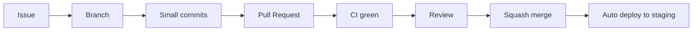

<div dir="rtl">

# روش کار در ریپوی سرمیز

این صفحه می‌گوید یک کار چطور از issue به کدِ روی سرور می‌رسد. همه‌ی اعضای تیم، و هر دستیار AI که با آن‌ها کار می‌کند، همین روش را دنبال می‌کنند.

[صفحه‌ی اصلی](README.md) | [فهرست مستندات](docs/README.md)

## ۱. مسیر یک کار

</div>



<div dir="rtl">

1. **issue را بردار.** هر کار یک issue با شناسه دارد، مثل `W2-CORE-1`. خودت را assign کن و معیارهای پذیرش را بخوان. اگر چیزی مبهم است همان‌جا بپرس.
2. **تحویل را بخوان.** تحویل هفته و بخش خودت در <span dir="ltr">`docs/handoffs/`</span> زمینه‌ی کار را می‌دهد.
3. **شاخه بساز.** از `main` تازه، با نام <span dir="ltr">`<بخش>/<شناسه>-<توضیح-کوتاه>`</span>.
4. **قدم‌های کوچک بردار.** هر commit یک تغییر قابل‌فهم است و تست خودش را دارد.
5. **Pull Request باز کن.** قالب را کامل پر کن. PR کوچک زودتر بازبینی می‌شود.
6. **بازبینی بگیر.** حداقل یک نفر، و برای کد پرداخت و ورود حتماً منتور.
7. **merge کن.** با squash. بعد از merge، CI نسخه‌ی تازه را روی `staging` می‌برد. همان‌جا امتحانش کن.

## ۲. شاخه و commit

نام شاخه با بخش شروع می‌شود: `core`، `order`، `web` یا `platform`. برای مستندات از `docs` استفاده کن.

</div>

```text
core/W2-CORE-1-menu-items
order/W4-ORD-2-zarinpal-sandbox
web/W3-WEB-3-kitchen-screen
platform/W1-PA-5-ci
docs/fix-handoff-week-2
```

<div dir="rtl">

پیام commit به روش Conventional Commits و به انگلیسی است: نوع، سرویس یا بخش داخل پرانتز، و یک جمله‌ی کوتاه که می‌گوید چه چیزی عوض شد.

</div>

```text
feat(order): expire unpaid online orders after 15 minutes
fix(catalog): bump menu_version when an option price changes
test(identity): cover refresh token reuse
docs(handoffs): correct week 2 dependency table
chore(ci): run buf breaking on pull requests
```

<div dir="rtl">

نوع‌ها: `feat`، `fix`، `test`، `docs`، `refactor`، `perf`، `chore`.

## ۳. قواعد Pull Request

- **یک کار، یک PR.** اگر PR از حدود ۴۰۰ خط تغییر بیشتر شد، آن را بشکن.
- **عنوان PR خودش یک Conventional Commit است و با شناسه‌ی کار تمام می‌شود:** <span dir="ltr">`feat(catalog): menu categories and items (W2-CORE-1)`</span>. چون merge با squash است، GitHub همین عنوان را پیام commit روی `main` می‌کند.
- **CI باید سبز باشد.** PR قرمز را برای بازبینی نفرست.
- **تست در همان PR است.** کاری که تست ندارد تمام نشده.
- **تغییر قرارداد جداست.** تغییر در <span dir="ltr">`proto/`</span> یا شکل رویدادها PR جدا می‌خواهد و همه‌ی بخش‌هایی که از آن استفاده می‌کنند باید تأیید کنند.
- **کد پرداخت و ورود** فقط با تأیید منتور merge می‌شود. این تغییرها را با چیز دیگری قاطی نکن.
- **کامنت بازبینی را در همان شاخه جواب بده.** PR تازه باز نکن.

> [!WARNING]
> این ریپو خصوصی است و سازمان روی پلن رایگان GitHub است. در این حالت GitHub قفل شاخه‌ی `main` و بازبینی اجباری را اعمال نمی‌کند. یعنی فعلاً خودِ تیم این قواعد را نگه می‌دارد: هیچ‌کس مستقیم روی `main` push نمی‌کند و هیچ PR بدون بازبینی merge نمی‌شود.

## ۴. بازبینی کد

وقتی کد کسی را بازبینی می‌کنی، به این ترتیب نگاه کن:

1. آیا معیارهای پذیرش issue برقرار است؟
2. آیا یکی از پنج قاعده‌ی [صفحه‌ی اصلی](README.md) شکسته شده؟ مخصوصاً `venue_id` در queryها و چیزهایی که لاگ می‌شوند.
3. آیا تست‌ها واقعاً چیزی را می‌سنجند؟
4. آیا کد را می‌فهمی؟ اگر نه، بپرس. کدی که بازبین نمی‌فهمد آماده‌ی merge نیست.

کامنت محترمانه و مشخص است: بگو کدام خط، چه مشکلی، و پیشنهادت چیست. هر هفته حداقل دو PR از زوج‌های دیگر را بازبینی کن.

## ۵. تعریف «تمام شد»

یک کار وقتی تمام است که همه‌ی این‌ها درست باشد:

- [ ] همه‌ی معیارهای پذیرش issue برقرار است.
- [ ] تست‌ها در همان PR هستند و CI سبز است.
- [ ] روی `staging` امتحانش کرده‌ای.
- [ ] مستنداتی که با این تغییر غلط می‌شوند به‌روز شده‌اند: README سرویس، فایل OpenAPI، و اگر لازم بود مشخصات فنی با یک سند تصمیم.
- [ ] هر خط را می‌توانی توضیح بدهی.

## ۶. کار با دستیار AI

استفاده از دستیار AI در این پروژه آزاد و حتی توصیه‌شده است. قواعدش:

- دستیار باید [AGENTS.md](AGENTS.md) را خوانده باشد. بیشتر ابزارها این فایل را خودشان می‌خوانند.
- در قالب PR بنویس کدام بخش را با کمک دستیار نوشته‌ای.
- هیچ رمز، کلید، شناسه‌ی درگاه یا داده‌ی واقعی مشتری را به دستیار نده.
- جزئیات API درگاه پرداخت و سرویس پیامک را از مستندات رسمی خودشان بردار، نه از حافظه‌ی دستیار.
- آخر هر جلسه از دستیار یادداشت تحویل بگیر.

راهنمای کامل: [فصل ۲۰، کار با AI](docs/guide/20-working-with-ai.md).

## ۷. وقتی می‌خواهی یک تصمیم فنی را عوض کنی

[مشخصات فنی](docs/SPEC.md) مرجع است. اگر فکر می‌کنی چیزی در آن باید عوض شود:

1. یک issue باز کن و مشکل را با یک مثال واقعی توضیح بده.
2. با منتور و بخش‌هایی که اثر می‌گیرند حرف بزن.
3. یک [سند تصمیم](docs/decisions/README.md) بنویس.
4. در همان PR، مشخصات فنی و فصل مربوط راهنما را هم اصلاح کن.

## ۸. نوشتن مستندات

مستندات فارسی‌اند و مخاطب را «تو» خطاب می‌کنند. اسم‌های فنی انگلیسی می‌مانند. قبل از هر PR که فایل Markdown را عوض می‌کند، این سه دستور را اجرا کن:

</div>

```bash
python3 scripts/rtl.py              # متن فارسی را راست‌به‌چپ می‌کند و کدها را چپ‌به‌راست نگه می‌دارد
python3 scripts/check-markdown.py   # ساختار صفحه‌ها را بررسی می‌کند
python3 scripts/check-links.py      # لینک‌های داخلی را بررسی می‌کند
```

<div dir="rtl">

سه قاعده برای اینکه اسکریپت درست کار کند: بلوک کد را داخل فهرستِ تورفته نگذار، بلوک کد را داخل <span dir="ltr">`<details>`</span> نگذار، و هر تگ <span dir="ltr">`<div>`</span> را در یک خط جدا بنویس.

## ۹. ریتم هفته

| کی | چه کاری |
|---|---|
| شنبه | صفحه‌ی هفته و تحویل بخش را می‌خوانی، کارها را با هم‌زوجت تقسیم می‌کنی |
| هر روز | یک گزارش نوشتاری کوتاه: دیروز چه کردم، امروز چه می‌کنم، کجا گیر کرده‌ام |
| وسط هفته | چیزهایی که بخش‌های دیگر منتظرشان هستند باید آماده باشد |
| آخر هفته | یادداشت آخر هفته را می‌نویسی و دمو روی سرور واقعی برگزار می‌شود |

## ۱۰. پرسیدن سؤال

- سؤال را در یک issue بپرس تا جوابش برای همه بماند.
- بگو چه کاری کردی، چه انتظاری داشتی و چه دیدی. خروجی خطا را کامل و داخل بلوک کد بگذار، نه به شکل عکس.
- اگر بیشتر از یک ساعت روی چیزی گیر کرده‌ای، بپرس. گیر کردنِ بی‌صدا گران‌ترین اتفاق در یک پروژه‌ی ۶ هفته‌ای است.

</div>
