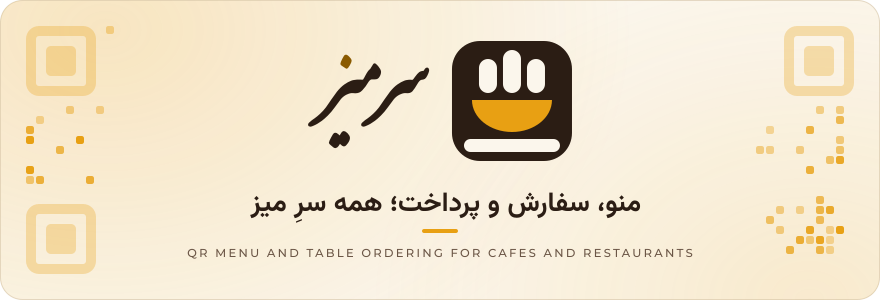
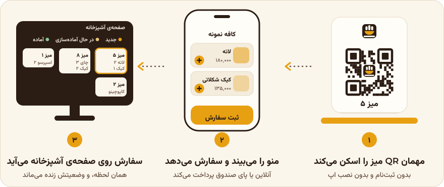
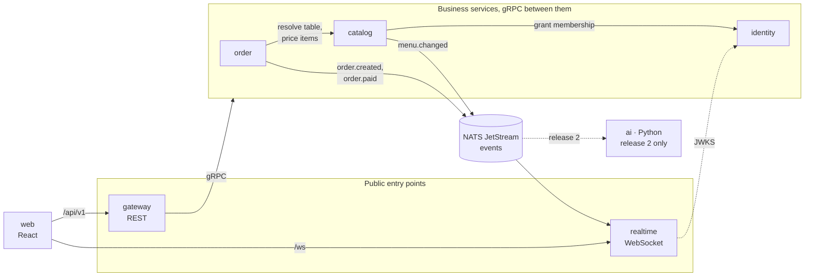
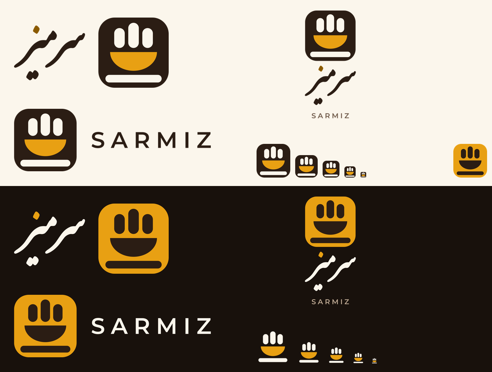

<picture>
  <source media="(prefers-color-scheme: dark)" srcset="docs/readme/hero-dark.svg">
  
</picture>

**[سه قدم](#سرمیز-در-سه-قدم)** · **[از کجا شروع کنم](#از-کجا-شروع-کنم)** · **[معماری](#معماری)** · **[مشخصات فنی](docs/SPEC.md)** · **[راهنما](docs/README.md)** · **[تیم](docs/team.md)** · **[برند](#برند-و-لوگو)**

---

**منو، سفارش و پرداخت؛ همه سرِ میز.**

سرمیز یک سرویس منوی دیجیتال و سفارش‌گیری برای کافه‌ها و رستوران‌هاست. صاحب کسب‌وکار منویش را می‌سازد و برای هر میز یک QR چاپ می‌کند. مهمان QR را اسکن می‌کند، منو را به زبان خودش می‌بیند، سفارش می‌دهد و آنلاین یا پای صندوق پرداخت می‌کند. سفارش همان لحظه روی صفحه‌ی آشپزخانه می‌آید.

این محصول را یک تیم سه‌نفره از Tecso در ۶ هفته می‌سازد. این یک تمرین نیست: خروجی باید آن‌قدر کامل باشد که Tecso با آن سراغ کافه‌ها و رستوران‌های واقعی برود.

> [!NOTE]
> الان در این ریپو فقط مستندات و برنامه‌ی کار هست. همه‌ی کد محصول را خود تیم می‌نویسد.

## سرمیز در سه قدم

<picture>
  <source media="(prefers-color-scheme: dark)" srcset="docs/readme/flow-dark.svg">
  
</picture>

این تصویر یک نمونه‌ی ساده برای توضیح مسیر است، نه طرح نهایی صفحه‌ها. طرح‌ها در `docs/design/` می‌آیند.

مهمان حساب کاربری نمی‌خواهد و چیزی نصب نمی‌کند. صاحب کسب‌وکار منو را می‌سازد، QR هر میز را چاپ می‌کند و سفارش‌ها را روی صفحه‌ی آشپزخانه می‌بیند.

## از کجا شروع کنم

| تو کی هستی | از اینجا شروع کن |
|---|---|
| عضو تیم، روز اول | [از اینجا شروع کن](docs/guide/01-start-here.md)، بعد [تیم و تقسیم کار](docs/team.md) |
| عضو تیم، اول هر هفته | [صفحه‌ی همان هفته](docs/handoffs/README.md) و کارهای نقش خودت در [تیم و تقسیم کار](docs/team.md) |
| منتور | [آماده‌سازی هفته‌ی صفر](docs/handoffs/week-0-mentor.md) و [طرح پروژه](docs/plan.md) |
| دستیار AI | [AGENTS.md](AGENTS.md) و [مشخصات فنی](docs/SPEC.md) |
| می‌خواهی از لوگو و رنگ‌ها استفاده کنی | [راهنمای برند](docs/brand/README.md) و [فایل‌های لوگو](docs/brand/logo/README.md) |

---

## چه چیزی در انتشار ۱ هست

| بخش | در انتشار ۱ |
|---|---|
| منو | دسته‌ها و آیتم‌ها، عکس، گزینه‌ها (اندازه و افزودنی)، برچسب حساسیت و رژیم با فیلتر، نشان‌های دستی (محبوب، تازه، پیشنهاد سرآشپز)، کلید «تمام شد» |
| زبان‌ها | محتوای منو به فارسی (الزامی) و در صورت تمایل انگلیسی، عربی، کردی سورانی و ترکی آذری که صاحب کسب‌وکار خودش تایپ می‌کند؛ رابط به فارسی و انگلیسی |
| سفارش | سفارش از میز، صدا زدن گارسون، درخواست صورت‌حساب، وضعیت زنده‌ی سفارش |
| پرداخت | آنلاین با زرین‌پال، یا پای صندوق |
| ابزار صاحب کسب‌وکار | صفحه‌ی زنده‌ی آشپزخانه، طراح QR با لوگو، هویت بصری کسب‌وکار، لینک عمومی منو برای اینستاگرام |
| پلتفرم | صفحه‌ی معرفی و قیمت، کافه و رستوران دمو، پنل ادمین Tecso |

سرویس هوش مصنوعی (ترجمه، ساخت منو از عکس، گارسون هوشمند)، منوی زمان‌دار، گزارش فروش و امتیازدهی به انتشار ۲ رفته‌اند. دلیلش در [سند تصمیم ۷](docs/decisions/0007-three-person-team.md) و فهرست کامل در [نقشه‌ی انتشارها](docs/roadmap.md) است.

## معماری

میکروسرویس در یک ریپو. مرورگر فقط با `gateway` (REST) و `realtime` (WebSocket) حرف می‌زند. خط‌چین‌ها مربوط به انتشار ۲ یا ارتباط‌های سبک هستند.

سرویس `ai` فقط در انتشار ۲ ساخته می‌شود؛ `catalog` آن را صدا می‌زند و به رویدادها گوش می‌دهد.

هر سرویس دیتابیس PostgreSQL خودش را دارد و هیچ سرویسی به دیتابیس سرویس دیگر دست نمی‌زند. Redis برای محدودیت نرخ و کش، و ذخیره‌سازی سازگار با S3 برای عکس‌هاست. قواعد کامل ارتباط سرویس‌ها در [بخش ۴ مشخصات فنی](docs/SPEC.md) آمده است.

## سرویس‌ها

معماری سرمیز میکروسرویس است. مرورگر فقط با `gateway` و `realtime` حرف می‌زند.

| سرویس | زبان | مسئول چه چیزی |
|---|---|---|
| [`gateway`](services/gateway/README.md) | Go | ورودی عمومی REST، بررسی توکن و نقش، محدودیت نرخ |
| [`identity`](services/identity/README.md) | Go | کاربران پنل، ورود با کد پیامکی، توکن‌ها، نقش‌ها |
| [`catalog`](services/catalog/README.md) | Go | کسب‌وکار، میز و QR، منو، عکس‌ها، منوی عمومی |
| [`order`](services/order/README.md) | Go | سفارش، درخواست خدمت، پرداخت، گزارش فروش |
| [`realtime`](services/realtime/README.md) | Go | WebSocket برای صفحه‌ی آشپزخانه و وضعیت سفارش |
| [`ai`](services/ai/README.md) | Python | ترجمه، ساخت منو از عکس، گارسون هوشمند؛ **انتشار ۲**، در انتشار ۱ ساخته نمی‌شود |
| [`web`](web/README.md) | React | منوی مهمان، پنل، صفحه‌ی آشپزخانه، صفحه‌ی معرفی، ادمین |

## نقشه‌ی ریپو

| مسیر | محتوا |
|---|---|
| `docs/` | همه‌ی مستندات: [فهرست کامل](docs/README.md) |
| `docs/team.md` | [تیم و تقسیم کار](docs/team.md): سه نقش و کارهای هر نقش، هفته به هفته |
| `docs/SPEC.md` | [مشخصات فنی](docs/SPEC.md)، مرجع نهایی همه‌ی تصمیم‌های فنی، به انگلیسی |
| `docs/guide/` | راهنمای کامل در ۲۴ فصل، از طراحی سیستم تا مانیتورینگ |
| `docs/handoffs/` | [تحویل هر هفته و هر بخش](docs/handoffs/README.md) |
| `docs/decisions/` | [سندهای تصمیم](docs/decisions/README.md) |
| `docs/brand/` | [برند](docs/brand/README.md)، و [لوگو](docs/brand/logo/README.md) با همه‌ی فایل‌های آماده برای وب و چاپ |
| `docs/readme/` | تصویرهای همین صفحه (SVG) |
| `services/` | شش سرویس بک‌اند، هر کدام با README خودش |
| `libs/go/kit/` | [شاسی مشترک سرویس‌های Go](libs/go/kit/README.md) |
| `proto/` | [قراردادهای gRPC و رویدادها](proto/README.md) |
| `web/` | [اپ React](web/README.md) |
| `deploy/` | [استقرار و زیرساخت](deploy/README.md) |
| `tests/` | [تست‌های سرتاسری، بار و جداسازی](tests/README.md) |
| `scripts/` | ابزارهای بررسی مستندات |
| `AGENTS.md` | قواعد دستیارهای AI در این ریپو |

---

## برنامه‌ی ۶ هفته

| هفته | موضوع | آخر هفته چه چیزی باید کار کند |
|---|---|---|
| [۱](docs/handoffs/week-1/README.md) | پایه | محیط محلی با یک دستور بالا می‌آید، CI سبز است و ورود با کد پیامکی از راه `gateway` کار می‌کند |
| [۲](docs/handoffs/week-2/README.md) | منو | روی سرور واقعی با دامنه و TLS، یک QR چاپ‌شده روی گوشی یک منوی واقعی باز می‌کند |
| [۳](docs/handoffs/week-3/README.md) | سفارش | سفارش در کمتر از ۲ ثانیه روی صفحه‌ی آشپزخانه دیده می‌شود |
| [۴](docs/handoffs/week-4/README.md) | پرداخت و مدیریت | پرداخت آزمایشی سفارش را دقیقاً یک بار «پرداخت‌شده» می‌کند |
| [۵](docs/handoffs/week-5/README.md) | ویترین | یک نفر غریبه بدون کمک دمو را کامل امتحان می‌کند |
| [۶](docs/handoffs/week-6/README.md) | محکم‌کاری و انتشار | همه‌ی معیارهای «تمام شد» برقرار است |

فهرست همه‌ی کارها: [docs/backlog.md](docs/backlog.md). هر کار یک issue در همین ریپو دارد، با برچسب نقش (`role:web`، `role:menu` یا `role:orders`) و milestone هفته‌ای که در آن انجام می‌شود. چیزهایی که به انتشار ۲ رفته‌اند، و دلیلش، در [سند تصمیم ۷](docs/decisions/0007-three-person-team.md) آمده است.

## راهنمای کامل

| # | فصل | # | فصل |
|---|---|---|---|
| ۱ | [از اینجا شروع کن](docs/guide/01-start-here.md) | ۱۳ | [میزبانی و زیرساخت ابری](docs/guide/13-hosting-and-cloud.md) |
| ۲ | [محصول](docs/guide/02-product.md) | ۱۴ | [CI/CD و کنترل نسخه](docs/guide/14-ci-cd-and-version-control.md) |
| ۳ | [طراحی سیستم](docs/guide/03-system-design.md) | ۱۵ | [لاگ و ردیابی خطا](docs/guide/15-logs-and-error-tracking.md) |
| ۴ | [معماری](docs/guide/04-architecture.md) | ۱۶ | [مانیتورینگ و هشدار](docs/guide/16-monitoring-and-alerts.md) |
| ۵ | [فرانت‌اند](docs/guide/05-frontend.md) | ۱۷ | [تست](docs/guide/17-testing.md) |
| ۶ | [API و قراردادها](docs/guide/06-api-and-contracts.md) | ۱۸ | [مقیاس‌پذیری و تاب‌آوری](docs/guide/18-scaling-and-resilience.md) |
| ۷ | [منطق بک‌اند و سرویس‌ها](docs/guide/07-backend-services.md) | ۱۹ | [سرویس هوش مصنوعی](docs/guide/19-ai-service.md) |
| ۸ | [دیتابیس و ذخیره‌سازی](docs/guide/08-database-and-storage.md) | ۲۰ | [کار با AI](docs/guide/20-working-with-ai.md) |
| ۹ | [ورود و دسترسی](docs/guide/09-auth-and-permissions.md) | ۲۱ | [پشتیبان‌گیری و بازیابی](docs/guide/21-backup-and-recovery.md) |
| ۱۰ | [امنیت و پرداخت](docs/guide/10-security-and-payments.md) | ۲۲ | [چندزبانگی، راست‌به‌چپ و دسترس‌پذیری](docs/guide/22-i18n-rtl-accessibility.md) |
| ۱۱ | [محدودیت نرخ](docs/guide/11-rate-limiting.md) | ۲۳ | [حریم خصوصی، موارد حقوقی و هزینه](docs/guide/23-privacy-legal-cost.md) |
| ۱۲ | [کش و CDN](docs/guide/12-caching-and-cdn.md) | ۲۴ | [واژه‌نامه](docs/guide/24-glossary.md) |

---

## پنج قاعده که هیچ‌وقت نمی‌شکنند

1. **کسب‌وکارها از هم جدا هستند.** هر query روی داده‌ی یک کسب‌وکار با `venue_id` محدود می‌شود.
2. **مبلغ را سرور حساب می‌کند.** پول همیشه عدد صحیح به ریال است و هیچ عددی از مرورگر باور نمی‌شود.
3. **کد پرداخت و ورود را منتور بازبینی می‌کند.**
4. **هیچ رمز، کلید یا داده‌ی واقعی مشتری** در کد، لاگ، commit یا دستیار AI نمی‌رود.
5. **هر خطی که تحویل می‌دهی باید بتوانی توضیح بدهی،** چه خودت نوشته باشی چه دستیار AI.

روش کار، نام‌گذاری شاخه‌ها و قواعد Pull Request در [CONTRIBUTING.md](CONTRIBUTING.md) آمده است.

---

## برند و لوگو

لوگو یک کاسه‌ی بخارکننده روی خط میز است: غذا و کافه، «سرِ میز». سه خط بخار به سه دندانه‌ی حرف «س» هم شباهت دارند. همه‌ی فایل‌ها (SVG، PNG، favicon، آیکن اپ و تصویر شبکه‌های اجتماعی) در [`docs/brand/logo/`](docs/brand/logo/README.md) آماده‌اند و لازم نیست چیزی دوباره بکشی.

| رنگ | مقدار | کجا |
|---|---|---|
| کرم | `#FBF6EC` | زمینه |
| اسپرسو | `#2B1D14` | متن، و کاشی لوگو |
| زعفرانی | `#E8A013` | دکمه‌ی اصلی و نشان‌ها، با متن اسپرسو روی آن |

قاعده‌های لحن، رنگ و فونت: [راهنمای برند](docs/brand/README.md).

