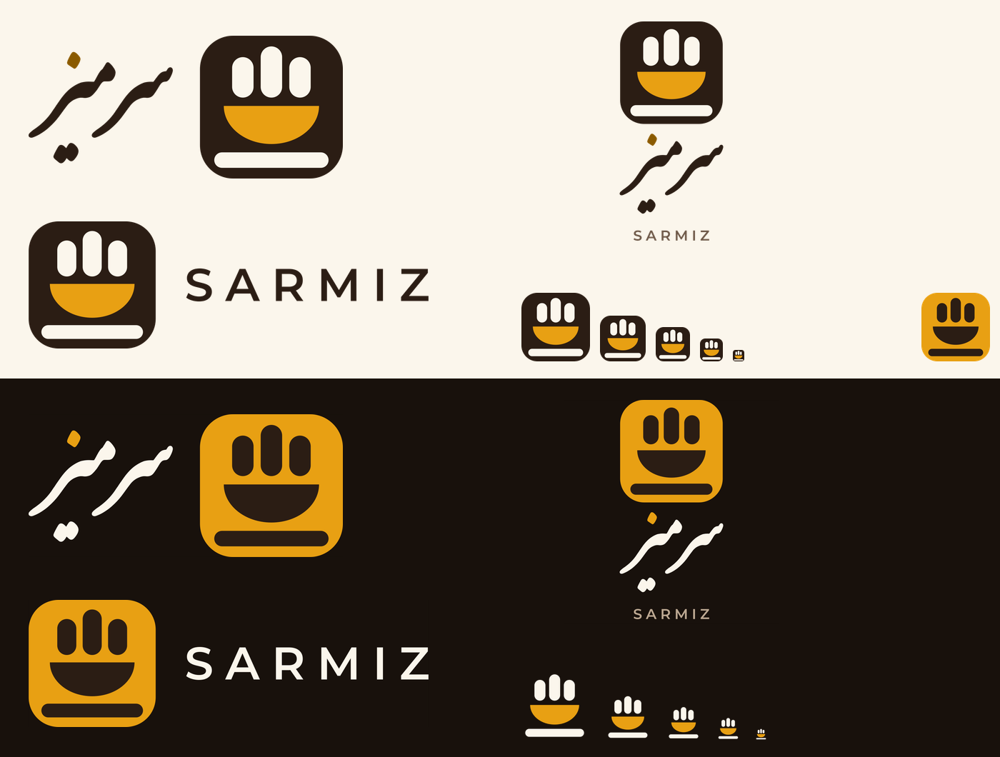

# برند سرمیز

نام، شعار، لحن، رنگ و فونت سرمیز، و قاعده‌هایی که باید در همه‌ی صفحه‌ها رعایت شوند.

[فهرست مستندات](../README.md)

> [!WARNING]
> نام «سرمیز» هنوز نهایی نیست. دامنه و ثبت برند بررسی نشده و منتور در هفته‌ی صفر درباره‌اش تصمیم می‌گیرد. تا آن موقع نام را در کد فقط در یک جا تعریف کن تا عوض کردنش آسان باشد.

## ۱. نام و شعار

| بخش | مقدار |
|---|---|
| نام فارسی | سرمیز |
| نام لاتین | Sarmiz |
| معنی | «سرِ میز»؛ همان جایی که محصول کار می‌کند |
| شعار | «منو، سفارش و پرداخت؛ همه سرِ میز.» |
| نام‌های جایگزین، اگر «سرمیز» آزاد نبود | بویور (Buyur)، منوچی (Menuchi) |

## ۲. لحن

سرمیز مثل یک کافه‌دار خوش‌برخورد حرف می‌زند، نه مثل یک شرکت نرم‌افزاری: گرم، ساده و مهمان‌نواز.

| این‌طور بنویس | این‌طور ننویس |
|---|---|
| «سفارشت ثبت شد. الان آماده‌اش می‌کنیم.» | «درخواست شما با موفقیت در سامانه ثبت گردید.» |
| «این آیتم الان تمام شده.» | «موجودی کالای انتخابی کافی نمی‌باشد.» |
| «اینترنت قطع شد. دوباره امتحان کن.» | «خطای شبکه رخ داده است. کد خطا: ۵۰۳» |
| «منویت آماده است. QR را چاپ کن و روی میز بگذار.» | «فرایند پیکربندی منو تکمیل شد.» |

قاعده‌ها:

- مهمان و صاحب کسب‌وکار را «تو» خطاب کن.
- اصطلاح فنی در متن رابط کاربری نیاور. کاربر نباید واژه‌ای مثل «سرور» یا «توکن» ببیند.
- پیام خطا بگوید چه شد و حالا چه کار کند.
- جمله‌ها کوتاه باشند. روی گوشی و وسط یک کافه‌ی شلوغ خوانده می‌شوند.

## ۳. رنگ

| نقش | نام | مقدار | کجا استفاده می‌شود |
|---|---|---|---|
| زمینه | کرم | `#FBF6EC` | زمینه‌ی صفحه‌ی معرفی و پنل |
| متن | قهوه‌ای اسپرسو | `#2B1D14` | متن اصلی و تیترها |
| تأکید | زعفرانی | `#E8A013` | دکمه‌ی اصلی و نشان‌ها، با متن اسپرسو روی آن |

> [!IMPORTANT]
> رنگ زعفرانی را برای متن روی زمینه‌ی کرم استفاده نکن. نسبت تضادش حدود ۲ به ۱ است و خوانا نیست. متن اسپرسو روی دکمه‌ی زعفرانی نسبت تضاد حدود ۷ به ۱ دارد و مشکلی ندارد.

رنگ‌های حالت‌ها (موفق، خطا، هشدار) و سایه‌های خاکستری را بخش فرانت در کار `W1-WEB-2` پیشنهاد می‌دهد. هر رنگ تازه باید با متن رویش نسبت تضاد دست‌کم ۴٫۵ به ۱ داشته باشد.

## ۴. فونت

| کاربرد | فونت |
|---|---|
| همه‌ی متن‌های فارسی، عربی، کردی و ترکی | وزیرمتن |
| متن انگلیسی | همان وزیرمتن، که حروف لاتین هم دارد |

فونت همراه اپ بارگذاری می‌شود و به سرویس بیرونی وابسته نیست، چون ممکن است از داخل ایران در دسترس نباشد.

## ۵. دو قاعده‌ی اصلی

**منوی مهمان مالِ خود کسب‌وکار است.** در صفحه‌ی منو، لوگو، عکس کاور و رنگ کسب‌وکار دیده می‌شود. از سرمیز فقط یک «با سرمیز» کوچک پایین صفحه می‌آید. مهمان باید حس کند در منوی همان کافه است.

**هویت سرمیز در صفحه‌ی معرفی و پنل دیده می‌شود.** حس آن باید اشتهاآور و گرم باشد، نه سرد و فنی.

## ۶. رنگ کسب‌وکار

هر کسب‌وکار یک رنگ اصلی برای منوی خودش انتخاب می‌کند (`theme_color`). چون این رنگ را کاربر انتخاب می‌کند، اپ باید خودش رنگ متنِ روی آن را تیره یا روشن انتخاب کند تا خوانا بماند. جزئیات در [فصل ۲۲](../guide/22-i18n-rtl-accessibility.md).

## ۷. لوگو

لوگوی سرمیز یک کاسه‌ی بخارکننده روی خط میز است: غذا و کافه، «سرِ میز». نوشته‌ی «سرمیز» نستعلیق است و SARMIZ با حروف درشت و فاصله‌دار؛ این دو فونت فقط برای لوگو هستند و متن اپ همان وزیرمتن می‌ماند.

همه‌ی فایل‌های آماده (SVG، PNG، favicon، آیکن اپ، تصویر پیش‌نمایش لینک)، اندازه‌ها و قاعده‌های استفاده در [لوگو](logo/README.md) است. لوگو را دوباره نکش و فایل را از همان‌جا بردار.

اگر نام «سرمیز» عوض شود، لوگو هم عوض می‌شود.

## ۸. چک‌لیست برند برای هر صفحه

- [ ] متن‌ها با لحن بخش ۲ نوشته شده‌اند.
- [ ] هیچ متن زعفرانی روی زمینه‌ی کرم نیست.
- [ ] در منوی مهمان، هویت کسب‌وکار جلوتر از سرمیز است.
- [ ] صفحه روی گوشی درست دیده می‌شود.
- [ ] پیام‌های خطا می‌گویند چه شد و حالا چه کار کنیم.
- [ ] لوگو و favicon از [`docs/brand/logo/`](logo/README.md) برداشته شده‌اند، نه دوباره کشیده شده‌اند.

