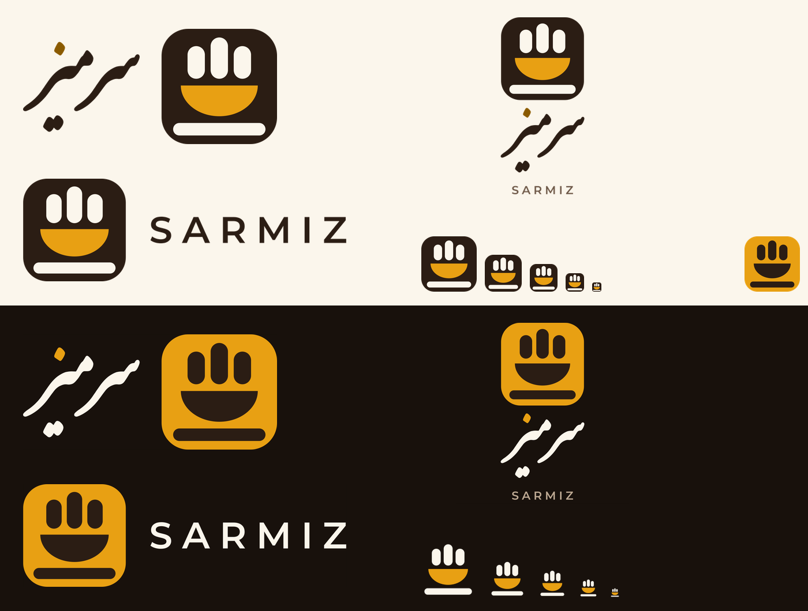

<div dir="rtl">

# لوگوی سرمیز

لوگو، آیکن‌ها و فایل‌های آماده‌ی وب. همه‌ی فایل‌ها SVG یا PNG هستند و برای نمایش به هیچ فونتی نیاز ندارند. چیزی را دوباره نکش؛ فایل را از همین‌جا بردار.

[راهنمای برند](../README.md) | [فهرست مستندات](../../README.md)



## ۱. ایده

یک کاسه‌ی بخارکننده روی خط میز: غذا و کافه، «سرِ میز». سه خط بخار به سه دندانه‌ی حرف «س» هم شباهت دارند. نماد روی یک کاشی گرد اسپرسویی می‌نشیند تا روی هر زمینه‌ای (آیکن گوشی، تب مرورگر، عکس پروفایل) یک شکل ثابت داشته باشد.

نوشته‌ی «سرمیز» نستعلیق است و SARMIZ با حروف درشت و فاصله‌دار نوشته شده تا ساده و باوقار دیده شود.

## ۲. کدام فایل را کجا بگذارم

| فایل | کجا استفاده می‌شود |
|---|---|
| `sarmiz-icon.svg` | آیکن اپ، آواتار، عکس پروفایل شبکه‌های اجتماعی. حالت پیش‌فرض (کاشی اسپرسو) |
| `sarmiz-icon-saffron.svg` | همان روی کاشی زعفرانی، برای زمینه‌ی تیره یا وقتی رنگ بیشتر لازم است |
| `sarmiz-symbol.svg`، `sarmiz-symbol-on-dark.svg` | فقط نماد، بدون کاشی: روی زمینه‌ی روشن، و روی زمینه‌ی تیره |
| `sarmiz-logo-fa.svg`، `sarmiz-logo-fa-on-dark.svg` | لوگوی افقی فارسی، نماد سمت راست چون فارسی راست‌به‌چپ خوانده می‌شود. هدر صفحه‌ها |
| `sarmiz-logo-en.svg`، `sarmiz-logo-en-on-dark.svg` | لوگوی افقی انگلیسی، نماد سمت چپ. هدر نسخه‌ی انگلیسی رابط |
| `sarmiz-logo-stacked.svg`، `sarmiz-logo-stacked-on-dark.svg` | لوگوی عمودی با هر دو نام. صفحه‌ی ورود، کارت QR میز، چاپ |
| `favicon.svg`، `favicon.ico` | آیکن تب مرورگر (ico شامل ۱۶، ۳۲ و ۴۸ پیکسل) |
| <span dir="ltr">`png/`</span> | همه‌ی حالت‌ها به‌صورت PNG، برای جاهایی که SVG نمی‌گیرند (ایمیل، اسلاید) |
| <span dir="ltr">`web/`</span> | هر چه فرانت باید در <span dir="ltr">`web/public/`</span> بگذارد (بخش ۳) |
| `social-preview.png` | تصویر پیش‌نمایش ریپو در GitHub، ۱۲۸۰ در ۶۴۰ پیکسل (بخش ۶) |

حالت‌های `on-dark` برای زمینه‌ی تیره‌اند و رنگ نوشته و کاشی را خودشان عوض کرده‌اند. دستی رنگ فایل را عوض نکن.

## ۳. استفاده در وب

محتوای پوشه‌ی <span dir="ltr">`docs/brand/logo/web/`</span> را در <span dir="ltr">`web/public/`</span> کپی کن (کار `W1-WEB-1`، وقتی اپ ساخته می‌شود). بعد در `index.html`:

</div>

```html
<link rel="icon" href="/favicon.svg" type="image/svg+xml">
<link rel="icon" href="/favicon.ico" sizes="48x48">
<link rel="apple-touch-icon" href="/apple-touch-icon.png">
<meta name="theme-color" content="#2B1D14">
<meta property="og:image" content="https://YOUR-DOMAIN/og-image.png">
```

<div dir="rtl">

| فایل در <span dir="ltr">`web/`</span> | کاربرد |
|---|---|
| `favicon.svg`، `favicon.ico` | تب مرورگر |
| `apple-touch-icon.png` | افزودن به صفحه‌ی خانه‌ی iPhone (۱۸۰ پیکسل) |
| `icon-192.png`، `icon-512.png` | آیکن‌های اپ، اگر تیم manifest بخواهد |
| `icon-maskable-512.png` | آیکن گرد اندروید: پس‌زمینه تا لبه پر است و نماد داخل ناحیه‌ی امن مانده |
| `og-image.png` | پیش‌نمایش لینک در پیام‌رسان‌ها، ۱۲۰۰ در ۶۳۰ پیکسل |

لوگوی داخل صفحه را با <span dir="ltr">``</span> بگذار و `alt` را «سرمیز» بنویس. اگر تیم PWA بخواهد، `manifest` تصمیم بخش فرانت است؛ رنگ‌های آن <span dir="ltr">`#2B1D14`</span> (theme) و <span dir="ltr">`#FBF6EC`</span> (background) هستند.

یادآوری از [راهنمای برند](../README.md): در منوی مهمان لوگوی خود کسب‌وکار دیده می‌شود و از سرمیز فقط یک «با سرمیز» کوچک پایین صفحه می‌آید.

## ۴. رنگ‌ها

| نقش | مقدار |
|---|---|
| اسپرسو | <span dir="ltr">`#2B1D14`</span> |
| زعفرانی | <span dir="ltr">`#E8A013`</span> |
| کرم | <span dir="ltr">`#FBF6EC`</span> |
| نقطه‌ی «ز» در نوشته‌ی فارسی، روی زمینه‌ی روشن | <span dir="ltr">`#8A5A00`</span> |

نقطه‌ی «ز» عمداً تیره‌تر از زعفرانی است: زعفرانی روی کرم کم‌رنگ است و «ز» شبیه «ر» دیده می‌شود. روی زمینه‌ی تیره زعفرانی خود رنگ است.

## ۵. قاعده‌ها

- **فضای خالی:** دور لوگو دست‌کم به اندازه‌ی عرض یک خط بخار (۱۵٪ عرض کاشی) جا بگذار.
- **کوچک‌ترین اندازه:** کاشی تنها ۱۶ پیکسل. لوگوی افقی یا عمودی ۴۰ پیکسل ارتفاع. زیر این اندازه خطوط نازک نستعلیق گم می‌شوند؛ از کاشی تنها استفاده کن.
- رنگ کاسه را عوض نکن، لوگو را کش نیار و روی عکس شلوغ نگذار.
- متن زعفرانی روی زمینه‌ی کرم ممنوع است (قاعده‌ی [راهنمای برند](../README.md)).

## ۶. فونت‌ها و مجوز

| متن | فونت | نکته |
|---|---|---|
| سرمیز | IranNastaliq | از نسخه‌ی دارای مجوز منتور به مسیر تبدیل شده. **فایل فونت در ریپو نیست و نباید باشد**؛ رسید مجوز را کنار فایل‌های برند نگه دار |
| SARMIZ | Montserrat SemiBold | مجوز SIL OFL، استفاده‌ی آزاد |

این دو فونت فقط برای لوگو هستند. متن اپ همان وزیرمتن است ([راهنمای برند](../README.md)، بخش ۴).

## ۷. وضعیت و تغییر لوگو

- نام «سرمیز» هنوز نهایی نیست ([راهنمای برند](../README.md)). اگر نام عوض شد، لوگو هم عوض می‌شود و همین پوشه را با فایل‌های تازه جایگزین کن.
- فایل‌ها SVG ساده‌اند و فایل منبع ابزار طراحی ندارند. اگر لوگو عوض شد، همه‌ی فایل‌های این پوشه را با هم عوض کن تا نسخه‌ها با هم نخوانند.
- **تصویر پیش‌نمایش GitHub:** `social-preview.png` را فقط صاحب ریپو می‌تواند بگذارد: Settings، بخش General، Social preview.

</div>
