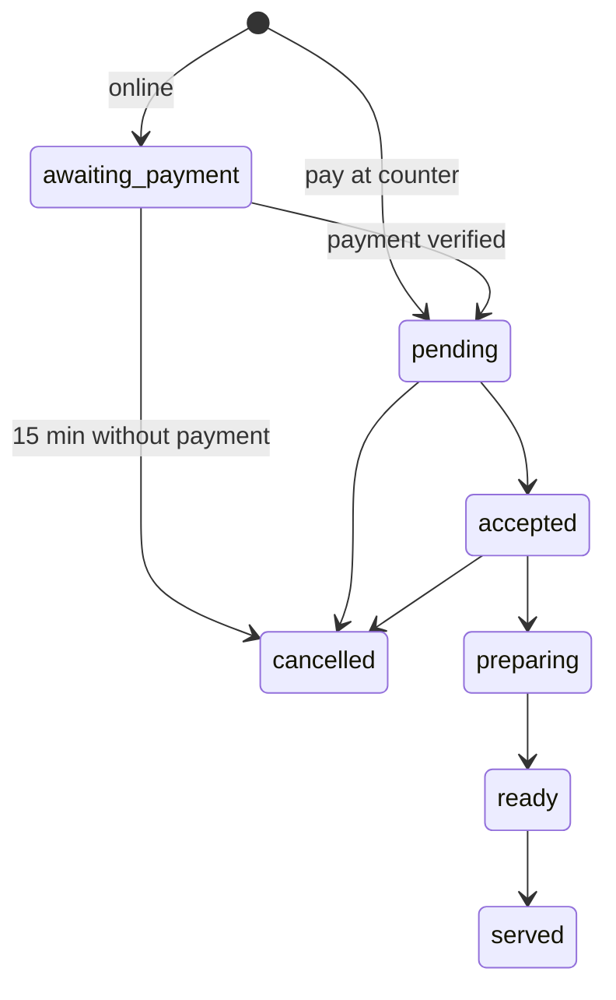

<div dir="rtl">

# محصول

این فصل به یک سؤال جواب می‌دهد: دقیقاً چه چیزی می‌سازیم، برای چه کسی، و پشت هر قابلیت چه قاعده‌ای هست؟

[بازگشت به فهرست مستندات](../README.md)

## ۱. چرا مهم است

گران‌ترین باگ‌های سرمیز باگ کد نیستند، باگ فهم محصول‌اند: سفارشی که قبل از پرداخت به آشپزخانه می‌رسد، جمعی که مرورگر حساب کرده، یا منویی که مهمان عرب‌زبان خالی می‌بیند. اگر بدانی هر کاربر چه می‌خواهد و هر قابلیت چه قاعده‌ای دارد، معیار پذیرش issueها را بهتر می‌فهمی و می‌توانی جواب دستیار AI را بسنجی. همه‌ی قاعده‌های این فصل از [مشخصات فنی](../SPEC.md) آمده‌اند؛ هر جا مشخصات فنی ساکت است، همان‌جا گفته‌ایم.

## ۲. تصمیم‌ها در یک نگاه

| موضوع | تصمیم | چرا |
|---|---|---|
| مهمان | بدون حساب و بدون نصب اپ؛ فقط اسکن QR | سر میز هیچ‌کس برای دیدن منو ثبت‌نام نمی‌کند |
| پول | پرداخت آنلاین به خود کسب‌وکار می‌رسد؛ Tecso هیچ‌وقت پول کسب‌وکار را نگه نمی‌دارد | یکی از چهار مزیت فروش است و مدل تسویه بر همین اساس انتخاب می‌شود |
| قیمت | در دیتابیس و API عدد صحیح به ریال؛ در رابط کاربری به تومان (ریال تقسیم بر ۱۰) | بدون خطای اعشار در محاسبه، و خوانا برای مهمان |
| زبان منو | پنج زبان `fa`، `en`، `ar`، `ckb`، `azb`؛ متن `fa` اجباری است | مهمان منو را به زبان خودش می‌خواند و همیشه متنی برای نمایش هست |
| سفارش آنلاین | تا پرداخت تأیید نشود، آشپزخانه سفارش را نمی‌بیند | برای سفارش پرداخت‌نشده غذا درست نمی‌شود |
| پیش‌نویس AI | صاحب کسب‌وکار همیشه قبل از اعمال، پیش‌نویس را بازبینی می‌کند | مدل اشتباه می‌کند و قیمت اشتباه نباید خودکار منتشر شود |
| گارسون هوشمند | فقط از منوی واقعی همان کسب‌وکار جواب می‌دهد و هیچ کاری انجام نمی‌دهد | جواب ساختگی درباره‌ی غذا یا حساسیت غذایی خطرناک است |
| نقش‌ها | سه نقش `owner`، `manager` و `staff` از هفته‌ی ۱ اعمال می‌شوند؛ رابط انتشار ۱ فقط `owner` می‌سازد | مدل داده از حالا برای انتشار ۲ جا دارد |
| پرداخت واقعی | حالت sandbox تا بازبینی امنیتی هفته‌ی ۶؛ حالت `live` را فقط ادمین Tecso روشن می‌کند | پول واقعی فقط بعد از بازبینی |

## ۳. چهار کاربر

| کاربر | چه می‌خواهد | کجا کار می‌کند | چطور شناخته می‌شود |
|---|---|---|---|
| مهمان | منو را سریع و به زبان خودش ببیند، سفارش بدهد و بداند سفارشش کجاست | <span dir="ltr">`/t/:qrToken`</span>، <span dir="ltr">`/m/:slug`</span>، <span dir="ltr">`/o/:orderId`</span> | حساب ندارد: یک `guest_session_id` تصادفی در مرورگر، و برای هر سفارش یک `order_token` |
| صاحب کسب‌وکار | منو را خودش بسازد و عوض کند، QR چاپ کند، فروش را ببیند و پولش به خودش برسد | <span dir="ltr">`/panel/*`</span> | شماره‌ی موبایل و کد یک‌بارمصرف، با نقش `owner` |
| آشپزخانه و صندوق | سفارش تازه را فوری ببیند و بشنود، وضعیت را با یک لمس جلو ببرد، آیتم تمام‌شده را ببندد | <span dir="ltr">`/panel/kitchen`</span>، معمولاً روی تبلت | همان ورود پنل |
| ادمین Tecso | کسب‌وکارها را ببیند، فعال یا تعلیق کند و حالت پرداخت را `live` کند | <span dir="ltr">`/admin/*`</span> | claim به نام `adm` در توکن |

> [!NOTE]
> رابط مدیریت کارکنان در انتشار ۱ نیست، پس حساب `staff` از راه پنل ساخته نمی‌شود. اینکه تبلت آشپزخانه با چه حسابی وارد می‌شود در مشخصات فنی نیامده است. پیشنهاد اولیه: با حساب صاحب کسب‌وکار. این را با منتور نهایی کن.

## ۴. سه مسیر اصلی

### ۴٫۱ صاحب کسب‌وکار: از ثبت‌نام تا QR چاپ‌شده

1. در پنل شماره‌ی موبایلش را می‌دهد. یک کد ۶ رقمی پیامک می‌شود که ۱۲۰ ثانیه اعتبار دارد. رمز عبور در کار نیست.
2. کد را وارد می‌کند و وارد پنل می‌شود.
3. در قدم «کسب‌وکارت را بساز» نام و نوع (`cafe` یا `restaurant`) را می‌دهد. سرمیز کسب‌وکار، یک شعبه‌ی پیش‌فرض و نقش `owner` را می‌سازد.
4. برندینگ را تنظیم می‌کند: لوگو، کاور، رنگ و زبان‌های فعال.
5. منو را می‌سازد: دسته‌ها، آیتم‌ها با قیمت و عکس، گزینه‌ها و برچسب‌ها. راه میان‌بر: عکس منوی کاغذی یا یک فایل Excel می‌دهد، پیش‌نویس را بازبینی و اعمال می‌کند.
6. با دکمه‌ی ترجمه، منو را به زبان‌های فعال ترجمه می‌کند و هر متنی را که خواست دستی اصلاح می‌کند.
7. میزها را تعریف می‌کند. هر میز یک `qr_token` تصادفی می‌گیرد.
8. در طراح QR لوگو را روی کد می‌گذارد و صفحه‌ی چاپ را می‌گیرد.
9. کد را چاپ می‌کند، روی میز می‌گذارد و با گوشی خودش اسکن می‌کند: منوی واقعی باز می‌شود. این همان معیار پایان هفته‌ی ۲ است.

کسب‌وکار سه وضعیت دارد: `pending`، `active` و `suspended`. اینکه کسب‌وکار تازه با کدام وضعیت ساخته می‌شود و `pending` چه چیزی را می‌بندد در مشخصات فنی نیامده است؛ زوج هسته این را در هفته‌ی ۱ با منتور تصمیم می‌گیرد.

### ۴٫۲ مهمان: از اسکن تا سفارش پرداخت‌شده

1. QR روی میز را اسکن می‌کند و <span dir="ltr">`/t/:qrToken`</span> در مرورگر باز می‌شود.
2. منو را به زبان خودش می‌بیند، بین دسته‌ها می‌گردد، جست‌وجو می‌کند و با برچسب‌های رژیم و حساسیت فیلتر می‌کند.
3. روی یک آیتم می‌زند، گزینه‌ها (مثلاً اندازه) را انتخاب می‌کند و به سبد اضافه می‌کند. سبد در `localStorage` همان مرورگر و برای همان میز می‌ماند.
4. در سبد تعداد و یادداشت را تنظیم می‌کند، روش پرداخت را انتخاب می‌کند و سفارش را ثبت می‌کند. قیمت‌ها را سرور خودش حساب می‌کند.
5. اگر «پای صندوق» را انتخاب کرده، سفارش همان لحظه با وضعیت `pending` به آشپزخانه می‌رود.
6. اگر «آنلاین» را انتخاب کرده، سفارش با وضعیت `awaiting_payment` ساخته می‌شود و مهمان به درگاه می‌رود و برمی‌گردد. فقط وقتی سرمیز پرداخت را با درگاه تأیید کرد، سفارش `pending` می‌شود. اگر تا ۱۵ دقیقه پرداخت نشود، خودکار لغو می‌شود.
7. در <span dir="ltr">`/o/:orderId`</span> وضعیت سفارش را زنده می‌بیند. از صفحه‌ی میز می‌تواند گارسون را صدا بزند یا صورت‌حساب بخواهد.
8. بعد از سفارش می‌تواند از ۱ تا ۵ ستاره امتیاز بدهد.

### ۴٫۳ آشپزخانه: از سفارش تازه تا سرو

1. <span dir="ltr">`/panel/kitchen`</span> روی تبلت باز است. صفحه هنگام باز شدن فهرست سفارش‌ها را از سرور می‌گیرد و بعد به WebSocket وصل می‌شود.
2. سفارش تازه در کمتر از ۲ ثانیه و با صدا ظاهر می‌شود: کد سفارش، نام میز، آیتم‌ها، گزینه‌ها و یادداشت.
3. کارمند سفارش را به ترتیب جلو می‌برد: قبول (`accepted`)، در حال آماده‌سازی (`preparing`)، آماده (`ready`) و سرو شد (`served`).
4. اگر سفارش را نمی‌شود آماده کرد، تا قبل از `preparing` می‌توان آن را لغو کرد.
5. اگر آیتمی تمام شد، با کلید «تمام شد» آن را می‌بندد.
6. درخواست‌های «گارسون» و «صورت‌حساب» روی همین صفحه می‌آیند و بعد از رسیدگی بسته می‌شوند.
7. صندوق‌دار وقتی پول را گرفت، سفارشِ پای صندوق را «پرداخت‌شده» علامت می‌زند.
8. اگر اتصال زنده قطع شود، صفحه این را نشان می‌دهد و با polling (پرسیدن دوره‌ای از سرور) ادامه می‌دهد. یک رویداد گم‌شده نباید هیچ سفارشی را گم کند.

</div>



<div dir="rtl">

## ۵. صفحه‌ها بر اساس گروه مسیر

| مسیر | مخاطب | صفحه‌ها |
|---|---|---|
| <span dir="ltr">`/`</span> و <span dir="ltr">`/pricing`</span> | بازدیدکننده | صفحه‌ی معرفی و صفحه‌ی قیمت‌ها (از پیش ساخته‌شده برای موتورهای جست‌وجو)، با ورودی «امتحان کن» به دو دمو |
| <span dir="ltr">`/t/:qrToken`</span> | مهمان سر میز | منو با دسته‌ها، برگه‌ی آیتم با گزینه‌ها، جست‌وجو و فیلتر، تعویض زبان، سبد و ثبت سفارش، صدا زدن گارسون، درخواست صورت‌حساب، پنجره‌ی گارسون هوشمند |
| <span dir="ltr">`/m/:slug`</span> | هر کسی که لینک را دارد، مثلاً از اینستاگرام | منوی عمومی. مسیر ساخت سفارش `qr_token` می‌خواهد، پس از اینجا سفارش ثبت نمی‌شود |
| <span dir="ltr">`/o/:orderId`</span> | مهمان | وضعیت زنده‌ی سفارش، پرداخت و نتیجه‌ی آن، امتیاز |
| <span dir="ltr">`/panel/*`</span> | صاحب کسب‌وکار و کارکنان | ورود، ساخت کسب‌وکار، ویرایشگر منو و گزینه‌ها، میزها و طراح QR، برندینگ، <span dir="ltr">`/panel/kitchen`</span>، فهرست و جزئیات سفارش‌ها، تنظیمات پرداخت، منوی زمان‌دار، پیشنهاد همراه، ورود منو، ترجمه، داشبورد فروش |
| <span dir="ltr">`/admin/*`</span> | ادمین Tecso | فهرست کسب‌وکارها، فعال و تعلیق کردن، تغییر حالت پرداخت |

مسیر دقیق زیرصفحه‌های پنل (به‌جز <span dir="ltr">`/panel/kitchen`</span>) در مشخصات فنی نیامده است. زوج فرانت آن‌ها را در `W1-WEB-1` و wireframeهای `W1-WEB-3` مشخص می‌کند.

## ۶. قابلیت‌های انتشار ۱ و قاعده‌ی هر کدام

«اختیاری» یعنی اگر وقت کم بیاید، اول از همه به بعد از هفته‌ی ۶ می‌رود.

| قابلیت | قاعده‌ی کسب‌وکاری |
|---|---|
| دسته و آیتم | نام و توضیح برای هر زبان جدا ذخیره می‌شود و `fa` اجباری است. قیمت صفر یا بیشتر است. هر تغییر در منو `menu_version` را بالا می‌برد |
| عکس | حداکثر ۵ مگابایت؛ فقط JPEG، PNG یا WebP که از روی محتوا بررسی می‌شود؛ به WebP در سه عرض ۳۲۰، ۸۰۰ و ۱۶۰۰ بازسازی می‌شود و اطلاعاتی مثل موقعیت GPS حذف می‌شود |
| گزینه‌های آیتم (اندازه، افزودنی) | هر گروه گزینه `min_select` و `max_select` دارد و هر گزینه یک `price_delta_rial`. سرور هنگام سفارش دوباره همین قاعده‌ها را بررسی می‌کند |
| برچسب رژیم و حساسیت، با فیلتر | فقط مقدارهای مجاز. رژیم: `vegetarian`، `vegan`، `gluten_free`، `sugar_free`، `spicy`، `caffeine_free`. حساسیت‌زا: `gluten`، `dairy`، `egg`، `nuts`، `peanut`، `soy`، `sesame`، `fish`، `shellfish` |
| نشان‌ها | فقط `popular`، `new` و `chef` |
| منوی زمان‌دار (اختیاری) | یک برنامه روزهای هفته و ساعت شروع و پایان دارد و دسته به آن وصل می‌شود. هم در منوی عمومی و هم هنگام قیمت‌گذاری سفارش رعایت می‌شود |
| کلید «تمام شد» | هر سه نقش می‌توانند آیتم را ببندند. آیتم بسته در منوی عمومی دیده می‌شود و سفارش آن با خطای روشن رد می‌شود |
| پنج زبان | ترتیب خواندن متن: زبان درخواستی، بعد زبان پیش‌فرض کسب‌وکار، بعد `fa`. جهت صفحه برای `fa`، `ar`، `ckb` و `azb` راست‌به‌چپ است. متن‌های خودِ رابط فقط `fa` و `en` است |
| ترجمه با AI | زبان‌هایی که AI ترجمه کرده روی آیتم علامت می‌خورند و صاحب کسب‌وکار می‌تواند متن را ویرایش کند |
| ورود منو از عکس (اختیاری؛ جایگزین: Excel) | ناهمگام است. پیش‌نویس با امتیاز اطمینان و هشدار برمی‌گردد و بدون تأیید صاحب کسب‌وکار چیزی وارد منو نمی‌شود. فایل‌های بارگذاری‌شده بعد از ۳۰ روز پاک می‌شوند |
| گارسون هوشمند (اختیاری) | فقط از منوی همان کسب‌وکار جواب می‌دهد، آیتم‌ها را ارجاع می‌دهد، سؤال بی‌ربط را رد می‌کند و خروجی‌اش متن ساده است. سقف: ۱۰ پیام در ۵ دقیقه برای هر مهمان و ۲۰۰ پیام در روز برای هر کسب‌وکار |
| سفارش از سر میز | سرور جمع را از قیمت‌های ذخیره‌شده حساب می‌کند و نام، قیمت و گزینه‌ها را در سفارش کپی می‌کند (snapshot)، پس ویرایش بعدی منو سفارش قدیمی را عوض نمی‌کند. سقف: ۵ سفارش در ۵ دقیقه برای هر مهمان و ۲۰ برای هر میز |
| صدا زدن گارسون و درخواست صورت‌حساب | دو نوع `waiter` و `bill`؛ برای هر میز و هر نوع، یک درخواست در ۶۰ ثانیه |
| وضعیت زنده‌ی سفارش | مهمان بدون تازه کردن صفحه تغییر وضعیت را می‌بیند |
| پیشنهاد همراه (اختیاری) | برای هر آیتم فهرستی از آیتم‌هایی که کنارش پیشنهاد می‌شوند |
| پرداخت آنلاین | مبلغ را سرور از سفارش ذخیره‌شده برمی‌دارد. هر پرداخت دقیقاً یک بار ثبت می‌شود. پرداخت ناموفق را می‌شود دوباره امتحان کرد. بازگرداندن پول در انتشار ۱ دستی است |
| پرداخت پای صندوق | سفارش مستقیم به آشپزخانه می‌رود و صندوق‌دار بعداً آن را پرداخت‌شده علامت می‌زند |
| صفحه‌ی آشپزخانه | سفارش در کمتر از ۲ ثانیه دیده می‌شود. سفارش `awaiting_payment` هیچ‌وقت اینجا نمی‌آید |
| طراح QR و میزها | هر میز یک `qr_token` تصادفی و یکتا دارد که می‌شود از نو ساختش؛ بعد از آن کد چاپ‌شده‌ی قبلی دیگر کار نمی‌کند |
| برندینگ و لینک عمومی منو | لوگو، کاور، رنگ و زبان‌های فعال؛ منو با `slug` یکتای کسب‌وکار در <span dir="ltr">`/m/:slug`</span> هم باز می‌شود |
| داشبورد فروش (اختیاری) | خلاصه‌ی امروز و ۷ روز اخیر، آیتم‌های پرفروش و ساعت‌های شلوغ؛ فقط برای `owner` و `manager` |
| امتیاز | ۱ تا ۵ ستاره با یک نظر اختیاری؛ برای هر سفارش فقط یک امتیاز |
| ویترین و ادمین | صفحه‌ی معرفی، صفحه‌ی قیمت‌ها، دو دمو و پنل ادمین Tecso |

## ۷. داستان‌های کاربر

| داستان | یادداشت پذیرش |
|---|---|
| مهمانم و می‌خواهم منو را به زبان خودم ببینم تا بدون کمک سفارش بدهم | آیتم ترجمه‌نشده با زبان پیش‌فرض کسب‌وکار یا `fa` دیده می‌شود، نه جای خالی. قیمت به تومان است |
| مهمانم و می‌خواهم با یک بار زدن دکمه سفارشم ثبت شود، حتی اگر اینترنت قطع و وصل شود | تکرار درخواست با همان `Idempotency-Key` سفارش دوم نمی‌سازد. کد سفارش را می‌بینم |
| مهمانم و می‌خواهم آنلاین پرداخت کنم و مطمئن باشم سفارشم به آشپزخانه رسیده | سفارش دقیقاً یک بار پرداخت‌شده می‌شود، حتی اگر صفحه‌ی بازگشت دو بار باز شود یا مرورگر را ببندم |
| در آشپزخانه‌ام و می‌خواهم سفارش تازه را بدون دست زدن به صفحه ببینم | سفارش زیر ۲ ثانیه و با صدا می‌آید. با قطع اتصال، هیچ سفارشی گم نمی‌شود |
| صاحب کسب‌وکارم و می‌خواهم قیمت را عوض کنم | منوی مهمان‌ها حدود ۳۰ ثانیه بعد تازه است. سفارش تازه با قیمت جدید حساب می‌شود و سفارش‌های قبلی دست نمی‌خورند |
| صاحب کسب‌وکارم و می‌خواهم از عکس منوی کاغذی‌ام منو بسازم | پیش‌نویس را با هشدارهایش می‌بینم و تا تأیید نکنم چیزی وارد منو نمی‌شود. اگر سرویس `ai` پایین است، پیام «دوباره تلاش کن» می‌بینم |
| صندوق‌دارم و می‌خواهم وقتی چیزی تمام شد با یک لمس ببندمش | با نقش `staff` هم می‌شود. بعد از آن، سفارش آن آیتم رد می‌شود |
| ادمین Tecso هستم و می‌خواهم یک کسب‌وکار را تعلیق کنم | فقط با claim `adm` ممکن است و در audit log ثبت می‌شود |

## ۸. مهمان برای هر وضعیت چه می‌بیند

متن‌های ستون سوم پیشنهاد اولیه‌اند. متن نهایی را زوج فرانت در wireframeها می‌نویسد.

| وضعیت سفارش | یعنی چه | مهمان چه می‌بیند | آشپزخانه می‌بیند؟ |
|---|---|---|---|
| `awaiting_payment` | سفارش آنلاین ثبت شده ولی پرداختش تأیید نشده | «منتظر پرداخت»، دکمه‌ی پرداخت و مهلت ۱۵ دقیقه | نه |
| `pending` | به آشپزخانه رسیده و هنوز کسی قبولش نکرده | «سفارش ثبت شد» و کد سفارش | بله |
| `accepted` | آشپزخانه قبول کرده | «سفارش تأیید شد» | بله |
| `preparing` | در حال آماده شدن است | «در حال آماده‌سازی» | بله |
| `ready` | آماده است | «سفارش آماده است» | بله |
| `served` | سر میز رسیده | «نوش جان» و دعوت به امتیاز دادن | بله |
| `cancelled` | لغو شده، دستی یا به خاطر پرداخت‌نشدن | «سفارش لغو شد» | بله، اگر قبلاً دیده بوده |

وضعیت پرداخت جداست: `unpaid`، `pending`، `paid`، `failed` و `refunded` (که در انتشار ۱ دستی ثبت می‌شود). سفارشِ پای صندوق تا وقتی صندوق‌دار علامت نزده `unpaid` می‌ماند، حتی اگر `served` شده باشد.

## ۹. دو دمو

سرمیز دو کسب‌وکار نمایشی دارد، یک کافه و یک رستوران. هر دو روی `production` هستند و با `is_demo = true` علامت خورده‌اند.

- از صفحه‌ی معرفی یک ورودی «امتحان کن» به آن‌ها می‌رسد (`W5-WEB-4`). منو، عکس و ترجمه‌هایشان در `W5-PA-4` آماده می‌شود.
- هر شب به حالت اول برمی‌گردند (`W5-CORE-2`). رفتار دقیق `is_demo` را زوج هسته در همان کار مشخص می‌کند.
- معیار پایان هفته‌ی ۵ همین است: یک غریبه بدون کمک از اسکن تا پرداخت sandbox را می‌رود.

## ۱۰. بیرون از محدوده، و چرا

دلیل کلی: شش هفته وقت داریم و مسیر «اسکن تا آشپزخانه» باید محکم باشد. هر چه به این مسیر کمک نمی‌کند بیرون مانده، ولی مدل داده برایش جا دارد. برنامه‌ی انتشارهای بعد در [نقشه‌ی راه](../roadmap.md) است.

| بیرون از انتشار ۱ | جایی که از حالا برایش گذاشته‌ایم |
|---|---|
| حساب مهمان و باشگاه مشتریان | `guest_session_id`؛ هویت مهمان بعداً اختیاری اضافه می‌شود |
| بیرون‌بر، ارسال و رزرو | مقدارهای `pickup` و `delivery` در نوع سفارش رزرو شده‌اند |
| رابط مدیریت کارکنان | جدول `memberships` و سه نقش از هفته‌ی ۱ اعمال می‌شوند |
| رابط چندشعبه‌ای | جدول `branches` و ستون `branch_id` از همین حالا هست |
| تقسیم صورت‌حساب، انعام، ایستگاه‌های آشپزخانه، چاپگر، اتصال به صندوق فروشگاهی، دامنه‌ی اختصاصی | هیچ؛ در انتشارهای بعد طراحی می‌شوند |
| هیچ‌وقت: اپ موبایل native | وعده‌ی محصول «بدون نصب» است |
| هیچ‌وقت: نگه داشتن پول کسب‌وکار نزد Tecso | پول مستقیم به کسب‌وکار می‌رسد |

## ۱۱. چهار مزیت فروش

| مزیت | چه چیزی باید درست باشد تا بشود فروختش |
|---|---|
| ترجمه‌ی منو به پنج زبان با AI | ترجمه‌ی AI علامت دارد و قابل ویرایش است؛ کیفیت هر زبان با یک مجموعه‌ی نمونه سنجیده شده (`W3-PA-4`) |
| ساخت منو از عکس منوی کاغذی | پیش‌نویس همیشه بازبینی می‌شود؛ اگر ارزیابی هفته‌ی ۱ منفی بود، مسیر Excel جایگزین است |
| گارسون هوشمند که فقط از منوی واقعی جواب می‌دهد | سؤال بی‌ربط و تلاش برای prompt injection (فریب دادن مدل با متن ورودی) را رد می‌کند |
| پول مستقیم به کسب‌وکار می‌رسد | مدل تسویه قبل از هفته‌ی ۴ با درگاه نهایی شده: [سند تصمیم ۶](../decisions/0006-payment-settlement-model.md) |

دو تا از این چهار مزیت اختیاری‌اند. اگر به بعد رفتند، صفحه‌ی معرفی نباید وعده‌شان را بدهد.

## ۱۲. واژه‌های محصول

| واژه | در کد | یعنی چه |
|---|---|---|
| کسب‌وکار | venue | یک حساب کافه یا رستوران |
| شعبه | branch | یک مکان فیزیکی؛ در انتشار ۱ هر کسب‌وکار دقیقاً یکی دارد |
| مهمان | guest | مشتری‌ای که QR را اسکن می‌کند |
| پنل | panel | اپ وبی که کارکنان کسب‌وکار با آن کار می‌کنند |
| کد سفارش | `code` | شماره‌ی کوتاهی که هر روز برای هر کسب‌وکار از نو شروع می‌شود |
| توکن سفارش | `order_token` | مقدار تصادفی که فقط یک بار، هنگام ساخت سفارش، برمی‌گردد و بدون آن سفارش خوانده نمی‌شود |
| درخواست خدمت | service request | صدا زدن گارسون یا درخواست صورت‌حساب |
| گروه گزینه | option group | مجموعه‌ای از انتخاب‌های یک آیتم، مثل «اندازه» |
| نشان | badge | علامت کوچک روی آیتم: پرطرفدار، تازه، پیشنهاد سرآشپز |
| اختیاری | stretch | اولین چیزهایی که اگر وقت کم بیاید به بعد می‌روند |
| انتشار ۱، ۲، ۳ | R1، R2، R3 | مرحله‌های عرضه‌ی محصول |

واژه‌نامه‌ی کامل در [فصل ۲۴](24-glossary.md) است.

## چک‌لیست انتشار ۱

- [ ] هر سه مسیر بخش ۴ با گوشی واقعی، از اول تا آخر، روی `production` رفته شده‌اند.
- [ ] یک غریبه دمو را بدون کمک از اسکن تا پرداخت sandbox می‌رود.
- [ ] هیچ سفارش `awaiting_payment` روی صفحه‌ی آشپزخانه دیده نمی‌شود.
- [ ] همه‌ی قیمت‌ها در رابط به تومان‌اند و هیچ جمعی در مرورگر حساب و به سرور فرستاده نمی‌شود.
- [ ] منوی هر دو دمو در هر پنج زبان متن دارد و زبانِ بدون ترجمه به `fa` برمی‌گردد.
- [ ] برای هر قابلیت اختیاری ثبت شده که «هست» یا «به بعد رفت»، و صفحه‌ی معرفی فقط چیزی را وعده می‌دهد که هست.
- [ ] هیچ دکمه یا صفحه‌ای از قابلیت‌های بیرون از محدوده در رابط نیست.
- [ ] راهنمای ساده برای صاحب کسب‌وکار نوشته شده است (`W6-ALL-4`).

## اشتباه‌های رایج

| اشتباه | چرا بد است | چه کار کن |
|---|---|---|
| حساب کردن جمع سبد در مرورگر و فرستادنش به سرور | هر کسی می‌تواند قیمت را عوض کند | مرورگر فقط شناسه‌ی آیتم، گزینه‌ها و تعداد را می‌فرستد |
| تبدیل ریال به تومان در بک‌اند | دو واحد پول در API قاطی می‌شود | API همیشه `_rial`؛ تبدیل فقط هنگام نمایش |
| جای خالی برای زبانی که ترجمه ندارد | مهمان منوی نصفه می‌بیند | همیشه ترتیب خواندن بخش ۶ را اجرا کن |
| ساختن قابلیت انتشار ۲ «چون ساده بود» | وقت قابلیت‌های اصلی را می‌خورد و تست و نگه‌داری می‌خواهد | فقط محدوده‌ی انتشار ۱؛ ایده را در issue بنویس |
| اعمال خودکار پیش‌نویس یا ترجمه‌ی AI بدون نشان دادن به صاحب کسب‌وکار | قیمت یا نام اشتباه منتشر می‌شود | پیش‌نویس همیشه بازبینی می‌شود و ترجمه‌ی AI علامت دارد |
| برچسب آزاد به‌جای مقدارهای مجاز | فیلتر مهمان کار نمی‌کند | فقط فهرست بخش ۶ |
| نوشتن متن فارسی مستقیم در کامپوننت | رابط انگلیسی نصفه می‌ماند | همه‌ی متن‌ها از لایه‌ی i18n می‌آیند |

## کار با AI روی این موضوع

**فایل‌هایی که به دستیار می‌دهی:** `AGENTS.md`، بخش‌های ۱، ۲، ۷، ۹ و ۱۹ از `docs/SPEC.md`، همین فصل و متن issue.

برای تبدیل یک قابلیت به حالت‌های تست:

</div>

```text
قابلیت «صدا زدن گارسون و درخواست صورت‌حساب» را در نظر بگیر.
همه‌ی قاعده‌های مربوط به آن را از docs/SPEC.md (بخش‌های ۲، ۶، ۷٫۳ و ۱۰) دربیاور و شماره‌ی بخش هر قاعده را بنویس.
برای هر قاعده یک حالت تست به شکل Given / When / Then بنویس.
اگر قاعده‌ای لازم است که در SPEC نیست، آن را جدا زیر عنوان «سؤال برای منتور» بنویس و از خودت نساز.
```

<div dir="rtl">

برای بررسی محدوده قبل از شروع کار:

</div>

```text
این ایده را دارم: [ایده را بنویس].
با استناد به بخش ۲ از docs/SPEC.md بگو در محدوده‌ی انتشار ۱ هست، اختیاری است، یا بیرون از محدوده است.
اگر بیرون است، بگو مدل داده‌ی فعلی چه جایی برایش گذاشته و کد ننویس.
```

<div dir="rtl">

برای مرور وضعیت‌ها:

</div>

```text
از روی بخش ۷٫۳ در docs/SPEC.md جدولی بساز از همه‌ی ترکیب‌های status و payment_status یک سفارش.
برای هر ترکیب بگو ممکن است یا نه، و اگر ممکن است مهمان و آشپزخانه هر کدام چه باید ببینند.
ترکیب‌هایی را که SPEC درباره‌شان ساکت است جدا فهرست کن.
```

<div dir="rtl">

**خودت حتماً بررسی کن:** هر قاعده‌ای که دستیار گفت شماره‌ی بخش دارد و واقعاً در مشخصات فنی هست؛ متن‌های فارسی رابط را یک آدم خوانده است؛ و جدول وضعیت‌ها با نمودار بخش ۴ می‌خواند.

## بیشتر بخوان

- [فصل ۵: فرانت‌اند](05-frontend.md) و [فصل ۲۲: چندزبانگی، راست‌به‌چپ و دسترس‌پذیری](22-i18n-rtl-accessibility.md).
- [فصل ۹: ورود و دسترسی](09-auth-and-permissions.md) و [فصل ۱۰: امنیت و پرداخت](10-security-and-payments.md).
- [فصل ۱۹: سرویس هوش مصنوعی](19-ai-service.md) و [فصل ۲۳: حریم خصوصی، موارد حقوقی و هزینه](23-privacy-legal-cost.md).
- [نقشه‌ی راه](../roadmap.md)، [فهرست کارها](../backlog.md) و [راهنمای برند](../brand/README.md).
- مشخصات فنی: بخش ۱ (محصول)، بخش ۲ (محدوده)، بخش‌های ۷٫۲ و ۷٫۳ (مقدارهای مجاز و وضعیت‌ها)، بخش ۸ (نقش‌ها)، بخش ۹ (پرداخت) و بخش ۱۹ (مسیرهای رابط).

</div>
