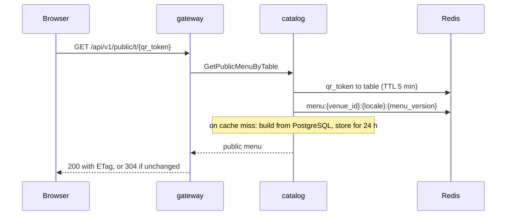
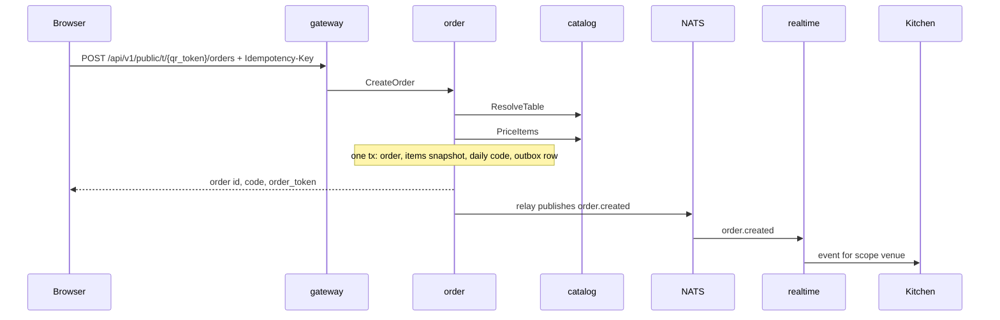
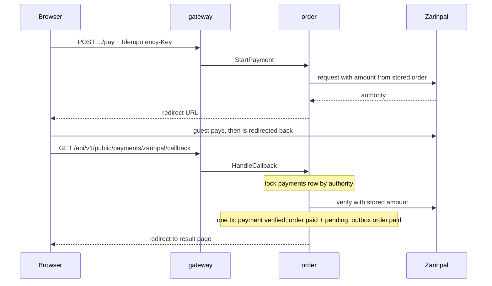

<div dir="rtl">

# طراحی سیستم

این فصل به یک سؤال جواب می‌دهد: سرمیز برای چه باری طراحی شده، کجا عمداً سادگی را به قیمت چیز دیگری خریده‌ایم، و وقتی یک تکه خراب شد چه می‌شود؟

[بازگشت به فهرست مستندات](../README.md)

## ۱. چرا مهم است

طراحی سیستم یعنی قبل از کد، با عدد و بده‌بستان فکر کنی: «این سیستم برای چند مهمان است؟ کجا باید دقیق باشد و کجا کمی دیر رسیدن داده اشکالی ندارد؟ اگر Redis بخوابد، مهمان سر میز چه می‌بیند؟» در سرمیز جواب این سؤال‌ها مستقیم روی پول و سفارش واقعی اثر دارد: سفارشی که به آشپزخانه نرسد یا پرداختی که دو بار ثبت شود، اعتماد یک کافه را برای همیشه از بین می‌برد. این فصل روش فکر کردن را نشان می‌دهد تا وقتی دستیار AI طرحی پیشنهاد داد، بتوانی بسنجی‌اش.

## ۲. تصمیم‌ها در یک نگاه

| موضوع | تصمیم | چرا |
|---|---|---|
| سبک معماری | microservices با یک ورودی عمومی؛ هر سرویس دیتابیس خودش را دارد | مالکیت روشن برای هر نفر، و خرابی `ai` یا `realtime` سفارش را نمی‌خواباند |
| سفارش و پرداخت | هر دو در `order`؛ «پرداخت تأییدشده» و «سفارش پرداخت‌شده» در یک تراکنش | سازگاری قوی بدون saga (زنجیره‌ی تراکنش‌های جبرانی بین سرویس‌ها) |
| رویدادها | NATS JetStream با transactional outbox؛ سازگاری نهایی (eventual consistency) | ذخیره‌ی سفارش به در دسترس بودن NATS وابسته نیست |
| صفحه‌ی آشپزخانه | WebSocket فقط خبر می‌دهد؛ وضعیت واقعی از API خوانده می‌شود | یک رویداد گم‌شده نباید سفارش را گم کند |
| کهنگی منو | منوی عمومی تا ۳۰ ثانیه می‌تواند کهنه باشد | `PriceItems` هنگام ساخت سفارش مرجع قیمت است |
| مقیاس | سرویس‌های Go بدون state؛ دست‌کم ۲ نسخه از `gateway`، `catalog`، `order` و `realtime` | بالا بردن تعداد Pod بدون تغییر کد |
| بازیابی | RPO ۲۴ ساعت (پشتیبان شبانه) و RTO ۴ ساعت | برای انتشار ۱ کافی و ارزان؛ مسیر رشد بهترش می‌کند |

## ۳. روش فکر کردن

هر طرحی را، چه خودت بنویسی چه دستیار AI، با این شش سؤال بسنج: ۱) سیستم دقیقاً چه کاری می‌کند؟ ۲) چقدر سریع و چقدر در دسترس، با چه باری؟ ۳) از روی هدف‌ها، تقریباً چند درخواست، چند سفارش و چقدر داده؟ ۴) گلوگاه کجاست (معمولاً دیتابیس و اتصال‌هایش، نه CPU)؟ ۵) کدام داده همیشه باید دقیق باشد و کدام می‌تواند کمی دیر برسد؟ ۶) اگر هر تکه بخوابد چه می‌شود و رشد از کجا می‌آید؟ بخش‌های بعدی همین شش سؤال را برای سرمیز جواب می‌دهند.

## ۴. نیازمندی‌ها

**کارکردی (خلاصه):** صاحب کسب‌وکار با کد پیامکی وارد می‌شود و منو و میز و QR می‌سازد؛ مهمان بدون حساب منو را به پنج زبان می‌بیند، سفارش می‌دهد و آنلاین یا پای صندوق پرداخت می‌کند؛ آشپزخانه سفارش را زنده می‌بیند؛ ترجمه، ساخت منو از عکس و گارسون هوشمند با AI. فهرست کامل در بخش ۲ [مشخصات فنی](../SPEC.md) و [فصل ۲](02-product.md) است.

**غیرکارکردی:** هدف‌های بخش ۳ مشخصات فنی. عددهای شروع‌اند و تیم با تست بار (`W3-PA-3`) اندازه می‌گیرد و تنظیمشان می‌کند. p95 یعنی ۹۵ درصد درخواست‌ها از این عدد سریع‌ترند؛ LCP یعنی زمانی که بزرگ‌ترین بخش صفحه دیده می‌شود؛ RPO یعنی حداکثر داده‌ای که از دست می‌رود و RTO یعنی حداکثر زمان برگشت.

| هدف | مقدار | کجا اندازه گرفته می‌شود |
|---|---|---|
| کسب‌وکار فعال | ۵۰ | داشبورد کسب‌وکار در Grafana |
| مهمان هم‌زمان | ۵۰۰ | تست بار k6 |
| اوج سفارش | ۲۰ در دقیقه | متریک `orders_created_total` |
| اتصال WebSocket | ۱۰۰ پنل و ۵۰۰ مهمان | متریک `ws_connections` |
| تأخیر منوی عمومی | p95 زیر ۳۰۰ میلی‌ثانیه در `gateway` | متریک مدت درخواست هر متد |
| تأخیر ساخت سفارش | p95 زیر ۸۰۰ میلی‌ثانیه | همان |
| رسیدن سفارش به صفحه‌ی آشپزخانه | زیر ۲ ثانیه | معیار پایان هفته‌ی ۳ |
| صفحه‌ی مهمان روی 4G | LCP زیر ۲ ثانیه، JavaScript مسیر مهمان حداکثر ۱۵۰ کیلوبایت gzip | Lighthouse روی گوشی واقعی |
| در دسترس بودن مسیرهای مهمان | ۹۹٫۵ درصد در ماه | probe بیرونی |
| RPO | ۲۴ ساعت | پشتیبان شبانه |
| RTO | ۴ ساعت | تمرین بازیابی `W5-PA-2` |

## ۵. تخمین سرانگشتی

> [!WARNING]
> همه‌ی عددهای این بخش تخمین سرانگشتی‌اند، نه اندازه‌گیری. فرض‌ها را صریح نوشته‌ایم تا اگر غلط بودند، عوضشان کنی. عدد واقعی را تست بار و Grafana می‌دهند.

### ۵٫۱ درخواست در ثانیه

فرض: هر مهمان هم‌زمان به‌طور میانگین هر ۳۰ ثانیه یک درخواست API می‌زند (منو، تعویض زبان، ثبت سفارش). عکس‌ها از CDN می‌آیند و اینجا حساب نمی‌شوند.

</div>

```text
guests:  500 concurrent / 30 s           = ~17 req/s
panels:  100 screens / 30 s safety poll  = ~3 req/s
orders:  20 per minute / 60              = ~0.3 req/s (each: 2 gRPC calls to catalog)
total at peak                            = ~20 req/s
with a 5x safety margin                  = ~100 req/s
if realtime is down: 100 panels / 5 s    = +20 req/s
```

<div dir="rtl">

نتیجه: تعداد درخواست کم است. چیزی که باید مراقبش باشی تأخیر است (p95 منو زیر ۳۰۰ میلی‌ثانیه، یعنی کش درست) و اتصال‌های دیتابیس، نه CPU.

### ۵٫۲ سفارش‌ها و عکس‌ها

فرض: روزی ۱۲ ساعت کار، ۲ ساعت اوج با ۲۰ سفارش در دقیقه و بقیه‌ی روز یک‌پنجم اوج؛ هر سفارش با ردیف‌ها، snapshot و ایندکس حدود ۵ کیلوبایت. هر کسب‌وکار ۶۰ آیتم با عکس؛ هر عکس در سه عرض WebP: ۳۲۰ (حدود ۲۰ کیلوبایت)، ۸۰۰ (حدود ۸۰) و ۱۶۰۰ (حدود ۲۵۰).

</div>

```text
orders/day:  2 h x 1200 + 10 h x 240     = ~5000 (~100 per venue)
order data:  5000 x 5 KB                 = ~25 MB/day = ~9 GB/year
images:      50 venues x 60 x 350 KB     = ~1 GB in sarmiz-media
per guest:   ~20 thumbnails x 20 KB      = ~0.4 MB from the CDN
```

<div dir="rtl">

با دیسک ۱۶۰ گیگابایتی سرور، حجم داده در انتشار ۱ مشکل نیست. ولی ترافیک CDN با تعداد مهمان بالا می‌رود، پس عکس ۳۲۰ پیکسلی در فهرست منو مهم است ([فصل ۲۳](23-privacy-legal-cost.md)). ردیف‌های `outbox` و `processed_events` هم جمع می‌شوند؛ زمان پاک کردنشان در `W1-ORD-4` تصمیم گرفته می‌شود.

### ۵٫۳ اتصال‌های WebSocket

فرض: هر اتصال در Go حدود ۵۰ کیلوبایت حافظه (goroutine و بافرها)؛ هر سفارش در عمرش حدود ۶ رویداد دارد و هر رویداد به ۳ گیرنده می‌رسد (دو صفحه‌ی پنل و صفحه‌ی مهمان).

</div>

```text
connections: 100 + 500                  = 600, ~30 MB of memory
heartbeats:  600 / 25 s                 = ~24 pings/s
fan-out:     20 orders/min x 6 x 3 / 60 = ~6 messages/s
```

<div dir="rtl">

یعنی یک Pod از `realtime` هم کافی است؛ دو نسخه برای در دسترس بودن است، نه بار.

### ۵٫۴ اتصال‌های دیتابیس و بودجه‌ی خرابی

هر Pod یک pool با ۱۰ اتصال دارد. در `production`، `catalog` و `order` هر کدام دست‌کم ۲ نسخه دارند و `identity` و `ai` هم اتصال می‌خواهند. `staging` روی همان سرور است، و در استقرار بی‌وقفه Podهای قدیم و جدید چند لحظه با هم زنده‌اند.

</div>

```text
production: catalog 2x10 + order 2x10 + identity 1x10 + ai = ~50+
staging on the same server                                  = ~50
during a rollout (old + new pods)                           = up to ~2x
downtime budget: 0.5% of 720 h                              = ~3.6 h per month
```

<div dir="rtl">

اگر حد اتصال PostgreSQL حدود ۱۰۰ باشد، با یک استقرار یا autoscale به سقف می‌خوری؛ برای همین هشدار «اتصال بالای ۸۰ درصد حد» در بخش ۱۲ مشخصات فنی هست و PgBouncer در مسیر رشد. و چون RTO ما ۴ ساعت است، یک بازیابی کامل از پشتیبان به‌تنهایی از کل بودجه‌ی خرابی ماه بیشتر است. جلوی خرابی‌های کوچک را باید با چند نسخه، health probe و استقرار بی‌وقفه گرفت، نه با بازیابی.

## ۶. تصمیم‌های کلیدی و هزینه‌شان

### ۶٫۱ microservices به‌جای یک سرویس

راستش را بگوییم: ۲۰ سفارش در دقیقه را یک سرویس تنها هم راحت جواب می‌دهد. انتخاب microservices به خاطر بار نیست: هر نفر مالک یک یا دو سرویس است و موازی کار می‌کند، خرابی `ai` یا `realtime` سفارش را نمی‌خواباند، و این همان مهارتی است که در دوره یاد گرفته‌اید ([سند تصمیم ۱](../decisions/0001-microservices.md)). ولی هزینه دارد:

| هزینه | در سرمیز یعنی | چطور کمش می‌کنیم |
|---|---|---|
| تماس شبکه به‌جای صدا زدن تابع | `CreateOrder` دو تماس gRPC به `catalog` دارد که هر کدام می‌تواند کند شود یا شکست بخورد | deadline پیش‌فرض ۲ ثانیه، circuit breaker، retry فقط برای خواندن |
| تراکنش بین دو سرویس نداریم | ساخت کسب‌وکار در `catalog` و دادن نقش در `identity` اتمی نیستند | کارهای حساس در یک سرویس می‌مانند؛ بقیه جبران دارند |
| چهار دیتابیس | join بین سرویس‌ها ممکن نیست | snapshot در سفارش، و UUID ساده بدون foreign key |
| خطایابی سخت‌تر | یک درخواست از سه سرویس رد می‌شود | `request_id` و trace از `gateway` تا آخر، در لاگ و Tempo |
| قرارداد بین نقش‌ها | تغییر یک proto هر سه نفر را درگیر می‌کند | `buf breaking` در CI و PR جدا برای قرارداد |

### ۶٫۲ سازگاری قوی برای سفارش و پرداخت

وقتی درگاه می‌گوید پول رسیده، ردیف `payments` باید `verified` شود و سفارش `paid` و `pending`. اگر این دو در دو سرویس بودند، یک قطعی بین آن‌ها پولی می‌ساخت که سفارشش هیچ‌وقت به آشپزخانه نمی‌رسد. برای همین پرداخت داخل `order` است و هر دو، همراه ردیف `outbox` برای `order.paid`، در یک تراکنش ثبت می‌شوند ([سند تصمیم ۲](../decisions/0002-order-owns-payments.md)).

### ۶٫۳ سازگاری نهایی برای رویدادها

خبرها (سفارش تازه، تغییر منو، نتیجه‌ی ورود منو) ناهمگام از NATS می‌روند، پس صفحه‌ی آشپزخانه ممکن است یک لحظه از دیتابیس عقب باشد. این را پذیرفته‌ایم چون سفارش اول در دیتابیس ثبت می‌شود و رویداد بعداً از `outbox` می‌رود؛ پنل هنگام اتصال، بعد از هر اتصال دوباره و هر ۳۰ ثانیه وضعیت را از `GET /venues/{venue_id}/orders` می‌خواند؛ و `outbox_lag_seconds` بالای ۶۰ هشدار می‌دهد.

### ۶٫۴ منوی کهنه تا ۳۰ ثانیه

پاسخ منوی عمومی `Cache-Control: public, max-age=30` دارد. اگر صاحب کافه قیمت لاته را عوض کند، مهمانی ممکن است تا ۳۰ ثانیه قیمت قبلی را ببیند. این قابل قبول است چون مرورگر جمع را حساب نمی‌کند: هنگام ثبت سفارش `order` قیمت را از `PriceItems` می‌گیرد و آیتم تمام‌شده با خطای روشن رد می‌شود. در عوض، اوج اسکن‌ها از CDN و Redis جواب می‌گیرد و p95 زیر ۳۰۰ میلی‌ثانیه می‌ماند.

> [!NOTE]
> اینکه رابط مهمان وقتی جمع سرور با جمع سبد فرق داشت چه نشان بدهد، در مشخصات فنی نیامده است. پیشنهاد اولیه: صفحه‌ی سفارش همیشه جمع سرور را نشان بدهد. بخش‌های فرانت و سفارش این را در هفته‌ی ۳ نهایی می‌کنند.

## ۷. سه مسیر اصلی

### ۷٫۱ مهمان منو را باز می‌کند

</div>



<div dir="rtl">

### ۷٫۲ مهمان سفارش می‌دهد (پرداخت پای صندوق)

</div>



<div dir="rtl">

سفارش آنلاین با `awaiting_payment` ساخته می‌شود و آشپزخانه نباید آن را ببیند تا `order.paid` برسد. اینکه این فیلتر کجا اعمال شود (منتشر نکردن، یا نادیده گرفتن در صفحه‌ی آشپزخانه) در مشخصات فنی صریح نیست؛ بخش سفارش در `W1-ORD-1` با منتور تصمیم می‌گیرد.

### ۷٫۳ پرداخت آنلاین

</div>



<div dir="rtl">

اگر مهمان بعد از پرداخت مرورگر را ببندد، callback نمی‌رسد؛ job تطبیق هر ۵ دقیقه پرداخت‌هایی را که بیش از ۲ دقیقه `initiated` مانده‌اند دوباره بررسی می‌کند. جزئیات API درگاه را فقط از مستندات رسمی خودش بردار. مسیر چهارم، تغییر منو، ساده است: `catalog` در همان تراکنش تغییر، `menu_version` را بالا می‌برد و ردیف `menu.changed` را می‌نویسد؛ `ai` منوی همان کسب‌وکار را دوباره index می‌کند.

## ۸. وقتی یک تکه خراب است

| خراب | چه چیزی کار می‌کند | کاربر چه می‌بیند | چرا این رفتار |
|---|---|---|---|
| `ai` | منو، سفارش، پرداخت | گارسون هوشمند می‌گوید در دسترس نیست؛ ترجمه و ورود منو پیام «دوباره تلاش کن» دارند | AI کندترین و ناپایدارترین تکه است، پس هیچ مسیر اصلی به آن وابسته نیست |
| `catalog` | سفارش‌های موجود، صفحه‌ی آشپزخانه | منو و سفارش تازه با پیام روشن در دسترس نیست | `PriceItems` مرجع قیمت است و سفارش با قیمت بررسی‌نشده بدتر از نبودن سفارش است. سفارش‌های قبلی snapshot دارند |
| `realtime` | همه‌چیز دیگر | پنل به polling هر ۵ ثانیه برمی‌گردد | WebSocket فقط خبررسان است؛ نبودنش فقط کمی تأخیر می‌آورد |
| NATS | سفارش‌ها ذخیره می‌شوند | رویدادها در `outbox` منتظر می‌مانند؛ آشپزخانه با polling کار می‌کند | outbox ذخیره را از انتشار جدا کرده است |
| Redis | منو بدون کش | ورود با کد ممکن نیست | کد یک‌بارمصرف فقط در Redis است. محدودیت نرخ برای OTP «بسته» شکست می‌خورد (هزینه‌ی پیامک و حمله) و برای منو «باز» (منو اصل محصول است) |
| درگاه پرداخت | پرداخت پای صندوق | دکمه‌ی پرداخت آنلاین پیام «دوباره تلاش کن» دارد | راه دوم پرداخت همیشه هست |

دو نکته که در جدول نیست: PostgreSQL در انتشار ۱ یک سرور است و اگر بخوابد تقریباً همه‌چیز می‌خوابد؛ این نقطه‌ی شکست تکی را آگاهانه پذیرفته‌ایم و جوابش پشتیبان شبانه و مسیر رشد است. و رفتار این جدول خودبه‌خود درست نمی‌شود: timeout، circuit breaker و پیام خطای درست را باید ساخت و با خاموش کردن واقعی هر تکه روی `staging` امتحان کرد (`W5-ORD-1`).

## ۹. مسیر رشد

| امروز | قدم بعد | کی |
|---|---|---|
| یک سرور با k3s | سه node | وقتی یک ماشین تنها ریسک در دسترس بودن شد |
| یک PostgreSQL | مدیریت‌شده با replica، بعد PgBouncer و replica خواندنی | وقتی اتصال‌ها یا خواندن منو گلوگاه شد |
| یک Redis | Redis با replica | وقتی ورود نباید به یک Pod وابسته باشد |
| یک NATS | سه node | وقتی رویدادها نباید با یک node بایستند |
| پرداخت داخل `order` | سرویس پرداخت جدا | گزینه‌ای برای انتشار ۳، نه زودتر |

زمان رشد را عدد می‌گوید، نه حدس: اگر هدف‌های بخش ۴ رد شدند یا کسب‌وکارها از ۵۰ بیشتر شدند، قدم بعد را بردار. جزئیات در [فصل ۱۸](18-scaling-and-resilience.md) و [فصل ۱۳](13-hosting-and-cloud.md).

## چک‌لیست انتشار ۱

- [ ] گزارش تست بار (`W3-PA-3`) با عددهای بخش ۴ مقایسه شده و فرض‌های بخش ۵ با عدد واقعی Grafana جایگزین شده‌اند.
- [ ] یک سفارش از گوشی در کمتر از ۲ ثانیه روی صفحه‌ی آشپزخانه دیده می‌شود.
- [ ] هر ردیف جدول بخش ۸ روی `staging` با خاموش کردن واقعی آن تکه امتحان شده است.
- [ ] کل اتصال‌های دیتابیس در اوج و هنگام استقرار زیر ۸۰ درصد حد است.
- [ ] تمرین بازیابی انجام شده و کمتر از ۴ ساعت طول کشیده است.
- [ ] هیچ سفارش `awaiting_payment` روی صفحه‌ی آشپزخانه نیست.

## اشتباه‌های رایج

| اشتباه | چرا بد است | چه کار کن |
|---|---|---|
| طراحی برای یک میلیون کاربر | پیچیدگی بی‌دلیل در شش هفته | با عددهای بخش ۴ طراحی کن و مسیر رشد را نگه دار |
| اعتماد به WebSocket برای وضعیت سفارش | با یک قطعی، سفارش از صفحه گم می‌شود | وضعیت را از API بخوان؛ WebSocket فقط خبر می‌دهد |
| صدا زدن سرویس دیگر وسط تراکنش | قفل‌ها باز می‌مانند و زیر بار همه‌چیز کند می‌شود | تماس بیرون از تراکنش، و تراکنش کوتاه |
| وابسته کردن مسیر اصلی به `ai` | خرابی مدل سفارش را می‌خواباند | `ai` فقط پشت قابلیت‌های جانبی با پیام «دوباره تلاش کن» |
| انتشار رویداد مستقیم بعد از commit | قطعی بین این دو، رویداد را گم می‌کند | همیشه از `outbox` |
| تخمین بدون نوشتن فرض | کسی نمی‌تواند عدد را بسنجد یا اصلاح کند | فرض را کنار حساب بنویس، مثل بخش ۵ |

## کار با AI روی این موضوع

**فایل‌هایی که به دستیار می‌دهی:** `AGENTS.md`، بخش‌های ۳، ۴، ۱۱ و ۱۶ از `docs/SPEC.md`، و همین فصل.

برای سنجیدن یک طرح:

</div>

```text
این طرح را برای [قابلیت] دارم: [طرح را بنویس].
با بخش‌های ۳، ۴٫۱ و ۱۶ از docs/SPEC.md مقایسه‌اش کن و فقط به این‌ها جواب بده:
۱. آیا وابستگی هم‌زمانی اضافه می‌کند که در جدول بخش ۴٫۱ نیست؟
۲. اگر هر سرویسی که در آن هست بخوابد، کاربر چه می‌بیند؟
۳. کدام داده باید در یک تراکنش ثبت شود و کدام می‌تواند با رویداد برود؟
هر جا جواب در SPEC نیست، بنویس «در SPEC نیست» و حدس نزن.
```

<div dir="rtl">

برای آزمون خرابی:

</div>

```text
برای ردیف «[نام تکه] خراب است» در جدول بخش ۱۶ از docs/SPEC.md یک سناریوی آزمایش روی staging بنویس:
چطور خاموشش کنم، چه چیزی را در کدام صفحه ببینم، کدام متریک و هشدار باید تکان بخورد، و چطور برش گردانم.
```

<div dir="rtl">

**خودت حتماً بررسی کن:** هر عددی که دستیار گفت با جدول بخش ۳ مشخصات فنی می‌خواند؛ فرض‌هایش صریح و منطقی‌اند؛ و طرحش هیچ وابستگی تازه‌ای خارج از جدول بخش ۴٫۱ نمی‌سازد.

## بیشتر بخوان

- [فصل ۴: معماری](04-architecture.md): سرویس‌ها، گراف تماس و outbox با جزئیات.
- [فصل ۸: دیتابیس و ذخیره‌سازی](08-database-and-storage.md)، [فصل ۱۲: کش و CDN](12-caching-and-cdn.md)، [فصل ۱۸: مقیاس‌پذیری و تاب‌آوری](18-scaling-and-resilience.md)، [فصل ۱۰: امنیت و پرداخت](10-security-and-payments.md) و [فصل ۲۱: پشتیبان‌گیری و بازیابی](21-backup-and-recovery.md).
- سندهای تصمیم: [۱](../decisions/0001-microservices.md)، [۲](../decisions/0002-order-owns-payments.md) و [۴](../decisions/0004-nats-jetstream-and-outbox.md).
- مشخصات فنی: بخش ۳ (هدف‌ها)، بخش ۴ (معماری و مسیرها)، بخش ۹ (پرداخت)، بخش ۱۱ (کش)، بخش ۱۵ (میزبانی) و بخش ۱۶ (مقیاس و تاب‌آوری).

</div>
