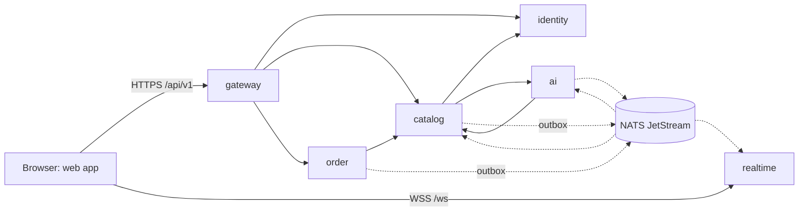

<div dir="rtl">

# معماری

این فصل به یک سؤال جواب می‌دهد: سرمیز از چه سرویس‌هایی ساخته شده، هر کدام مالک چه داده‌ای است، با هم چطور حرف می‌زنند، و یک endpoint یا رویداد تازه را چطور از اول تا آخر اضافه کنی؟

[بازگشت به فهرست مستندات](../README.md)

## ۱. چرا مهم است

در سرمیز پنج سرویس و یک اپ وب را سه نفر هم‌زمان می‌سازند (سرویس ششم، `ai`، مال انتشار ۲ است). اگر مرزها روشن نباشد، دو هفته بعد `order` مستقیم از جدول‌های `catalog` می‌خواند، یک تغییر کوچک در یک سرویس سه سرویس دیگر را می‌شکند، و دیگر کسی نمی‌داند داده‌ی کدام جدول درست است. این فصل نقشه و قاعده‌هایی است که جلوی این را می‌گیرد. چرایی و بده‌بستان هر مرز در [فصل ۳](03-system-design.md) آمده؛ اینجا «چطور» را می‌بینی.

## ۲. تصمیم‌ها در یک نگاه

| موضوع | تصمیم | چرا |
|---|---|---|
| ورودی عمومی | مرورگر فقط با `gateway` (REST) و `realtime` (WebSocket) حرف می‌زند | یک جا برای توکن، نقش، محدودیت نرخ و CORS |
| تماس هم‌زمان | gRPC با Protobuf، deadline پیش‌فرض ۲ ثانیه، retry فقط برای خواندن، circuit breaker | قرارداد تایپ‌دار و شکست سریع |
| تماس ناهمگام | رویداد روی NATS JetStream از راه transactional outbox | رویداد گم نمی‌شود و ذخیره به NATS وابسته نیست |
| داده | هر سرویس دیتابیس و نقش دیتابیس خودش؛ ارجاع بین سرویس‌ها فقط UUID بدون foreign key | هیچ سرویسی بی‌خبر جدول دیگری را نمی‌شکند |
| گراف تماس | فقط شش یال مجاز؛ یال تازه سند تصمیم می‌خواهد | وابستگی کمتر یعنی خرابی کمتر و استقرار مستقل |
| `gateway` | با grpc-gateway از annotationهای proto ساخته می‌شود، به‌علاوه‌ی middleware؛ منطق کسب‌وکاری ندارد | یک منبع برای REST، gRPC و OpenAPI |

## ۳. نقشه‌ی کلی

</div>



<div dir="rtl">

خط پر یعنی تماس هم‌زمان (gRPC، یا HTTP داخلی برای `ai`) و خط‌چین یعنی رویداد. زیرساخت مشترک: یک سرور PostgreSQL با چهار دیتابیس، Redis، NATS JetStream، object storage سازگار با S3 (در محیط محلی MinIO)، و Ollama برای مدل‌ها.

## ۴. سرویس‌ها و داده‌ای که مالکش هستند

| سرویس | مسئولیت | داده‌ای که مالک است | بخش |
|---|---|---|---|
| `gateway` | REST به gRPC، بررسی JWT، نقش هر مسیر، محدودیت نرخ، CORS، `request_id` | دیتابیس ندارد؛ کلیدهای محدودیت نرخ در Redis، کش JWKS در حافظه | پلتفرم و هوش مصنوعی |
| `identity` | کاربران پنل، ورود با کد، توکن‌ها، عضویت و نقش، ادمین‌های Tecso | دیتابیس `identity`: `users`، `memberships`، `refresh_tokens`، `audit_log`؛ کد یک‌بارمصرف در Redis | هسته |
| `catalog` | کسب‌وکار، شعبه، میز و QR، برندینگ، منو، عکس، منوی عمومی، ورود منو، ترجمه‌های ذخیره‌شده | دیتابیس `catalog`: `venues`، `branches`، `dining_tables`، جدول‌های منو، `media`، `import_jobs`، `outbox`، `audit_log`؛ کش منو و `qr_token` در Redis؛ باکت‌های `sarmiz-media` و `sarmiz-imports` | هسته |
| `order` | سفارش، درخواست خدمت، امتیاز، پرداخت، تنظیمات پرداخت، گزارش فروش | دیتابیس `orders`: `orders`، `order_items`، `payments`، `payment_configs`، `service_requests`، `ratings`، `daily_counters`، `outbox`، `processed_events`، `audit_log` | سفارش |
| `realtime` | پخش رویدادها با WebSocket به صفحه‌ی آشپزخانه و صفحه‌ی سفارش مهمان | هیچ؛ فقط اتصال‌های باز در حافظه | سفارش |
| `ai` (Python) | ترجمه، ورود منو از عکس، گارسون هوشمند | دیتابیس `ai`: `menu_chunks` با pgvector؛ فایل‌های `sarmiz-imports` را فقط می‌خواند | پلتفرم و هوش مصنوعی |
| `web` | منوی مهمان، پنل، صفحه‌ی آشپزخانه، صفحه‌ی معرفی، ادمین | هیچ؛ سبد در `localStorage` مرورگر | فرانت |

## ۵. گراف تماس مجاز

این جدول از بخش ۴٫۱ مشخصات فنی است. هر تماس هم‌زمانی که در آن نیست ممنوع است، مگر با سند تصمیم.

| صدا می‌زند | اجازه دارد صدا بزند | برای چه |
|---|---|---|
| `gateway` | `identity`، `catalog`، `order` | ترجمه‌ی REST به gRPC |
| `catalog` | `identity`، `ai` | دادن نقش `owner` بعد از `CreateVenue`؛ ترجمه |
| `order` | `catalog` | `ResolveTable` و `PriceItems` |
| `ai` | `catalog` | `GetMenuSnapshot` برای index کردن |
| `realtime` و `identity` | هیچ‌کس | |

**چرا این‌قدر کوچک؟** هر یال سه هزینه دارد: اگر مقصد بخوابد مبدأ هم آسیب می‌بیند، تغییر قرارداد مقصد مبدأ را می‌شکند، و دو سرویس دیگر مستقل منتشر نمی‌شوند. حلقه (A به B و B به A) بدترین حالت است، چون یک کندی بین دو سرویس دور می‌زند. `identity` و `realtime` هیچ تماسی ندارند تا همیشه بالا باشند و آزادانه restart شوند.

> [!NOTE]
> `realtime` باید ticket مهمان یا پنل را بررسی کند، ولی در گراف هیچ تماسی ندارد. اینکه کلید بررسی ticket چطور به `realtime` می‌رسد در مشخصات فنی نیامده است؛ بخش سفارش در `W1-ORD-3` با منتور تصمیم می‌گیرد و اگر تماس تازه‌ای لازم شد، سند تصمیم می‌نویسد.

## ۶. هم‌زمان یا ناهمگام

| سؤال | gRPC هم‌زمان | رویداد ناهمگام |
|---|---|---|
| فراخوان به جواب نیاز دارد تا کارش تمام شود؟ | بله: `order` بدون قیمت از `PriceItems` سفارش نمی‌سازد | نه: `order` منتظر نمی‌ماند تا آشپزخانه خبر بگیرد |
| اگر مقصد خوابید چه؟ | فراخوان هم خطا می‌دهد (`unavailable`) | فرستنده کارش را می‌کند؛ رویداد بعداً می‌رسد |
| چند گیرنده؟ | یکی | صفر تا چند؛ فرستنده نمی‌داند کی گوش می‌دهد |
| مثال در سرمیز | `ResolveTable`، `PriceItems`، `GrantMembership`، `GetMenuSnapshot` | `order.created`، `order.paid`، `menu.changed`، `import.requested` |

قاعده‌ی سرانگشتی: «الان جواب لازم دارم» یعنی تماس هم‌زمان؛ «خبر بده که اتفاقی افتاد» یعنی رویداد. کار سنگین AI مثل ورود منو همیشه رویداد است، چون ممکن است دقیقه‌ها طول بکشد.

## ۷. transactional outbox به زبان ساده

اگر اول سفارش را commit کنی و بعد به NATS بفرستی، قطعی بین این دو خبر را گم می‌کند؛ اگر اول بفرستی و commit شکست بخورد، آشپزخانه سفارشی را می‌بیند که وجود ندارد. راه‌حل: رویداد را در همان تراکنش، به شکل یک ردیف در جدول `outbox` همان سرویس بنویس. یا هر دو ثبت می‌شوند یا هیچ‌کدام. مثال تغییر قیمت در `catalog`:

</div>

```sql
BEGIN;
UPDATE menu_items SET price_rial = $3 WHERE id = $2 AND venue_id = $1;
UPDATE venues SET menu_version = menu_version + 1 WHERE id = $1;
INSERT INTO outbox (event_id, subject, payload)
VALUES ($4, 'sarmiz.catalog.menu.changed', $5);
COMMIT;
```

<div dir="rtl">

یک حلقه‌ی relay ردیف‌های فرستاده‌نشده را برمی‌دارد، به NATS می‌فرستد و بعد `sent_at` را پر می‌کند. پیشنهاد اولیه (همان که در [فصل ۸](08-database-and-storage.md) آمده): برداشتن ردیف‌ها با `FOR UPDATE SKIP LOCKED` تا دو نسخه‌ی سرویس یک ردیف را دو بار نفرستند. فاصله‌ی دور زدن relay در مشخصات فنی نیامده؛ چون کل مسیر تا آشپزخانه باید زیر ۲ ثانیه باشد، پیشنهاد اولیه زیر نیم ثانیه است و در `W1-ORD-4` نهایی می‌شود.

## ۸. مصرف‌کننده‌ی idempotent

relay ممکن است بعد از فرستادن و قبل از ثبت `sent_at` از کار بیفتد و همان رویداد را دوباره بفرستد؛ outbox «دست‌کم یک بار» تحویل می‌دهد، نه «دقیقاً یک بار». پس مصرف‌کننده باید idempotent باشد: اگر یک رویداد دو بار برسد، نتیجه مثل یک بار باشد. الگو: `id` رویداد را در همان تراکنشی که اثرش را ثبت می‌کنی در `processed_events` بنویس، و فقط بعد از commit به JetStream ack بده (اعلام دریافت). اگر قبل از ack از کار بیفتی، JetStream دوباره می‌فرستد و این جدول تکرار را می‌گیرد.

</div>

```sql
BEGIN;
INSERT INTO processed_events (event_id) VALUES ($1) ON CONFLICT DO NOTHING;
-- 0 rows inserted: already handled, commit and ack
-- 1 row inserted: apply the change here, in the same transaction
COMMIT;
```

<div dir="rtl">

ستون‌های دقیق `processed_events` در `W1-ORD-4` تصمیم گرفته می‌شود؛ این فقط شکل الگوست. `realtime` دیتابیس ندارد و لازم هم ندارد: فرستادن دوباره‌ی یک خبر به صفحه بی‌خطر است، چون صفحه تکراری را با شناسه‌ی سفارش کنار می‌گذارد و وضعیت را از API می‌خواند.

## ۹. ساختار ریپو و آناتومی یک سرویس Go

ریپو این پوشه‌ها را دارد: <span dir="ltr">`services/`</span> (شش سرویس)، <span dir="ltr">`libs/go/kit/`</span> (شاسی مشترک)، <span dir="ltr">`proto/`</span> (قراردادها، و <span dir="ltr">`proto/events/`</span> برای JSON Schema رویدادها)، <span dir="ltr">`web/`</span>، <span dir="ltr">`deploy/`</span>، <span dir="ltr">`tests/`</span> و <span dir="ltr">`docs/`</span>. یک `go.work` همه‌ی ماژول‌های Go را کنار هم می‌گذارد. هر سرویس Go این شکل را دارد:

</div>

```text
services/<name>/
├── cmd/server/main.go     wire config, kit server, handlers
├── internal/
│   ├── config/
│   ├── handler/           gRPC handlers: translate and validate, no business rules
│   ├── service/           business rules, unit tested
│   ├── repository/        SQL with pgx; every method takes venue_id for venue data
│   └── model/
├── migrations/            goose SQL files
├── Dockerfile
└── README.md
```

<div dir="rtl">

| لایه | کارش | کارش نیست |
|---|---|---|
| `handler` | خواندن metadata مطمئن، تبدیل proto به model، صدا زدن `service`، نگاشت خطا با kit | قاعده‌ی کسب‌وکاری، SQL |
| `service` | قاعده‌ها: ماشین وضعیت، قیمت، مجوز؛ مرز تراکنش | دانستن proto یا HTTP |
| `repository` | SQL پارامتری با pgx، همیشه با `venue_id` | تصمیم کسب‌وکاری |

یک نمونه‌ی کوچک از `handler`. نام تابع‌های kit فرضی‌اند؛ نام واقعی را `W1-PA-2` تعیین می‌کند:

</div>

```go
func (h *OrderHandler) ListOrders(ctx context.Context, req *orderv1.ListOrdersRequest) (*orderv1.ListOrdersResponse, error) {
	md, err := kit.TrustedMetadata(ctx) // x-venue-id, x-role, x-user-id
	if err != nil {
		return nil, kit.ToStatus(err)
	}
	page, err := h.svc.ListOrders(ctx, md.VenueID, toFilter(req))
	if err != nil {
		return nil, kit.ToStatus(err)
	}
	return toProto(page), nil
}
```

<div dir="rtl">

## ۱۰. metadata مطمئن از `gateway` تا سرویس

`gateway` روی هر تماس این‌ها را می‌فرستد: `x-request-id`، `x-user-id`، `x-venue-id`، `x-role`، `x-guest-session` و trace context استاندارد W3C.

1. `gateway` توکن را بررسی می‌کند و `x-user-id` را از claim `sub` می‌سازد.
2. برای مسیرهای <span dir="ltr">`/venues/{venue_id}/*`</span>، نقش کاربر در همان کسب‌وکار را از claim `mem` پیدا می‌کند، با جدول مجوز مسیر می‌سنجد و `x-venue-id` و `x-role` را می‌گذارد.
3. برای مهمان، هدر `X-Guest-Session` را به `x-guest-session` تبدیل می‌کند.
4. هر مقداری با همین نام‌ها که از بیرون آمده باشد دور ریخته می‌شود. metadata را فقط `gateway` می‌سازد، وگرنه هر کسی می‌تواند بگوید «من owner هستم».
5. سرویس‌ها به این metadata اعتماد می‌کنند فقط چون جز `gateway` کسی به آن‌ها نمی‌رسد (NetworkPolicy). باز هم هر query را با `venue_id` محدود می‌کنند و منبعِ کسب‌وکار دیگر را `not_found` برمی‌گردانند.
6. `x-request-id` و trace context در تماس‌های داخلی (مثل `order` به `catalog`) و در envelope رویدادها هم جلو می‌روند تا یک درخواست را در لاگ و Tempo تا آخر دنبال کنی.

اینکه کدام فیلدهای کاربر در تماس‌های داخلی هم جلو بروند در مشخصات فنی نیامده است. پیشنهاد اولیه: در متدهای داخلی مثل `PriceItems` شناسه‌ی کسب‌وکار در خود پیام باشد؛ تصمیم نهایی با `W1-PA-2`.

## ۱۱. دستور کار: اضافه کردن یک endpoint از اول تا آخر

مثال: `GET /api/v1/venues/{venue_id}/orders`، یعنی `OrderService.ListOrders` در `order`. قبل از هر چیز مطمئن شو مسیر در جدول بخش ۶٫۱ و متد در بخش ۶٫۲ مشخصات فنی هست؛ اگر نیست، اول issue و سند تصمیم.

1. **proto:** متد و پیام‌ها را در <span dir="ltr">`proto/sarmiz/order/v1/`</span> بنویس، با annotation مسیر HTTP و قواعد `protovalidate`. اگر endpoint بین دو بخش است، این قدم را در یک PR جدا بفرست تا بقیه از روی قرارداد کار کنند.
2. **کد بساز:** `buf lint`، `buf breaking` و `buf generate`. دستور دقیق در جدول «Commands» فایل `AGENTS.md` است.
3. **handler:** فقط تبدیل و اعتبارسنجی، مثل نمونه‌ی بخش ۹.
4. **service:** قاعده‌ها؛ اینجا فیلترها، `limit` (پیش‌فرض ۲۰ و حداکثر ۱۰۰) و cursor.
5. **repository:** SQL پارامتری که با `venue_id` شروع می‌شود و از ایندکس درست استفاده می‌کند.
6. **تست:** تست جدولی برای `service`، تست یکپارچه با PostgreSQL واقعی برای `repository`، و یک حالت در <span dir="ltr">`tests/isolation/`</span>: کاربر کسب‌وکار دیگر باید `not_found` بگیرد.
7. **مسیر در `gateway`:** نقش مجاز را از جدول مجوز بخش ۸ بگذار (دیدن سفارش برای هر سه نقش آزاد است) و محدودیت نرخ پنل را اعمال کن.
8. **OpenAPI:** `docs/api/openapi.yaml` را دوباره بساز و در همان PR commit کن.
9. **کلاینت وب:** تایپ‌ها را از OpenAPI دوباره بساز و یک hook با TanStack Query بنویس؛ هیچ `any`.
10. **مستندات:** README سرویس و هر سندی که این تغییر غلطش کرده را به‌روز کن.

</div>

```proto
rpc ListOrders(ListOrdersRequest) returns (ListOrdersResponse) {
  option (google.api.http) = {get: "/api/v1/venues/{venue_id}/orders"};
}
message ListOrdersRequest {
  string venue_id = 1 [(buf.validate.field).string.uuid = true];
  int32 limit = 2 [(buf.validate.field).int32 = {gte: 0, lte: 100}];
  string cursor = 3;
}
```

<div dir="rtl">

## ۱۲. دستور کار: اضافه کردن یک رویداد

1. **لازم است؟** همه‌ی رویدادهای انتشار ۱ در جدول بخش ۶٫۳ مشخصات فنی هستند. رویداد تازه یعنی تغییر مشخصات فنی، که PR و سند تصمیم می‌خواهد.
2. **نام:** <span dir="ltr">`sarmiz.<service>.<entity>.<event>`</span>، مثل `sarmiz.order.service_request.resolved`. فرستنده همیشه سرویس مالک داده است.
3. **schema:** JSON Schema در <span dir="ltr">`proto/events/`</span> و تست schema. envelope همیشه `id`، `type`، `version`، `time`، `venue_id`، `trace_id` و `data` دارد.
4. **انتشار:** ردیف `outbox` در همان تراکنش تغییر کسب‌وکاری؛ هیچ‌وقت مستقیم به NATS نفرست. بعد از استقرار، `outbox_lag_seconds` را در Grafana ببین.
5. **مصرف:** مصرف‌کننده idempotent است (بخش ۸) و فقط بعد از commit ack می‌دهد.
6. **تغییر شکل:** فیلد تازه‌ی اختیاری اشکالی ندارد؛ حذف یا تغییر معنی یک فیلد یعنی `version` تازه، و تا همه‌ی مصرف‌کننده‌ها به‌روز نشده‌اند، نسخه‌ی قدیم هم منتشر می‌شود.

## ۱۳. قاعده‌ها و سندهای تصمیم

- هیچ سرویسی دیتابیس سرویس دیگر را نمی‌خواند یا نمی‌نویسد؛ داده را از API مالکش بخواه یا snapshot نگه دار.
- هیچ وابستگی هم‌زمان تازه‌ای بدون سند تصمیم، و هیچ سرویس یا زیرساخت تازه‌ای در انتشار ۱.
- منطق کسب‌وکاری در `gateway` نمی‌نشیند و کد مشترک فقط در `libs/go/kit` است، نه کپی در سرویس.
- قرارداد (proto، schema رویداد، OpenAPI) مثل API عمومی است: فیلد را دوباره استفاده یا شماره‌گذاری مجدد نکن و `buf breaking` باید سبز باشد.
- تراکنش را کوتاه نگه دار و وسطش سرویس دیگری را صدا نزن.

سندهای تصمیم مرتبط: [۱: microservices](../decisions/0001-microservices.md)، [۲: پرداخت داخل `order`](../decisions/0002-order-owns-payments.md)، [۳: یک دیتابیس برای هر سرویس](../decisions/0003-database-per-service.md)، [۴: NATS JetStream و outbox](../decisions/0004-nats-jetstream-and-outbox.md)، [۵: متن چندزبانه به شکل JSONB](../decisions/0005-i18n-as-jsonb.md) و [۶: مدل تسویه‌ی پرداخت](../decisions/0006-payment-settlement-model.md). فهرست و قالب در [README سندهای تصمیم](../decisions/README.md) است.

## چک‌لیست انتشار ۱

- [ ] هیچ تماس هم‌زمانی خارج از جدول بخش ۵ در کد نیست و هر تماس خروجی deadline و circuit breaker دارد.
- [ ] هر نقش دیتابیس فقط به دیتابیس خودش دسترسی دارد و تستش هست.
- [ ] همه‌ی رویدادهای بخش ۶٫۳ مشخصات فنی از `outbox` منتشر می‌شوند، JSON Schema و تست دارند، و هر مصرف‌کننده با رویداد تکراری امتحان شده است.
- [ ] `gateway` metadata مطمئنی را که از بیرون آمده دور می‌ریزد و تستش هست.
- [ ] `docs/api/openapi.yaml` با proto یکی است و کلاینت وب از آن ساخته شده است.
- [ ] README هر سرویس مسئولیت، جدول‌ها، متدها و رویدادهایش را دارد.

## اشتباه‌های رایج

| اشتباه | چرا بد است | چه کار کن |
|---|---|---|
| خواندن مستقیم جدول `catalog` از `order` «فقط برای گزارش» | دو سرویس به یک schema گره می‌خورند | `PriceItems` یا snapshot در خود سفارش |
| انتشار مستقیم به NATS بعد از commit | رویداد با یک قطعی گم می‌شود | همیشه ردیف `outbox` |
| ack قبل از commit | با یک crash، اثر رویداد برای همیشه از دست می‌رود | اول commit، بعد ack |
| خواندن `venue_id` از body درخواست | کاربر می‌تواند کسب‌وکار دیگری را بخواهد | `venue_id` از metadata مطمئن و بررسی‌شده |
| retry روی `CreateOrder` بین سرویس‌ها | سفارش دو بار ثبت می‌شود | retry فقط برای خواندن؛ `Idempotency-Key` برای ساخت |
| یال تازه در گراف «چون ساده‌تر بود» | وابستگی پنهان و خرابی زنجیره‌ای | اول سند تصمیم و نظر منتور |

## کار با AI روی این موضوع

**فایل‌هایی که به دستیار می‌دهی:** `AGENTS.md`، بخش‌های ۴، ۵ و ۶ از `docs/SPEC.md`، همین فصل، `proto/README.md` و README سرویسی که رویش کار می‌کنی.

برای اضافه کردن یک endpoint:

</div>

```text
می‌خواهم endpoint [مسیر و متد] را طبق بخش ۱۱ از docs/guide/04-architecture.md اضافه کنم.
اول بررسی کن که مسیر در بخش ۶٫۱ و متد در بخش ۶٫۲ از docs/SPEC.md هست. اگر نیست، متوقف شو و بگو.
هنوز کد ننویس. فهرست فایل‌هایی که عوض می‌شوند را به ترتیب قدم‌های بخش ۱۱ بده،
و برای هر قدم بگو چه تستی لازم است. نقش مجاز را از جدول مجوز بخش ۸ SPEC بیاور.
```

<div dir="rtl">

برای بازبینی مرزها قبل از PR:

</div>

```text
diff این شاخه را بخوان و فقط دنبال این‌ها بگرد:
تماس gRPC یا HTTP که در جدول بخش ۴٫۱ از docs/SPEC.md نیست، دسترسی به دیتابیس سرویس دیگر،
انتشار مستقیم به NATS بدون outbox، ack قبل از commit، و query بدون venue_id.
برای هر مورد نام فایل و شماره‌ی خط بده. اگر چیزی پیدا نکردی همین را بگو.
```

<div dir="rtl">

**خودت حتماً بررسی کن:** هر تماس تازه در جدول بخش ۵ هست؛ `venue_id` از metadata آمده نه از ورودی کاربر؛ ردیف `outbox` و تغییر کسب‌وکاری واقعاً در یک تراکنش‌اند؛ مصرف‌کننده با رویداد تکراری تست شده؛ و فایل OpenAPI در همان PR به‌روز شده است.

## بیشتر بخوان

- [فصل ۳: طراحی سیستم](03-system-design.md)، [فصل ۶: API و قراردادها](06-api-and-contracts.md)، [فصل ۷: منطق بک‌اند و سرویس‌ها](07-backend-services.md)، [فصل ۸: دیتابیس و ذخیره‌سازی](08-database-and-storage.md) و [فصل ۹: ورود و دسترسی](09-auth-and-permissions.md).
- [README شاسی مشترک](../../libs/go/kit/README.md)، [README قراردادها](../../proto/README.md) و [README فایل OpenAPI](../api/README.md).
- مشخصات فنی: بخش ۴ (معماری و گراف تماس)، بخش ۵ (ساختار ریپو)، بخش ۶ (قراردادها و رویدادها)، بخش ۸ (metadata و مجوز) و بخش ۱۶ (تاب‌آوری).

</div>
