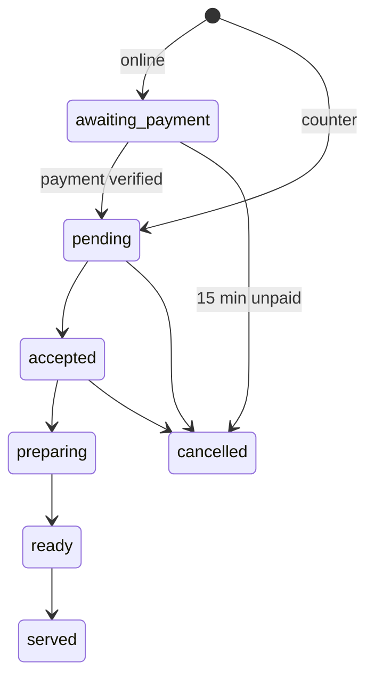
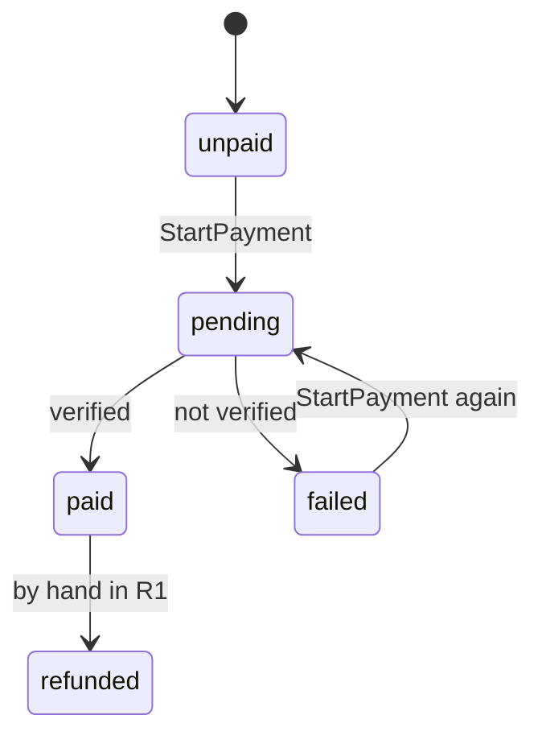

<div dir="rtl">

# منطق بک‌اند و سرویس‌ها

این فصل به یک سؤال جواب می‌دهد: هر سرویس Go سرمیز دقیقاً چه کاری می‌کند و چه کاری نباید بکند، قواعد کسب‌وکار کجای کد می‌نشینند، و خطا، تراکنش و کارهای پس‌زمینه را چطور درست بنویسی؟

[بازگشت به فهرست مستندات](../README.md)

## ۱. چرا مهم است

بیشتر باگ‌های خطرناک سرمیز در منطق بک‌اند است، نه در رابط کاربری: سفارشی که دو بار ثبت می‌شود، قیمتی که از مرورگر آمده، پرداختی که تأیید شده ولی سفارشش به آشپزخانه نرسیده. پنج سرویس Go را دو نفر مختلف می‌نویسند؛ اگر هر کدام خطا، تراکنش و لایه‌ها را به سلیقه‌ی خودش بچیند، کسی نمی‌تواند کد دیگری را بازبینی کند. این فصل یک شکل مشترک و قواعد هر سرویس را می‌گوید.

## ۲. تصمیم‌ها در یک نگاه

| موضوع | تصمیم | چرا |
|---|---|---|
| چیدمان سرویس | `cmd/server` و <span dir="ltr">`internal/{config,handler,service,repository,model}`</span> و <span dir="ltr">`migrations/`</span> | همان شکل دوره؛ هر کس هر سرویسی را باز کند راهش را پیدا می‌کند |
| قواعد کسب‌وکار | فقط در `service`، با تست جدولی و هدف پوشش ۷۰٪ | قیمت، وضعیت سفارش و جدول نقش‌ها بدون دیتابیس تست شوند |
| شاسی مشترک | `libs/go/kit` برای config، لاگ، سرور gRPC، دیتابیس، رویداد، خطا و تست | یک نسخه از کد تکراری |
| خطا | wrap با <span dir="ltr">`%w`</span>؛ نگاشت به کد gRPC فقط یک جا، در kit | یک قالب خطا برای همه |
| تماس بیرونی | deadline (پیش‌فرض ۲ ثانیه)، تکرار فقط برای خواندن idempotent، circuit breaker | یک سرویس کند بقیه را با خودش پایین نکشد |
| قیمت | `catalog.PriceItems` مرجع قیمت است | منوی کش‌شده تا ۳۰ ثانیه کهنه است؛ پول نباید باشد |
| سفارش و پرداخت | هر دو در `order` | [سند تصمیم ۲](../decisions/0002-order-owns-payments.md): پرداخت و سفارش در یک تراکنش |
| حالت | همه‌ی سرویس‌ها stateless؛ در `production` دست‌کم ۲ replica از `gateway`، `catalog`، `order` و `realtime` | هر کار پس‌زمینه باید با دو نسخه‌ی هم‌زمان درست بماند |

## ۳. لایه‌ها داخل یک سرویس Go

| لایه | چه چیزی اینجاست | چه چیزی اینجا **نیست** |
|---|---|---|
| `cmd/server/main.go` | خواندن config، ساختن وابستگی‌ها، بالا آوردن سرور و کارهای پس‌زمینه با kit | هر نوع منطق |
| `internal/handler` | تبدیل پیام proto به `model`، خواندن metadata مطمئن با kit، صدا زدن `service` | قاعده‌ی کسب‌وکار، SQL |
| `internal/service` | قاعده‌ها، ماشین وضعیت، مرز تراکنش، تماس با سرویس دیگر از راه interface | نوع‌های proto، متن SQL |
| `internal/repository` | SQL با pgx و پارامتر؛ هر متد روی داده‌ی کسب‌وکار `venue_id` می‌گیرد | تصمیم‌گیری («اگر … بود، …») |
| `internal/model` | نوع‌های دامنه و خطاهای دامنه | وابستگی به pgx یا gRPC |

`service` فقط interface می‌شناسد؛ برای همین در تست واحد، repository و کلاینت `catalog` را با نسخه‌ی جعلی عوض می‌کنی. نمونه (نام‌ها فقط برای نشان دادن ایده):

</div>

```go
type OrderRepo interface {
	Insert(ctx context.Context, tx pgx.Tx, o model.Order) error
	Get(ctx context.Context, venueID, orderID uuid.UUID) (model.Order, error)
}

type Pricing interface { // wraps catalog.PriceItems
	PriceItems(ctx context.Context, venueID uuid.UUID, in []model.LineInput) ([]model.PricedLine, error)
}

type OrderService struct {
	repo    OrderRepo
	pricing Pricing
	now     func() time.Time // injected so expiry and daily code are testable
}
```

<div dir="rtl">

## ۴. خطا و نگاشت به کد gRPC

1. `repository` خطای فنی را به خطای دامنه تبدیل می‌کند: «ردیف پیدا نشد» به `not found`، نقض یکتایی به `conflict`.
2. `service` خطای دامنه برمی‌گرداند و با <span dir="ltr">`fmt.Errorf("...: %w", err)`</span> زمینه اضافه می‌کند.
3. یک interceptor در kit خطا را به کد gRPC تبدیل می‌کند و `gateway` آن را به قالب REST ([فصل ۶](06-api-and-contracts.md)). هیچ handlerی `status.Error` دستی نمی‌سازد.
4. خطای ناشناخته `internal` می‌شود: متن کاملش فقط در لاگ (با `request_id`) و GlitchTip می‌رود، نه در پاسخ.
5. هر خطا را فقط یک بار لاگ کن، در interceptor؛ نه در هر لایه.

</div>

```go
// example only: the real helper names are set in W1-PA-2
var ErrBadTransition = kiterr.FailedPrecondition("order status transition not allowed")

if !canMove(o.Status, to) {
	return fmt.Errorf("update order %s: %w", o.ID, ErrBadTransition)
}
```

<div dir="rtl">

منبعی که مال کسب‌وکار دیگری است همیشه `not_found` است، نه `permission_denied`: repository با `WHERE id = $1 AND venue_id = $2` اصلاً آن را پیدا نمی‌کند.

## ۵. context، deadline و لغو

- `context.Context` همیشه پارامتر اول است. در مسیر درخواست هیچ‌وقت <span dir="ltr">`context.Background()`</span> نساز؛ همان `ctx` درخواست را پایین بده تا deadline و trace برسند.
- تماس gRPC بیرونی deadline پیش‌فرض ۲ ثانیه از kit می‌گیرد و هرگز بیشتر از زمانِ باقی‌مانده‌ی درخواست ورودی نیست.
- goroutineی که بعد از پاسخ زنده می‌ماند با `ctx` درخواست کار نکند؛ با پایان درخواست لغو می‌شود.
- اگر `ctx` وسط کار لغو شد (مهمان صفحه را بست)، کار نیمه‌تمام را ادامه نده؛ ولی تراکنشی که commit شده تمام‌شده است و برنمی‌گردد.
- کار پس‌زمینه یک `ctx` ریشه از `main` دارد که با `SIGTERM` لغو می‌شود، و هر دور کارش timeout خودش را دارد.
- خاموشی آرام (graceful shutdown) با kit: درخواست تازه نگیر، درخواست‌های در جریان را تمام کن، کارهای پس‌زمینه را متوقف کن، poolها را ببند.
- timeout تماس با درگاه پرداخت را مشخصات فنی عدد نداده؛ در `W3-ORD-4` با منتور تعیین می‌شود.

## ۶. تراکنش کجا شروع و تمام می‌شود

تراکنش در لایه‌ی `service` باز و بسته می‌شود؛ متدهای repository آن را به‌عنوان پارامتر می‌گیرند. handler هیچ‌وقت تراکنش باز نمی‌کند. قاعده‌ی اصلی: **وسط تراکنش سرویس دیگری را صدا نزن** (تنها استثنا verify پرداخت است که در [فصل ۸](08-database-and-storage.md) آمده).

`CreateOrder` به این ترتیب:

1. بیرون از تراکنش: `catalog.ResolveTable` و `catalog.PriceItems`. اگر یکی شکست خورد، خطا را برگردان؛ چیزی ذخیره نشده است.
2. `BEGIN`؛ شمارنده‌ی روزانه با دستور اتمی، درج سفارش و ردیف‌ها با snapshot، ردیف `outbox` برای `order.created`؛ `COMMIT`.
3. بعد از commit کاری لازم نیست: relay رویداد را منتشر می‌کند.

`CreateVenue` برعکس است: کسب‌وکار و شعبه‌ی پیش‌فرض در یک تراکنش، بعد از commit تماس `identity.GrantMembership`، و اگر شکست خورد، جبران (compensation) تا کسب‌وکار نیمه‌ساخته نماند. روش جبران در `W1-CORE-3` تعیین و تست می‌شود.

## ۷. `gateway`

**مسئولیت:** REST به gRPC، بررسی JWT با JWKS (کش ۱۰ دقیقه)، نقش برای هر مسیر از جدول دسترسی، محدودیت نرخ در Redis، CORS و بررسی Origin روی متدهای ناامن، `request_id`، سقف بدنه، قالب واحد خطا.

**هرگز:** منطق کسب‌وکار، دیتابیس، تماس با سرویسی جز `identity`، `catalog` و `order`. هدرهای `x-user-id`، `x-venue-id` و `x-role` را از مرورگر نپذیر؛ این metadata را فقط خود `gateway` از روی توکن می‌سازد، وگرنه هر کسی خودش را `owner` معرفی می‌کند.

ترتیب middlewareها (پیشنهاد اولیه، `W1-PA-4`): `request_id`، CORS و Origin، سقف بدنه، محدودیت نرخ، JWT، نقش، ساختن metadata، تماس، قالب خطا. اگر Redis پایین بود، مسیرهای OTP بسته می‌مانند و منوی عمومی باز.

## ۸. `identity`

| قاعده | مقدار |
|---|---|
| کد یک‌بارمصرف | ۶ رقم، ۱۲۰ ثانیه، حداکثر ۵ تلاش برای هر کد، ارسال دوباره بعد از ۶۰ ثانیه؛ hash آن با شمارنده در Redis زیر <span dir="ltr">`otp:{phone}`</span> |
| پاسخ `RequestOtp` | برای شماره‌ی ثبت‌شده و نشده یکی است |
| توکن دسترسی | JWT با Ed25519، ۱۵ دقیقه، claimهای `sub`، `adm`، `mem`، `exp`، `jti` |
| توکن تازه‌سازی | ۲۵۶ بیت تصادفی، ۳۰ روز، hashشده، در هر استفاده عوض می‌شود؛ استفاده‌ی دوباره از توکن قدیمی کل `family_id` را باطل می‌کند |
| `GetMe` | نقش‌ها را همیشه از دیتابیس می‌خواند، نه از توکن |
| `IssueStreamTicket` | JWT شصت‌ثانیه‌ای با scope <span dir="ltr">`venue:<id>`</span> یا <span dir="ltr">`order:<id>`</span> |
| audit | ورود و تغییر نقش در `audit_log` ثبت می‌شوند |

**هرگز:** تماس با سرویس دیگر، لاگ کد و توکن و شماره‌ی کامل، مقایسه‌ی کد با <span dir="ltr">`==`</span> (از `crypto/subtle` استفاده کن)، فعال بودن پیامک `console` بیرون از `local`. جزئیات در [فصل ۹](09-auth-and-permissions.md).

## ۹. `catalog`

- **`menu_version`.** هر تغییر منو، موجودی (`SetItemAvailability`) یا زمان‌بندی، `venues.menu_version` را در همان تراکنش بالا می‌برد و ردیف `outbox` برای `menu.changed` می‌نویسد. کش منوی عمومی با کلید <span dir="ltr">`menu:{venue_id}:{locale}:{menu_version}`</span> خودبه‌خود کهنه می‌شود.
- **زبان.** ترتیب خواندن: زبان خواسته‌شده، بعد `venues.default_locale`، بعد `fa`. `fa` هنگام ذخیره اجباری است.
- **تصویر.** حداکثر ۵ مگابایت؛ نوع از روی محتوا (JPEG، PNG، WebP)؛ decode و ساخت دوباره به WebP در عرض‌های ۳۲۰، ۸۰۰ و ۱۶۰۰ که metadata را هم پاک می‌کند؛ کلید `v/{venue_id}/{sha256}-{width}.webp` و یک ردیف در `media`.
- **`PriceItems`، مرجع قیمت.** برای هر ردیف بررسی می‌کند: آیتم مال همین کسب‌وکار است، فعال و موجود است، دسته‌اش الان طبق زمان‌بندی فعال است، گزینه‌ها مال همین آیتم و موجودند و تعدادشان بین `min_select` و `max_select` است. قیمت واحد = `price_rial` به‌علاوه‌ی جمع `price_delta_rial`ها. خروجی داده‌ی snapshot (نام‌ها، قیمت‌ها، گزینه‌ها) است و خطای هر آیتم ناموجود `failed_precondition`.
- **`ResolveTable`.** از `qr_token` به کسب‌وکار، شعبه، میز و برچسب؛ با کش ۵ دقیقه‌ای در Redis.

**هرگز:** نگه داشتن سفارش، تماس با `order`، صدا زدن `ai` وسط تراکنش. اگر `ai` پایین است، منو کار می‌کند و دکمه‌ی ترجمه پیام «دوباره امتحان کن» نشان می‌دهد.

> [!WARNING]
> منوی زمان‌دار با گذشت ساعت عوض می‌شود بی‌آنکه `menu_version` تغییر کند، ولی کلید کش فقط به `menu_version` بسته است. اینکه فیلتر زمان هنگام خواندن انجام شود یا در کلید کش بیاید، در `W3-CORE-2` تصمیم گرفته می‌شود. `PriceItems` در هر حال زمان را خودش بررسی می‌کند.

## ۱۰. `order`

</div>





<div dir="rtl">

- **انتقال وضعیت** فقط از یک تابع در `service` با جدول انتقال‌های مجاز می‌گذرد، و `UPDATE` وضعیت قبلی را در `WHERE` دارد. چه کسی (مهمان یا کارکنان) کدام لغو را مجاز است در `W3-ORD-2` تعیین می‌شود. صفحه‌ی آشپزخانه هیچ‌وقت `awaiting_payment` را نمی‌بیند.
- **پرداخت در صندوق** در نمودار دوم نیست؛ پیشنهاد اولیه: `MarkPaidAtCounter` وضعیت پرداخت را مستقیم از `unpaid` به `paid` می‌برد. در `W1-ORD-1` نهایی کن.
- **snapshot قیمت.** `order_items` نام، قیمت واحد، گزینه‌ها و جمع ردیف را از خروجی `PriceItems` نگه می‌دارد؛ جمع‌ها را سرور حساب می‌کند.
- **کد روزانه** با شمارنده‌ی اتمی در `daily_counters` ([فصل ۸](08-database-and-storage.md)).
- **order token** ۱۲۸ بیت تصادفی، فقط یک بار برمی‌گردد و فقط hash آن در `order_token_hash` می‌ماند.
- **idempotency.** کلید در `orders.idempotency_key` با یک قید یکتایی؛ درخواست تکراری سفارش موجود را برمی‌گرداند. به «اول SELECT بعد INSERT» تکیه نکن؛ دو درخواست هم‌زمان هر دو از SELECT رد می‌شوند. دامنه‌ی یکتایی (پیشنهاد اولیه: `venue_id` و کلید) در `W2-ORD-1` تعیین می‌شود.
- **انقضا.** سفارش آنلاین `expires_at` = زمان ساخت + ۱۵ دقیقه دارد و کار پس‌زمینه لغوش می‌کند.
- **پرداخت** دقیقاً طبق بخش ۹ مشخصات فنی و [فصل ۱۰](10-security-and-payments.md)، با بازبینی منتور.

**هرگز:** اعتماد به مبلغ یا وضعیتی که از مرورگر یا query string callback آمده، خواندن دیتابیس `catalog`، تماس با سرویسی جز `catalog`.

## ۱۱. `realtime`

- اتصال WSS را با ticket می‌پذیرد: امضا، `exp` و scope را بررسی می‌کند. `realtime` حق تماس هم‌زمان با کسی را ندارد، پس کلید عمومی را از کجا بگیرد در مشخصات فنی نیامده؛ پیشنهاد اولیه: از config و secret، در `W1-ORD-3` نهایی شود.
- **fan-out.** هر pod خودش به NATS subscribe می‌کند و **همه‌ی** رویدادها را می‌گیرد. اگر podها یک consumer مشترک (صف) داشته باشند، هر رویداد فقط به یک pod می‌رسد و نیمی از صفحه‌های آشپزخانه خبر را نمی‌بینند.
- فیلتر: scope <span dir="ltr">`venue:<id>`</span> با `venue_id` پاکت، و scope <span dir="ltr">`order:<id>`</span> با `order_id` داخل `data`.
- ping هر ۲۵ ثانیه و متریک `ws_connections`. پیشنهاد اولیه: هر اتصال یک بافر محدود دارد و اتصال کندی که بافرش پر شد بسته می‌شود تا بقیه معطل نمانند.

**هرگز:** دیتابیس، تماس هم‌زمان، یا مرجع وضعیت بودن. sticky session لازم نیست.

## ۱۲. کارهای پس‌زمینه در انتشار ۱

| کار | سرویس | کی | چه می‌کند | امن با چند replica |
|---|---|---|---|---|
| relay برای `outbox` | `catalog`، `order` | حلقه‌ی پیوسته | ردیف‌های فرستاده‌نشده را منتشر و `sent_at` را پر می‌کند | `FOR UPDATE SKIP LOCKED` (پیشنهاد اولیه)؛ تکرار را مصرف‌کننده تحمل می‌کند |
| انقضای سفارش پرداخت‌نشده | `order` | پیشنهاد اولیه: هر دقیقه | `awaiting_payment` با `expires_at` گذشته را `cancelled` می‌کند و `status_changed` در `outbox` می‌نویسد | <span dir="ltr">`UPDATE ... WHERE status = 'awaiting_payment' AND expires_at < now()`</span> |
| تطبیق پرداخت | `order` | هر ۵ دقیقه | پرداخت‌هایی که بیش از ۲ دقیقه `initiated` مانده‌اند را با مبلغ ذخیره‌شده verify می‌کند، از همان مسیر `HandleCallback` | قفل ردیف پرداخت، مثل callback |
| مصرف‌کننده‌ی `import.completed` | `catalog` | پیوسته | پیش‌نویس را در `import_jobs` می‌گذارد | consumer مشترک بین replicaها و dedupe با `id` |

قاعده‌ها برای هر کار پس‌زمینه:

1. idempotent باشد: اجرای دوباره یا هم‌زمان نتیجه را عوض نکند.
2. دسته‌ی محدود بردارد (مثلاً ۱۰۰ ردیف)، timeout خودش را داشته باشد و با خاموشی آرام متوقف شود.
3. لاگ و متریک داشته باشد؛ `outbox_lag_seconds` زیر ۶۰.
4. پیشنهاد اولیه: همه داخل همان process سرویس، از `main` راه می‌افتند؛ deployment جدا لازم نیست.

> [!CAUTION]
> اگر مهمان در درگاه پرداخت است و همان لحظه کار انقضا سفارشش را لغو کند، ممکن است پول کم شود ولی سفارش لغو باشد. پیشنهاد اولیه: کار انقضا سفارشی که پرداختش `pending` است را لغو نکند تا تطبیق تکلیفش را روشن کند. این را در `W3-ORD-2` با منتور نهایی کن.

## ۱۳. شاسی مشترک `libs/go/kit`

| در kit هست | در kit نیست |
|---|---|
| config، لاگ JSON با `log/slog`، راه‌اندازی سرور gRPC با interceptorهای `request_id`، recovery، لاگ، متریک و trace | قاعده‌ی کسب‌وکار هر سرویس |
| health (<span dir="ltr">`/healthz`</span>، <span dir="ltr">`/readyz`</span>، سرویس health در gRPC)، <span dir="ltr">`/metrics`</span>، خاموشی آرام | `model` و proto یک سرویس خاص |
| نگاشت خطا به کد gRPC، خواندن metadata مطمئن | کدی که فقط یک سرویس لازم دارد |
| کمک‌کار pgx و Redis، کلاینت gRPC با deadline و circuit breaker | |
| پاکت رویداد، relay برای `outbox`، مصرف‌کننده‌ی idempotent (`W1-ORD-4`)، کمک‌کار تست | |

kit را `W1-PA-2` می‌سازد و بخش‌های هسته و سفارش بازبینی‌اش می‌کنند؛ قالب «سرویس تازه» هم همان‌جاست. اگر چیزی کم است، کپی‌اش را در سرویست نساز: issue بزن یا PR به kit بفرست. هر تغییر kit همه‌ی سرویس‌ها را عوض می‌کند، پس تست خودش را می‌خواهد.

## چک‌لیست انتشار ۱

- [ ] هیچ handlerی SQL یا قاعده‌ی کسب‌وکار ندارد و هیچ repositoryی تصمیم نمی‌گیرد.
- [ ] قاعده‌های قیمت، ماشین‌های وضعیت و جدول نقش‌ها تست جدولی با <span dir="ltr">`-race`</span> دارند.
- [ ] هیچ تماس شبکه‌ای وسط تراکنش نیست، جز verify پرداخت که بازبینی منتور را گذرانده.
- [ ] همه‌ی تماس‌های بیرونی deadline دارند و با کشتن `catalog` در `staging` رفتار جدول بخش ۱۶ مشخصات فنی دیده شده است.
- [ ] هر سه کار پس‌زمینه با دو replica هم‌زمان تست شده‌اند و کار تکراری یا گم‌شده ندارند.
- [ ] `gateway` هدرهای <span dir="ltr">`x-*`</span> رسیده از مرورگر را دور می‌ریزد.
- [ ] هیچ سرویسی کدی از kit را کپی نکرده است.

## اشتباه‌های رایج

| اشتباه | چرا بد است | چه کار کن |
|---|---|---|
| جمع سفارش از روی قیمتی که مرورگر فرستاده | مهمان قیمت را صفر می‌کند | فقط خروجی `PriceItems` |
| `catalog.PriceItems` داخل تراکنش | تراکنش و قفل‌ها تا ۲ ثانیه باز می‌مانند | اول تماس، بعد تراکنش |
| <span dir="ltr">`context.Background()`</span> در handler | deadline و trace گم می‌شوند و درخواست لغوشده ادامه پیدا می‌کند | `ctx` ورودی را پایین بده |
| `UPDATE orders SET status = $1 WHERE id = $2` | دو کارمند هم‌زمان وضعیت را به عقب برمی‌گردانند | وضعیت قبلی در `WHERE` و بررسی تعداد ردیف |
| کار پس‌زمینه‌ای که فرض می‌کند تنهاست | با دو replica هر سفارش دو بار لغو یا هر رویداد دو بار فرستاده می‌شود | شرط اتمی یا `SKIP LOCKED` |
| لاگ کردن خطا در هر لایه | یک خطا پنج خط لاگ می‌شود | فقط در interceptor |
| `return err` بدون زمینه | در لاگ نمی‌فهمی خطا از کجا آمده | <span dir="ltr">`fmt.Errorf("...: %w", err)`</span> |

## کار با AI روی این موضوع

**فایل‌هایی که به دستیار می‌دهی:** `AGENTS.md`، بخش‌های ۴، ۷ و ۹ از `docs/SPEC.md`، همین فصل، README سرویس، `libs/go/kit/README.md` و فایل‌های لایه‌ای که رویش کار می‌کنی.

</div>

```text
روی متد UpdateOrderStatus در سرویس order کار می‌کنیم. بخش ۷٫۳ از docs/SPEC.md و docs/guide/07-backend-services.md را بخوان.
هنوز کد ننویس. اول جدول انتقال‌های مجاز وضعیت سفارش را از مشخصات فنی بیرون بکش،
بعد برای تابع canMove در لایه‌ی service یک تست جدولی بنویس که همه‌ی انتقال‌های مجاز و چند انتقال غیرمجاز را بسنجد.
انتقالی که در مشخصات فنی نیست اضافه نکن؛ اگر جایی مبهم است، فهرستش کن.
```

```text
کار پس‌زمینه‌ی انقضای سفارش‌های پرداخت‌نشده در internal/service را مثل یک بازبین سخت‌گیر بخوان.
فرض کن دو replica هم‌زمان اجرا می‌شوند. هر جایی که یک سفارش ممکن است دو بار لغو شود، رویداد دو بار نوشته شود،
یا سفارشی که پرداختش در جریان است لغو شود را با شماره‌ی خط بگو. برای هر مورد یک تست هم‌زمانی پیشنهاد بده.
```

<div dir="rtl">

**خودت حتماً بررسی کن:** تست‌ها را با `go test -race` اجرا کن و یکی را عمداً بشکن تا ببینی واقعاً چیزی را می‌سنجند. برای هر تماس بیرونی که دستیار نوشته، بپرس deadlineش کجاست و آیا داخل تراکنش است. کار پس‌زمینه را محلی با دو نسخه‌ی هم‌زمان اجرا کن و نتیجه را در دیتابیس ببین.

## بیشتر بخوان

- [مشخصات فنی](../SPEC.md): بخش ۴ (معماری و تماس‌های مجاز)، ۵ (چیدمان)، ۷ (مدل داده و ماشین‌های وضعیت)، ۸ (ورود)، ۹ (پرداخت)، ۱۶ (رفتار هنگام خرابی).
- [فصل ۶: API و قراردادها](06-api-and-contracts.md)، [فصل ۸: دیتابیس و ذخیره‌سازی](08-database-and-storage.md)، [فصل ۹: ورود و دسترسی](09-auth-and-permissions.md)، [فصل ۱۰: امنیت و پرداخت](10-security-and-payments.md).
- [فصل ۱۵: لاگ و ردیابی خطا](15-logs-and-error-tracking.md)، [فصل ۱۷: تست](17-testing.md)، [فصل ۱۸: مقیاس‌پذیری و تاب‌آوری](18-scaling-and-resilience.md).
- README سرویس‌ها: [gateway](../../services/gateway/README.md)، [identity](../../services/identity/README.md)، [catalog](../../services/catalog/README.md)، [order](../../services/order/README.md)، [realtime](../../services/realtime/README.md)، و [شاسی مشترک](../../libs/go/kit/README.md).

</div>
