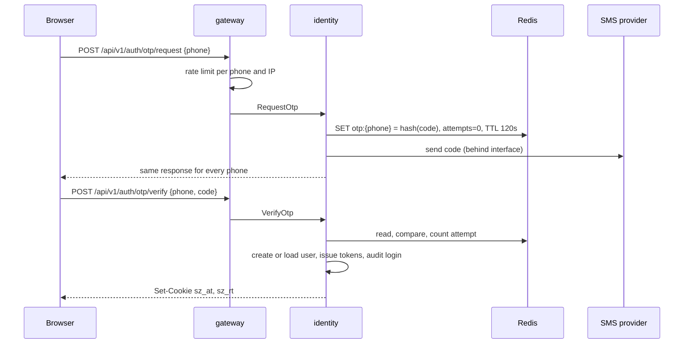

<div dir="rtl">

# ورود و دسترسی

این فصل به یک سؤال جواب می‌دهد: چه کسی وارد سرمیز می‌شود، با چه چیزی ثابت می‌کند خودش است، و کجا و چطور بررسی می‌شود که حق انجام یک کار را دارد؟

[بازگشت به فهرست مستندات](../README.md)

## ۱. چرا مهم است

در سرمیز یک توکن یعنی دسترسی به منو، سفارش‌ها و تنظیم پرداخت یک کسب‌وکار واقعی. اگر کسی با حدس زدن کد پیامکی وارد حساب صاحب یک کافه شود، می‌تواند قیمت‌ها را عوض کند یا درگاه پرداخت را دست بزند. اگر بررسی نقش فقط در یک جا باشد، یک اشتباه در `gateway` کافی است تا داده‌ی یک کسب‌وکار به دیگری برسد. این فصل قاعده‌های بخش ۸ مشخصات فنی را قدم‌به‌قدم توضیح می‌دهد تا بدانی هر قاعده جلوی چه حمله‌ای را می‌گیرد.

## ۲. تصمیم‌ها در یک نگاه

| موضوع | تصمیم | چرا |
|---|---|---|
| ورود پنل | شماره‌ی موبایل و کد یک‌بارمصرف (OTP) ۶ رقمی | صاحب کافه رمز عبور به خاطر نمی‌سپارد؛ شماره‌ی موبایل را همه دارند |
| توکن دسترسی | JWT امضاشده با Ed25519، عمر ۱۵ دقیقه | `gateway` بدون صدا زدن `identity` بررسی‌اش می‌کند؛ عمر کوتاه خسارت دزدی را کم می‌کند |
| توکن تازه‌سازی | تصادفی ۲۵۶ بیتی، ۳۰ روز، در هر استفاده عوض می‌شود، hash آن ذخیره می‌شود | دزدی توکن با استفاده‌ی دوباره لو می‌رود |
| نگه‌داری در مرورگر | کوکی‌های `sz_at` و `sz_rt` با `HttpOnly`، `Secure` و `SameSite=Lax` | جاوااسکریپت (و هر XSS) به توکن نمی‌رسد |
| CSRF | `SameSite=Lax` به‌علاوه‌ی بررسی Origin در `gateway` برای هر متد ناامن | دو لایه، چون هیچ‌کدام به‌تنهایی کافی نیست |
| کلید امضا | از Kubernetes secret؛ کلید عمومی با JWKS از `identity`، کش ۱۰ دقیقه در `gateway` | کلید خصوصی فقط در یک سرویس است |
| نقش‌ها | `owner`، `manager`، `staff` در claim به نام `mem` | جدول دسترسی از هفته‌ی ۱ اجرا می‌شود، حتی اگر رابط کاربری فقط `owner` بسازد |
| بررسی دوباره | `gateway` برای هر مسیر، سرویس برای هر منبع | یک لایه‌ی خراب کل سیستم را باز نکند |
| کسب‌وکار اشتباه | `not_found`، نه `permission_denied` | نشود با حدس شناسه فهمید چه چیزی وجود دارد |
| مهمان | بدون حساب؛ `guest_session_id` برای محدودیت نرخ و `order_token` برای خواندن سفارش | ورود بدون اپ و بدون ثبت‌نام |

## ۳. ورود با کد یک‌بارمصرف، قدم‌به‌قدم

</div>



<div dir="rtl">

1. **درخواست کد.** `gateway` اول محدودیت نرخ را اعمال می‌کند: برای هر شماره یک بار در ۶۰ ثانیه و ۵ بار در ساعت، برای هر IP ۲۰ بار در ساعت ([فصل ۱۱](11-rate-limiting.md)).
2. **ساختن کد.** `identity` شماره را به قالب E.164 در می‌آورد، یک کد ۶ رقمی با `crypto/rand` می‌سازد و فقط hash آن را با شمارنده‌ی تلاش در کلید <span dir="ltr">`otp:{phone}`</span> با TTL ۱۲۰ ثانیه می‌گذارد.
3. **فرستادن.** پیامک از پشت یک interface می‌رود. در `local` پیاده‌سازی `console` کد را در لاگ چاپ می‌کند و در هیچ محیط دیگری روشن نمی‌شود. جزئیات API سرویس پیامک را از مستندات رسمی همان سرویس بردار، نه از حافظه‌ی دستیار.
4. **جواب یکسان.** جواب `RequestOtp` برای شماره‌ی ثبت‌شده و ثبت‌نشده دقیقاً یکی است، تا نشود فهمید چه کسی مشتری سرمیز است.
5. **بررسی کد.** `VerifyOtp` شمارنده را **قبل** از مقایسه بالا می‌برد، hash را با `crypto/subtle` در زمان ثابت مقایسه می‌کند، و بعد از ۵ تلاش اشتباه کد را باطل می‌کند. کد درست هم بعد از یک بار استفاده پاک می‌شود.
6. **کاربر و توکن.** اگر کاربری با این شماره نیست ساخته می‌شود (ثبت‌نام همان ورود اول است)، توکن‌ها صادر می‌شوند، یک ردیف ورود در `audit_log` نوشته می‌شود و دو کوکی تنظیم می‌شوند.

> [!WARNING]
> فضای کد ۶ رقمی فقط یک میلیون حالت دارد. hash ساده‌ی SHA-256 کد را هر کس با دسترسی به Redis در کسری از ثانیه برمی‌گرداند. پیشنهاد اولیه: HMAC با یک کلید از secret، و شماره را هم در ورودی HMAC بگذار. انتخاب نهایی با منتور در `W1-CORE-2` است.

## ۴. توکن‌ها و کوکی‌ها

| چیز | شکل | عمر | کجا نگه داشته می‌شود | نکته |
|---|---|---|---|---|
| توکن دسترسی | JWT با Ed25519؛ claimهای `sub`، `adm`، `mem`، `exp`، `jti` | ۱۵ دقیقه | کوکی `sz_at` | سرور جایی ذخیره‌اش نمی‌کند |
| توکن تازه‌سازی | ۲۵۶ بیت تصادفی، بدون معنا | ۳۰ روز | کوکی `sz_rt` با `Path=/api/v1/auth`؛ hash آن در `refresh_tokens` | در هر استفاده عوض می‌شود |
| کوکی‌ها | `HttpOnly`، `Secure`، `SameSite=Lax` | | مرورگر | توکن هیچ‌وقت در `localStorage` یا بدنه‌ی JSON نمی‌آید |

`Path=/api/v1/auth` یعنی مرورگر `sz_rt` را فقط برای مسیرهای ورود می‌فرستد؛ در هزاران درخواست منو و سفارش اصلاً جابه‌جا نمی‌شود. `Max-Age` کوکی‌ها را مشخصات فنی نگفته؛ پیشنهاد اولیه برابر با عمر همان توکن.

**چرخش و خانواده.** «خانواده» (family) زنجیره‌ی توکن‌های تازه‌سازی‌ای است که از یک ورود ساخته می‌شوند. هنگام ورود یک `family_id` تازه ساخته می‌شود. هر بار که `POST /auth/refresh` صدا زده می‌شود:

1. hash توکن رسیده در `refresh_tokens` پیدا می‌شود.
2. اگر پیدا نشد یا منقضی بود: `unauthenticated`.
3. اگر `revoked_at` آن پر بود، یعنی یک توکن قدیمی دوباره آمده: **همه‌ی** ردیف‌های همان `family_id` باطل می‌شوند و جواب `unauthenticated` است. یا دزد این توکن را داشته یا کاربر واقعی؛ نمی‌دانیم کدام، پس هر دو باید دوباره وارد شوند.
4. وگرنه ردیف فعلی باطل می‌شود، یک ردیف تازه با همان `family_id` ساخته می‌شود، و توکن دسترسی تازه با نقش‌های **فعلی** دیتابیس صادر می‌شود.

مراحل ۳ و ۴ باید در یک تراکنش و با قفل ردیف باشند، وگرنه دو درخواست هم‌زمان هر دو موفق می‌شوند.

> [!CAUTION]
> اگر دو تب پنل هم‌زمان توکن را تازه کنند، دومی توکن باطل‌شده را می‌فرستد و کل خانواده می‌سوزد؛ کاربر بی‌دلیل بیرون می‌افتد. `web` باید در هر لحظه فقط یک درخواست تازه‌سازی در جریان داشته باشد و بقیه منتظر همان بمانند (`W1-WEB-4`). اینکه بین تب‌ها هم هماهنگ شود یا `identity` یک مهلت کوتاه برای توکن تازه‌باطل‌شده بدهد، تصمیم بخش‌های هسته و فرانت با منتور است.

**خروج.** `Logout` توکن تازه‌سازی را باطل می‌کند (پیشنهاد اولیه: کل خانواده‌ی همان دستگاه) و کوکی‌ها را پاک می‌کند. توکن دسترسی تا ۱۵ دقیقه هنوز معتبر است؛ مشخصات فنی فهرست سیاه `jti` ندارد و عمر کوتاه همین را جبران می‌کند.

## ۵. CSRF: دو لایه

CSRF یعنی سایت دیگری مرورگر کاربرِ واردشده را وادار کند به سرمیز درخواست بفرستد و کوکی‌ها خودبه‌خود همراهش بروند.

| لایه | چه می‌کند | چه چیزی را نمی‌پوشاند |
|---|---|---|
| `SameSite=Lax` | مرورگر کوکی را در POST، فرم و fetch از سایت دیگر نمی‌فرستد | ناوبری سطح بالا با GET (کلیک روی لینک) کوکی را می‌برد؛ مرورگرهای قدیمی ممکن است رعایت نکنند |
| بررسی Origin در `gateway` | برای `POST`، `PUT`، `PATCH` و `DELETE`، هدر `Origin` باید در فهرست مجاز Originهای سرمیز باشد؛ وگرنه `permission_denied` | |

نتیجه‌ی مهم: **هیچ GETی نباید چیزی را عوض کند**، چون لایه‌ی اول جلوی GET را نمی‌گیرد و لایه‌ی دوم فقط متدهای ناامن را می‌بیند. callback درگاه (`GET /public/payments/zarinpal/callback`) استثنای ظاهری است: کوکی لازم ندارد و خودش با `authority` و verify سمت سرور امن می‌شود ([فصل ۱۰](10-security-and-payments.md)).

اینکه درخواست ناامنِ بدون هدر `Origin` رد شود یا نه را مشخصات فنی نگفته. پیشنهاد اولیه: رد شود، چون مرورگرهای امروزی برای POST همیشه آن را می‌فرستند. در `W1-PA-4` تصمیم گرفته می‌شود.

## ۶. کلیدها و JWKS

- کلید خصوصی Ed25519 فقط در `identity` است و از یک Kubernetes secret خوانده می‌شود. هیچ‌وقت در repo، لاگ یا <span dir="ltr">`.env.example`</span> نمی‌آید.
- `identity` کلیدهای عمومی را به شکل JWKS (فهرست کلیدهای عمومی به قالب JSON) روی یک نشانی HTTP داخلی منتشر می‌کند.
- `gateway` این فهرست را ۱۰ دقیقه در حافظه نگه می‌دارد و امضا، `exp` و الگوریتم را بررسی می‌کند. فقط `EdDSA` پذیرفته می‌شود؛ توکن با `alg: none` یا الگوریتم دیگر رد می‌شود.

پیشنهاد اولیه برای عوض کردن کلید (مشخصات فنی جزئیاتش را نگفته): هر توکن در هدرش `kid` دارد. کلید تازه را اول فقط در JWKS منتشر کن، بعد از گذشتن زمان کش (۱۰ دقیقه) با آن امضا کن، و کلید قدیمی را وقتی بردار که آخرین توکن امضاشده با آن منقضی شده باشد (۱۵ دقیقه‌ی دیگر).

> [!IMPORTANT]
> `realtime` هم باید ticket را که یک JWT است بررسی کند، ولی طبق جدول بخش ۴٫۱ مشخصات فنی هیچ سرویسی را صدا نمی‌زند. مشخصات فنی نگفته `realtime` کلید عمومی را از کجا می‌گیرد. پیشنهاد اولیه: کلید عمومی از config یا secret به `realtime` داده شود؛ اگر تیم خواست JWKS را از `identity` بخواند، یک سند تصمیم لازم است. این در `W1-ORD-3` با منتور نهایی می‌شود.

## ۷. claim نقش‌ها و قاعده‌ی تازه‌سازی بعد از تغییر

claim `mem` فهرستی از <span dir="ltr">`{v: venue_id, r: role}`</span> است. `gateway` نقش را از همین claim می‌خواند و دیتابیس را نگاه نمی‌کند. نتیجه: توکن تا وقتی منقضی نشده، نقش‌های **لحظه‌ی صدور** را نشان می‌دهد.

| موقعیت | چه می‌شود | چه کار کن |
|---|---|---|
| کاربر تازه کسب‌وکار ساخته (`CreateVenue`) | توکن فعلی هنوز این کسب‌وکار را ندارد و درخواست بعدی `not_found` می‌گیرد | `web` بلافاصله `POST /auth/refresh` را صدا می‌زند و بعد ادامه می‌دهد |
| نقش کسی برداشته شده | تا ۱۵ دقیقه هنوز نقش قدیمی را در توکن دارد | پذیرفته‌شده در انتشار ۱؛ عمر کوتاه توکن سقف خطر است |
| صفحه‌ای که باید نقش واقعی را نشان دهد | | از `GET /me` بخوان؛ این مسیر همیشه از دیتابیس می‌خواند |

## ۸. جدول دسترسی و دو بار بررسی

| کار | `owner` | `manager` | `staff` |
|---|---|---|---|
| دیدن سفارش‌ها، تغییر وضعیت سفارش، رسیدگی به درخواست خدمت، روشن و خاموش کردن «تمام شد» | بله | بله | بله |
| ویرایش منو، میزها، QR، برند، زمان‌بندی، import، ترجمه | بله | بله | نه |
| دیدن گزارش فروش | بله | بله | نه |
| تغییر تنظیم پرداخت، مدیریت اعضا، حذف کسب‌وکار | بله | نه | نه |

**بار اول: `gateway`، برای هر مسیر.** `venue_id` را از مسیر (<span dir="ltr">`/venues/{venue_id}/...`</span>) می‌خواند و در `mem` دنبالش می‌گردد.

- عضو این کسب‌وکار نیست: `not_found`. فرقی با کسب‌وکاری که وجود ندارد نمی‌کند.
- عضو است ولی نقشش کم است: `permission_denied`. این چیزی را لو نمی‌دهد چون کاربر خودش عضو است.
- مجاز است: `x-user-id`، `x-venue-id` و `x-role` را به‌عنوان metadata مطمئن به سرویس می‌دهد.

چون `gateway` از proto ساخته می‌شود، ساده‌ترین شکل یک جدول از نام متد gRPC به نقش‌های مجاز است:

</div>

```go
// example only: the real table lives in gateway and is unit tested
var allowedRoles = map[string][]string{
	"/sarmiz.order.v1.OrderService/UpdateOrderStatus":   {"owner", "manager", "staff"},
	"/sarmiz.catalog.v1.MenuService/SetItemAvailability": {"owner", "manager", "staff"},
	"/sarmiz.catalog.v1.MenuService/UpdateItem":          {"owner", "manager"},
	"/sarmiz.order.v1.ReportService/GetSalesSummary":     {"owner", "manager"},
	"/sarmiz.order.v1.PaymentService/SetPaymentConfig":   {"owner"},
}
```

<div dir="rtl">

متدی که در این جدول نیست باید **رد** شود، نه آزاد. نام دقیق متدهای منو در قرارداد proto (`W1-CORE-4`) مشخص می‌شود.

**بار دوم: سرویس، برای هر منبع.** سرویس `venue_id` را از metadata می‌گیرد و در هر query می‌گذارد: `WHERE id = $1 AND venue_id = $2`. اگر کاربر کسب‌وکار «الف» شناسه‌ی یک آیتم از کسب‌وکار «ب» را در مسیر خودش بگذارد، `gateway` او را رد نمی‌کند (چون `venue_id` مسیر مال خودش است) ولی query چیزی پیدا نمی‌کند و جواب `not_found` است. از هفته‌ی ۴ (`W4-CORE-1`) سرویس‌ها نقش را هم دوباره با همین جدول بررسی می‌کنند.

> [!NOTE]
> مشخصات فنی برای چند کار نقش را صریح نگفته: `MarkPaidAtCounter` (پیشنهاد اولیه: هر سه نقش، چون صندوق‌دار معمولاً `staff` است)، خواندن تنظیم پرداخت (پیشنهاد اولیه: فقط `owner`). «حذف کسب‌وکار» هم در جدول هست ولی متد gRPC آن در بخش ۶٫۲ نیامده. این‌ها در `W4-CORE-1` با منتور نهایی می‌شوند.

## ۹. ادمین‌های پلتفرم

کاربری که `users.is_platform_admin` او درست است، claim `adm` می‌گیرد و فقط به <span dir="ltr">`/admin/*`</span> دسترسی دارد: فهرست کسب‌وکارها، فعال یا معلق کردن، و گذاشتن حالت پرداخت روی `live`. `adm` به‌خودی‌خود نقشی در <span dir="ltr">`/venues/{venue_id}/*`</span> نمی‌دهد. هر تغییر وضعیت کسب‌وکار در `audit_log` ثبت می‌شود. اینکه چه کسی و چطور این ستون را برای اعضای Tecso روشن می‌کند در مشخصات فنی نیامده؛ پیشنهاد اولیه: دستی، توسط منتور، نه از راه هیچ API.

## ۱۰. مهمان‌ها

| چیز | چیست | برای چه | چه چیزی **نیست** |
|---|---|---|---|
| `guest_session_id` | شناسه‌ی تصادفی که مرورگر می‌سازد و در `X-Guest-Session` می‌فرستد | محدودیت نرخ، و «سفارش‌های من در این دستگاه» | مدرک هویت. هر کسی می‌تواند هر مقداری بفرستد |
| `order_token` | ۱۲۸ بیت تصادفی، فقط یک بار در جواب ساخت سفارش برمی‌گردد؛ `order` فقط `order_token_hash` را نگه می‌دارد | خواندن سفارش، شروع پرداخت، امتیاز دادن، گرفتن ticket | قابل بازیابی. اگر مرورگر آن را گم کند، سفارش فقط از پنل دیده می‌شود |

پس «سفارش‌های من» با `guest_session_id` فقط فهرست کوتاه نشان می‌دهد و برای جزئیات هر سفارش باز هم `order_token` لازم است. اینکه توکن در کدام هدر فرستاده شود را مشخصات فنی نگفته؛ پیشنهاد اولیه یک هدر جدا، **نه** query string، چون query string در لاگ ingress و تاریخچه‌ی مرورگر می‌ماند. در `W2-ORD-2` تصمیم گرفته می‌شود.

## ۱۱. ticket برای WebSocket

مرورگر نمی‌تواند روی اتصال WebSocket هدر دلخواه بگذارد، پس احراز هویت با یک ticket در نشانی است: <span dir="ltr">`wss://<host>/ws?ticket=<ticket>`</span>. چون در نشانی است و ممکن است در لاگ بماند، فقط ۶۰ ثانیه عمر دارد. مرورگر آن را با `POST /api/v1/stream-tickets` می‌گیرد و `identity` با `IssueStreamTicket` صادرش می‌کند.

- پنل: کاربر واردشده با یک نقش در کسب‌وکار، scope برابر <span dir="ltr">`venue:<venue_id>`</span>.
- مهمان: با `order_token` معتبر، scope برابر <span dir="ltr">`order:<order_id>`</span>. چون `identity` کسی را صدا نمی‌زند، `gateway` اول توکن سفارش را با `order.ValidateOrderToken` می‌سنجد. این ترتیب از جدول تماس‌های مجاز بخش ۴٫۱ می‌آید؛ قرارداد دقیقش در `W2-ORD-4` نهایی می‌شود.
- `realtime` فقط رویدادهایی را می‌فرستد که `venue_id` یا `order_id` آن‌ها با scope بخواند.
- ticket فقط برای شروع اتصال است. بعد از قطع شدن، مرورگر ticket تازه می‌گیرد.

## ۱۲. اعتماد بین سرویس‌ها در انتشار ۱

- از بیرون فقط `gateway` و `realtime` پشت ingress دیده می‌شوند.
- سرویس‌ها به metadata مثل `x-venue-id` فقط به این دلیل اعتماد می‌کنند که NetworkPolicy نمی‌گذارد کسی جز `gateway` به آن‌ها برسد.
- تماس HTTP داخلی به `ai` یک هدر secret مشترک دارد، به‌علاوه‌ی NetworkPolicy. mTLS و service mesh خارج از محدوده‌ی انتشار ۱ هستند.

> [!CAUTION]
> `gateway` باید هر هدری مثل `x-user-id`، `x-venue-id` یا `x-role` را که از **مرورگر** رسیده دور بریزد و فقط مقدار خودش را بگذارد. اگر grpc-gateway هدرهای ورودی را بدون پالایش به metadata ببرد، هر کسی با یک `curl` نقش `owner` هر کسب‌وکاری را می‌گیرد. این باید تست داشته باشد.

## ۱۳. چه چیزی حتماً تست می‌خواهد

- [ ] کد درست، کد اشتباه، کد منقضی، تلاش ششم بعد از ۵ اشتباه، شماره‌ای که کدی ندارد.
- [ ] جواب `RequestOtp` برای شماره‌ی ثبت‌شده و ثبت‌نشده یکی است.
- [ ] Redis جز hash، هیچ کدی را به شکل خوانا ندارد.
- [ ] چرخش توکن تازه‌سازی، و باطل شدن کل خانواده با توکن قدیمی؛ دو تازه‌سازی هم‌زمان با یک توکن فقط یکی موفق می‌شود.
- [ ] توکن با امضای اشتباه، منقضی، `alg` دیگر، یا `kid` ناشناخته رد می‌شود؛ POST با Origin غیرمجاز هم رد می‌شود.
- [ ] جدول دسترسی: هر نقش در هر ردیف جدول (تست واحد در `gateway` و از هفته‌ی ۴ در سرویس‌ها).
- [ ] کاربر کسب‌وکار «الف» روی همه‌ی مسیرهای پنل کسب‌وکار «ب» `not_found` می‌گیرد (<span dir="ltr">`tests/isolation/`</span>، `W4-PA-3`).
- [ ] هدر `x-venue-id` یا `x-role` فرستاده‌شده از بیرون اثری ندارد.
- [ ] بعد از `CreateVenue` و تازه‌سازی، `mem` کسب‌وکار تازه را دارد.
- [ ] ticket منقضی، ticket با scope کسب‌وکار دیگر، و `order_token` اشتباه رد می‌شوند.
- [ ] کاربر بدون `adm` روی <span dir="ltr">`/admin/*`</span> رد می‌شود و در لاگ‌ها هیچ کد، توکن یا شماره‌ی کاملی نیست.

## چک‌لیست انتشار ۱

- [ ] کلید امضای `production` با `staging` فرق دارد و فقط در Kubernetes secret است.
- [ ] پیامک آزمایشی `console` در `staging` و `production` خاموش است.
- [ ] همه‌ی تست‌های بخش ۱۳ در CI سبزند.
- [ ] فهرست Originهای مجاز فقط دامنه‌های سرمیز را دارد.
- [ ] NetworkPolicy نشان داده شده: از یک Pod دیگر نمی‌شود مستقیم `catalog` یا `order` را صدا زد.
- [ ] ورود، تغییر عضویت و تغییر وضعیت کسب‌وکار در `audit_log` ثبت می‌شوند.
- [ ] منتور همه‌ی کد ورود و دسترسی را بازبینی کرده و بازبینی امنیتی هفته‌ی ۶ (`W6-ALL-1`) بخش ورود را گذرانده است.

## اشتباه‌های رایج

| اشتباه | چرا بد است | چه کار کن |
|---|---|---|
| گذاشتن توکن در `localStorage` «چون راحت‌تر است» | هر XSS توکن را می‌برد | فقط کوکی `HttpOnly` |
| مقایسه‌ی کد با <span dir="ltr">`==`</span> | زمان مقایسه اطلاعات لو می‌دهد | `crypto/subtle.ConstantTimeCompare` روی hash |
| بالا بردن شمارنده بعد از مقایسه | با درخواست‌های هم‌زمان بیش از ۵ حدس ممکن است | اول شمارنده را اتمی بالا ببر، بعد مقایسه کن |
| `permission_denied` برای کسب‌وکار دیگر | می‌شود فهمید کدام شناسه وجود دارد | `not_found` |
| اعتماد به `venue_id` بدنه‌ی درخواست | کاربر هر عددی بفرستد | فقط از metadata مطمئن |
| متد تازه‌ای که در جدول نقش‌ها نیست آزاد می‌ماند | هر کاربر واردشده به آن می‌رسد | پیش‌فرض رد؛ تستی که همه‌ی متدها را با جدول مقایسه کند |
| GET که چیزی را عوض می‌کند | از سد CSRF رد می‌شود | تغییر فقط با متد ناامن |

## کار با AI روی این موضوع

**فایل‌هایی که به دستیار می‌دهی:** `AGENTS.md`، بخش‌های ۶ و ۸ از `docs/SPEC.md`، همین فصل، README سرویس (`services/identity/README.md` یا `services/gateway/README.md`) و متن issue.

طراحی تست قبل از کد:

</div>

```text
روی RefreshToken در سرویس identity کار می‌کنیم. بخش ۸ از docs/SPEC.md و docs/guide/09-auth-and-permissions.md را بخوان.
هنوز کد ننویس. یک جدول تست برای لایه‌ی service بده با این حالت‌ها:
توکن معتبر، توکن منقضی، توکن ناشناخته، توکن باطل‌شده (reuse)، دو درخواست هم‌زمان با یک توکن.
برای هر حالت بگو چه چیزی در refresh_tokens باید عوض شود و جواب چه کد خطایی است.
اگر جایی مشخصات فنی چیزی نگفته، حدس نزن و سؤالش را بنویس.
```

<div dir="rtl">

بازبینی جدول نقش‌ها در `gateway`:

</div>

```text
فایل proto همه‌ی سرویس‌ها و جدول allowedRoles در gateway را بخوان.
با جدول دسترسی بخش ۸ از docs/SPEC.md مقایسه کن.
فهرست بده: متدهایی که در proto هستند ولی در جدول نیستند، و ردیف‌هایی که با مشخصات فنی نمی‌خوانند.
چیزی را خودت تصمیم نگیر؛ برای موارد مبهم سؤال بنویس.
```

<div dir="rtl">

بازبینی امنیتی قبل از PR:

</div>

```text
diff این شاخه را مثل یک بازبین امنیتی بخوان. فقط دنبال این‌ها بگرد:
هدر x-user-id یا x-venue-id یا x-role که از بیرون پذیرفته شود، بررسی JWT بدون محدود کردن alg،
لاگ شدن کد یا توکن یا شماره‌ی کامل، مقایسه‌ی غیر زمان‌ثابت، GET که حالت را عوض کند.
برای هر مورد نام فایل و شماره‌ی خط بده. اگر چیزی پیدا نکردی همین را بگو.
```

<div dir="rtl">

**خودت حتماً بررسی کن:** سناریوی بخش ۹ [تحویل هفته‌ی ۱ هسته](../handoffs/week-1/core.md) را خودت روی `staging` اجرا کن. با `curl` یک هدر `x-role: owner` بفرست و ببین اثری ندارد. یک توکن تازه‌سازی را دو بار بفرست و در دیتابیس ببین کل خانواده باطل شده است. از دستیار نخواه الگوریتم رمزنگاری بنویسد؛ از `crypto/rand`، `crypto/ed25519` و `crypto/subtle` استفاده کن. هیچ توکن یا کد واقعی را در گفت‌وگو نگذار.

## بیشتر بخوان

- [مشخصات فنی](../SPEC.md): بخش ۶٫۱ (مسیرها و خطاها)، بخش ۶٫۲ (metadata مطمئن)، بخش ۶٫۴ (WebSocket)، بخش ۷٫۱ (جدول‌های `identity`)، بخش ۸ (ورود و دسترسی)، بخش ۱۷ (پایه‌ی امنیت).
- [فصل ۱۰: امنیت و پرداخت](10-security-and-payments.md) و [فصل ۱۱: محدودیت نرخ](11-rate-limiting.md).
- [فصل ۵: فرانت](05-frontend.md)، [فصل ۶: API و قراردادها](06-api-and-contracts.md) و [فصل ۸: دیتابیس و ذخیره‌سازی](08-database-and-storage.md).
- [فصل ۱۷: تست](17-testing.md): مجموعه‌ی تست جداسازی.
- README سرویس‌ها: [identity](../../services/identity/README.md)، [gateway](../../services/gateway/README.md)، [realtime](../../services/realtime/README.md).

</div>
