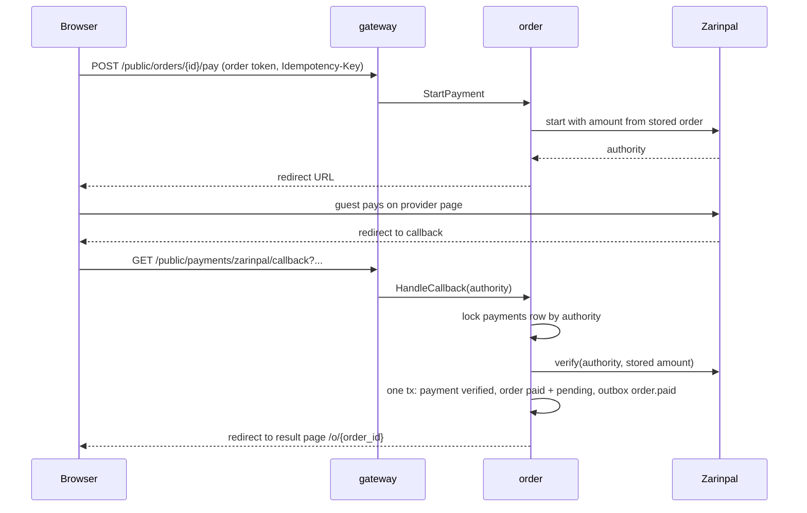

<div dir="rtl">

# امنیت و پرداخت

این فصل به یک سؤال جواب می‌دهد: چه کسی ممکن است به سرمیز حمله کند، کجا، و چطور پرداخت آنلاین را طوری بسازی که پول یک بار، به اندازه‌ی درست و به حساب درست برسد؟

[بازگشت به فهرست مستندات](../README.md)

## ۱. چرا مهم است

سرمیز پول واقعی مهمان‌ها را به حساب کسب‌وکارهای واقعی می‌فرستد و منو و سفارش ده‌ها کافه را کنار هم نگه می‌دارد. یک باگ در تأیید پرداخت یعنی غذای پول‌نداده روی صفحه‌ی آشپزخانه، یا پولی که دو بار کم شده. یک query بدون `venue_id` یعنی سفارش‌های یک کافه جلوی چشم رقیبش. این فصل تهدیدها را یکجا فهرست می‌کند، بخش ۹ و ۱۷ مشخصات فنی را توضیح می‌دهد، و چک‌لیستی می‌دهد که در هر PR و در بازبینی هفته‌ی ۶ از آن استفاده می‌کنی.

## ۲. تصمیم‌ها در یک نگاه

| موضوع | تصمیم | چرا |
|---|---|---|
| مالک پرداخت | سرویس `order`، نه سرویس جدا | علامت زدن سفارش و ثبت پرداخت باید در یک تراکنش باشد ([سند تصمیم ۲](../decisions/0002-order-owns-payments.md)) |
| پول | فقط ریال صحیح؛ مبلغ را سرور از سفارش ذخیره‌شده حساب می‌کند | هیچ عددی از مرورگر یا callback قابل اعتماد نیست |
| درگاه | Zarinpal پشت interface به نام `PaymentProvider`، با یک provider جعلی | مدل تسویه هنوز باز است و کد باید با هر دو جور شود |
| مدل تسویه | **تصمیم باز**؛ Tecso در هیچ حالتی پول کسب‌وکار را نگه نمی‌دارد | [سند تصمیم ۶](../decisions/0006-payment-settlement-model.md) |
| حالت پرداخت | `off`، `sandbox`، `live`؛ تا بازبینی هفته‌ی ۶ فقط sandbox؛ `live` را فقط ادمین پلتفرم روشن می‌کند | پول واقعی فقط بعد از بازبینی کامل |
| اطلاعات درگاه | رمزشده با AES-256-GCM، کلید از secret، هیچ‌وقت لاگ یا کامل برگردانده نمی‌شود | نشت دیتابیس نباید به نشت حساب درگاه برسد |
| بازپرداخت | دستی در انتشار ۱ | کم‌خطرترین راه برای تیم کوچک |
| بازبینی | همه‌ی کد پرداخت و ورود را منتور بازبینی می‌کند | اشتباه این‌جا مستقیم پول است |

## ۳. جدول تهدیدها

| تهدید | کجا می‌زند | دفاع |
|---|---|---|
| نشت داده بین کسب‌وکارها | مسیرهای <span dir="ltr">`/venues/{venue_id}/*`</span>، repositoryها، پخش رویداد در `realtime`، کلیدهای کش | `venue_id` در هر query، `not_found` برای کسب‌وکار دیگر، scope در ticket، `venue_id` در کلید کش، مجموعه‌ی تست <span dir="ltr">`tests/isolation/`</span> ([فصل ۹](09-auth-and-permissions.md)) |
| تصاحب حساب با کد یک‌بارمصرف | <span dir="ltr">`/auth/otp/request`</span> و <span dir="ltr">`/auth/otp/verify`</span> | محدودیت نرخ برای شماره و IP، ۵ تلاش برای هر کد، عمر ۱۲۰ ثانیه، HMAC با کلید secret در Redis، جواب یکسان، تشخیص استفاده‌ی دوباره از توکن تازه‌سازی، ثبت ورود در `audit_log` |
| دست بردن در قیمت | `POST /public/t/{qr_token}/orders` | مرورگر فقط شناسه‌ی آیتم، گزینه‌ها و تعداد را می‌فرستد؛ `order` قیمت را از `catalog.PriceItems` می‌گیرد و جمع را خودش حساب می‌کند |
| تکرار پرداخت یا تأیید دوباره | callback درگاه و job تطبیق | `authority` یکتا، قفل ردیف با `FOR UPDATE`، پرداختِ `verified` همان جواب قبلی را برمی‌گرداند، همه‌چیز در یک تراکنش |
| callback جعلی | `GET /public/payments/zarinpal/callback` | وضعیت داخل query string نادیده گرفته می‌شود؛ فقط verify سمت سرور با مبلغ ذخیره‌شده تصمیم می‌گیرد |
| XSS ذخیره‌شده از متن منو | منوی مهمان، پنل، صفحه‌ی آشپزخانه | React خروجی را escape می‌کند؛ هیچ‌وقت `dangerouslySetInnerHTML` روی متن کاربر یا مدل؛ Content-Security-Policy |
| فایل مخرب | بارگذاری تصویر و import | سقف حجم، بررسی نوع از روی محتوا، decode و ساخت دوباره به WebP، bucket خصوصی برای import، هیچ سرویسی نشانی داده‌شده توسط کاربر را fetch نمی‌کند |
| نشت secret | repo، لاگ، image، گفت‌وگو با AI | gitleaks در CI، فقط Kubernetes secret و GitHub secret، <span dir="ltr">`.env.example`</span> بدون مقدار، لاگ بدون توکن و کد و credential |
| سوءاستفاده و scraping | منوی عمومی، ساخت سفارش، دستیار AI، پیامک | محدودیت‌های بخش ۱۰ مشخصات فنی ([فصل ۱۱](11-rate-limiting.md))، سفارش آنلاین تا پرداخت به آشپزخانه نمی‌رسد |
| prompt injection علیه گارسون AI | <span dir="ltr">`/public/t/{qr_token}/assistant`</span>، متن منو | دستیار ابزار و اثر جانبی ندارد، فقط از منوی همان کسب‌وکار جواب می‌دهد، خروجی متن ساده است، سؤال بی‌ربط رد می‌شود، مجموعه‌ی ارزیابی با سؤال‌های injection |
| جعل هدر نقش | `gateway` | هدرهای `x-user-id`، `x-venue-id` و `x-role` ورودی دور ریخته می‌شوند؛ NetworkPolicy |
| CSRF | همه‌ی متدهای ناامن | `SameSite=Lax` به‌علاوه‌ی بررسی Origin |

## ۴. پایه‌ی امنیت (بخش ۱۷ مشخصات فنی)

| قاعده | یعنی در عمل | کار مرتبط |
|---|---|---|
| ورودی دو بار اعتبارسنجی می‌شود | `protovalidate` در لبه و دوباره در لایه‌ی service؛ SQL فقط با پارامتر | همه |
| خروجی escape می‌شود | متن کاربر یا مدل هیچ‌وقت HTML رندر نمی‌شود | فرانت |
| headerهای امنیتی | HSTS، Content-Security-Policy، `X-Content-Type-Options: nosniff`، `Referrer-Policy`، <span dir="ltr">`frame-ancestors 'none'`</span> از ingress و وب‌سرور | `W4-PA-2` |
| CORS | فقط Originهای سرمیز | `W1-PA-4` |
| secretها | فقط Kubernetes secret و GitHub secret؛ <span dir="ltr">`.env`</span> در gitignore | `W1-PA-1`، `W1-PA-5` |
| کمترین دسترسی | یک نقش دیتابیس برای هر سرویس، NetworkPolicy، container بدون root، root filesystem فقط‌خواندنی هر جا ممکن است | `W4-PA-2` |
| ثبت کارهای حساس | ورود، تغییر عضویت، تغییر تنظیم پرداخت، تغییر وضعیت کسب‌وکار در `audit_log` | `W4-CORE-1`، `W4-ORD-1` |
| داده‌ی شخصی | فقط نام و شماره‌ی صاحب کسب‌وکار؛ مهمان در انتشار ۱ داده‌ی شخصی نمی‌گذارد | همه |
| AI | متن منو و پیام مهمان ورودی ناامن‌اند؛ دستیار ابزار ندارد و خروجی‌اش متن ساده است | پلتفرم و هوش مصنوعی |
| بدون fetch نشانی کاربر | هیچ سرویسی URLی را که کاربر داده باز نمی‌کند (جلوی SSRF، یعنی وادار کردن سرور به درخواست به شبکه‌ی داخلی) | همه |
| AI و داده‌ی واقعی | secret، credential، داده‌ی `production` یا داده‌ی واقعی مشتری در دستیار AI گذاشته نمی‌شود | همه |

## ۵. تصمیم باز: مدل تسویه

منتور باید قبل از هفته‌ی ۴ از Zarinpal بپرسد کدام مدل مجاز است. نتیجه در [سند تصمیم ۶](../decisions/0006-payment-settlement-model.md) ثبت می‌شود.

| | مدل A: merchant هر کسب‌وکار | مدل B: یک حساب سرمیز با تسویه‌ی تقسیمی |
|---|---|---|
| چطور | هر کسب‌وکار شناسه‌ی merchant خودش را در پنل وارد می‌کند | سرمیز یک حساب merchant دارد و قابلیت split-settlement درگاه سهم هر پرداخت را مستقیم به حساب بانکی کسب‌وکار می‌فرستد |
| مزیت | پول مستقیم به حساب خود کسب‌وکار می‌رود؛ رابطه‌ی حقوقی ساده | یک بار راه‌اندازی برای همه؛ کسب‌وکار درگیر ثبت درگاه نمی‌شود |
| ریسک | Zarinpal شناسه‌ی merchant را به یک وب‌سایت ثبت‌شده گره می‌زند، پس callback روی دامنه‌ی سرمیز ممکن است رد شود | به قرارداد و تأیید این قابلیت از طرف درگاه وابسته است؛ سرمیز باید اطلاعات تسویه‌ی هر کسب‌وکار را درست نگه دارد |
| در `payment_configs` (برداشت اولیه) | بیشتر `credentials_enc` به کار می‌آید | بیشتر `settlement` به کار می‌آید |

در هر دو مدل Tecso پول کسب‌وکار را نگه نمی‌دارد، و کد پشت `PaymentProvider` نوشته می‌شود تا هر کدام انتخاب شد، فقط پیاده‌سازی provider عوض شود.

## ۶. ایده‌ی `PaymentProvider`

</div>

```go
// example only: final shape is decided in W3-ORD-4 with the mentor
type PaymentProvider interface {
	// Start registers a payment and returns the provider's authority and the redirect URL.
	Start(ctx context.Context, req StartRequest) (StartResult, error)
	// Verify asks the provider whether this authority was paid for exactly this amount.
	Verify(ctx context.Context, authority string, amountRial int64) (VerifyResult, error)
}
```

<div dir="rtl">

- بقیه‌ی سرویس `order` فقط این interface را می‌شناسد، نه Zarinpal را.
- provider جعلی برای `local` و تست‌ها همه‌ی حالت‌ها را می‌سازد: موفق، ناموفق، timeout، و callback تکراری.
- نشانی‌ها، فیلدها، کدهای خطا و حتی واحد پولی که درگاه می‌خواهد را از **مستندات رسمی فعلی Zarinpal** در هفته‌ی ۴ بردار، نه از حافظه و نه از دستیار AI. هر تبدیل واحد فقط داخل پیاده‌سازی provider است؛ بقیه‌ی کد همیشه ریال است.

## ۷. نُه قاعده‌ی پرداخت

1. **مبلغ.** ریال صحیح. سرور مبلغ را از سفارش ذخیره‌شده حساب می‌کند. هیچ چیز از مرورگر یا پارامترهای callback قابل اعتماد نیست.
2. **`StartPayment`.** فقط برای سفارشی با `payment_method = online` و `payment_status` برابر `unpaid` یا `failed`. یک ردیف `payments` می‌سازد، provider را صدا می‌زند، `authority` یکتا را ذخیره می‌کند و نشانی redirect را برمی‌گرداند.
3. **`HandleCallback`.** پرداخت را از روی `authority` می‌خواند و ردیف را قفل می‌کند. اگر قبلاً `verified` شده، همان نتیجه را دوباره برمی‌گرداند. وگرنه verify درگاه را با مبلغ ذخیره‌شده صدا می‌زند؛ در صورت موفقیت، پرداخت `verified`، سفارش `paid` و `pending`، و ردیف `outbox` برای `order.paid`، همه در یک تراکنش.
4. **تطبیق.** یک job هر ۵ دقیقه پرداخت‌هایی را که بیش از ۲ دقیقه `initiated` مانده‌اند دوباره بررسی می‌کند، چون مهمان ممکن است بعد از پرداخت مرورگر را ببندد.
5. **sandbox.** تا بازبینی امنیتی هفته‌ی ۶ فقط sandbox. فقط ادمین پلتفرم کسب‌وکار را `live` می‌کند.
6. **اطلاعات درگاه.** رمزشده با AES-256-GCM و کلید از secret؛ هیچ‌وقت لاگ نمی‌شود و هیچ API آن را کامل برنمی‌گرداند.
7. **بازپرداخت.** دستی: صاحب کسب‌وکار در پنل خود درگاه بازپرداخت می‌کند و سفارش را `refunded` علامت می‌زند.
8. **ثبت تغییر.** هر تغییر تنظیم پرداخت یک ردیف `audit_log` می‌نویسد.
9. **بازبینی.** همه‌ی کد پرداخت و ورود قبل از ادغام بازبینی منتور می‌خواهد.

## ۸. مسیر کامل پرداخت آنلاین

</div>



<div dir="rtl">

مسیر دقیق شروع پرداخت در قرارداد proto سفارش نهایی می‌شود؛ مشخصات فنی فقط `POST .../pay` با `Idempotency-Key` را گفته است.

نکته‌های این مسیر:

- callback از مرورگر مهمان می‌آید، نه مستقیم از درگاه. پس هر کسی می‌تواند هر query stringی بسازد. تنها چیزی که از آن برمی‌داری `authority` است تا ردیف را پیدا کنی.
- `authority` ناشناخته یعنی صفحه‌ی خطا، نه خطای داخلی.
- تماس verify وسط تراکنش و با قفل است، پس timeout کوتاه می‌خواهد ([فصل ۸](08-database-and-storage.md)، بخش ۸).
- اگر verify ناموفق بود، پرداخت `failed` می‌شود و مهمان می‌تواند دوباره پرداخت کند (قاعده‌ی ۲).

## ۹. job تطبیق

مهمان پول را داده، ولی قبل از برگشتن به سرمیز اینترنتش قطع شده است. callback هیچ‌وقت نمی‌رسد. بدون job تطبیق، سفارش بعد از ۱۵ دقیقه خودکار لغو می‌شود در حالی که پولش رفته است.

1. هر ۵ دقیقه، پرداخت‌های `initiated` قدیمی‌تر از ۲ دقیقه را پیدا کن.
2. برای هر کدام **همان** تابعی را صدا بزن که `HandleCallback` صدا می‌زند: قفل، بررسی وضعیت، verify با مبلغ ذخیره‌شده، یک تراکنش.
3. چون از دو نسخه‌ی `order` دو job هم‌زمان اجرا می‌شود، قفل ردیف نمی‌گذارد یک پرداخت دو بار پردازش شود.
4. تعداد پرداخت‌هایی که job تأیید کرد را به‌عنوان متریک نگه دار؛ عدد بالا یعنی مسیر callback ایراد دارد.

> [!WARNING]
> دو حالت را مشخصات فنی دقیق نگفته و باید در `W3-ORD-4` با منتور تصمیم گرفته شود: job تا کی برای یک پرداخت بی‌جواب تلاش کند و کی آن را `failed` بزند (پیشنهاد اولیه: تا لحظه‌ی انقضای ۱۵ دقیقه‌ای سفارش)، و اگر پولِ سفارشی که تازه لغو شده تأیید شد چه شود (پیشنهاد اولیه: سفارش لغوشده دوباره باز نشود، در `audit_log` ثبت و هشدار داده شود، و بازپرداخت دستی انجام شود).

## ۱۰. sandbox تا تأیید

| حالت | چه کسی تنظیم می‌کند | یعنی چه |
|---|---|---|
| `off` | پیش‌فرض (پیشنهاد اولیه) | فقط پرداخت در صندوق |
| `sandbox` | صاحب کسب‌وکار در پنل (`SetPaymentConfig`) | پرداخت آزمایشی با sandbox درگاه |
| `live` | فقط ادمین پلتفرم (`AdminSetPaymentMode`) | پول واقعی |

هر ردیف `payments` حالت خودش را ذخیره می‌کند، تا پرداخت sandbox هیچ‌وقت با پرداخت واقعی قاطی نشود. در `W6-ALL-3` فقط یک پرداخت واقعی با مبلغ کم روی یک کسب‌وکار آزمایشی انجام می‌شود، با حضور منتور.

## ۱۱. چرا آشپزخانه سفارش آنلاین را بعد از پرداخت می‌بیند

سفارش آنلاین با وضعیت `awaiting_payment` ساخته می‌شود و فقط وقتی پرداختش تأیید شد به `pending` می‌رود. صفحه‌ی آشپزخانه هیچ‌وقت سفارش `awaiting_payment` را نمی‌بیند.

- **غذای پول‌نداده.** مهمانی که در صفحه‌ی درگاه منصرف می‌شود، نباید آشپز را به کار بیندازد.
- **سفارش جعلی.** هر کسی می‌تواند QR را اسکن کند. بدون این قاعده، یک اسکریپت آشپزخانه را با سفارش پر می‌کند.
- **ترتیب ساده.** آشپزخانه فقط یک قاعده دارد: هر چیزی که روی صفحه است باید آماده شود.

سفارش پرداخت در صندوق مستقیم با `pending` شروع می‌شود؛ آنجا محدودیت نرخ برای هر نشست مهمان و هر میز جلوی سوءاستفاده را می‌گیرد. این قاعده را سرور اعمال می‌کند، نه فقط رابط کاربری؛ جزئیاتش در `W2-ORD-2` و `W3-WEB-3` است.

## ۱۲. چک‌لیست امنیتی هر PR

این را در توضیح PR تیک بزن. اگر موردی به PR تو ربط ندارد، بنویس «ندارد».

- [ ] هر query روی داده‌ی کسب‌وکار `venue_id` را از metadata مطمئن در `WHERE` دارد.
- [ ] منبع کسب‌وکار دیگر `not_found` می‌دهد و تست دارد.
- [ ] هیچ مبلغ، وضعیت یا نقشی از مرورگر پذیرفته نمی‌شود.
- [ ] ورودی در proto با `protovalidate` و در service دوباره بررسی شده؛ SQL فقط با پارامتر.
- [ ] هیچ متن کاربر یا مدل به شکل HTML رندر نمی‌شود.
- [ ] هیچ کد، توکن، credential یا شماره‌ی کامل در لاگ، خطا یا تست نیست.
- [ ] هیچ secretی در diff نیست و gitleaks سبز است.
- [ ] پیام خطا جزئیات داخلی (SQL، stack trace، نام سرویس) را لو نمی‌دهد.
- [ ] مسیر یا متد تازه در جدول نقش‌های `gateway` ثبت شده و محدودیت نرخ لازم را دارد.
- [ ] اگر به پرداخت یا ورود دست زده‌ای: PR جداست و منتور بازبین است.

## ۱۳. چک‌لیست بازبینی امنیتی هفته‌ی ۶

این چک‌لیست `W6-ALL-1` است. برای هر مورد، مدرک (نام تست، خروجی دستور، اسکرین‌شات) را در issue همان کار بگذار. هر مورد شکست‌خورده جدی قبل از روشن کردن `live` درست می‌شود.

**ورود**

- [ ] تست‌های فهرست بخش ۱۳ [فصل ۹](09-auth-and-permissions.md) در CI سبزند.
- [ ] تلاش ششم روی یک کد رد می‌شود؛ درخواست کد دوم زودتر از ۶۰ ثانیه `429` می‌گیرد.
- [ ] استفاده‌ی دوباره از توکن تازه‌سازی کل خانواده را باطل می‌کند (دستی روی `staging` امتحان شده).
- [ ] کلید امضای `production` فقط در secret است و با `staging` فرق دارد.
- [ ] POST با `Origin` غیرمجاز رد می‌شود؛ کوکی‌ها `HttpOnly`، `Secure` و `SameSite=Lax` دارند.

**جداسازی کسب‌وکارها**

- [ ] <span dir="ltr">`tests/isolation/`</span> همه‌ی مسیرهای پنل را با دو کسب‌وکار امتحان می‌کند و سبز است.
- [ ] جدول نقش‌ها برای هر سه نقش تست دارد؛ هیچ متدی بدون ردیف در جدول نیست.
- [ ] هدرهای `x-venue-id` و `x-role` فرستاده‌شده با `curl` اثری ندارند.
- [ ] ticket کسب‌وکار «الف» رویدادهای کسب‌وکار «ب» را دریافت نمی‌کند.

**پرداخت**

- [ ] callback با query string دست‌کاری‌شده سفارش را `paid` نمی‌کند.
- [ ] callback دو بار پشت‌سرهم یک پرداخت `verified` و یک رویداد `order.paid` می‌سازد.
- [ ] callback هم‌زمان با job تطبیق فقط یک بار پردازش می‌شود (تست هم‌زمانی).
- [ ] مبلغ verify همیشه `amount_rial` ذخیره‌شده است؛ تغییر قیمت منو بعد از سفارش مبلغ را عوض نمی‌کند.
- [ ] `credentials_enc` در دیتابیس رمزشده است و هیچ API و هیچ لاگی آن را کامل نشان نمی‌دهد.
- [ ] صاحب کسب‌وکار نمی‌تواند `live` را روشن کند؛ هر تغییر تنظیم پرداخت در `audit_log` هست.
- [ ] منتور کد پرداخت را خط‌به‌خط بازبینی کرده است.

**ورودی و خروجی**

- [ ] نام آیتم <span dir="ltr">`<script>alert(1)</script>`</span> در منوی مهمان، پنل و صفحه‌ی آشپزخانه متن ساده نشان داده می‌شود.
- [ ] فایل غیرتصویری با پسوند <span dir="ltr">`.jpg`</span>، فایل بزرگ‌تر از ۵ مگابایت، و بدنه‌ی JSON بزرگ‌تر از ۱ مگابایت رد می‌شوند.
- [ ] تصویر بارگذاری‌شده metadata (مثل GPS) ندارد.
- [ ] هیچ خطای ۵۰۰ متن داخلی یا SQL برنمی‌گرداند.

**secretها**

- [ ] gitleaks روی کل تاریخچه‌ی repo تمیز است.
- [ ] <span dir="ltr">`.env.example`</span> هیچ مقداری ندارد؛ هیچ secretی در image یا Helm values نیست.
- [ ] در Loki جست‌وجوی کد، توکن و شماره‌ی کامل چیزی پیدا نمی‌کند.

**زیرساخت**

- [ ] از اینترنت فقط ingress در دسترس است؛ پورت PostgreSQL، Redis، NATS و Grafana بسته است.
- [ ] NetworkPolicy: از یک Pod آزمایشی نمی‌شود مستقیم `catalog`، `order` یا `ai` را صدا زد.
- [ ] containerها بدون root اجرا می‌شوند؛ Trivy، govulncheck، npm audit و pip-audit یافته‌ی بحرانی بازی ندارند.
- [ ] headerهای امنیتی بخش ۴ روی دامنه‌ی `production` دیده می‌شوند.
- [ ] پشتیبان رمزشده است و یک بار بازیابی شده ([فصل ۲۱](21-backup-and-recovery.md)).

**AI**

- [ ] تماس به `ai` بدون هدر secret مشترک رد می‌شود.
- [ ] سؤال‌های prompt injection مجموعه‌ی ارزیابی ۳۰ سؤالی رد یا بی‌اثر می‌شوند؛ آیتمی که در منو نیست پیشنهاد نمی‌شود.
- [ ] جواب دستیار متن ساده نشان داده می‌شود و محدودیت نرخ هر نشست و هر کسب‌وکار کار می‌کند.

## چک‌لیست انتشار ۱

- [ ] مدل تسویه تصمیم گرفته شده و [سند تصمیم ۶](../decisions/0006-payment-settlement-model.md) پر است.
- [ ] مسیر پرداخت sandbox در `staging` دقیقاً یک بار سفارش را `paid` می‌کند (معیار هفته‌ی ۴).
- [ ] job تطبیق در `staging` اجرا می‌شود و یک پرداخت بدون callback را درست می‌کند.
- [ ] هشدار «بیش از ۳ تأیید ناموفق در ۱۰ دقیقه» تنظیم و یک بار امتحان شده است.
- [ ] چک‌لیست بخش ۱۳ کامل است و یافته‌های جدی بسته شده‌اند.
- [ ] پرداخت واقعی `W6-ALL-3` انجام و نتیجه‌اش ثبت شده است.

## اشتباه‌های رایج

| اشتباه | چرا بد است | چه کار کن |
|---|---|---|
| خواندن وضعیت «موفق» از query string callback | هر کسی آن را می‌سازد | فقط verify سمت سرور |
| فرستادن مبلغ از مرورگر به `StartPayment` | مهمان مبلغ را کم می‌کند | مبلغ از سفارش ذخیره‌شده |
| verify بدون قفل ردیف | دو callback هم‌زمان دو رویداد `order.paid` می‌سازند | `SELECT ... FOR UPDATE` و بررسی `verified` |
| ثبت پرداخت و تغییر سفارش در دو تراکنش | پرداخت ثبت شده ولی سفارش هنوز منتظر است | یک تراکنش، به‌علاوه‌ی `outbox` |
| نوشتن نشانی و فیلدهای Zarinpal از حافظه‌ی دستیار | ممکن است قدیمی یا ساختگی باشد | مستندات رسمی فعلی |
| لاگ کردن کل پاسخ درگاه یا تنظیم پرداخت | اطلاعات حساس در Loki | فیلدهای لازم، بدون credential |
| `dangerouslySetInnerHTML` برای توضیح آیتم | XSS ذخیره‌شده | متن ساده |
| کار جدا برای job تطبیق با منطق خودش | دو مسیر با دو رفتار متفاوت | یک تابع مشترک با `HandleCallback` |

## کار با AI روی این موضوع

**فایل‌هایی که به دستیار می‌دهی:** `AGENTS.md`، بخش‌های ۷٫۳، ۹ و ۱۷ از `docs/SPEC.md`، همین فصل، [فصل ۸](08-database-and-storage.md)، `services/order/README.md`، و بخش مرتبط از مستندات رسمی Zarinpal که **خودت** کپی کرده‌ای.

طراحی تست `HandleCallback`:

</div>

```text
روی HandleCallback در سرویس order کار می‌کنیم. بخش ۹ از docs/SPEC.md و docs/guide/10-security-and-payments.md را بخوان.
هنوز کد ننویس. یک جدول تست با provider جعلی بده برای این حالت‌ها:
verify موفق، verify ناموفق، authority ناشناخته، callback دوم بعد از verified، callback هم‌زمان با job تطبیق، timeout درگاه.
برای هر حالت بگو بعد از تست، payments و orders و outbox باید چه وضعیتی داشته باشند.
هیچ نشانی یا فیلد Zarinpal ننویس؛ فقط PaymentProvider.
```

<div dir="rtl">

بازبینی امنیتی diff پرداخت:

</div>

```text
diff این شاخه را مثل یک بازبین امنیتی سخت‌گیر بخوان، با نه قاعده‌ی بخش ۹ از docs/SPEC.md.
برای هر قاعده بگو رعایت شده، نقض شده یا به این diff ربطی ندارد، با نام فایل و شماره‌ی خط.
به‌خصوص دنبال این‌ها بگرد: مبلغ یا وضعیت از ورودی، تراکنش جدا، نبود قفل، لاگ شدن credential.
```

<div dir="rtl">

ساختن سناریوهای حمله برای بازبینی هفته‌ی ۶:

</div>

```text
چک‌لیست بخش ۱۳ از docs/guide/10-security-and-payments.md را بخوان.
برای بخش «جداسازی کسب‌وکارها» و «پرداخت»، برای هر مورد یک دستور curl یا یک تست Go پیشنهاد بده که روی staging اجرا شود.
از داده‌ی واقعی، secret یا توکن واقعی استفاده نکن؛ جای آن‌ها متغیر محیطی بگذار.
```

<div dir="rtl">

**خودت حتماً بررسی کن:** نشانی، فیلد و کد خطای درگاه را خودت با مستندات رسمی مقایسه کن. تست هم‌زمانی را خودت با <span dir="ltr">`-race`</span> و چند بار اجرا کن. هیچ credential درگاه، حتی sandbox، را در گفت‌وگو با دستیار نگذار. هر خط کد پرداخت را باید بتوانی برای منتور توضیح بدهی.

## بیشتر بخوان

- [مشخصات فنی](../SPEC.md): بخش ۴٫۲ (چرا `order` مالک پرداخت است)، بخش ۴٫۳ (جریان پرداخت)، بخش ۷٫۳ (جدول‌ها و ماشین وضعیت)، بخش ۹ (پرداخت)، بخش ۱۲ (هشدار پرداخت)، بخش ۱۷ (پایه‌ی امنیت).
- [سند تصمیم ۲](../decisions/0002-order-owns-payments.md) و [سند تصمیم ۶](../decisions/0006-payment-settlement-model.md).
- [فصل ۹: ورود و دسترسی](09-auth-and-permissions.md)، [فصل ۱۱: محدودیت نرخ](11-rate-limiting.md)، [فصل ۸: دیتابیس و ذخیره‌سازی](08-database-and-storage.md).
- [فصل ۱۹: سرویس AI](19-ai-service.md)، [فصل ۲۳: حریم خصوصی، حقوق و هزینه](23-privacy-legal-cost.md).
- README سرویس [order](../../services/order/README.md).

</div>
