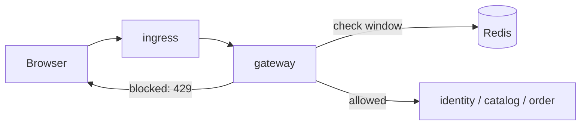

<div dir="rtl">

# محدودیت نرخ

این فصل به یک سؤال جواب می‌دهد: هر کس چند بار در چه مدتی می‌تواند یک کار را در سرمیز انجام دهد، این شمارش کجا و چطور انجام می‌شود، و وقتی کسی از سقف رد شد چه اتفاقی می‌افتد؟

[بازگشت به فهرست مستندات](../README.md)

## ۱. چرا مهم است

هر درخواست کد ورود یک پیامک است و پیامک پول دارد؛ بدون سقف، یک اسکریپت ساده هم هزینه‌ی سرمیز را بالا می‌برد و هم گوشی یک آدم بی‌گناه را با پیامک بمباران می‌کند. سفارش ساختن بدون حساب است، پس بدون سقف، یک نفر می‌تواند صفحه‌ی آشپزخانه‌ی یک کافه را با سفارش جعلی پر کند. گارسون AI روی سرور مدل خودمان اجرا می‌شود و ظرفیتش محدود است؛ یک مهمان پرحرف نباید آن را برای بقیه از کار بیندازد. محدودیت نرخ ارزان‌ترین دفاع در برابر هر سه است.

## ۲. تصمیم‌ها در یک نگاه

| موضوع | تصمیم | چرا |
|---|---|---|
| کجا | در `gateway` | یک جا برای همه‌ی مسیرها؛ درخواست ردشده به سرویس‌ها نمی‌رسد |
| چطور | پنجره‌ی لغزان (sliding window) در Redis | منصفانه‌تر از پنجره‌ی ثابت؛ همه‌ی نسخه‌های `gateway` یک شمارش مشترک می‌بینند |
| جواب ردشده | `429`، کد خطای `rate_limited` و هدر `Retry-After` | مرورگر می‌داند کی دوباره امتحان کند |
| عددها | جدول بخش ۱۰ مشخصات فنی، به‌عنوان مقدار شروع | بعد از آزمون بار تنظیم می‌شوند |
| Redis پایین | OTP بسته (fail closed)، منوی عمومی باز (fail open) | پیامک بی‌سقف خطرناک‌تر از ورود موقتاً ناممکن است؛ منو باید همیشه باز شود |
| حجم بدنه | ۱ مگابایت برای JSON، ۶ مگابایت برای بارگذاری | بدنه‌ی بزرگ حافظه و CPU را می‌خورد |
| تلاش‌های هر کد OTP | در خود `identity` | این شمارش به خود کد گره خورده، نه به درخواست |

## ۳. کجا اعمال می‌شود و چه چیزی در سرویس‌ها می‌ماند

</div>



<div dir="rtl">

| در `gateway` | در سرویس |
|---|---|
| همه‌ی سقف‌های جدول بخش ۴، بر اساس IP، شماره، نشست مهمان، میز، کاربر | ۵ تلاش برای **هر کد** OTP در `identity`، چون با کد تازه از صفر شروع می‌شود و در همان کلید <span dir="ltr">`otp:{phone}`</span> است |
| حجم بدنه | انقضای خودکار سفارش آنلاین پرداخت‌نشده بعد از ۱۵ دقیقه در `order` (این محدودیت نرخ نیست، ولی جلوی انباشت سفارش را می‌گیرد) |

> [!NOTE]
> مشخصات فنی همه‌ی سقف‌ها را در `gateway` گذاشته، ولی فهرست کارها سقف درخواست خدمت هر میز را در `W3-ORD-1` و سقف‌های گارسون AI را در `W5-CORE-1` هم آورده است. سقف «هر کسب‌وکار» به `venue_id` نیاز دارد که `gateway` از مسیر <span dir="ltr">`/public/t/{qr_token}/assistant`</span> ندارد. پیشنهاد اولیه: سقف هر کسب‌وکار برای گارسون در `catalog` بعد از پیدا کردن میز اعمال شود و بقیه در `gateway`. زوج‌های پلتفرم و هسته در `W2-PA-1` این را با منتور نهایی می‌کنند.

## ۴. جدول کامل سقف‌ها

| دامنه | سقف | کلید شمارش | جلوی چه چیزی |
|---|---|---|---|
| هر IP، همه‌ی مسیرها | ۳۰۰ در دقیقه | IP | سیل کلی درخواست |
| درخواست OTP، هر شماره | ۱ در ۶۰ ثانیه و ۵ در ساعت | شماره‌ی E.164 | بمباران پیامکی یک نفر |
| درخواست OTP، هر IP | ۲۰ در ساعت | IP | پیامک به شماره‌های زیاد از یک جا |
| تأیید OTP، هر شماره | ۱۰ در ۱۰ دقیقه، و ۵ تلاش برای هر کد | شماره | حدس زدن کد |
| منوی عمومی، هر IP | ۱۲۰ در دقیقه | IP | جمع‌آوری خودکار منوها (scraping) |
| ساخت سفارش، هر نشست مهمان | ۵ در ۵ دقیقه | `guest_session_id` | سفارش‌های پشت‌سرهم از یک گوشی |
| ساخت سفارش، هر میز | ۲۰ در ۵ دقیقه | `qr_token` | سیل سفارش روی یک میز با نشست‌های عوض‌شونده |
| ساخت سفارش، هر IP | ۶۰ در ساعت | IP | اسکریپتی که میز و نشست را عوض می‌کند |
| درخواست خدمت، هر میز و نوع | ۱ در ۶۰ ثانیه | `qr_token` و `type` | زنگ زدن پشت‌سرهم گارسون |
| گارسون AI، هر نشست مهمان | ۱۰ در ۵ دقیقه | `guest_session_id` | یک مهمان پرحرف |
| گارسون AI، هر کسب‌وکار | ۲۰۰ در روز | `venue_id` | هزینه و ظرفیت مدل |
| بارگذاری، هر کاربر | ۳۰ در ساعت | `sub` توکن | پر کردن object storage |
| API پنل، هر کاربر | ۶۰۰ در دقیقه | `sub` توکن | باگ یا اسکریپت در پنل |

یک درخواست ممکن است زیر چند سقف باشد. ساخت سفارش هم سقف IP کلی را می‌شمارد، هم سه سقف خودش را؛ اولین سقفی که پر شود درخواست را رد می‌کند.

## ۵. پنجره‌ی لغزان، ساده

پنجره‌ی ثابت («از دقیقه‌ی ۱۲:۰۰ تا ۱۲:۰۱») یک ایراد دارد: کسی می‌تواند ۵ درخواست در ثانیه‌ی آخر یک پنجره و ۵ درخواست در ثانیه‌ی اول پنجره‌ی بعد بفرستد، یعنی دو برابر سقف در دو ثانیه. پنجره‌ی لغزان همیشه به «۶۰ ثانیه‌ی گذشته از همین لحظه» نگاه می‌کند.

یک پیاده‌سازی ساده با sorted set (مجموعه‌ی مرتب) در Redis، برای «۵ سفارش در ۵ دقیقه برای هر نشست»:

</div>

```text
// now = 1700000300000 ms, window = 300000 ms, limit = 5
ZREMRANGEBYSCORE rl:order:gs:{guest_session_id} 0 1700000000000   // drop entries older than the window
ZCARD            rl:order:gs:{guest_session_id}                   // count what is left
// if count < 5:
ZADD             rl:order:gs:{guest_session_id} 1700000300000 {request_id}
PEXPIRE          rl:order:gs:{guest_session_id} 300000
// else: reject; Retry-After = oldest entry score + window - now
```

<div dir="rtl">

- این چند دستور باید **اتمی** اجرا شوند، وگرنه دو درخواست هم‌زمان هر دو «۴» می‌بینند و هر دو رد نمی‌شوند. پیشنهاد اولیه: یک اسکریپت Lua در Redis.
- هر کلید TTL دارد، پس شمارنده‌ی کسی که دیگر نمی‌آید خودش پاک می‌شود.
- برای سقف‌های بزرگ (۶۰۰ در دقیقه) sorted set تا ۶۰۰ عضو دارد. در مقیاس بخش ۳ مشخصات فنی مشکلی نیست؛ اگر شد، روش «شمارنده‌ی لغزان» (دو پنجره‌ی ثابت با وزن) حافظه‌ی کمتری می‌خواهد.
- الگوریتم دقیق و قالب نام کلیدها (مثل <span dir="ltr">`rl:<scope>:<id>`</span> بالا) را مشخصات فنی نگفته و در `W2-PA-1` تصمیم گرفته می‌شود. فقط باید در شاسی یا `gateway` یک جا پیاده شود، نه در هر مسیر جدا.

## ۶. کلیدها و دام‌های هر کدام

| کلید | از کجا می‌آید | دام | چه کار کن |
|---|---|---|---|
| IP | هدری که ingress می‌گذارد | `gateway` پشت ingress است و IP مستقیم اتصال همیشه IP خود ingress است؛ همه‌ی دنیا یک IP می‌شوند | IP واقعی را از هدری بخوان که ingress (یا CDN) می‌گذارد، و فقط وقتی درخواست از همان proxyهای مطمئن آمده |
| IP | | هدر `X-Forwarded-For` را مرورگر هم می‌تواند بفرستد؛ اولین مقدار آن دست مهاجم است | از سمت راست فهرست بخوان و proxyهای مطمئن را رد کن؛ اولین IP نامطمئن همان کاربر است |
| IP | | همه‌ی مهمان‌های یک کافه روی یک Wi-Fi یک IP دارند؛ شبکه‌ی موبایل هم گاهی هزاران کاربر را پشت یک IP می‌برد | سقف‌های IP را بالا نگه دار و برای مهمان به کلیدهای نشست و میز تکیه کن |
| شماره | بدنه‌ی <span dir="ltr">`/auth/otp/*`</span> | <span dir="ltr">`09...`</span> و <span dir="ltr">`+989...`</span> دو کلید جدا می‌شوند و سقف دور زده می‌شود | قبل از شمارش به E.164 تبدیل کن |
| نشست مهمان | هدر `X-Guest-Session` | مرورگر آن را می‌سازد؛ مهاجم هر بار یکی تازه می‌فرستد | برای همین سقف میز و IP هم هست؛ نشست تنها سقف نیست |
| میز | `qr_token` مسیر | یک میز ۸ نفره‌ی شلوغ واقعاً چند سفارش می‌دهد | ۲۰ در ۵ دقیقه را در آزمون بار و روز اول بسنج |
| کاربر | `sub` توکن | چند تبلت آشپزخانه که با یک حساب وارد شده‌اند سقف مشترک دارند | polling هر ۳۰ ثانیه کم است، ولی کد polling را با حلقه‌ی بی‌وقفه ننویس |
| کسب‌وکار | `venue_id` | در مسیر عمومی `gateway` آن را ندارد | بخش ۳ |

> [!WARNING]
> «ساخت سفارش، هر IP: ۶۰ در ساعت» برای یک کافه‌ی شلوغ با ۳۰ میز روی یک Wi-Fi ممکن است کم باشد. این دقیقاً همان چیزی است که در آزمون بار و هفته‌ی اول استفاده‌ی واقعی باید دیده شود. اگر درست باشد، مهمان‌های واقعی `429` می‌بینند و این بدتر از هر حمله‌ای است.

اینکه هدر IP واقعی کدام است به ingress controller و CDN انتخاب‌شده بستگی دارد (`W1-PA-6` و `W2-PA-2`)؛ نامش را از مستندات همان‌ها بردار. اگر مسیر منوی عمومی از CDN بگذرد، IP دیده‌شده در `gateway` ممکن است IP لبه‌ی CDN باشد؛ این را با یک درخواست واقعی بسنج.

## ۷. `429`، `Retry-After` و واکنش `web`

</div>

```json
{
  "error": {
    "code": "rate_limited",
    "message": "too many requests",
    "request_id": "01JC..."
  }
}
```

<div dir="rtl">

همراه با هدر `Retry-After: 42` (ثانیه). متن `message` برای توسعه‌دهنده است؛ `web` متن فارسی خودش را از لایه‌ی i18n نشان می‌دهد.

| جا | واکنش `web` |
|---|---|
| درخواست کد | شمارش معکوس ۶۰ ثانیه‌ای از قبل روی دکمه‌ی «ارسال دوباره»؛ با `429` همان را از `Retry-After` تنظیم کن |
| ساخت سفارش | سبد را نگه دار، پیام «کمی صبر کن» با زمان، و برای تلاش دوباره همان `Idempotency-Key` را بفرست |
| گارسون AI | پیام «الان نمی‌توانم جواب بدهم» در خود پنجره‌ی گفت‌وگو؛ متن مهمان پاک نشود |
| همه‌جا | TanStack Query نباید `429` را فوراً دوباره بفرستد؛ یا تلاش دوباره نکند یا تا `Retry-After` صبر کند |

## ۸. وقتی Redis پایین است

| مسیر | رفتار | چرا |
|---|---|---|
| <span dir="ltr">`/auth/otp/request`</span> و <span dir="ltr">`/auth/otp/verify`</span> | بسته: `unavailable` (۵۰۳) | بدون شمارش، پیامک و حدس کد بی‌سقف می‌شوند؛ کد هم خودش در Redis است |
| منوی عمومی | باز: درخواست رد نمی‌شود | مهمانِ پشت میز باید منو را ببیند |
| بقیه‌ی مسیرها | مشخصات فنی نگفته | پیشنهاد اولیه: ساخت سفارش و پنل باز با لاگ هشدار؛ گارسون AI بسته، چون هزینه‌اش با سقف کنترل می‌شود. در `W2-PA-1` تصمیم گرفته می‌شود |

- تماس به Redis timeout کوتاه می‌خواهد. Redis کند از Redis خاموش بدتر است، چون همه‌ی درخواست‌ها را کند می‌کند.
- «باز» یعنی آگاهانه: هر بار که سقفی به‌خاطر خطای Redis رد نشد، یک متریک یا لاگ بنویس تا در Grafana دیده شود.

## ۹. سقف حجم بدنه

- JSON: ۱ مگابایت. بارگذاری: ۶ مگابایت. `catalog` خودش فایل بزرگ‌تر از ۵ مگابایت را نمی‌پذیرد؛ یک مگابایت اضافه جا برای سربار multipart است.
- در Go با `http.MaxBytesReader` قبل از خواندن بدنه؛ هرگز اول کل بدنه را در حافظه نخوان و بعد اندازه بگیر.
- ingress هم سقف بدنه‌ی خودش را دارد. آن را با این عددها هماهنگ کن تا خطا از یک جای قابل‌پیش‌بینی بیاید.
- مشخصات فنی برای بدنه‌ی بزرگ کد خطای جدا ندارد؛ پیشنهاد اولیه `validation_failed` در همان قالب خطای یکسان.

## ۱۰. چطور سقف‌ها را تست کنی

1. **تست واحد** برای محدودکننده با ساعت جعلی: درخواست پنجم رد نمی‌شود، ششم رد می‌شود، بعد از گذشت پنجره دوباره مجاز است، `Retry-After` درست است.
2. **تست یکپارچه** با Redis واقعی (testcontainers-go): دو goroutine هم‌زمان روی آخرین جای خالی، فقط یکی رد نمی‌شود.
3. **مجموعه‌ی امنیت** در <span dir="ltr">`tests/isolation/`</span>: بخش ۱۳ مشخصات فنی سقف‌ها را هم جزو آن آورده است؛ دست‌کم OTP و ساخت سفارش.
4. **دستی روی `staging`:**

</div>

```bash
for i in $(seq 1 7); do
  curl -s -o /dev/null -w "%{http_code} " -X POST "$API/api/v1/auth/otp/request" \
    -H "Origin: $WEB_ORIGIN" -H "Content-Type: application/json" -d '{"phone":"'"$TEST_PHONE"'"}'
done; echo
```

<div dir="rtl">

باید اولی موفق و بقیه `429` باشند. شماره‌ی آزمایشی را از متغیر محیطی بخوان؛ شماره‌ی واقعی کسی را برای تست نگذار.

5. **خرابی:** در `staging` Redis را متوقف کن و ببین ورود `503` می‌دهد و منو باز می‌شود.

## ۱۱. تنظیم بعد از آزمون بار

1. در `W3-PA-3` با k6 رفتار واقعی را شبیه‌سازی کن: یک کافه با ۳۰ میز پشت یک IP، و ۵۰۰ مهمان هم‌زمان بخش ۳ مشخصات فنی.
2. شمار درخواست‌های ردشده را برای هر دامنه بشمار. نام متریک در مشخصات فنی نیامده؛ پیشنهاد اولیه یک counter با برچسب دامنه، که در داشبورد `gateway` دیده شود.
3. هر سقفی که مهمان واقعی را رد می‌کند بالا ببر؛ هر سقفی که هیچ‌وقت به آن نزدیک نمی‌شوی را نگه دار، چون برای حمله است نه برای استفاده‌ی عادی.
4. عددها را در config بگذار، نه در کد، تا بدون build تازه عوض شوند.
5. هر تغییر عدد، چون در مشخصات فنی است، با PR و سند تصمیم ثبت می‌شود.

## چک‌لیست انتشار ۱

- [ ] همه‌ی سقف‌های بخش ۴ پیاده و جای اعمال هر کدام (`gateway` یا سرویس) در README `gateway` نوشته شده است.
- [ ] IP واقعی کاربر در لاگ `gateway` درست است و با `X-Forwarded-For` ساختگی عوض نمی‌شود.
- [ ] شماره قبل از شمارش به E.164 تبدیل می‌شود.
- [ ] هر `429` هدر `Retry-After` و قالب خطای یکسان دارد و `web` آن را با پیام فارسی نشان می‌دهد.
- [ ] رفتار با Redis خاموش روی `staging` امتحان شده است.
- [ ] سقف بدنه در `gateway` و ingress هماهنگ است.
- [ ] نتیجه‌ی آزمون بار خوانده شده و عددها در صورت لزوم با سند تصمیم تنظیم شده‌اند.

## اشتباه‌های رایج

| اشتباه | چرا بد است | چه کار کن |
|---|---|---|
| شمارنده در حافظه‌ی هر Pod | با ۲ نسخه‌ی `gateway` سقف عملاً دو برابر است | Redis مشترک |
| `GET` و بعد `SET` جدا | دو درخواست هم‌زمان هر دو رد نمی‌شوند | اسکریپت Lua یا دستور اتمی |
| کلید بدون TTL | Redis پر می‌شود | `PEXPIRE` به اندازه‌ی پنجره |
| خواندن IP از اولین مقدار `X-Forwarded-For` | مهاجم هر IPی بخواهد می‌سازد | فقط از proxy مطمئن، از سمت راست |
| سقف فقط روی `guest_session_id` | مهاجم نشست تازه می‌سازد | سقف میز و IP کنارش |
| تلاش دوباره‌ی خودکار بعد از `429` | سقف دوباره پر می‌شود | صبر تا `Retry-After` |
| عدد سقف در کد | تنظیم یعنی انتشار تازه | config |

## کار با AI روی این موضوع

**فایل‌هایی که به دستیار می‌دهی:** `AGENTS.md`، بخش‌های ۸، ۱۰ و ۱۶ از `docs/SPEC.md`، همین فصل، `services/gateway/README.md` و متن issue `W2-PA-1`.

طراحی محدودکننده:

</div>

```text
روی محدودیت نرخ در gateway کار می‌کنیم (W2-PA-1). بخش ۱۰ از docs/SPEC.md و docs/guide/11-rate-limiting.md را بخوان.
هنوز کد ننویس. یک طرح بده: interface محدودکننده، اسکریپت Lua پنجره‌ی لغزان، شکل config برای جدول سقف‌ها،
و اینکه برای هر ردیف جدول کلید شمارش از کجای درخواست خوانده می‌شود.
برای ردیف‌هایی که gateway اطلاعات کلیدشان را ندارد، حدس نزن و سؤال بنویس.
```

<div dir="rtl">

تست هم‌زمانی:

</div>

```text
برای محدودکننده‌ی پنجره‌ی لغزان تست یکپارچه با testcontainers-go و Redis واقعی بنویس.
حالت‌ها: درخواست‌های زیر سقف، درخواست دقیقاً روی سقف، ۲۰ goroutine هم‌زمان روی آخرین جای خالی،
گذشتن پنجره، و Retry-After درست. ساعت را تزریق کن تا تست به sleep نیاز نداشته باشد.
```

<div dir="rtl">

**خودت حتماً بررسی کن:** دستور `curl` بخش ۱۰ را خودت اجرا کن. با یک هدر `X-Forwarded-For` ساختگی ببین IP شمرده‌شده عوض نمی‌شود. Redis را در `staging` خودت خاموش کن. اسکریپت Lua را خط‌به‌خط بفهم؛ اتمی بودنش کل ماجراست.

## بیشتر بخوان

- [مشخصات فنی](../SPEC.md): بخش ۳ (هدف‌های بار)، بخش ۸ (OTP)، بخش ۱۰ (محدودیت نرخ)، بخش ۱۳ (تست امنیت)، بخش ۱۶ (رفتار هنگام خرابی Redis).
- [فصل ۹: ورود و دسترسی](09-auth-and-permissions.md) و [فصل ۱۰: امنیت و پرداخت](10-security-and-payments.md).
- [فصل ۸: دیتابیس و ذخیره‌سازی](08-database-and-storage.md): کلیدهای Redis.
- [فصل ۱۶: مانیتورینگ و هشدار](16-monitoring-and-alerts.md) و [فصل ۱۸: مقیاس‌پذیری و تاب‌آوری](18-scaling-and-resilience.md).
- README سرویس [gateway](../../services/gateway/README.md) و [tests](../../tests/README.md).

</div>
