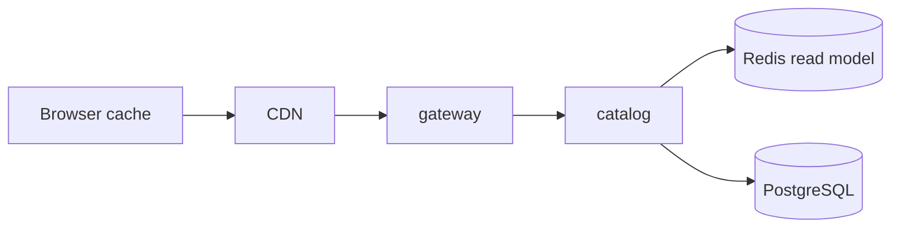

<div dir="rtl">

# کش و CDN

این فصل به یک سؤال جواب می‌دهد: کدام داده‌ی سرمیز کجا و تا کی کش می‌شود، چطور کش کهنه پاک می‌شود، و چه چیزی هرگز نباید کش شود؟

[بازگشت به فهرست مستندات](../README.md)

## ۱. چرا مهم است

منوی عمومی داغ‌ترین مسیر سرمیز است: هر اسکن QR یک درخواست منو است و ساعت ناهار ده‌ها مهمان یک کافه هم‌زمان آن را باز می‌کنند. هدف بخش ۳ مشخصات فنی می‌گوید منو باید با p95 زیر ۳۰۰ میلی‌ثانیه برسد و صفحه‌ی مهمان روی 4G زیر ۲ ثانیه بالا بیاید؛ بدون کش، هر اسکن یعنی چند query سنگین روی PostgreSQL. از آن طرف، کش اشتباه یعنی سفارش یک مهمان در جواب مهمان دیگر، یا آیتمی که تمام شده ولی هنوز سفارش داده می‌شود. این فصل می‌گوید چه چیزی کجا کش می‌شود و چرا بقیه نه.

## ۲. تصمیم‌ها در یک نگاه

| موضوع | تصمیم | چرا |
|---|---|---|
| مدل خواندن منو | Redis در `catalog` با کلید <span dir="ltr">`menu:{venue_id}:{locale}:{menu_version}`</span> و TTL ۲۴ ساعت | منوی آماده با یک `GET` |
| باطل کردن | `menu_version` در کلید؛ هیچ کلیدی پاک نمی‌شود | نسخه‌ی تازه خودبه‌خود کلید تازه است |
| جواب HTTP منو | `ETag` از `menu_version` و زبان؛ `Cache-Control: public, max-age=30, stale-while-revalidate=300` | مرورگر و CDN بار را برمی‌دارند |
| کهنگی قابل قبول | ۳۰ ثانیه | `PriceItems` هنگام ساخت سفارش مرجع قیمت و موجودی است |
| تصویر | کلید با hash محتوا؛ `max-age=31536000, immutable` | فایل با این کلید هیچ‌وقت عوض نمی‌شود |
| فایل‌های وب | نام hash‌دار برای همیشه؛ `index.html` کش نمی‌شود | انتشار تازه فوراً دیده شود |
| هرگز کش نمی‌شود | پاسخ‌های ورود، سفارش، پرداخت، هر چیزی زیر <span dir="ltr">`/venues/*`</span> | شخصی، متعلق به یک کسب‌وکار، یا مدام در حال تغییر |
| CDN | از یک ارائه‌دهنده‌ی ایرانی؛ کدام، هنوز باز است | بخش ۱۰ |

## ۳. لایه‌ها، یکی‌یکی

| چه چیزی | کجا | قاعده |
|---|---|---|
| مدل خواندن منوی عمومی | Redis در `catalog` | کلید <span dir="ltr">`menu:{venue_id}:{locale}:{menu_version}`</span>، TTL ۲۴ ساعت |
| جواب HTTP منوی عمومی | مرورگر و CDN | `ETag` و `Cache-Control: public, max-age=30, stale-while-revalidate=300` |
| `qr_token` به میز | Redis در `catalog` | TTL ۵ دقیقه |
| JWKS | حافظه‌ی `gateway` | ۱۰ دقیقه |
| تصویرها | CDN | کلید با hash محتوا، `Cache-Control: public, max-age=31536000, immutable` |
| فایل‌های وب | CDN | نام hash‌دار برای همیشه، `index.html` نه |
| داده‌ی سرور در مرورگر | TanStack Query | `staleTime` برای هر منبع |

</div>



<div dir="rtl">

**Redis در `catalog`.** «مدل خواندن» (read model) یعنی منوی کامل یک کسب‌وکار به یک زبان، با دسته‌ها، آیتم‌ها، گزینه‌ها، برچسب‌ها و fallback زبان، از قبل سرهم‌شده و آماده‌ی فرستادن. ساختنش چند query است؛ خواندنش یک `GET`. نگاشت `qr_token` به میز هم ۵ دقیقه در Redis می‌ماند تا هر اسکن به `dining_tables` نرود.

**HTTP: `ETag` و `Cache-Control`.**

| بخش هدر | یعنی چه |
|---|---|
| `public` | CDN هم اجازه دارد جواب را نگه دارد، نه فقط مرورگر |
| `max-age=30` | تا ۳۰ ثانیه جواب تازه حساب می‌شود و بدون پرسیدن از سرور استفاده می‌شود |
| `stale-while-revalidate=300` | تا ۳۰۰ ثانیه‌ی بعدش جواب کهنه یک بار فوراً نشان داده می‌شود و هم‌زمان نسخه‌ی تازه در پس‌زمینه گرفته می‌شود |
| `ETag` | برچسب نسخه‌ی جواب. مرورگر یا CDN آن را در `If-None-Match` برمی‌گرداند؛ اگر نسخه عوض نشده، جواب `304` بدون بدنه است |

`ETag` از `menu_version` و زبان ساخته می‌شود؛ قالب دقیقش (مثلاً <span dir="ltr">`"42-fa"`</span>) در `W2-CORE-5` تعیین می‌شود. جواب `304` چند بایت است، نه چند ده کیلوبایت؛ روی 4G این فرق محسوس است.

**CDN.** برای منوی عمومی، CDN جلوی `gateway` جواب را با همان قواعد نگه می‌دارد، پس صد مهمانی که در یک دقیقه یک منو را باز می‌کنند ممکن است فقط دو سه درخواست به سرور برسانند. برای تصویر و فایل وب، CDN تقریباً همه‌ی بار را برمی‌دارد.

**TanStack Query.** داده‌ی سرور در حافظه‌ی صفحه نگه داشته می‌شود. `staleTime` می‌گوید تا چند وقت بدون درخواست دوباره تازه حساب شود. عددها را مشخصات فنی برای هر منبع به تیم سپرده؛ پیشنهاد اولیه: منوی مهمان ۳۰ ثانیه هم‌اندازه‌ی `max-age`، سفارش‌ها و درخواست‌های خدمت صفر (چون WebSocket و polling هر ۳۰ ثانیه آن‌ها را تازه می‌کنند).

## ۴. `menu_version`: باطل کردن بدون پاک کردن

هر تغییر در منو، موجودی یا زمان‌بندی، `venues.menu_version` را در **همان تراکنش** یکی بالا می‌برد. چون نسخه در کلید Redis و در `ETag` است:

- نسخه‌ی ۴۲ کلید `menu:{venue_id}:fa:42` را می‌خواهد. این کلید هنوز وجود ندارد، پس درخواست بعدی آن را از PostgreSQL می‌سازد.
- کلید `menu:{venue_id}:fa:41` دیگر هیچ‌وقت خوانده نمی‌شود و بعد از ۲۴ ساعت خودش می‌رود.
- هیچ کدی لازم نیست کلید را `DEL` کند. پس هیچ‌وقت هم پیش نمی‌آید که «پاک کردن را فراموش کردیم» یا «پاک کردن بین تراکنش و commit اجرا شد و کهنه دوباره نوشته شد».

برای ساختن کلید، `catalog` باید `menu_version` **فعلی** را بداند. پیشنهاد اولیه: آن را برای هر درخواست با یک query کوتاه روی کلید اصلی `venues` بخوان؛ اگر آن را هم کش کنی، کهنگی منو از ۳۰ ثانیه بیشتر می‌شود. نگاشت `qr_token` به میز می‌تواند ۵ دقیقه بماند چون میز به‌ندرت عوض می‌شود؛ ولی وقتی `RegenerateQrToken` صدا زده می‌شود، کلید `qr_token` قدیمی را همان لحظه پاک کن، وگرنه QR قدیمی تا ۵ دقیقه هنوز کار می‌کند.

</div>

```go
// example only: building the key; the version comes from the venues row, not from a cache
key := fmt.Sprintf("menu:%s:%s:%d", venueID, locale, menuVersion)
```

<div dir="rtl">

## ۵. یک مثال کامل: آیتم «تمام شد»

ساعت ۱۳:۰۰:۰۰. صاحب کافه (یا کارمند، چون `staff` هم اجازه دارد) از صفحه‌ی آشپزخانه «چیزکیک» را تمام‌شده می‌زند.

| زمان | چه اتفاقی می‌افتد |
|---|---|
| ۱۳:۰۰:۰۰ | `SetItemAvailability` در یک تراکنش: `is_available = false`، `menu_version` از ۴۱ به ۴۲، ردیف `outbox` برای `menu.changed` |
| ۱۳:۰۰:۰۰ | صفحه‌ی آشپزخانه و پنل فوراً حالت تازه را می‌بینند؛ <span dir="ltr">`/venues/*`</span> کش نمی‌شود |
| ۱۳:۰۰:۰۵ | مهمان «ب» تازه QR را اسکن می‌کند. CDN جوابی دارد که ۲۵ ثانیه پیش با نسخه‌ی ۴۱ گرفته شده و هنوز تازه است. «ب» چیزکیک را موجود می‌بیند |
| ۱۳:۰۰:۱۰ | مهمان «الف» که از قبل منو را باز داشت، چیزکیک را در سبد می‌گذارد و سفارش می‌دهد |
| ۱۳:۰۰:۱۰ | `order.CreateOrder` با `catalog.PriceItems` قیمت و موجودی را از دیتابیس می‌پرسد. جواب: این آیتم موجود نیست. سفارش ساخته نمی‌شود و `web` به «الف» می‌گوید چیزکیک تمام شده و سبد را اصلاح می‌کند |
| ۱۳:۰۰:۳۰ به بعد | جواب CDN کهنه شده. درخواست بعدی هنوز یک بار جواب نسخه‌ی ۴۱ را می‌گیرد (stale-while-revalidate)، ولی CDN هم‌زمان با `If-None-Match` از سرور می‌پرسد، نسخه‌ی ۴۲ را می‌گیرد و از آن به بعد همه آن را می‌بینند |
| چند ثانیه بعد | سرویس `ai` رویداد `menu.changed` را مصرف می‌کند و منو را دوباره index می‌کند |

درس این مثال: کش منو **همیشه** ممکن است کمی کهنه باشد. این مشکلی نیست چون هیچ تصمیم پولی یا موجودی از روی کش گرفته نمی‌شود؛ `PriceItems` همیشه از دیتابیس می‌خواند. اینکه خطای موجودی با کدام کد خطا برگردد در قرارداد `W2-CORE-6` تعیین می‌شود (پیشنهاد اولیه: `failed_precondition` با شناسه‌ی آیتم‌ها در `fields`).

> [!NOTE]
> به‌خاطر `stale-while-revalidate`، یک مهمان ممکن است یک بار منویی ببیند که از ۳۰ ثانیه قدیمی‌تر است. نمایش بعدی تازه است و `PriceItems` جلوی سفارش اشتباه را می‌گیرد.

## ۶. تصویرها: کلید با hash، کش برای همیشه

کلید هر تصویر در `sarmiz-media` این است: `v/{venue_id}/{sha256}-{width}.webp`. `sha256` از محتوای فایل ساخته می‌شود.

- محتوای تازه یعنی hash تازه یعنی کلید تازه. فایلی که با یک کلید نوشته شد هیچ‌وقت عوض نمی‌شود.
- برای همین هدر `Cache-Control: public, max-age=31536000, immutable` بی‌خطر است: یک سال، و `immutable` یعنی مرورگر حتی موقع refresh هم دوباره نپرسد.
- عوض کردن عکس آیتم یعنی یک ردیف `media` تازه و تغییر منو؛ `menu_version` بالا می‌رود و منوی تازه به کلید تازه اشاره می‌کند. هیچ purge (پاک کردن دستی از CDN) لازم نیست.
- سه عرض ۳۲۰، ۸۰۰ و ۱۶۰۰ برای این است که `web` با `srcset` فقط اندازه‌ی لازم را بگیرد؛ گوشی روی 4G عکس ۱۶۰۰ پیکسلی نمی‌خواهد.

اینکه فایل‌های قدیمیِ بی‌استفاده کی پاک شوند در مشخصات فنی نیامده؛ در انتشار ۱ می‌مانند و حجمشان کم است.

## ۷. فایل‌های وب و چرا `index.html` کش نمی‌شود

Vite هنگام build نام هر فایل JS و CSS را با hash محتوایش می‌سازد (مثل `assets/menu-3f9a1c.js`). این فایل‌ها مثل تصویرها برای همیشه کش می‌شوند.

`index.html` اما نام ثابت دارد و فهرست فایل‌های hash‌دار **فعلی** را در خودش دارد. اگر کش شود، بعد از انتشار تازه مرورگرها تا مدت‌ها JS قدیمی را اجرا می‌کنند و تعمیر یک باگ به کاربران نمی‌رسد. برای همین `index.html` هر بار از سرور خوانده می‌شود؛ پیشنهاد اولیه `Cache-Control: no-cache` که مرورگر را مجبور می‌کند قبل از استفاده بپرسد. صفحه‌های prerender‌شده‌ی <span dir="ltr">`/`</span> و <span dir="ltr">`/pricing`</span> هم HTML هستند و همین قاعده را دارند.

> [!WARNING]
> مسیرهای `web` lazy بارگذاری می‌شوند. مهمانی که منو را قبل از انتشار باز کرده، بعد از انتشار ممکن است تکه‌ی JS قدیمی‌ای را بخواهد که دیگر نیست. پیشنهاد اولیه: فایل‌های build قبلی را تا مدتی نگه دار، و خطای بارگذاری تکه را با یک بار بارگذاری دوباره‌ی صفحه جواب بده. جزئیاتش در `W2-PA-2` و `W1-WEB-1` تصمیم گرفته می‌شود.

## ۸. چه چیزی هرگز کش نمی‌شود

| چه چیزی | چرا |
|---|---|
| پاسخ‌های <span dir="ltr">`/auth/*`</span> و <span dir="ltr">`/me`</span> | کوکی و هویت دارند؛ یک کش مشترک ممکن است توکن یک نفر را به دیگری بدهد |
| سفارش‌ها (<span dir="ltr">`/public/orders/*`</span>، <span dir="ltr">`/venues/{venue_id}/orders*`</span>) | وضعیت هر ثانیه عوض می‌شود و فقط با `order_token` یا نقش خوانده می‌شوند |
| پرداخت‌ها و callback | پول؛ هر جواب باید از دیتابیس باشد |
| هر چیزی زیر <span dir="ltr">`/venues/*`</span> | داده‌ی یک کسب‌وکار است؛ کش مشترک یعنی نشت بین کسب‌وکارها |
| <span dir="ltr">`/stream-tickets`</span> و <span dir="ltr">`/admin/*`</span> | توکن کوتاه‌عمر و داده‌ی ادمین |

مشخصات فنی هدر دقیق را نگفته؛ پیشنهاد اولیه: `gateway` برای همه‌ی این مسیرها `Cache-Control: no-store` بگذارد تا هیچ CDN یا proxyی آن‌ها را نگه ندارد.

قاعده‌ی کلی‌تر: فقط جوابی را `public` کش کن که برای **همه‌ی** درخواست‌کننده‌ها دقیقاً یکی است. جواب منوی عمومی نباید هیچ چیز وابسته به کاربر داشته باشد و هیچ‌وقت `Set-Cookie` نفرستد. اگر زبان از هدری مثل `Accept-Language` خوانده شود، CDN باید بر اساس آن هم جدا کند؛ پیشنهاد اولیه: زبان در خود نشانی بیاید تا نشانی هر زبان جدا باشد. این در `W2-CORE-5` تصمیم گرفته می‌شود.

## ۹. هجوم به کش (cache stampede)

با کلید نسخه‌دار، هر تغییر منو برای **همه** یک miss تضمین‌شده است. اگر ۵۰ مهمان در همان ثانیه‌ی بعد از تغییر منو را بخواهند، ۵۰ درخواست هم‌زمان همان منو را از PostgreSQL می‌سازند. این همان «هجوم به کش» است.

ساده‌ترین دفاع در هر Pod: `singleflight`، یعنی درخواست‌های هم‌زمان برای یک کلید منتظر یک ساختن بمانند.

</div>

```go
// example only
var group singleflight.Group

func (s *PublicMenu) get(ctx context.Context, key string) ([]byte, error) {
	if b, err := s.redis.Get(ctx, key).Bytes(); err == nil {
		return b, nil
	}
	v, err, _ := group.Do(key, func() (any, error) {
		return s.buildAndStore(ctx, key) // build from PostgreSQL, SET with 24h TTL
	})
	if err != nil {
		return nil, err
	}
	return v.([]byte), nil
}
```

<div dir="rtl">

با ۲ نسخه‌ی `catalog`، در بدترین حالت ۲ ساختن هم‌زمان داری، نه ۵۰. `stale-while-revalidate` در CDN هم بیشتر مهمان‌ها را با جواب قبلی راه می‌اندازد. قفل توزیع‌شده در Redis در این مقیاس لازم نیست. اگر Redis پایین باشد، منو بدون کش از PostgreSQL ساخته می‌شود (بخش ۱۶ مشخصات فنی)، پس `singleflight` آنجا مهم‌تر هم هست.

## ۱۰. سنجیدن نرخ برخورد (hit rate)

`W4-CORE-3` می‌خواهد نرخ برخورد کش دیده شود. سه جا را نگاه کن:

| لایه | چه بشماری | از کجا |
|---|---|---|
| Redis در `catalog` | hit و miss مدل خواندن | پیشنهاد اولیه: دو counter در <span dir="ltr">`/metrics`</span>، مثل `menu_cache_hits_total` و `menu_cache_misses_total`؛ این نام‌ها در مشخصات فنی نیستند |
| HTTP | نسبت `304` به `200` در منوی عمومی | متریک‌ها یا لاگ `gateway` |
| CDN | نسبت جواب از لبه به جواب از مبدأ | داشبورد ارائه‌دهنده‌ی CDN |

هدف عددی را مشخصات فنی نگفته. بعد از آزمون بار (`W3-PA-3`) عدد پایه را ثبت کن. اگر hit rate در Redis پایین است، معمولاً یعنی `menu_version` بیش از لازم بالا می‌رود (مثلاً هر بار ذخیره‌ی فرم بدون تغییر واقعی) یا کلید زبان یکدست نیست (`fa` و `FA`).

## ۱۱. CDN داخل ایران: تصمیم باز

مشخصات فنی می‌گوید object storage و CDN از یک ارائه‌دهنده‌ی ابری ایرانی گرفته شوند، ولی **کدام ارائه‌دهنده** هنوز تصمیم گرفته نشده (جزو تصمیم باز ۳، انتخاب ارائه‌دهنده‌ی میزبانی، در هفته‌ی ۰). بخش پلتفرم در `W2-PA-2` آن را راه می‌اندازد. وقتی گزینه‌ها را مقایسه می‌کنی، این‌ها را بپرس:

- آیا `Cache-Control` و `ETag` مبدأ را رعایت می‌کند، و `immutable` و `stale-while-revalidate` را می‌شناسد؟
- می‌شود برای یک مسیر (مثل <span dir="ltr">`/api/v1/public/*`</span>) کش را روشن و برای بقیه‌ی <span dir="ltr">`/api/v1/*`</span> کاملاً خاموش کرد؟
- IP واقعی کاربر را در کدام هدر به مبدأ می‌فرستد ([فصل ۱۱](11-rate-limiting.md))؟
- TLS روی دامنه‌ی خود سرمیز، purge در صورت اضطرار، و هزینه به ازای هر گیگابایت.

هر جوابی را از مستندات رسمی همان ارائه‌دهنده بردار و نتیجه را در README `deploy` بنویس.

## چک‌لیست انتشار ۱

- [ ] منوی عمومی هدر `ETag` و `Cache-Control` درست دارد و درخواست دوم با `If-None-Match` جواب `304` می‌گیرد.
- [ ] هر تغییر منو، موجودی یا زمان‌بندی `menu_version` را در همان تراکنش بالا می‌برد؛ تست دارد.
- [ ] تمام‌شدن یک آیتم حداکثر بعد از چند ده ثانیه در منوی مهمان دیده می‌شود و سفارشش همان لحظه رد می‌شود.
- [ ] `RegenerateQrToken` کش توکن قدیمی را پاک می‌کند.
- [ ] تصویرها و فایل‌های hash‌دار `immutable` هستند؛ `index.html` کش نمی‌شود.
- [ ] هیچ مسیر <span dir="ltr">`/auth/*`</span>، سفارش، پرداخت یا <span dir="ltr">`/venues/*`</span> در CDN کش نمی‌شود (با درخواست واقعی و بررسی هدرهای جواب CDN امتحان شده).
- [ ] `singleflight` یا معادلش روی ساختن منو هست.
- [ ] نرخ برخورد Redis، HTTP و CDN در داشبورد یا گزارش آزمون بار ثبت شده است.

## اشتباه‌های رایج

| اشتباه | چرا بد است | چه کار کن |
|---|---|---|
| `DEL` کلید منو بعد از هر تغییر | ترتیب commit و پاک کردن خراب می‌شود و کهنه برمی‌گردد | کلید نسخه‌دار، بدون پاک کردن |
| کش کردن `menu_version` | کهنگی منو چند دقیقه می‌شود | از دیتابیس بخوان |
| تکیه بر کش منو برای قیمت یا موجودی سفارش | مهمان چیز تمام‌شده را با قیمت قدیمی می‌خرد | فقط `PriceItems` |
| `public` روی پاسخی که به کاربر وابسته است | CDN جواب یک نفر را به دیگری می‌دهد | `no-store` |
| کش کردن `index.html` | انتشار تازه به کاربران نمی‌رسد | `no-cache` |
| عکس تازه با همان کلید قدیمی | CDN تا یک سال عکس قدیمی را نشان می‌دهد | کلید از hash محتوا |
| بالا بردن `menu_version` بدون تغییر واقعی | hit rate بی‌دلیل پایین می‌آید | فقط وقتی چیزی واقعاً عوض شد |

## کار با AI روی این موضوع

**فایل‌هایی که به دستیار می‌دهی:** `AGENTS.md`، بخش‌های ۳، ۷٫۲، ۷٫۵ و ۱۱ از `docs/SPEC.md`، همین فصل، `services/catalog/README.md` و متن issue (`W2-CORE-5` یا `W4-CORE-3`).

طراحی مسیر منوی عمومی:

</div>

```text
روی GetPublicMenuByTable در سرویس catalog کار می‌کنیم (W2-CORE-5). بخش ۱۱ از docs/SPEC.md و docs/guide/12-caching-and-cdn.md را بخوان.
هنوز کد ننویس. قدم‌به‌قدم بگو یک درخواست از qr_token تا جواب با ETag از کدام کش‌ها و کدام queryها می‌گذرد،
کجا menu_version خوانده می‌شود، و کجا singleflight لازم است.
برای جاهایی که مشخصات فنی چیزی نگفته (قالب ETag، جای زبان در نشانی) سؤال بنویس، تصمیم نگیر.
```

<div dir="rtl">

بازبینی هدرهای کش:

</div>

```text
همه‌ی مسیرهای gateway و هدر Cache-Control هر کدام را فهرست کن.
با بخش ۱۱ از docs/SPEC.md مقایسه کن و هر مسیری که شخصی، متعلق به یک venue، یا مربوط به سفارش و پرداخت است
ولی no-store ندارد را با نام فایل و شماره‌ی خط نشان بده.
```

<div dir="rtl">

**خودت حتماً بررسی کن:** با `curl -I` هدرهای منوی عمومی، یک تصویر، یک فایل JS و `index.html` را روی `staging` ببین. یک آیتم را تمام‌شده بزن و با دو گوشی سناریوی بخش ۵ را خودت اجرا کن. هدرهای جواب CDN را هم نگاه کن تا مطمئن شوی مسیرهای پنل از لبه برنمی‌گردند.

## بیشتر بخوان

- [مشخصات فنی](../SPEC.md): بخش ۳ (هدف‌های سرعت)، بخش ۴٫۳ (جریان باز کردن منو)، بخش ۷٫۲ (`menu_version`)، بخش ۷٫۵ (object storage)، بخش ۱۱ (کش و CDN)، بخش ۱۶ (رفتار هنگام خرابی Redis).
- [فصل ۸: دیتابیس و ذخیره‌سازی](08-database-and-storage.md): Redis و bucketها.
- [فصل ۵: فرانت](05-frontend.md): TanStack Query و بودجه‌ی سرعت صفحه‌ی مهمان.
- [فصل ۱۳: میزبانی و ابر](13-hosting-and-cloud.md) و [فصل ۱۱: محدودیت نرخ](11-rate-limiting.md).
- [فصل ۱۸: مقیاس‌پذیری و تاب‌آوری](18-scaling-and-resilience.md).
- README سرویس [catalog](../../services/catalog/README.md) و [deploy](../../deploy/README.md).

</div>
