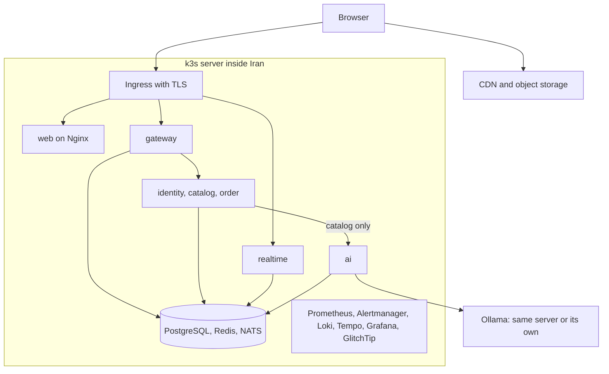

<div dir="rtl">

# میزبانی و زیرساخت ابری

این فصل به یک سؤال جواب می‌دهد: سرمیز روی چه سروری، با چه اجزایی و در چه محیط‌هایی اجرا می‌شود، و قبل از بالا آوردنش چه چیزهایی را باید اندازه بگیری و تصمیم بگیری؟

[بازگشت به فهرست مستندات](../README.md)

> [!NOTE]
> **انتشار ۱ با تیم سه‌نفره:** Ollama و سرور مدل مال انتشار ۲‌اند و الان لازم نیستند ([سند تصمیم ۷](../decisions/0007-three-person-team.md)). در زمان نوشتن طرح سه‌نفره، image رسمی MinIO در Docker Hub پیدا نمی‌شد؛ `W1-PA-1` یک جایگزین سازگار با S3 انتخاب می‌کند و انتخاب را در `deploy/README.md` می‌نویسد.

## ۱. چرا مهم است

مهمانِ یک کافه وسط سفارش دادن است؛ اگر سرور جواب ندهد، نه منو باز می‌شود و نه سفارش به آشپزخانه می‌رسد. سرمیز قول داده مسیرهای مهمان ۹۹٫۵٪ ماه در دسترس باشند و وقتی اینترنت بین‌الملل قطع می‌شود هم کار کنند، پس جای سرور و چیدمان اجزا بخشی از خود محصول است. در انتشار ۱ همه‌چیز روی یک سرور می‌نشیند و جا محدود است؛ اگر ندانی هر جزء چقدر حافظه می‌خواهد، اولین شبِ شلوغ همه با هم می‌افتند.

## ۲. تصمیم‌ها در یک نگاه

| موضوع | تصمیم | چرا |
|---|---|---|
| محیط‌ها | `local`، `staging` و `production` | کار هر روز روی سرور واقعی دیده شود، بدون اینکه به داده‌ی واقعی دست بزند |
| محل سرور | یک سرور داخل ایران | کسب‌وکارها با قطع اینترنت بین‌الملل هم کار کنند |
| اندازه‌ی شروع | پیشنهاد مشخصات فنی: ۸ vCPU، ۱۶ GB RAM و ۱۶۰ GB SSD | برای هدف‌های بخش ۳ مشخصات فنی: ۵۰ کسب‌وکار و ۵۰۰ مهمان هم‌زمان |
| اجرا | k3s (توزیع سبک Kubernetes) با دو namespace: `staging` و `production` | همان Kubernetes دوره است، ولی روی یک سرور جا می‌شود |
| استقرار | Helm، با یک chart عمومی برای همه‌ی سرویس‌های Go | پنج سرویس Go یک شکل دارند؛ پنج chart یعنی پنج جا برای اشتباه |
| TLS | cert-manager | گواهی خودکار صادر و تمدید می‌شود |
| object storage و CDN | از یک ارائه‌دهنده‌ی ابری ایرانی | همان دلیلِ محل سرور |
| رازها (secrets) | فقط در Kubernetes secrets و GitHub secrets | هیچ رازی نباید به Git برسد |
| دسترسی از بیرون | از سرویس‌های بک‌اند فقط `gateway` و `realtime` پشت ingress هستند | بقیه به metadata مطمئنِ `gateway` اعتماد می‌کنند و نباید از بیرون دیده شوند |
| سرور مدل | شاید ماشین جدا؛ بعد از ارزیابی هفته‌ی ۱ تصمیم گرفته می‌شود | مدل‌ها حافظه‌ی زیادی می‌خواهند |
| مسیر رشد | سه node، PostgreSQL مدیریت‌شده با replica، Redis با replica، سه node برای NATS | بخش ۱۲ همین فصل |

## ۳. سه محیط

| | `local` | `staging` | `production` |
|---|---|---|---|
| کجا | Docker Compose برای PostgreSQL، Redis، NATS، MinIO و در صورت نیاز Ollama؛ سرویس‌ها از روی source اجرا می‌شوند | namespace `staging` روی cluster | namespace `production` روی همان cluster |
| داده | ساختگی؛ اسکریپت seed یک کسب‌وکار نمونه با منوی کامل می‌سازد (`W2-PA-5`) | داده‌ی نمونه‌ی seedشده؛ داده‌ی واقعی هیچ‌وقت اینجا نمی‌آید | داده‌ی واقعی کسب‌وکارها، به‌علاوه‌ی کافه و رستوران دمو با `is_demo = true` |
| پرداخت | provider جعلی | Zarinpal در حالت sandbox | تا بازبینی امنیتی هفته‌ی ۶ فقط sandbox؛ بعد از آن `live` را فقط ادمین پلتفرم برای هر کسب‌وکار روشن می‌کند |
| پیامک | پیامک جعلی که کد را چاپ می‌کند | سرویس پیامک با شماره‌های آزمایشی تیم؛ پیاده‌سازی `console` اینجا فعال نمی‌شود | سرویس پیامک واقعی |
| چه کسی مستقر می‌کند | خودت، با یک دستور (`W1-PA-1`) | CI، خودکار، با هر merge به `main` | CI، با tag نسخه‌ی `vX.Y.Z` و تأیید دستی |
| نشانی | `localhost` | تیم تعیین می‌کند | تیم تعیین می‌کند |

چند نکته درباره‌ی این جدول:

- الگوی نشانی‌ها به دامنه بستگی دارد و دامنه هنوز تصمیم باز ۱ است. بعد از قطعی شدنش، بخش پلتفرم الگو را در `W1-PA-6` می‌نویسد و در `deploy/README.md` ثبت می‌کند.
- مشخصات فنی برای پیامکِ `staging` چیزی نگفته است. ردیف بالا از تحویل هفته‌ی ۱ هسته می‌آید؛ جزئیاتش را تیم با حساب پیامک منتور در هفته‌ی ۱ قطعی می‌کند.
- جزئیات مسیر استقرار در [فصل ۱۴](14-ci-cd-and-version-control.md) است.

> [!IMPORTANT]
> `staging` و `production` روی یک سرورند، ولی هیچ چیز مشترکی از داده و راز ندارند. سرویسِ `staging` هرگز به دیتابیس، Redis، NATS یا bucket محیط `production` وصل نمی‌شود، حتی «برای یک تست سریع».

## ۴. چرا داخل ایران

- **قطع اینترنت بین‌الملل.** مهمان، پنل و صفحه‌ی آشپزخانه همه داخل ایران‌اند. وقتی سرور هم داخل باشد، قطع ارتباط خارجی جلوی سفارش گرفتن را نمی‌گیرد. دلیل اصلی مشخصات فنی همین است.
- **سرعت.** صفحه‌ی مهمان باید روی 4G در کمتر از ۲ ثانیه باز شود و `p95` منوی عمومی زیر ۳۰۰ میلی‌ثانیه باشد. فاصله‌ی کمتر تا کاربر یعنی رفت‌وبرگشت کوتاه‌تر.
- **همسایه‌ها.** object storage، CDN، سرویس پیامک و درگاه پرداخت همه داخلی‌اند و از سرور داخلی بدون واسطه در دسترس‌اند.
- **بهای این تصمیم.** بعضی سرویس‌های خارجی که سرور به آن‌ها نیاز دارد (image registry، مخزن مدل‌ها، صادرکننده‌ی گواهی TLS، API پیام‌رسانِ هشدارها) ممکن است از داخل کند باشند یا در دسترس نباشند. برای همین بررسی دسترسی‌ها کار هفته‌ی ۱ است (بخش ۱۰).

## ۵. روی سرور چه چیزهایی اجرا می‌شود

</div>



<div dir="rtl">

| گروه | اجزا | کارش |
|---|---|---|
| پایه‌ی cluster | k3s، ingress controller، cert-manager | زمان‌بندی Podها، ورودی HTTPS، گواهی TLS |
| سرویس‌های سرمیز | `gateway`، `identity`، `catalog`، `order`، `realtime`، `ai` و `web` (فایل‌های ایستا پشت Nginx) | خود محصول |
| داده و پیام | PostgreSQL با چهار دیتابیس `identity`، `catalog`، `orders` و `ai`؛ Redis؛ NATS JetStream | داده‌ی ماندگار، cache و کد ورود، رویدادها |
| مشاهده‌پذیری | Prometheus، Alertmanager، Loki، Tempo، Grafana، GlitchTip | metric، هشدار، لاگ، trace، داشبورد، خطا ([فصل ۱۵](15-logs-and-error-tracking.md) و [فصل ۱۶](16-monitoring-and-alerts.md)) |
| بیرون از سرور | object storage و CDN، سرویس پیامک، درگاه پرداخت، و شاید سرور مدل | از ارائه‌دهنده‌های دیگر گرفته می‌شوند |

مسیرهای ingress ساده‌اند: <span dir="ltr">`/api/v1/*`</span> به `gateway` می‌رود، <span dir="ltr">`/ws`</span> به `realtime`، و بقیه به `web`. هیچ سرویس دیگری (و هیچ‌کدام از PostgreSQL، Redis، NATS و Prometheus) نباید از اینترنت در دسترس باشد.

k3s یک ingress controller پیش‌فرض دارد. اینکه همان بماند یا عوض شود، و اینکه دیسک PostgreSQL روی چه نوع volume باشد، تصمیم بخش پلتفرم در `W1-PA-6` است. حواست باشد: روی یک سرور، همه‌ی volumeها روی همان یک دیسک‌اند. اگر دیسک برود، همه‌چیز رفته است؛ برای همین [فصل ۲۱](21-backup-and-recovery.md) جدی است.

## ۶. بودجه‌ی منابع

> [!WARNING]
> این جدول فقط **برآورد شروع** است، نه عدد اندازه‌گیری‌شده. هیچ‌کدام از این عددها در مشخصات فنی نیست. کار تو این است که بعد از بالا آمدن هر جزء مصرف واقعی را ببینی و جدول را اصلاح کنی.

| جزء | حافظه | CPU |
|---|---|---|
| k3s و اجزای پایه (ingress، cert-manager، DNS داخلی) | ۱٫۵ GB | ۱ |
| PostgreSQL در `production` | ۲ GB | ۱ |
| PostgreSQL در `staging` | ۰٫۵ GB | ۰٫۲۵ |
| Redis، هر دو محیط | ۰٫۵ GB | ۰٫۲۵ |
| NATS JetStream، هر دو محیط | ۰٫۵ GB | ۰٫۲۵ |
| سرویس‌های سرمیز در `production`، با دو replica برای `gateway`، `catalog`، `order` و `realtime` | ۲ GB | ۱٫۵ |
| سرویس‌های سرمیز در `staging`، هر کدام یک replica | ۱٫۲۵ GB | ۰٫۵ |
| Prometheus و Alertmanager | ۱ GB | ۰٫۵ |
| Loki | ۱ GB | ۰٫۵ |
| Tempo | ۰٫۵ GB | ۰٫۲۵ |
| Grafana | ۰٫۲۵ GB | ۰٫۱ |
| GlitchTip | ۱ GB | ۰٫۵ |
| **جمع** | **۱۲ GB** | **۶٫۶ vCPU** |

از این جدول سه نتیجه بگیر:

1. حدود ۴ GB و ۱٫۴ vCPU خالی می‌ماند. این جا برای سیستم‌عامل، اوج مصرف و rollout است (هنگام استقرار، Pod قدیم و جدید چند لحظه با هم زنده‌اند).
2. Ollama در این جدول نیست. مدلی که چند گیگابایت حافظه می‌خواهد در جای خالی جا نمی‌شود، مگر چیز دیگری را کوچک کنی. سؤال «سرور مدل جدا» از همین‌جا می‌آید (بخش ۱۱).
3. دیسک ۱۶۰ GB را بیشتر لاگ ۱۴ روزه‌ی Loki، داده‌ی Prometheus، imageها و PostgreSQL پر می‌کنند. هشدار دیسک روی ۸۰٪ است.

جدا بودن PostgreSQL، Redis و NATS برای هر محیط «پیشنهاد اولیه» است تا `staging` هیچ‌وقت نتواند به داده‌ی `production` برسد. مشخصات فنی فقط می‌گوید هر محیط یک namespace است. اگر تیم راه دیگری انتخاب کرد، سند تصمیم بنویسد.

عدد واقعی را این‌طور پیدا کن: `kubectl top pods -n production`، داشبورد زیرساخت در Grafana، و گزارش load test (`W3-PA-3`). عددهای نهایی requests و limits در `W5-PA-3` بسته می‌شوند.

## ۷. namespace، منابع و health probe

- **namespace.** `staging` و `production` در `W1-PA-6` ساخته می‌شوند. برای ابزارهای مشاهده‌پذیری یک namespace جدا پیشنهاد می‌شود (پیشنهاد اولیه؛ نامش با بخش پلتفرم).
- **requests و limits.** هر container باید هر دو را داشته باشد. `requests` یعنی «این‌قدر حتماً لازم دارم» و مبنای زمان‌بندی است؛ `limits` سقف است. Pod بدون limit می‌تواند حافظه‌ی همسایه‌هایش را بخورد.
- **probe.** هر سرویس <span dir="ltr">`/healthz`</span> (زنده‌ام) و <span dir="ltr">`/readyz`</span> (وابستگی‌هایم آماده‌اند) دارد. Kubernetes با اولی Pod را restart می‌کند و با دومی تصمیم می‌گیرد ترافیک بفرستد یا نه. اینکه <span dir="ltr">`/readyz`</span> هر سرویس چه چیزی را بسنجد در [فصل ۱۶](16-monitoring-and-alerts.md) آمده است.
- **replica و autoscaling.** در `production` دست‌کم دو replica برای `gateway`، `catalog`، `order` و `realtime`، با HorizontalPodAutoscaler روی ۷۰٪ CPU. روی یک سرور، دو replica جلوی افتادن یک Pod و قطعی هنگام rollout را می‌گیرد، نه جلوی از دست رفتن خود سرور را.
- **امنیت Pod.** container با کاربر غیر root، فایل‌سیستم ریشه‌ی فقط‌خواندنی هر جا شد، و NetworkPolicy بین Podها (`W4-PA-2`).

نمونه‌ی کوچک از valueهای یک سرویس. نام کلیدها را chart تیم تعیین می‌کند:

</div>

```yaml
# example values for the order service in production
replicaCount: 2
resources:
  requests: { cpu: 100m, memory: 128Mi }
  limits: { memory: 256Mi }
livenessProbe:
  httpGet: { path: /healthz, port: http }
readinessProbe:
  httpGet: { path: /readyz, port: http }
autoscaling: { enabled: true, minReplicas: 2, targetCPUUtilizationPercentage: 70 }
```

<div dir="rtl">

## ۸. رازها در cluster

| راز | چه کسی مصرف می‌کند |
|---|---|
| کلید امضای JWT (Ed25519) | `identity` |
| رمز role هر دیتابیس | سرویسِ صاحب همان دیتابیس |
| کلید AES-256-GCM برای رمز کردن اطلاعات درگاه کسب‌وکارها | `order` |
| راز مشترکِ header برای صدا زدن `ai` | `catalog` و `ai` |
| کلید سرویس پیامک | `identity` |
| کلیدهای object storage | `catalog`، `ai` و job پشتیبان‌گیری |
| دسترسی CI به registry و cluster | GitHub secrets |

قواعد:

1. هیچ رازی در Git نیست: نه در <span dir="ltr">`deploy/`</span>، نه در فایل values، نه در workflow. <span dir="ltr">`.env.example`</span> فقط نام متغیرها را دارد.
2. `staging` و `production` رازهای جدا دارند. کلید یک محیط نباید در محیط دیگر کار کند.
3. Kubernetes secret فقط base64 است، نه رمزشده. هر کس kubeconfig دارد رازها را می‌خواند؛ پس kubeconfig را مثل راز نگه دار و به کسی که لازم ندارد نده.
4. راز را با متغیر محیطی یا فایل mountشده به Pod بده، نه با آرگومان خط فرمان، و هیچ‌وقت لاگش نکن.
5. یک نسخه‌ی امن از رازها باید بیرون از cluster باشد، وگرنه با رفتن سرور رازها هم می‌روند ([فصل ۲۱](21-backup-and-recovery.md)).
6. راز لو رفت؟ پاک کردن از Git کافی نیست؛ باید عوض شود.

روش ساختن و به‌روز کردن رازها را بخش پلتفرم در `W1-PA-6` انتخاب و مستند می‌کند. مشخصات فنی ابزاری برایش تعیین نکرده است.

## ۹. DNS و TLS

1. دامنه تصمیم باز ۱ است و منتور باید قبل از پایان هفته‌ی ۰ آن را قطعی کند (`W0-M-1`).
2. برای هر محیط یک رکورد DNS به IP سرور لازم است، و یک نام برای CDN که ارائه‌دهنده می‌گوید چطور تنظیمش کنی.
3. cert-manager گواهی را می‌گیرد و قبل از انقضا تمدید می‌کند. صادرکننده‌ی گواهی و روش تأیید مالکیت دامنه را بخش پلتفرم در `W1-PA-6` انتخاب می‌کند و دسترسی سرور به آن را می‌آزماید.
4. تمدید را به امید خدا رها نکن: هشدار «گواهی کمتر از ۱۴ روز اعتبار دارد» در [فصل ۱۶](16-monitoring-and-alerts.md) برای همین است.
5. اتصال WebSocket روی <span dir="ltr">`/ws`</span> طولانی است و هر ۲۵ ثانیه ping دارد. timeout بیکاری ingress باید از این بیشتر باشد، وگرنه صفحه‌ی آشپزخانه مدام قطع و وصل می‌شود.
6. headerهای امنیتی (HSTS، Content-Security-Policy و بقیه‌ی فهرست بخش ۱۷ مشخصات فنی) از ingress و وب‌سرور می‌آیند.

> [!TIP]
> پیشنهاد اولیه: وب و API هر محیط روی یک host باشند (همان تقسیم مسیر بخش ۵). این‌طوری کوکی‌های `sz_at` و `sz_rt` و allowlist مربوط به CORS ساده می‌مانند.

## ۱۰. بررسی دسترسی به image registry

CI بیرون از ایران image می‌سازد و سرور داخل ایران باید آن را pull کند. اگر این مسیر کار نکند، هیچ استقراری انجام نمی‌شود. این بررسی بخشی از `W1-PA-6` است:

1. از روی سرور یکی از imageهای پایه‌ای را که در Dockerfileها استفاده می‌شود pull کن و زمانش را یادداشت کن.
2. از CI یک image آزمایشی به registry انتخابی push کن.
3. همان image را روی سرور با یک راز فقط‌خواندنی pull کن.
4. این را سه بار در ساعت‌های مختلف تکرار کن؛ یک بار موفق چیزی را ثابت نمی‌کند.
5. امتحان کن اگر registry در دسترس نباشد چه می‌شود: Podی که imageاش از قبل روی node هست باید بدون registry هم restart شود.
6. همین بررسی را برای دانلود مدل‌های Ollama هم انجام بده.
7. نتیجه را با عدد در یادداشت آخر هفته بنویس. اگر مسیر پایدار نبود، راه‌حل (مثلاً registry داخل ایران یا روی خود سرور) یک تصمیم است و سند تصمیم می‌خواهد.

## ۱۱. دو تصمیم باز

### PostgreSQL مدیریت‌شده یا داخل cluster

تصمیم باز ۳ است و منتور در هفته‌ی ۰ می‌گیرد. تو باید بده‌بستانش را بدانی:

| معیار | داخل cluster | مدیریت‌شده |
|---|---|---|
| هزینه | داخل همان سرور، بدون قلم جدا | یک قلم ماهانه‌ی جدا |
| اگر سرور از دست برود | دیتابیس هم می‌رود؛ تا ۲۴ ساعت داده از دست می‌رود | دیتابیس جداست و سالم می‌ماند |
| backup | کاملاً با خودمان (`W4-PA-1` و `W5-PA-2`) | ارائه‌دهنده هم دارد، ولی تمرین بازیابی باز هم لازم است |
| کار عملیاتی | بیشتر: نسخه، دیسک، تنظیم | کمتر |
| pgvector برای دیتابیس `ai` | خودمان نصب می‌کنیم | باید بپرسی ارائه‌دهنده پشتیبانی می‌کند یا نه |
| یک role و یک دیتابیس برای هر سرویس | آزادیم | باید ارائه‌دهنده اجازه بدهد |
| تأخیر شبکه | ناچیز | باید در همان شبکه یا مرکز داده باشد |
| مسیر رشد (replica) | سخت‌تر | ساده‌تر؛ مسیر رشد هم همین است |

### سرور مدل جدا

مشخصات فنی می‌گوید سرور مدل شاید ماشین خودش را بخواهد و تصمیم بعد از ارزیابی هفته‌ی ۱ (`W1-PA-7`) گرفته می‌شود. در گزارش ارزیابی این عددها باید باشد تا بشود تصمیم گرفت:

- هر مدل انتخابی چقدر حافظه می‌گیرد و روی CPU هر درخواست ترجمه یا خواندن منو چند ثانیه طول می‌کشد.
- وقتی مدل زیر بار است، `p95` منوی عمومی و ثبت سفارش روی همان سرور چه می‌شود.
- اگر جدا شد: ارتباط `ai` با آن از شبکه‌ی خصوصی، و یک قلم هزینه‌ی تازه.

قاعده‌ی راهنما: مسیر مهمان مهم‌تر از AI است. طبق بخش ۱۶ مشخصات فنی، وقتی `ai` پایین است منو، سفارش و پرداخت باید کار کنند؛ برعکسش قابل قبول نیست.

## ۱۲. مسیر رشد

| امروز | قدم بعد | چه چیزی را حل می‌کند |
|---|---|---|
| یک سرور | سه node | افتادن یک ماشین کل سرمیز را نمی‌خواباند |
| یک PostgreSQL | PostgreSQL مدیریت‌شده با replica | دیتابیس به یک دیسک وابسته نیست |
| یک Redis | Redis با replica | ورود با کد به یک Pod وابسته نمی‌ماند |
| یک NATS | سه node برای NATS | رویدادها با افتادن یک node نمی‌ایستند |

کد از همین حالا برای این مسیر آماده نوشته می‌شود: سرویس‌های Go state ندارند و `realtime` به sticky session نیاز ندارد. زمان رفتن به قدم بعد را عددها می‌گویند، نه حدس: مصرف پایدار بالای بودجه‌ی بخش ۶، رد شدن از هدف‌های بخش ۳ مشخصات فنی، یا بیشتر شدن کسب‌وکارها از ۵۰. جزئیات در [فصل ۱۸](18-scaling-and-resilience.md).

## ۱۳. قلم‌های هزینه برای منتور

قیمت‌ها را اینجا نمی‌نویسیم؛ منتور عدد روز را از ارائه‌دهنده می‌گیرد. تو فقط باید بدانی چه قلم‌هایی هست و هر کدام با چه چیزی بزرگ می‌شود:

| قلم | با چه چیزی بزرگ می‌شود | به کدام تصمیم وصل است |
|---|---|---|
| سرور اصلی | CPU، حافظه و دیسک | تصمیم باز ۳ |
| سرور مدل، اگر جدا شد | حافظه و نوع پردازنده | ارزیابی هفته‌ی ۱ |
| PostgreSQL مدیریت‌شده، اگر انتخاب شد | اندازه و replica | تصمیم باز ۳ |
| object storage | حجم عکس‌ها (هر عکس در سه عرض) و نسخه‌های پشتیبان | تصمیم باز ۳ |
| CDN | ترافیک عکس‌ها و فایل‌های وب | تصمیم باز ۳ |
| پیامک | تعداد کدهای ورود؛ metric آن `otp_sent_total` است | تصمیم باز ۴ |
| دامنه | تمدید سالانه | تصمیم باز ۱ |
| پلن GitHub (ریپو عمومی است و پلن رایگان کافی است؛ پلن پولی فقط اگر ریپو خصوصی شود) | تعداد اعضا | تصمیم ۶ (بسته شد) |

نگاه کامل‌تر به هزینه در [فصل ۲۳](23-privacy-legal-cost.md) است.

## چک‌لیست انتشار ۱

- [ ] سرور داخل ایران است و k3s با دو namespace `staging` و `production` کار می‌کند.
- [ ] هر دو محیط دامنه و گواهی TLS معتبر دارند و تمدید خودکار یک بار دیده شده است.
- [ ] از بیرون فقط `web`، `gateway` و `realtime` در دسترس‌اند؛ NetworkPolicy بقیه را بسته است.
- [ ] هر container requests، limits، <span dir="ltr">`/healthz`</span> و <span dir="ltr">`/readyz`</span> دارد و با کاربر غیر root اجرا می‌شود.
- [ ] `gateway`، `catalog`، `order` و `realtime` در `production` دست‌کم دو replica و autoscaling روی ۷۰٪ CPU دارند.
- [ ] هیچ رازی در Git نیست و رازهای دو محیط جداست.
- [ ] دسترسی سرور به registry و مخزن مدل‌ها آزمایش و ثبت شده است.
- [ ] جدول بودجه‌ی منابع با عددهای واقعیِ بعد از load test به‌روز شده است.
- [ ] تصمیم باز ۳ و سؤال سرور مدل بسته و در سند تصمیم ثبت شده‌اند.

## اشتباه‌های رایج

| اشتباه | چرا بد است | چه کار کن |
|---|---|---|
| image با tag `latest` | نمی‌دانی چه نسخه‌ای اجراست و rollback بی‌معنی می‌شود | فقط tag برابر git SHA |
| Pod بدون requests و limits | یک سرویس حافظه‌ی همه را می‌خورد و node همه را می‌کشد | هر دو را بگذار و با `kubectl top` اصلاح کن |
| وصل کردن `staging` به دیتابیس `production` | یک تست، داده‌ی واقعی کسب‌وکارها را خراب می‌کند | هر محیط داده و راز خودش را دارد |
| تغییر دستی با `kubectl edit` | با استقرار بعدی گم می‌شود و هیچ‌کس نمی‌داند چه بود | تغییر را در <span dir="ltr">`deploy/`</span> بنویس و PR بده |
| گذاشتن راز در فایل values | راز برای همیشه در تاریخچه‌ی Git می‌ماند | Kubernetes secret؛ در values فقط نام آن |
| اجرای Ollama کنار بقیه بدون اندازه‌گیری | مدل حافظه را می‌گیرد و مسیر مهمان می‌افتد | اول ارزیابی هفته‌ی ۱، بعد تصمیم |
| باز گذاشتن پورت PostgreSQL، Redis، NATS یا Grafana به اینترنت | هر کسی می‌تواند امتحانش کند | فقط ingress باز باشد؛ برای دسترسی تیم راه امن بگذار |

## کار با AI روی این موضوع

**فایل‌هایی که به دستیار می‌دهی:** `AGENTS.md`، بخش‌های ۱۵، ۱۶ و ۱۷ از `docs/SPEC.md`، `deploy/README.md`، همین فصل و تحویل هفته‌ی بخش پلتفرم.

پرامپت طراحی chart عمومی:

</div>

```text
روی کار W1-PA-6 کار می‌کنیم. AGENTS.md، بخش‌های ۱۵ و ۱۶ از docs/SPEC.md و deploy/README.md را بخوان.
هنوز چیزی ننویس. اول بگو یک Helm chart عمومی به چه valueهایی نیاز دارد
تا gateway، identity، catalog، order و realtime همه با همان chart مستقر شوند.
برای هر value بگو در staging و production چه فرقی دارد.
آخرش سؤال‌هایی را فهرست کن که جوابشان در مستندات نیست.
```

<div dir="rtl">

پرامپت بازبینی manifest قبل از PR:

</div>

```text
خروجی helm template این سرویس را مثل یک بازبین سخت‌گیر بخوان.
فقط دنبال این‌ها بگرد: container بدون requests و limits، نبودن liveness یا readiness probe،
اجرا با کاربر root، image با tag غیر از git SHA، راز یا رمز در متن manifest،
و Serviceای که بی‌دلیل از بیرون در دسترس است.
برای هر مورد نام فایل و خط بده. اگر موردی نبود همین را بگو.
```

<div dir="rtl">

پرامپت به‌روز کردن بودجه‌ی منابع:

</div>

```text
این خروجی kubectl top pods برای namespaceهای staging و production است:
<خروجی را اینجا بگذار>
آن را با جدول بودجه‌ی منابع در docs/guide/13-hosting-and-cloud.md مقایسه کن.
بگو کدام جزء از برآورد بیشتر مصرف کرده و برای هر سرویس چه requests و limits پیشنهاد می‌کنی.
عددی را که در خروجی نیست حدس نزن.
```

<div dir="rtl">

**خودت حتماً بررسی کن:**

- kubeconfig، راز، رمز یا خروجی `kubectl get secret` را هیچ‌وقت به دستیار نده.
- هر manifest را قبل از اعمال با `helm template` ببین و اول روی `staging` امتحان کن.
- قیمت، سقف‌ها و جزئیات ارائه‌دهنده‌ی ابری را از مستندات رسمی خودش بگیر، نه از دستیار.
- اگر دستیار ابزار یا سرویس زیرساختی تازه‌ای پیشنهاد کرد که در مشخصات فنی نیست، نپذیر؛ اول سند تصمیم.

## بیشتر بخوان

- [مشخصات فنی](../SPEC.md): بخش ۱۵ (میزبانی و محیط‌ها)، بخش ۱۶ (مقیاس‌پذیری)، بخش ۱۷ (پایه‌ی امنیت) و بخش ۲۰ (تصمیم‌های باز).
- [فصل ۱۲: cache و CDN](12-caching-and-cdn.md)
- [فصل ۱۴: CI/CD و کنترل نسخه](14-ci-cd-and-version-control.md)
- [فصل ۱۶: مانیتورینگ و هشدار](16-monitoring-and-alerts.md)
- [فصل ۱۸: مقیاس‌پذیری و تاب‌آوری](18-scaling-and-resilience.md)
- [فصل ۲۱: پشتیبان‌گیری و بازیابی](21-backup-and-recovery.md)
- [راهنمای پوشه‌ی deploy](../../deploy/README.md)

</div>
