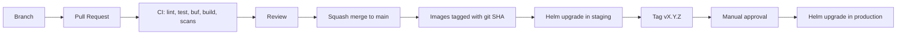

<div dir="rtl">

# CI/CD و کنترل نسخه

این فصل به یک سؤال جواب می‌دهد: یک تغییر کوچک از شاخه‌ی تو تا `production` چه مسیری را طی می‌کند، چه چیزی در هر قدم بررسی می‌شود، و اگر خراب شد چطور برش می‌گردانی؟

[بازگشت به فهرست مستندات](../README.md)

## ۱. چرا مهم است

سه نفر در شش هفته روی پنج سرویس و یک اپ وب در یک ریپو کار می‌کنند و هر روز چند بار merge می‌کنند. اگر مسیر تغییر روشن و خودکار نباشد، `main` می‌شکند، `staging` با کد هیچ‌کس نمی‌خواند و هیچ‌کس نمی‌داند چه نسخه‌ای روی سرور است. در سرمیز یک استقرار بد یعنی کافه‌ای که وسط شلوغی سفارش نمی‌گیرد؛ پس هم رسیدن کد به سرور باید ساده باشد و هم برگرداندنش در چند دقیقه.

## ۲. تصمیم‌ها در یک نگاه

| موضوع | تصمیم | چرا |
|---|---|---|
| ریپو | یک ریپو برای همه‌ی سرویس‌ها، وب، proto، deploy و مستندات | تغییر قرارداد و مصرف‌کننده‌هایش در یک PR دیده می‌شود |
| جریان شاخه | trunk-based؛ `main` همیشه قابل استقرار است | شاخه‌ی عمرطولانی یعنی merge دردناک و `staging` بی‌معنی |
| نام شاخه | <span dir="ltr">`<section>/<task-id>-<slug>`</span> | از نام شاخه معلوم است کدام بخش و کدام کار |
| پیام commit | Conventional Commits | تاریخچه‌ی خوانا و یادداشت انتشار از روی آن |
| merge | PR اجباری، دست‌کم یک بازبینی، squash merge | هر کار یک commit تمیز روی `main` |
| کد پرداخت و ورود | تأیید منتور قبل از merge | این کد با پول و حساب واقعی کار دارد |
| CI روی PR | با path filter: lint، تست، `buf`، build، gitleaks، بررسی مستندات | فقط سرویسی که عوض شده اجرا شود و CI سریع بماند |
| بعد از merge | image با tag برابر git SHA، استقرار خودکار روی `staging` با Helm | هر merge در چند دقیقه روی سرور واقعی دیده می‌شود |
| `production` | tag نسخه‌ی SemVer به شکل `vX.Y.Z` و تأیید دستی | انتشار عمدی است، نه اتفاقی |
| migration | job از نوع pre-upgrade در Helm برای هر سرویس، با الگوی expand-then-contract | schema قبل از کد تازه آماده است و rollback کد بی‌خطر است |
| rollback | `helm rollback` | یک دستور، بدون build دوباره |
| اسکن | govulncheck، npm audit، pip-audit و Trivy، هفتگی و روی PR | آسیب‌پذیری وابستگی‌ها قبل از رسیدن به سرور دیده شود |

## ۳. مسیر کد از شاخه تا production

</div>



<div dir="rtl">

**چرا یک ریپو؟** سرمیز میکروسرویس است، ولی تیم یکی است و قراردادها مدام عوض می‌شوند. وقتی `order` یک فیلد تازه از `catalog.PriceItems` می‌خواهد، تغییر proto، کد `catalog`، کد `order` و نوع‌های تولیدشده‌ی وب همه در یک ریپو هستند و `buf breaking` همان‌جا شکستن قرارداد را می‌گیرد. با شش ریپو، همین کار شش PR هماهنگ و چند روز انتظار می‌شد. هزینه‌اش این است که CI باید بفهمد چه چیزی عوض شده؛ کار path filterها همین است (بخش ۷).

## ۴. trunk-based و نام شاخه

trunk-based یعنی یک شاخه‌ی اصلی (`main`) و شاخه‌های کوتاه که حداکثر یکی دو روز عمر می‌کنند. شاخه‌ی `develop` یا `release` نداریم.

قواعد:

1. شاخه را همیشه از `main` تازه بساز: `git switch main && git pull && git switch -c core/W2-CORE-1-menu-items`.
2. شاخه‌ای که بیشتر از دو روز باز مانده، یعنی کار بزرگ است. بشکنش (پیشنهاد اولیه؛ مشخصات فنی فقط می‌گوید «کوتاه‌عمر»).
3. هر روز `main` را در شاخه‌ات بیاور (`git rebase main` یا `git merge main`) تا تداخل‌ها کوچک بمانند.
4. کار نیمه‌کاره را طوری merge کن که چیزی را نشکند و دیده نشود؛ مثلاً متد تازه‌ای که هنوز هیچ صفحه‌ای صدایش نمی‌زند. `main` همیشه قابل استقرار است.

نام شاخه: <span dir="ltr">`<section>/<task-id>-<slug>`</span>. پیشوندها همان‌اند که در [CONTRIBUTING.md](../../CONTRIBUTING.md) آمده: `core`، `order`، `web`، `platform` (برای بخش پلتفرم و هوش مصنوعی، نه `platform-ai`)، و برای مستندات بدون شناسه‌ی کار `docs`.

</div>

```text
core/W2-CORE-1-menu-items
order/W4-ORD-2-zarinpal-sandbox
web/W3-WEB-3-kitchen-screen
platform/W1-PA-5-ci
docs/fix-handoff-week-2
```

<div dir="rtl">

## ۵. Conventional Commits

شکل پیام: <span dir="ltr">`<type>(<scope>): <summary>`</span>، به انگلیسی، با فعل امری و بدون نقطه‌ی آخر. `scope` نام سرویس یا بخش است: `identity`، `catalog`، `order`، `realtime`، `gateway`، `ai`، `web`، `kit`، `proto`، `ci`، `deploy`، `docs`، `handoffs`.

| type | کی | نمونه در سرمیز |
|---|---|---|
| `feat` | رفتار تازه | `feat(catalog): bump menu_version on sold-out toggle` |
| `fix` | رفع باگ | `fix(order): reject StartPayment for counter orders` |
| `test` | فقط تست | `test(identity): cover refresh token reuse` |
| `perf` | سرعت | `perf(catalog): add index on menu_items venue_id and category_id` |
| `docs` | مستندات | `docs(handoffs): correct week 2 dependency table` |
| `chore` | ابزار، CI، deploy | `chore(ci): run buf breaking on pull requests` |

تغییری که قرارداد عمومی را می‌شکند (مثلاً حذف یک فیلد از <span dir="ltr">`/api/v1`</span>) با <span dir="ltr">`!`</span> علامت می‌خورد: <span dir="ltr">`feat(gateway)!: ...`</span>. ولی قبلش سند تصمیم لازم است.

**squash و پیام نهایی.** با squash merge، کل PR یک commit روی `main` می‌شود و GitHub به‌طور پیش‌فرض عنوان PR را پیام آن می‌گذارد. عنوان PR طبق CONTRIBUTING با شناسه‌ی کار شروع می‌شود (`W2-CORE-1: menu categories and items`). پیشنهاد اولیه: موقع squash، پیام commit نهایی را به شکل Conventional Commits بنویس و شناسه را آخرش بگذار: <span dir="ltr">`feat(catalog): menu categories and items (W2-CORE-1)`</span>. این‌طوری هم تاریخچه قاعده را دارد و هم کار پیدا می‌شود.

## ۶. چرخه‌ی Pull Request

| قدم | چه کسی | چه چیزی باید درست باشد |
|---|---|---|
| ۱. باز کردن | نویسنده | عنوان با شناسه‌ی کار؛ قالب PR کامل، شامل بخش استفاده از AI؛ زیر حدود ۴۰۰ خط تغییر |
| ۲. CI | خودکار | همه‌ی کارهای CI سبز؛ PR قرمز برای بازبینی فرستاده نمی‌شود |
| ۳. بازبینی | دست‌کم یک نفر از بخش دیگر | معیارهای پذیرش، قواعد سخت `AGENTS.md`، تست‌هایی که واقعاً چیزی می‌سنجند |
| ۴. بازبینی منتور | منتور | هر تغییری در پرداخت، ورود و توکن، و کارهای علامت‌دار <span dir="ltr">`[mentor]`</span> |
| ۵. جواب کامنت‌ها | نویسنده | در همان شاخه؛ PR تازه باز نکن |
| ۶. squash merge | نویسنده بعد از تأیید | پیام نهایی به شکل بخش ۵؛ شاخه بعد از merge پاک می‌شود |
| ۷. امتحان روی `staging` | نویسنده | تا روی `staging` ندیده‌ای، کار «تمام» نیست |

دو قاعده‌ی دیگر: تغییر در <span dir="ltr">`proto/`</span> یا JSON Schema رویدادها در <span dir="ltr">`proto/events/`</span> یک PR جداست که همه‌ی بخش‌های مصرف‌کننده تأییدش می‌کنند؛ و تغییر پرداخت یا ورود با کار دیگری در یک PR قاطی نمی‌شود، تا منتور فقط همان را بخواند.

## ۷. CI روی هر Pull Request

| بررسی | ابزار | کجا |
|---|---|---|
| lint | golangci-lint برای Go، ESLint برای وب، Ruff برای Python | هر سرویس تغییرکرده |
| تست | `go test -race`، Vitest، pytest؛ تست یکپارچه با testcontainers-go یا Compose در CI | هر سرویس تغییرکرده |
| قرارداد | `buf lint`، `buf breaking` در برابر `main`، تولید دوباره‌ی کد و مقایسه‌ی `docs/api/openapi.yaml` | وقتی <span dir="ltr">`proto/`</span> عوض شده |
| build | ساخت image هر سرویس تغییرکرده و build وب (بدون push) | هر سرویس تغییرکرده |
| راز | gitleaks | همیشه |
| مستندات | `scripts/check-markdown.py` و `scripts/check-links.py` | وقتی فایل Markdown عوض شده |
| آسیب‌پذیری | govulncheck، npm audit، pip-audit، Trivy روی image | روی PR و هفتگی (بخش ۱۲) |

**path filter چیست؟** شرطی در workflow که می‌گوید «این کار را فقط وقتی اجرا کن که فایلی در این مسیرها عوض شده باشد». بدون آن، تغییر یک کلمه در README کل تست‌های شش سرویس را اجرا می‌کند. نقشه‌ی پیشنهادی (پیشنهاد اولیه؛ نهایی‌اش در `W1-PA-5`):

| اگر این عوض شد | این‌ها اجرا می‌شوند |
|---|---|
| <span dir="ltr">`services/<name>/**`</span> | lint، تست و build همان سرویس |
| <span dir="ltr">`libs/go/kit/**`</span> یا `go.work` | همه‌ی سرویس‌های Go، چون همه به شاسی وابسته‌اند |
| <span dir="ltr">`proto/**`</span> | بررسی‌های `buf` و همه‌ی سرویس‌هایی که کدشان از آن proto ساخته می‌شود |
| `docs/api/openapi.yaml` | type check و تست وب، چون کلاینت وب از همین فایل ساخته می‌شود |
| <span dir="ltr">`web/**`</span> | ESLint، Vitest و build وب |
| <span dir="ltr">`services/ai/**`</span> | Ruff و pytest |
| <span dir="ltr">`**/*.md`</span> | بررسی مستندات |
| <span dir="ltr">`deploy/**`</span> | `helm lint` و `helm template` (ابزارش در مشخصات فنی نیامده) |
| <span dir="ltr">`.github/workflows/**`</span> | همه، چون خود CI عوض شده |

یک نمونه‌ی کوچک با GitHub Actions، فقط برای اینکه شکل کار را ببینی:

</div>

```yaml
# example: .github/workflows/order.yml
name: order
on:
  pull_request:
    paths: ["services/order/**", "libs/go/kit/**", "proto/**", "go.work"]
jobs:
  test:
    runs-on: ubuntu-latest
    steps:
      - uses: actions/checkout@v4
      - uses: actions/setup-go@v5
        with: { go-version-file: services/order/go.mod }
      - run: go test -race ./...
        working-directory: services/order
```

<div dir="rtl">

## ۸. بعد از merge به `main`

1. CI برای هر سرویسی که عوض شده image می‌سازد و با git SHA همان commit tag می‌زند، مثلاً `order:3f9c2ab`. tag `latest` هرگز.
2. image به registry می‌رود (بررسی دسترسی سرور به registry در [فصل ۱۳](13-hosting-and-cloud.md) است).
3. CI با Helm آن سرویس را در namespace `staging` به‌روز می‌کند: اول job migration (بخش ۱۰)، بعد Podهای تازه.
4. نویسنده‌ی PR کارش را روی `staging` امتحان می‌کند. اگر چیزی خراب است، اولویت اول درست کردن یا برگرداندن همان تغییر است، نه کار تازه.

دسترسی CI به cluster یک راز در GitHub secrets است. پیشنهاد اولیه: کلیدی که CI برای `staging` دارد فقط به namespace `staging` دسترسی داشته باشد، تا یک workflow اشتباه نتواند `production` را عوض کند.

## ۹. انتشار در `production`

1. وقتی `staging` سالم است و منتور موافق است، روی همان commit از `main` یک tag می‌زنی: `git tag v0.4.0 && git push origin v0.4.0`.
2. workflow انتشار با این tag شروع می‌شود و منتظر تأیید دستی در یک GitHub environment به نام `production` می‌ماند.
3. بعد از تأیید، همان imageهایی که روی `staging` امتحان شده‌اند (همان git SHA) با Helm در `production` مستقر می‌شوند. پیشنهاد اولیه: برای انتشار image تازه نساز؛ چیزی که امتحان شده همان است که منتشر می‌شود.
4. بعد از استقرار، داشبورد overview و نرخ خطا را چند دقیقه نگاه کن (پیشنهاد اولیه: ۱۵ دقیقه) ([فصل ۱۶](16-monitoring-and-alerts.md)).

SemVer یعنی `MAJOR.MINOR.PATCH`: باگ‌فیکس `PATCH` را بالا می‌برد، قابلیت تازه `MINOR` را، و شکستن API عمومی (مثلاً رفتن از <span dir="ltr">`/api/v1`</span> به <span dir="ltr">`/api/v2`</span>) `MAJOR` را. یک tag برای کل ریپو است، نه برای هر سرویس. اینکه شماره از کجا شروع شود را مشخصات فنی نگفته؛ پیشنهاد اولیه: `v0.x.0` در طول هفته‌ها و `v1.0.0` برای انتشار ۱ بعد از هفته‌ی ۶.

یادداشت انتشار از روی Conventional Commits ساخته می‌شود: `git log v0.3.0..v0.4.0 --oneline` همه‌ی `feat` و `fix`ها را نشان می‌دهد.

**hotfix.** شاخه‌ی release نداریم. باگ فوری هم از همان مسیر می‌رود: شاخه، PR، بازبینی، merge، `staging`، و یک tag تازه‌ی `PATCH`. اگر صبر کردن ممکن نیست، اول rollback کن (بخش ۱۱) و بعد با آرامش درستش کن.

## ۱۰. migration به شکل job پیش از ارتقا

هر سرویسی که دیتابیس دارد (`identity`، `catalog`، `order` و `ai`) یک job Helm از نوع `pre-upgrade` دارد که migrationهای goose همان سرویس را اجرا می‌کند. یعنی:

- schema **قبل** از Podهای تازه آماده است.
- اگر migration شکست بخورد، ارتقا متوقف می‌شود و Podهای قدیمی سر جایشان می‌مانند.
- در طول rollout، Pod قدیم و جدید چند لحظه با هم روی schema تازه کار می‌کنند. پس schema تازه باید با کد قدیمی هم کار کند.

`helm rollback` فقط کد را عقب می‌برد و migration را برنمی‌گرداند. برای همین هر migration باید expand-then-contract باشد: اول چیزی را **اضافه** کن (ستون nullable، جدول تازه، ایندکس)، کد را عوض کن، و حذفِ چیز قدیمی را به یک انتشار بعدتر بگذار. این‌طوری کد قبلی همیشه با schema فعلی کار می‌کند و rollback امن است. مثال قدم‌به‌قدم در [فصل ۸، بخش ۶](08-database-and-storage.md) است.

> [!WARNING]
> `DROP COLUMN`، `RENAME COLUMN` یا `ALTER COLUMN ... TYPE` در یک migration که با کد استفاده‌کننده‌اش در یک انتشار است، rollback را می‌شکند. بازبین PR باید این‌ها را ببیند و رد کند.

## ۱۱. روش rollback

وقتی بعد از استقرار نرخ خطا بالا رفت یا یک مسیر اصلی (منو، سفارش، پرداخت) خراب شد:

1. **تصمیم بگیر، طولش نده.** پیشنهاد اولیه: اگر در ۱۰ دقیقه علت روشن نشد، rollback کن. درست کردن بعداً.
2. نسخه‌ی سالم قبلی را پیدا کن:

</div>

```bash
helm history order -n production
```

<div dir="rtl">

3. برگردان (عدد REVISION را از خروجی بالا بردار):

</div>

```bash
helm rollback order <REVISION> -n production --wait
```

<div dir="rtl">

4. نگاه کن: Podها `Ready` شوند، نرخ خطا و `p95` به حالت قبل برگردد، سفارش آزمایشی روی کسب‌وکار دمو ثبت شود.
5. در گروه تیم بنویس چه نسخه‌ای برگشت و چرا، و یک issue باز کن.
6. درست کردن از مسیر عادی است: PR روی `main`، `staging`، tag تازه. تغییر دستی با `kubectl edit` روی cluster ممنوع است.

اگر خود migration مشکل دارد (مثلاً داده را خراب کرده)، rollback کد کافی نیست؛ به [فصل ۲۱](21-backup-and-recovery.md) برو. نام release هر سرویس در Helm (اینجا `order`) را `W1-PA-6` تعیین می‌کند. تمرین rollback بخشی از `W5-PA-3` است.

## ۱۲. اسکن وابستگی‌ها و image

- **gitleaks:** راز، کلید یا توکنی که وارد commit شده.
- **govulncheck:** آسیب‌پذیری شناخته‌شده در وابستگی‌های Go که کد واقعاً صدایشان می‌زند.
- **npm audit** برای وب و **pip-audit** برای سرویس `ai`.
- **Trivy:** بسته‌های سیستم‌عامل و کتابخانه‌های داخل image.

این‌ها روی هر PR و یک بار در هفته روی `main` اجرا می‌شوند (کار `W4-PA-2`؛ gitleaks از `W1-PA-5`). اجرای هفتگی مهم است، چون آسیب‌پذیری تازه روی کدی که عوض نشده هم پیدا می‌شود. اینکه از چه سطح شدتی CI قرمز شود را مشخصات فنی نگفته؛ پیشنهاد اولیه: `critical` و `high` با راه‌حل موجود CI را قرمز کنند و بقیه در یک issue هفتگی جمع شوند.

اگر gitleaks یک راز واقعی پیدا کرد، پاک کردن commit کافی نیست: راز را همان روز عوض کن ([فصل ۲۱](21-backup-and-recovery.md)).

## ۱۳. قفل شاخه: قاعده با انضباط، نه با GitHub

> [!IMPORTANT]
> ریپو خصوصی است و سازمان روی پلن رایگان GitHub است. در این حالت GitHub قفل شاخه‌ی `main` (branch protection) و بازبینی اجباری را اعمال نمی‌کند. هر کسی که دسترسی نوشتن دارد، فنی می‌تواند مستقیم روی `main` push کند یا PR بدون بازبینی را merge کند.

این تصمیم باز ۶ مشخصات فنی است: ریپو خصوصی بماند یا پلن پولی گرفته شود. تا منتور تصمیم نگرفته، تیم قواعد را با انضباط نگه می‌دارد:

- هیچ‌کس مستقیم روی `main` push نمی‌کند، حتی برای «یک typo».
- هیچ PRی بدون یک تأیید و CI سبز merge نمی‌شود؛ پرداخت و ورود بدون منتور هرگز.
- اگر کسی اشتباهاً push کرد، همان روز در گروه می‌گوید و تغییر از مسیر PR دوباره بازبینی می‌شود.

همین محدودیت احتمالاً برای تأیید دستی در GitHub environment هم هست: طبق مستندات GitHub، قواعد محافظت environment (مثل تأییدکننده‌ی اجباری) در ریپوی خصوصی به پلن وابسته است. قبل از تکیه به آن، صفحه‌ی رسمی GitHub را برای پلن خودتان بخوان. تا آن موقع پیشنهاد اولیه این است: فقط منتور tag انتشار می‌زند و workflow انتشار را تأیید می‌کند.

## چک‌لیست انتشار ۱

- [ ] CI با path filter روی هر PR اجرا می‌شود و هیچ سرویسی از قلم نیفتاده (یک PR آزمایشی در `libs/go/kit` همه‌ی سرویس‌های Go را اجرا کرده).
- [ ] gitleaks، govulncheck، npm audit، pip-audit و Trivy روی PR و هفتگی اجرا می‌شوند.
- [ ] `buf breaking` و مقایسه‌ی `docs/api/openapi.yaml` در CI هستند.
- [ ] هر merge به `main` imageهایی با tag برابر git SHA می‌سازد و `staging` را خودکار به‌روز می‌کند.
- [ ] انتشار `production` فقط با tag `vX.Y.Z` و تأیید دستی ممکن است.
- [ ] migration هر سرویس به شکل job پیش از ارتقا اجرا می‌شود و یک migration شکست‌خورده ارتقا را متوقف می‌کند.
- [ ] rollback یک بار در `staging` و یک بار در تمرین `W5-PA-3` انجام و زمانش ثبت شده.
- [ ] تصمیم باز ۶ گرفته شده یا قاعده‌ی «بدون push مستقیم» به همه‌ی تیم گفته شده.

## اشتباه‌های رایج

| اشتباه | چرا بد است | چه کار کن |
|---|---|---|
| شاخه‌ای که یک هفته باز می‌ماند | تداخل بزرگ و بازبینی ناممکن | کار را بشکن و هر روز `main` را بیاور |
| PR هزارخطی «همه‌ی کار هفته» | هیچ‌کس واقعاً نمی‌خواندش | یک کار، یک PR، زیر حدود ۴۰۰ خط |
| path filter بدون <span dir="ltr">`libs/go/kit/**`</span> | تغییر شاسی بدون تست سرویس‌ها merge می‌شود | وابستگی‌های مشترک را در filter همه بگذار |
| حذف ستون همراه با کدی که دیگر از آن نمی‌خواند | rollback کد قبلی را می‌شکند | expand-then-contract، حذف در انتشار بعد |
| build دوباره برای `production` | چیزی منتشر می‌شود که امتحان نشده | همان image با همان git SHA |
| `kubectl edit` برای «فقط همین یک بار» | استقرار بعدی پاکش می‌کند و هیچ‌کس نمی‌داند | تغییر در <span dir="ltr">`deploy/`</span> و PR |
| merge با CI قرمز چون «تست flaky است» | تست flaky باگ واقعی را پنهان می‌کند | issue برای تست باز کن و درستش کن |

## کار با AI روی این موضوع

**فایل‌هایی که به دستیار می‌دهی:** `AGENTS.md`، `CONTRIBUTING.md`، بخش‌های ۱۳ و ۱۴ از `docs/SPEC.md`، `deploy/README.md`، همین فصل، و workflowهای موجود در <span dir="ltr">`.github/workflows/`</span>.

پرامپت طراحی CI برای `W1-PA-5`:

</div>

```text
روی کار W1-PA-5 کار می‌کنیم. AGENTS.md، بخش‌های ۱۳ و ۱۴ از docs/SPEC.md و docs/guide/14-ci-cd-and-version-control.md را بخوان.
هنوز YAML ننویس. اول یک جدول بده: هر workflow، رویدادی که آن را شروع می‌کند، path filterهایش، و jobهایش.
مطمئن شو تغییر در libs/go/kit، go.work و proto همه‌ی مصرف‌کننده‌ها را اجرا می‌کند.
هر ابزاری که در بخش ۱۴ مشخصات فنی نیست را جدا علامت بزن و دلیل بیاور.
```

<div dir="rtl">

پرامپت بازبینی migration قبل از merge:

</div>

```text
این فایل migration در services/catalog/migrations/ است. آن را با قاعده‌ی expand-then-contract در docs/guide/08-database-and-storage.md بسنج.
بگو آیا نسخه‌ی قبلی کد بعد از اجرای این migration هنوز کار می‌کند یا نه، و اگر نه کدام دستور مشکل دارد.
آیا بخش Down کامل برمی‌گرداند؟ آیا روی جدول بزرگ قفل طولانی می‌گیرد؟
```

<div dir="rtl">

**خودت حتماً بررسی کن:**

- workflow را روی یک PR آزمایشی اجرا کن و ببین دقیقاً همان jobهایی که انتظار داری اجرا شدند، نه بیشتر و نه کمتر.
- اسم actionها و نسخه‌هایشان را از مستندات رسمی‌شان بردار و نسخه را ثابت کن.
- هیچ kubeconfig، توکن registry یا رازی را به دستیار نده؛ در workflow فقط نام GitHub secret می‌آید.
- اگر دستیار ابزار CI یا سرویس تازه‌ای پیشنهاد کرد که در مشخصات فنی نیست، اول سند تصمیم.

## بیشتر بخوان

- [مشخصات فنی](../SPEC.md): بخش ۱۳ (تست)، بخش ۱۴ (CI/CD و کنترل نسخه)، بخش ۱۵ (محیط‌ها) و بخش ۲۰ (تصمیم باز ۶).
- [روش کار در ریپو](../../CONTRIBUTING.md)
- [فصل ۸: دیتابیس و ذخیره‌سازی](08-database-and-storage.md)، بخش migration
- [فصل ۱۳: میزبانی و زیرساخت ابری](13-hosting-and-cloud.md)
- [فصل ۱۷: تست](17-testing.md)
- [فصل ۲۱: پشتیبان‌گیری و بازیابی](21-backup-and-recovery.md)
- [راهنمای پوشه‌ی deploy](../../deploy/README.md)

</div>
