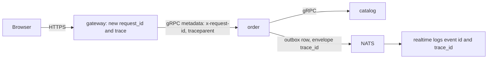

<div dir="rtl">

# لاگ و ردیابی خطا

این فصل به یک سؤال جواب می‌دهد: هر سرویس سرمیز چه چیزی و با چه شکلی لاگ می‌کند، چه چیزی هرگز نباید در لاگ بیاید، و وقتی کسب‌وکاری می‌گوید «چیزی کار نمی‌کند» چطور از روی لاگ و خطاها علت را پیدا می‌کنی؟

[بازگشت به فهرست مستندات](../README.md)

## ۱. چرا مهم است

یک سفارش در سرمیز از `gateway`، `order`، `catalog`، outbox، NATS و `realtime` رد می‌شود تا به صفحه‌ی آشپزخانه برسد. وقتی صاحب کافه زنگ می‌زند که «سفارش‌ها نمی‌آیند»، تو به سرور SSH نمی‌زنی و فایل نمی‌خوانی؛ در Loki یک شناسه را دنبال می‌کنی و در چند دقیقه می‌فهمی زنجیره کجا پاره شده. این فقط وقتی ممکن است که همه‌ی سرویس‌ها یک شکل لاگ کنند. طرف دیگرش هم مهم است: لاگ جایی است که شماره‌ی موبایل، کد ورود و توکن‌ها راحت نشت می‌کنند، و لاگ ۱۴ روز می‌ماند.

## ۲. تصمیم‌ها در یک نگاه

| موضوع | تصمیم | چرا |
|---|---|---|
| قالب | JSON روی stdout؛ `log/slog` در Go و `structlog` در Python | ماشین بخواند و جست‌وجو کند؛ جمع‌آوری کار cluster است، نه سرویس |
| فیلدهای اجباری | `time`، `level`، `service`، `env`، `request_id`، `trace_id`، `venue_id`، `user_id`، `msg` | با یک فیلد بشود همه‌ی خط‌های یک درخواست یا یک کسب‌وکار را پیدا کرد |
| جمع‌آوری | Loki | کنار Grafana، با همان داشبوردها و یک زبان پرس‌وجو |
| نگه‌داری | ۱۴ روز | برای بررسی مشکل کافی است و دیسک یک سرور را پر نمی‌کند |
| داده‌ی حساس | شماره‌ی موبایل پوشیده؛ کد ورود، توکن، اطلاعات درگاه و کارت هرگز | لاگ را آدم‌های بیشتری می‌بینند تا دیتابیس |
| ردیابی خطا | GlitchTip روی سرور خودمان، با Sentry SDK در Go، Python و وب | خطاها گروه‌بندی می‌شوند و با stack trace و نسخه دیده می‌شوند |
| نسخه | `release` برابر git SHA | بفهمی خطا از کدام استقرار شروع شد |
| وب | source map برای GlitchTip آپلود می‌شود | stack trace کد minifyشده خواناست |
| شروع کار | `W2-PA-3`، روی شاسی `W1-PA-2` | از هفته‌ی ۲ هر خط لاگ `request_id` و `trace_id` دارد |

## ۳. شکل یک خط لاگ

یک رویداد، یک خط JSON. نمونه از سرویس `order`:

</div>

```json
{"time":"2026-11-10T12:00:00Z","level":"info","service":"order","env":"production",
 "request_id":"01JC...","trace_id":"4bf92f3577b34da6a3ce929d0e0e4736",
 "venue_id":"9b1d...","user_id":"","msg":"order created","order_id":"5f0e...","code":42}
```

<div dir="rtl">

| فیلد | از کجا می‌آید | نکته |
|---|---|---|
| `time` | خود logger | UTC به شکل `RFC 3339` |
| `level` | کد | بخش ۴ |
| `service`، `env` | config سرویس هنگام شروع | در هر خط، بدون اینکه کد تو کاری کند |
| `request_id` | `gateway` می‌سازد و با metadata `x-request-id` می‌فرستد | در جواب خطا هم برمی‌گردد (بخش ۶٫۱ مشخصات فنی) |
| `trace_id` | OpenTelemetry، از context درخواست | همان شناسه‌ای که در Tempo دنبالش می‌گردی |
| `venue_id`، `user_id` | metadata مطمئن `x-venue-id` و `x-user-id` | برای مهمان `user_id` خالی است |
| `msg` | کد | جمله‌ی کوتاه انگلیسی و ثابت؛ مقدارها در فیلد جدا |

قاعده‌ی مهم: `msg` را با مقدار نساز (<span dir="ltr">`"order " + id + " created"`</span>). پیام ثابت بنویس و مقدار را فیلد کن، وگرنه نمی‌شود روی پیام فیلتر کرد. شاسی `libs/go/kit` فیلدهای ثابت را از context برمی‌دارد؛ تو فقط <span dir="ltr">`logger.InfoContext(ctx, "order created", "order_id", id)`</span> می‌نویسی. اگر در سرویسی دیدی `request_id` خالی است، یعنی `ctx` را جایی گم کرده‌ای.

> [!NOTE]
> `slog` سطح را با حروف بزرگ (`INFO`) و `structlog` معمولاً با حروف کوچک می‌نویسد. پیشنهاد اولیه: شاسی و سرویس `ai` هر دو حروف کوچک بنویسند تا پرس‌وجوهای Loki یکی باشند. این را `W1-PA-2` قطعی می‌کند.

## ۴. سطح لاگ

| سطح | کی | نمونه در سرمیز |
|---|---|---|
| `debug` | جزئیات برای عیب‌یابی محلی | ورودی و خروجی `PriceItems` با جزئیات گزینه‌ها |
| `info` | اتفاق عادی و مهم کسب‌وکار | سفارش ثبت شد، وضعیت عوض شد، کسب‌وکار ساخته شد |
| `warn` | چیز غیرعادی که سیستم خودش از پسش برآمد | تلاش دوباره‌ی relay برای انتشار، circuit breaker باز شد، رویداد تکراری کنار گذاشته شد |
| `error` | کاری که باید انجام می‌شد و نشد و کسی باید نگاه کند | دیتابیس در دسترس نیست، پاسخ نامفهوم از درگاه، panic |

پیشنهاد اولیه: در `staging` و `production` سطح پیش‌فرض `info` باشد و `debug` فقط با تغییر config موقت روشن شود. یک خط `info` برای هر درخواست کافی است (شاسی می‌نویسد: متد، کد نتیجه، مدت)؛ برای هر حلقه و هر query لاگ ننویس.

## ۵. `request_id` و `trace_id` در طول مسیر

</div>



<div dir="rtl">

- `gateway` برای هر درخواست یک `request_id` تازه می‌سازد و یک trace شروع می‌کند. پیشنهاد اولیه: `request_id` فرستاده‌شده از بیرون را قبول نکن، چون هر کسی می‌تواند هر چیزی بفرستد.
- هر تماس gRPC، `x-request-id` و W3C trace context را در metadata می‌برد. interceptorهای شاسی آن‌ها را در context می‌گذارند.
- رویداد `request_id` ندارد، ولی پاکت رویداد `trace_id` دارد (بخش ۶٫۳ مشخصات فنی). مصرف‌کننده (`realtime`، `ai`، `catalog`) هنگام پردازش، `trace_id` و `id` رویداد را لاگ می‌کند. پس از درخواست به رویداد با `trace_id` می‌رسی.
- وقتی کاربر خطا می‌بیند، `request_id` در بدنه‌ی خطاست. پیشنهاد اولیه: وب آن را به‌عنوان «کد پیگیری» در پیام خطا نشان بدهد تا صاحب کسب‌وکار بتواند برایت بفرستد.

## ۶. چیزهایی که هرگز لاگ نمی‌شوند

| چیز | چرا | به جایش |
|---|---|---|
| کد یک‌بارمصرف | با آن می‌شود وارد حساب دیگری شد | «otp sent» با شماره‌ی پوشیده |
| توکن دسترسی، توکن تازه‌سازی، ticket وب‌سوکت، `order_token` | هر کدام یک کلید است | `jti` یا `family_id` اگر لازم است |
| کوکی‌ها و header `Authorization` | همان توکن‌ها هستند | هیچ |
| اطلاعات درگاه کسب‌وکار (`credentials_enc` و نسخه‌ی رمزگشایی‌شده) | پول کسب‌وکار | فقط `venue_id` و `mode` |
| داده‌ی کارت | سرمیز اصلاً نباید آن را ببیند | هیچ |
| شماره‌ی موبایل کامل | داده‌ی شخصی صاحب کسب‌وکار | شماره‌ی پوشیده |
| راز header تماس با `ai`، رمز دیتابیس، کلیدها | راز | هیچ |
| بدنه‌ی کامل درخواست‌های <span dir="ltr">`/auth/*`</span> و پرداخت | همه‌ی موارد بالا داخلشان است | فقط فیلدهای بی‌خطر |

پوشاندن شماره: مشخصات فنی شکلش را تعیین نکرده. پیشنهاد اولیه: کد کشور و سه رقم اول اپراتور و دو رقم آخر بماند، بقیه ستاره. بهتر از تابع، یک نوع است که خودش موقع لاگ پوشیده شود، تا فراموش کردن ممکن نباشد:

</div>

```go
// example for libs/go/kit: a phone type that masks itself in slog
type Phone string

func (p Phone) LogValue() slog.Value {
	s := string(p)
	if len(s) < 8 {
		return slog.StringValue("***")
	}
	return slog.StringValue(s[:6] + strings.Repeat("*", len(s)-8) + s[len(s)-2:])
}
// slog.Info("otp sent", "phone", Phone("+989120000000")) logs "+98912*****00"
```

<div dir="rtl">

در Python همین کار را با یک processor در `structlog` بکن که کلیدهای `phone` را پوشیده کند. یک تست بنویس که خروجی logger را بگیرد و ثابت کند شماره‌ی کامل در آن نیست.

## ۷. Loki: جمع‌آوری و پرس‌وجو

سرویس فقط روی stdout می‌نویسد. یک agent روی node، خروجی containerها را می‌خواند و به Loki می‌فرستد. اینکه کدام agent، تصمیم زوج پلتفرم در `W2-PA-3` است؛ مشخصات فنی آن را تعیین نکرده.

**label در برابر فیلد.** Loki لاگ‌ها را با labelها دسته می‌کند و هر ترکیب تازه‌ی label یک جریان جدا می‌سازد. پس label فقط برای چیزهای کم‌تعداد است: `env`، `service`، `namespace`، `pod`. `request_id`، `venue_id`، `user_id` و `order_id` هرگز label نیستند؛ آن‌ها را هنگام پرس‌وجو با <span dir="ltr">`| json`</span> از متن بیرون می‌کشی.

چند پرس‌وجوی LogQL نمونه:

</div>

```text
# errors of the order service in production
{env="production", service="order"} | json | level="error"

# every line of one request, across all services
{env="production"} | json | request_id="01JC..."

# one venue in the last hour (choose the time range in Grafana)
{env="production", service=~"order|realtime"} | json | venue_id="9b1d..."

# error lines per service, for a dashboard panel
sum by (service) (count_over_time({env="production"} | json | level="error" [5m]))
```

<div dir="rtl">

**نگه‌داری.** ۱۴ روز، طبق مشخصات فنی. در Loki این یک تنظیم retention است؛ مطمئن شو واقعاً پاک می‌کند (فشرده‌سازی و پاک کردن باید روشن باشد) و دیسک را زیر نظر داشته باش، چون هشدار دیسک روی ۸۰٪ است. پیشنهاد اولیه: `staging` همان ۱۴ روز یا کمتر؛ بیشتر لازم نیست.

## ۸. GlitchTip و Sentry SDK

GlitchTip یک سرویس ردیابی خطای self-hosted است که با SDKهای Sentry کار می‌کند: خطاها را با stack trace جمع می‌کند، خطاهای یکسان را یک «issue» می‌کند و می‌گوید از کدام نسخه شروع شده‌اند.

| کجا | SDK | چه کسی گزارش می‌دهد |
|---|---|---|
| سرویس‌های Go | `sentry-go`، داخل شاسی `libs/go/kit` | interceptor بازیابی panic و نگاشت خطا: فقط خطاهایی که به `internal` یا `unavailable` می‌رسند |
| سرویس `ai` | `sentry-sdk` با یکپارچگی FastAPI | exceptionهای پیش‌بینی‌نشده و شکست پردازش رویداد |
| وب | Sentry SDK برای React | error boundaryها (بخش ۱۹ مشخصات فنی) و خطاهای پیش‌بینی‌نشده‌ی شبکه |

قواعد مشترک:

1. **`release` برابر git SHA.** همان SHA که tag image است. در Go و Python از متغیر محیطی که Helm از tag image پر می‌کند بخوان؛ در وب هنگام build در CI.
2. **`environment` برابر `env`.** خطای `staging` نباید با `production` قاطی شود.
3. **DSN از config.** DSN سرویس‌های بک‌اند در Kubernetes secret است. DSN وب ناچار در مرورگر دیده می‌شود؛ این عادی است.
4. **داده‌ی حساس نفرست.** ارسال خودکار داده‌ی شخصی را خاموش کن و در hook پیش از ارسال، کوکی‌ها، `Authorization` و بدنه‌ی <span dir="ltr">`/auth/*`</span> و پرداخت را پاک کن. همان فهرست بخش ۶.
5. **source map برای وب.** CI بعد از build وب، source mapها را با همان `release` به GlitchTip آپلود می‌کند. پیشنهاد اولیه: فایل‌های <span dir="ltr">`.map`</span> را روی CDN منتشر نکن. ابزار و دستور آپلود را از مستندات رسمی GlitchTip بردار.

اینکه GlitchTip برای issue تازه در گروه پیام‌رسان هم خبر بدهد یا نه، در مشخصات فنی نیامده؛ پیشنهاد اولیه: فقط برای `production`، و تیم در `W3-PA-2` تصمیم می‌گیرد. مدت نگه‌داری رویدادها در GlitchTip را هم همان‌جا تعیین کنید.

## ۹. خطا یا نتیجه‌ی عادی کسب‌وکار؟

اگر هر `not_found` در GlitchTip برود، آنجا پر از نویز می‌شود و خطای واقعی گم می‌شود. قاعده: **خطا یعنی چیزی که برنامه‌نویس باید درست کند.** جوابی که کاربر به‌خاطر ورودی یا وضعیت خودش گرفته، خطا نیست.

| حالت | سطح لاگ | GlitchTip | metric |
|---|---|---|---|
| `validation_failed`، `not_found`، `permission_denied` | `info` | نه | از RED هر متد |
| `rate_limited` | `info` | نه | از RED `gateway` |
| کد ورود اشتباه | `info`، بدون کد | نه | — |
| آیتم تمام‌شده یا گزینه‌ی نامعتبر در `PriceItems` (`failed_precondition`) | `info` | نه | — |
| مهمان پرداخت را لغو کرد یا verify درگاه موفق نبود | `warn` | نه | `payments_failed_total`؛ هشدار از روی آن |
| درگاه جواب نامفهوم داد یا timeout شد | `error` | بله | `payments_failed_total` |
| رویداد تکراری که کنار گذاشته شد | `debug` | نه | — |
| رویدادی که بعد از تلاش‌های دوباره هم پردازش نشد، یا `version` ناشناخته | `error` | بله | — |
| دیتابیس، Redis یا NATS در دسترس نیست | `error` | بله، ولی گروه‌بندی‌شده | <span dir="ltr">`/readyz`</span> و هشدارها |
| panic | `error` | بله | — |

دقیق کردن اینکه `payments_failed_total` دقیقاً با چه چیزی زیاد شود، با زوج سفارش در `W4-ORD-2` است؛ هشدار پرداخت در [فصل ۱۶](16-monitoring-and-alerts.md) به همین عدد تکیه دارد.

## ۱۰. بررسی قدم‌به‌قدم: «سفارش‌ها به آشپزخانه نمی‌رسند»

صاحب یک کافه پیام داده که از نیم ساعت پیش سفارش تازه روی صفحه‌ی آشپزخانه نمی‌آید.

1. **بپرس و بنویس.** نام یا `slug` کسب‌وکار، از کی، همه‌ی سفارش‌ها یا فقط پرداخت آنلاین، و آیا صفحه‌ی آشپزخانه نشانگر «قطع اتصال» را نشان می‌دهد. `venue_id` را از پنل ادمین پیدا کن.
2. **اول ببین مشکل عمومی است یا نه.** داشبورد overview: نرخ خطا، `p95`، و هشدارهای فعال. در GlitchTip ببین issue تازه‌ای هست و `release` آن همان استقرار امروز است یا نه. اگر بله، احتمالاً rollback ([فصل ۱۴](14-ci-cd-and-version-control.md)).
3. **آیا سفارش اصلاً ثبت شده؟** در Loki:

</div>

```text
{env="production", service="order"} | json | venue_id="9b1d..." | msg="order created"
```

<div dir="rtl">

4. **اگر ثبت نشده:** همان پرس‌وجو را بدون فیلتر `msg` بزن و دنبال `CreateOrder` با کد خطا بگرد. علت‌های رایج: `catalog` در دسترس نیست (`unavailable`)، آیتم تمام‌شده، یا `rate_limited` برای میز (۲۰ سفارش در ۵ دقیقه). `request_id` یک خط را بردار و همه‌ی خط‌های آن درخواست را در همه‌ی سرویس‌ها ببین.
5. **اگر ثبت شده ولی دیده نمی‌شود:** وضعیتش را ببین. سفارش آنلاین تا پرداخت تأیید نشود در `awaiting_payment` است و آشپزخانه اصلاً آن را نشان نمی‌دهد. اگر چند سفارش آنلاین پشت سر هم پرداخت‌نشده مانده‌اند، مشکل در پرداخت است: `payments_failed_total` و لاگ `HandleCallback`.
6. **اگر `pending` است ولی روی صفحه نیست:** صفحه‌ی آشپزخانه هر ۳۰ ثانیه سفارش‌ها را از API می‌خواند. اگر حتی بعد از تازه کردن صفحه هم نیست، مشکل در API فهرست سفارش‌ها یا مرورگر است، نه در رویدادها. اگر بعد از تازه کردن می‌آید ولی زنده نمی‌آید، مسیر رویداد را دنبال کن: `outbox_lag_seconds`، سلامت NATS، و در Loki <span dir="ltr">`{service="realtime"}`</span> با `trace_id` همان سفارش.
7. **trace را باز کن.** `trace_id` را در Tempo جست‌وجو کن تا ببینی هر قدم چقدر طول کشید و کجا شکست خورد.
8. **ببند.** در یک issue بنویس چه شد، علت، و چه چیزی درستش کرد. اگر هشداری باید زودتر خبر می‌داد و نداد، آن را هم درست کن. اگر علت باگ بود، تستی بنویس که دوباره نیفتد.

> [!TIP]
> این سناریو را یک بار در `staging` تمرین کن: `realtime` را خاموش کن، سفارش بده و همین قدم‌ها را برو. وقتی مشکل واقعی پیش بیاید، دیگر اولین بارت نیست.

## چک‌لیست انتشار ۱

- [ ] همه‌ی سرویس‌ها JSON با همه‌ی فیلدهای اجباری روی stdout می‌نویسند و سطح‌ها یک شکل‌اند.
- [ ] `request_id` و `trace_id` در هر خط لاگ درخواست هست و `request_id` در هر جواب خطا برمی‌گردد.
- [ ] مصرف‌کننده‌های رویداد `id` رویداد و `trace_id` را لاگ می‌کنند.
- [ ] تست خودکار ثابت می‌کند شماره‌ی کامل، کد ورود و توکن در لاگ نمی‌آیند.
- [ ] Loki لاگ هر دو محیط را دارد و بعد از ۱۴ روز پاک می‌کند.
- [ ] GlitchTip خطای Go، Python و وب را با `release` برابر git SHA و `environment` درست می‌گیرد.
- [ ] stack trace وب در GlitchTip با source map خواناست.
- [ ] سناریوی «سفارش‌ها نمی‌رسند» یک بار در `staging` تمرین شده است.

## اشتباه‌های رایج

| اشتباه | چرا بد است | چه کار کن |
|---|---|---|
| `fmt.Println` یا `log.Printf` | خط بدون JSON و بدون `request_id` | فقط logger شاسی با `ctx` |
| لاگ کردن کل struct درخواست | توکن یا شماره همراهش می‌رود | فیلدهای مشخص و بی‌خطر را لاگ کن |
| `request_id` یا `venue_id` به‌عنوان label در Loki | هزاران جریان؛ Loki کند می‌شود و حافظه می‌خورد | label کم‌تعداد؛ بقیه را هنگام پرس‌وجو با پارسر `json` بخوان |
| فرستادن هر `not_found` به GlitchTip | خطای واقعی زیر نویز گم می‌شود | جدول بخش ۹ |
| لاگ `error` و برگرداندن خطا در هر لایه | یک خطا پنج بار لاگ می‌شود | خطا را با <span dir="ltr">`%w`</span> بپیچان و فقط یک جا، در لبه، لاگ کن |
| خطای وب بدون source map | stack trace بی‌معنی | آپلود در CI با همان `release` |
| `debug` روشن در `production` و فراموش شده | دیسک پر می‌شود | `debug` فقط موقت و با یادآوری خاموش کردن |

## کار با AI روی این موضوع

**فایل‌هایی که به دستیار می‌دهی:** `AGENTS.md`، بخش ۱۲ و ۱۷ از `docs/SPEC.md`، همین فصل، `libs/go/kit/README.md`، و فایل logger شاسی.

پرامپت برای `W2-PA-3`:

</div>

```text
روی کار W2-PA-3 کار می‌کنیم. AGENTS.md، بخش ۱۲ از docs/SPEC.md و docs/guide/15-logs-and-error-tracking.md را بخوان.
هنوز کد ننویس. بگو در libs/go/kit کجا باید request_id و trace_id از context به هر خط لاگ اضافه شوند،
و کجا خطا به GlitchTip فرستاده شود تا فقط internal و unavailable گزارش شوند.
برای هر تصمیمی که در مستندات نیست، سؤال بپرس.
```

<div dir="rtl">

پرامپت بازبینی لاگ‌ها قبل از PR:

</div>

```text
diff این شاخه را فقط از نظر لاگ بخوان. دنبال این‌ها بگرد:
لاگ شدن کد ورود، توکن، کوکی، Authorization، اطلاعات درگاه یا شماره‌ی کامل؛
لاگی که ctx نمی‌گیرد؛ msg که با مقدار ساخته شده؛ خطایی که چند بار لاگ می‌شود؛
و خطای عادی کسب‌وکار که به GlitchTip می‌رود. برای هر مورد فایل و خط بده.
```

<div dir="rtl">

پرامپت ساختن پرس‌وجو:

</div>

```text
یک پرس‌وجوی LogQL بنویس که در env=production همه‌ی خط‌های سرویس order و realtime را
برای venue_id برابر <شناسه> در یک ساعت گذشته نشان دهد، فقط سطح warn و error.
venue_id را label فرض نکن؛ با | json از متن بخوان. هر بخش پرس‌وجو را توضیح بده.
```

<div dir="rtl">

**خودت حتماً بررسی کن:**

- لاگ واقعی، خروجی Loki یا رویداد GlitchTip از `production` را به دستیار نده؛ ممکن است داده‌ی کسب‌وکارها در آن باشد. نمونه‌ی ساختگی بساز.
- بعد از هر تغییر logger، یک ورود کامل در `staging` انجام بده و در Loki دنبال شماره‌ی خودت بگرد. نباید پیدا شود.
- نام بسته‌ها و تنظیمات SDK را از مستندات رسمی Sentry و GlitchTip بردار.

## بیشتر بخوان

- [مشخصات فنی](../SPEC.md): بخش ۶٫۱ (قالب خطا)، بخش ۶٫۳ (پاکت رویداد)، بخش ۱۲ (مشاهده‌پذیری) و بخش ۱۷ (پایه‌ی امنیت).
- [فصل ۱۰: امنیت و پرداخت](10-security-and-payments.md)
- [فصل ۱۳: میزبانی و زیرساخت ابری](13-hosting-and-cloud.md)
- [فصل ۱۴: CI/CD و کنترل نسخه](14-ci-cd-and-version-control.md)
- [فصل ۱۶: مانیتورینگ و هشدار](16-monitoring-and-alerts.md)
- [فصل ۲۳: حریم خصوصی، قانون و هزینه](23-privacy-legal-cost.md)

</div>
