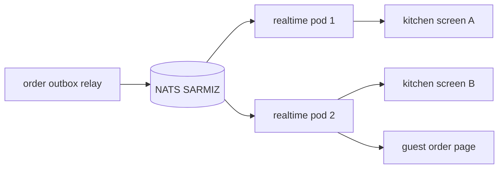

<div dir="rtl">

# مقیاس‌پذیری و تاب‌آوری

این فصل به یک سؤال جواب می‌دهد: اگر بار سرمیز ده برابر شود، یا یکی از سرویس‌ها از کار بیفتد، چه چیزی اول می‌شکند و کد باید چه کار کند که بقیه‌ی سیستم سرپا بماند؟

[بازگشت به فهرست مستندات](../README.md)

## ۱. چرا مهم است

جمعه شب یک کافه‌ی شلوغ، صفحه‌ی آشپزخانه تنها راهی است که سفارش‌ها به آشپز می‌رسند. اگر `catalog` بیفتد و `order` بی‌محابا منتظرش بماند، صف درخواست‌ها پر می‌شود و حتی فهرست سفارش‌های آشپزخانه هم کند می‌شود، در حالی که آن فهرست اصلاً به `catalog` نیازی ندارد. تاب‌آوری (resilience) یعنی خرابی یک قسمت فقط همان قسمت را از کار بیندازد. مقیاس‌پذیری یعنی بدانی با رشد بار کدام قسمت اول به سقف می‌رسد و از قبل راهش را آماده کرده باشی.

## ۲. تصمیم‌ها در یک نگاه

| موضوع | تصمیم | چرا |
|---|---|---|
| سرویس‌های Go | stateless (بی‌حالت)؛ در `production` دست‌کم ۲ replica از `gateway`، `catalog`، `order` و `realtime`، با HorizontalPodAutoscaler روی CPU ۷۰٪ | یک pod می‌تواند بمیرد یا عوض شود بدون اینکه کسی بفهمد |
| `realtime` | هر pod به NATS وصل است و اتصال‌های خودش را سرویس می‌دهد؛ sticky session لازم نیست | هر pod می‌تواند هر صفحه‌ای را سرویس بدهد |
| دیتابیس | pool کوچک pgx در هر pod (شروع با ۱۰)، ایندکس‌هایی که با `venue_id` شروع می‌شوند، PgBouncer و replica خواندنی بعداً | اول کارهای ارزان، بعد زیرساخت تازه |
| تماس بین سرویس‌ها | deadline برای هر تماس (پیش‌فرض ۲ ثانیه)، retry فقط برای خواندن idempotent و با jitter، circuit breaker روی کلاینت‌های gRPC و HTTP | یک سرویس کند نباید بقیه را با خودش پایین بکشد |
| رویدادها | outbox تراکنشی و مصرف‌کننده‌ی idempotent | قطعی NATS سفارش را گم نکند |
| درخواست‌های تکراری | هدر `Idempotency-Key` روی `POST .../orders` و `POST .../pay`، نگه‌داری ۲۴ ساعت | تلاش دوباره‌ی مرورگر سفارش دوم نسازد |
| کارهای سنگین AI | صف کار NATS با سقف هم‌زمانی | مدل کند است و نباید زیر هجوم درخواست خفه شود |
| رفتار هنگام خرابی | جدول بخش ۱۶ مشخصات فنی | هر خرابی یک رفتار تعریف‌شده و قابل‌آزمون دارد |
| مسیر رشد | سه node، PostgreSQL مدیریت‌شده با replica، Redis با replica، سه node برای NATS | بخش ۱۵ مشخصات فنی |

## ۳. مقیاس سرمیز امروز، و ده برابر آن

| هدف بخش ۳ | مقدار | به زبان درخواست |
|---|---|---|
| کسب‌وکار فعال | ۵۰ | |
| مهمان هم‌زمان | ۵۰۰ | بیشترشان منو را یک بار می‌گیرند و بعد از کش مرورگر و CDN می‌خوانند |
| اوج سفارش | ۲۰ در دقیقه | یعنی یک سفارش هر ۳ ثانیه؛ برای PostgreSQL بسیار کم است |
| اتصال WebSocket | ۱۰۰ پنل و ۵۰۰ مهمان | ۶۰۰ اتصال باز که بیشترشان بی‌کارند |

این بار برای یک سرور ۸ هسته‌ای کم است. پس در انتشار ۱ خطر اصلی **خرابی** است، نه **بار**. با این حال باید بدانی در ده برابر (۵۰۰ کسب‌وکار، ۵۰۰۰ مهمان، ۲۰۰ سفارش در دقیقه، ۶۰۰۰ اتصال) چه چیزی اول می‌شکند. برآورد اولیه، به ترتیب (آزمون بار `W3-PA-3` باید آن را تأیید یا رد کند):

1. **سرور مدل.** هر جواب دستیار یا ترجمه چند ثانیه CPU یا GPU می‌گیرد. حتی امروز هم این اولین گلوگاه است؛ برای همین سقف هم‌زمانی و محدودیت نرخ دارد.
2. **اتصال‌های PostgreSQL.** HPA تعداد pod را بالا می‌برد و هر pod ۱۰ اتصال تازه می‌خواهد. خیلی زودتر از اینکه PostgreSQL از نظر CPU خسته شود، سقف اتصال پر می‌شود (بخش ۶).
3. **تک‌سرور.** همه‌چیز روی یک ماشین k3s است. ده برابر بار یعنی CPU و حافظه‌ی مشترک، و خاموشی همان یک ماشین یعنی خاموشی همه. اینجا مسیر رشد سه‌node لازم می‌شود.
4. **queryهای بی‌ایندکس.** جدول `orders` روزبه‌روز بزرگ‌تر می‌شود؛ queryای که امروز روی هزار ردیف سریع است، روی یک میلیون ردیف کند می‌شود.
5. **`realtime` و NATS تک‌node.** هر pod همه‌ی رویدادها را می‌گیرد و فیلتر می‌کند؛ با ۶۰۰۰ اتصال حافظه و پخش رویداد را باید اندازه گرفت.

## ۴. سرویس بی‌حالت، replica و HPA

بی‌حالت یعنی هیچ چیزِ مهمی فقط در حافظه‌ی یک pod نیست. سفارش و پرداخت در PostgreSQL، کد یک‌بارمصرف و کش در Redis، رویداد در NATS، توکن در کوکی و سبد مهمان در `localStorage` مرورگر است. در حافظه فقط چیزی می‌ماند که از نو ساخته می‌شود، مثل کش JWKS در `gateway`.

- **دست‌کم ۲ replica:** هنگام استقرار تازه (rolling update) و وقتی یک pod می‌میرد، دیگری جواب می‌دهد.
- **HPA روی CPU ۷۰٪:** درصد CPU نسبت به `resources.requests` حساب می‌شود؛ بدون request، HPA کار نمی‌کند. request و limit را `W5-PA-3` تعیین می‌کند.
- **خاموشی آرام:** شاسی (`W1-PA-2`) با سیگنال SIGTERM اول <span dir="ltr">`/readyz`</span> را ناموفق می‌کند، درخواست‌های در جریان را تمام می‌کند و بعد بسته می‌شود.
- تعداد replica برای `identity` و `ai` در مشخصات فنی نیامده؛ `W5-PA-3` تعیینش می‌کند.

</div>

```yaml
# example only: the generic Helm chart from W1-PA-6 renders this
apiVersion: autoscaling/v2
kind: HorizontalPodAutoscaler
metadata: {name: order}
spec:
  scaleTargetRef: {apiVersion: apps/v1, kind: Deployment, name: order}
  minReplicas: 2
  maxReplicas: 4   # initial suggestion, bounded by the pool arithmetic below
  metrics:
    - type: Resource
      resource: {name: cpu, target: {type: Utilization, averageUtilization: 70}}
```

<div dir="rtl">

## ۵. `realtime` بدون sticky session

sticky session یعنی load balancer هر کاربر را همیشه به همان pod بفرستد. سرمیز به آن نیاز ندارد، چون هیچ pod چیزی را نمی‌داند که pod دیگر نداند:

</div>



<div dir="rtl">

1. هر pod **همه‌ی** رویدادهای سفارش را می‌گیرد و فقط به اتصال‌هایی می‌فرستد که scope بلیتشان (<span dir="ltr">`venue:<venue_id>`</span> یا <span dir="ltr">`order:<order_id>`</span>) با رویداد می‌خواند.
2. اگر pod بمیرد، مرورگر با backoff دوباره وصل می‌شود، بلیت تازه می‌گیرد و به هر pod که رسید وصل می‌شود.
3. پنل بعد از هر اتصال دوباره وضعیت واقعی را از `GET /venues/{venue_id}/orders` می‌خواند، و هر ۳۰ ثانیه هم برای اطمینان. پس رویداد گم‌شده سفارش را گم نمی‌کند.

> [!WARNING]
> در `realtime` از queue group در NATS استفاده نکن. queue group هر رویداد را فقط به **یکی** از podها می‌دهد؛ صفحه‌ی آشپزخانه‌ای که به pod دیگر وصل است سفارش را نمی‌بیند. برعکس، مصرف‌کننده‌های `ai` و `catalog` باید رویداد را بین replicaها **تقسیم** کنند تا هر رویداد یک بار پردازش شود (بخش ۱۰).

## ۶. مقیاس دیتابیس، قدم‌به‌قدم

**قدم ۱: حساب اتصال‌ها.** هر pod یک pool جدا دارد، پس جمع اتصال‌ها برابر «بیشینه‌ی تعداد pod ضرب در اندازه‌ی pool» است. PostgreSQL به‌طور پیش‌فرض `max_connections = 100` دارد و هشدار بخش ۱۲ بالای ۸۰٪ آن به صدا درمی‌آید. یک حساب نمونه با `maxReplicas` پیشنهادی:

| سرویس | بیشینه‌ی pod | pool | اتصال |
|---|---|---|---|
| `identity` | ۲ | ۱۰ | ۲۰ |
| `catalog` | ۴ | ۱۰ | ۴۰ |
| `order` | ۴ | ۱۰ | ۴۰ |
| `ai` | ۲ | ۵ | ۱۰ |
| migration، پشتیبان، اتصال دستی | | | حدود ۵ |
| **جمع** | | | **۱۱۵ از ۱۰۰** |

یعنی با همین عددهای کوچک، اگر HPA همه‌چیز را بالا ببرد، اتصال کم می‌آوری. اگر `staging` هم روی همان سرور PostgreSQL باشد، اتصال‌های آن را هم اضافه کن. راه‌ها به ترتیب: pool کوچک‌تر (۵ تا ۸ برای سرویس‌های کم‌بار)، سقف `maxReplicas` متناسب با این جدول، بالا بردن `max_connections` (حافظه می‌خورد)، و در آخر PgBouncer. عدد واقعی را با <span dir="ltr">`SHOW max_connections;`</span> روی سرور خودتان ببین.

**قدم ۲: ایندکس.** ایندکس‌هایی که با `venue_id` شروع می‌شوند و plan خوانده‌شده با `EXPLAIN` ([فصل ۸](08-database-and-storage.md)). ارزان‌ترین و مؤثرترین قدم.

**قدم ۳: PgBouncer.** یک connection pooler (واسطی که اتصال‌های زیاد کلاینت را روی چند اتصال واقعی سوار می‌کند) جلوی PostgreSQL. در حالت transaction pooling باید تنظیم pgx با آن سازگار شود؛ این را هر وقت لازم شد با سند تصمیم اضافه کنید.

**قدم ۴: replica خواندنی.** برای گزارش فروش و ساختن منوی عمومی وقتی کش خالی است. replica کمی عقب است، پس وضعیت سفارش و پرداخت را هیچ‌وقت از replica نخوان.

**قدم ۵: partitioning.** تقسیم جدول `orders` بر اساس زمان؛ کار انتشارهای بعدی است، نه انتشار ۱.

## ۷. timeout، retry با jitter و circuit breaker

**timeout.** هر تماس بیرونی deadline دارد؛ پیش‌فرض ۲ ثانیه. `context` درخواست را تا پایین زنجیره پاس بده تا وقتی کاربر رفته، کار هم متوقف شود.

</div>

```go
// example only
ctx, cancel := context.WithTimeout(ctx, 2*time.Second)
defer cancel()
priced, err := c.catalog.PriceItems(ctx, req)
if err != nil {
	return nil, fmt.Errorf("price items: %w", err) // mapped to unavailable by the kit
}
```

<div dir="rtl">

**retry.** فقط خواندن‌های idempotent را دوباره بفرست، مثل `ResolveTable` و `PriceItems` که چیزی را عوض نمی‌کنند. `CreateOrder`، `StartPayment` یا هر نوشتنی را خودکار تکرار نکن. فاصله‌ی تلاش‌ها تصادفی است (jitter)، وگرنه صد کلاینتی که با هم شکست خورده‌اند با هم دوباره می‌کوبند. تعداد تلاش‌ها داخل همان deadline ۲ ثانیه جا می‌شود؛ پیشنهاد اولیه: حداکثر ۲ تلاش.

**circuit breaker.** یک کلید خودکار دور کلاینت:

| حالت | رفتار |
|---|---|
| بسته | تماس‌ها عادی می‌روند و شکست‌ها شمرده می‌شوند |
| باز | بعد از چند شکست پشت سر هم، تماس اصلاً فرستاده نمی‌شود و فوراً `unavailable` برمی‌گردد |
| نیمه‌باز | بعد از مدتی، یک تماس آزمایشی می‌رود؛ اگر موفق شد کلید بسته می‌شود |

**مثال: `catalog` پایین است.** بدون breaker، هر `CreateOrder` در `order` ۲ ثانیه منتظر `PriceItems` می‌ماند، goroutineها و اتصال‌ها جمع می‌شوند، و `ListOrders` آشپزخانه هم که به `catalog` نیازی ندارد کند می‌شود. با breaker، بعد از چند شکست `CreateOrder` در چند میلی‌ثانیه `503` با کد `unavailable` می‌دهد، مهمان پیام روشن می‌بیند و صفحه‌ی آشپزخانه عادی کار می‌کند. آستانه‌ی شکست، مدت باز ماندن و کتابخانه را `W5-ORD-1` انتخاب می‌کند؛ پیشنهاد اولیه: ۵ شکست پشت سر هم و ۱۰ ثانیه باز.

## ۸. رفتار هنگام خرابی، ردیف به ردیف

| از کار افتاده | چه چیزی کار می‌کند | کاربر چه می‌بیند | کد باید چه کند |
|---|---|---|---|
| `ai` | منو، سفارش، پرداخت | دستیار می‌گوید در دسترس نیست؛ ترجمه و import پیام «دوباره تلاش کن» می‌دهند | `catalog` تماس با `ai` را با timeout و breaker می‌زند و `unavailable` برمی‌گرداند؛ `import.requested` در stream می‌ماند و job در `queued` می‌ماند تا `ai` برگردد |
| `catalog` | سفارش‌های موجود، صفحه‌ی آشپزخانه | منو و سفارش تازه با پیام روشن در دسترس نیستند | breaker در `order` سریع شکست می‌خورد؛ متدهایی که `catalog` لازم ندارند (`ListOrders`، `UpdateOrderStatus`) هیچ تماسی با آن نمی‌گیرند |
| `realtime` | بقیه‌ی سیستم | پنل هر ۵ ثانیه وضعیت را می‌کشد | وب قطع اتصال را تشخیص می‌دهد، نشانگر اتصال را نشان می‌دهد، به polling ۵ ثانیه‌ای می‌رود و با backoff دوباره وصل می‌شود |
| NATS | سفارش ذخیره می‌شود | آشپزخانه با polling به‌روز می‌ماند | هیچ درخواستی به خاطر NATS شکست نمی‌خورد؛ ردیف‌ها در `outbox` می‌مانند و relay تلاش را ادامه می‌دهد؛ هشدار `outbox_lag_seconds` بالای ۶۰ |
| Redis | منو بدون کش | ورود با کد در دسترس نیست | `catalog` با خطای Redis مستقیم از PostgreSQL می‌خواند؛ `gateway` برای مسیرهای OTP بسته شکست می‌خورد و برای منوی عمومی باز |
| درگاه پرداخت | پرداخت در صندوق | دکمه‌ی پرداخت آنلاین پیام «دوباره تلاش کن» می‌دهد | تماس با درگاه timeout دارد؛ پرداختی که verify آن timeout شد `initiated` می‌ماند تا job تطبیق ۵ دقیقه‌ای دوباره بررسی‌اش کند |

> [!NOTE]
> مشخصات فنی برای Redis فقط دو حالت را گفته: مسیرهای OTP بسته، منوی عمومی باز. رفتار بقیه‌ی محدودیت‌های نرخ هنگام قطعی Redis را بخش پلتفرم در `W2-PA-1` تصمیم می‌گیرد و می‌نویسد.

## ۹. کلید idempotency

شبکه‌ی موبایل وسط ثبت سفارش قطع می‌شود؛ مرورگر نمی‌داند سفارش ثبت شد یا نه و دوباره می‌فرستد. بدون کلید، آشپزخانه دو سفارش می‌بیند.

1. وب برای هر بار «ثبت سفارش» یک UUID تازه می‌سازد و در هدر `Idempotency-Key` می‌فرستد. تلاش دوباره‌ی **همان** ثبت، **همان** کلید را می‌فرستد.
2. `order` کلید را در `orders.idempotency_key` ذخیره می‌کند. درخواست دوم با همان کلید سفارش تازه نمی‌سازد و همان سفارش قبلی را برمی‌گرداند.
3. دو درخواست هم‌زمان با یک کلید را قید یکتایی دیتابیس جدا می‌کند، نه یک `SELECT` قبل از `INSERT`. پیشنهاد اولیه: ایندکس یکتا روی (`venue_id`، `idempotency_key`)؛ در `W2-ORD-1` نهایی می‌شود.
4. کلید ۲۴ ساعت معتبر است. جای نگه‌داری کلید برای `POST .../pay` در جدول‌های بخش ۷ نیامده؛ `W4-ORD-2` تصمیمش را می‌گیرد.

همین ایده جاهای دیگر هم هست: مصرف‌کننده‌ی رویداد با `processed_events` و `HandleCallback` با قفل ردیف و «اگر `verified` است همان نتیجه را بده».

## ۱۰. فشار برگشتی برای کارهای AI

فشار برگشتی (backpressure) یعنی وقتی کار سریع‌تر از توان پردازش می‌رسد، کار در صف بماند، نه اینکه مصرف‌کننده زیر بار بخوابد. در انتشار ۱ کار سنگین AI، import منو از عکس و نمایه‌سازی بعد از `menu.changed` است:

1. `catalog` رویداد `import.requested` را منتشر می‌کند و job در وضعیت `queued` است.
2. `ai` با یک consumer مشترک بین replicaها از JetStream می‌خواند و حداکثر N کار را هم‌زمان برمی‌دارد (در JetStream با `MaxAckPending`). پیشنهاد اولیه: N برابر ۱ تا ۲ برای یک سرور Ollama؛ با ارزیابی هفته‌ی ۱ تنظیم شود.
3. بقیه‌ی کارها در stream منتظر می‌مانند. ack فقط بعد از انتشار `import.completed` فرستاده می‌شود؛ اگر `ai` وسط کار بمیرد، پیام دوباره تحویل می‌شود، پس پردازش با `job_id` idempotent است.
4. <span dir="ltr">`/v1/translate`</span> و <span dir="ltr">`/v1/assistant`</span> همگام‌اند و صف ندارند. آن‌ها را با timeout و سقف هم‌زمانی محافظت کن و وقتی سقف پر است فوراً `unavailable` بده، به‌جای اینکه درخواست‌ها بی‌انتها منتظر بمانند.

## ۱۱. کارهای پس‌زمینه با چند replica

وقتی از `order` دو replica داری، هر حلقه‌ی پس‌زمینه هم دو بار اجرا می‌شود: relay outbox، job تطبیق پرداخت هر ۵ دقیقه، لغو سفارش آنلاین پرداخت‌نشده بعد از ۱۵ دقیقه، و در `catalog` بازنشانی شبانه‌ی کسب‌وکارهای نمایشی. هر کدام باید با اجرای هم‌زمان امن باشد:

- کار ردیف‌به‌ردیف را با `FOR UPDATE SKIP LOCKED` بردار تا هر ردیف را فقط یک replica بگیرد.
- شرط وضعیت را در `UPDATE` بگذار تا تکرار اثری نداشته باشد.
- کار شبانه را می‌شود CronJob در Kubernetes کرد تا فقط یک بار اجرا شود.

</div>

```sql
-- example only: expire unpaid online orders, safe with many replicas
UPDATE orders SET status = 'cancelled', updated_at = now()
WHERE id IN (
  SELECT id FROM orders
  WHERE status = 'awaiting_payment' AND expires_at < now()
  ORDER BY expires_at LIMIT 100
  FOR UPDATE SKIP LOCKED)
RETURNING id, venue_id;
```

<div dir="rtl">

این query عمداً روی همه‌ی کسب‌وکارها کار می‌کند و تنها جای مجاز برای query بدون فیلتر `venue_id` همین jobهای سیستمی است. این را در کامنت کد و توضیح PR روشن بگو. در همان تراکنش، برای هر سفارش لغوشده ردیف `outbox` رویداد `order.status_changed` را با `venue_id` خودش بنویس.

## ۱۲. آزمون خرابی کوچک در `staging`

`W5-ORD-1` جدول بخش ۸ را با از کار انداختن واقعی هر قسمت در `staging` می‌آزماید:

1. در گروه تیم خبر بده، داشبوردهای Grafana و یک مهمان و یک صفحه‌ی آشپزخانه را باز کن.
2. یک قسمت را از کار بینداز، مثلاً:

</div>

```bash
# example only: deployment names come from the Helm chart (W1-PA-6)
kubectl -n staging scale deployment/catalog --replicas=0
# try: open a menu, place an order, change a status in the kitchen
kubectl -n staging scale deployment/catalog --replicas=2
```

<div dir="rtl">

3. برای هر ردیف جدول، رفتار دیده‌شده را کنار رفتار مورد انتظار بنویس: پیام کاربر، زمان پاسخ، کد خطا، هشدارهایی که آمد یا نیامد.
4. قسمت را برگردان و ببین خودبه‌خود به حالت عادی برمی‌گردد: ردیف‌های `outbox` فرستاده می‌شوند، صفحه‌ی آشپزخانه دوباره وصل می‌شود.
5. برای هر فرق، issue باز کن.

برای `realtime` یک pod را `kubectl delete pod` کن تا اتصال دوباره را ببینی. برای درگاه پرداخت، پیشنهاد اولیه درگاه جعلی در حالت timeout است؛ روش نهایی را بخش سفارش انتخاب می‌کند. هیچ‌وقت در `production` این آزمون را اجرا نکن.

## ۱۳. خواندن گزارش آزمون بار و تصمیم برای درست کردن

گزارش `W3-PA-3` را این‌طور بخوان: برای هر سناریو p95 در برابر هدف، درصد خطا، و اینکه زمان کجا رفته (trace در Tempo: `gateway`، سرویس، یا دیتابیس). بعد اشباع را ببین: CPU هر pod، اتصال‌های دیتابیس، `outbox_lag_seconds`، `ws_connections`.

| نشانه | علت محتمل | اول این را امتحان کن |
|---|---|---|
| p95 منو بالاست ولی CPU پایین | کش Redis کار نمی‌کند یا ETag برنمی‌گردد | نرخ برخورد کش و هدرها |
| زمان در دیتابیس است | ایندکس نیست یا query در حلقه است | `EXPLAIN`، و یک query به‌جای N تا |
| خطای زمان انتظار pool | pool کوچک یا تراکنش طولانی | تراکنش را کوتاه کن، بعد pool را بسنج |
| CPU یک سرویس نزدیک سقف | کار پرهزینه در مسیر داغ | profile بگیر، بعد replica |
| رسیدن سفارش به آشپزخانه بالای ۲ ثانیه | فاصله‌ی relay outbox یا تأخیر NATS | `outbox_lag_seconds` و فاصله‌ی حلقه‌ی relay |

قاعده: فقط چیزی را درست کن که از هدف رد شده یا نزدیک آن است، و replica اضافه کردن آخرین راه است، نه اولین. بعد از هر تغییر همان سناریو را دوباره اجرا کن و عدد قبل و بعد را در گزارش بنویس. `W5-ORD-2` همین چرخه را برای سرویس سفارش اجرا می‌کند.

## چک‌لیست انتشار ۱

- [ ] `gateway`، `catalog`، `order` و `realtime` در `production` دست‌کم ۲ replica و HPA روی CPU ۷۰٪ دارند، با request و limit.
- [ ] جمع `maxReplicas × pool` همه‌ی سرویس‌ها زیر ۸۰٪ `max_connections` است.
- [ ] همه‌ی تماس‌های gRPC و HTTP بیرونی deadline دارند و کلاینت‌ها breaker دارند.
- [ ] هیچ نوشتنی خودکار retry نمی‌شود.
- [ ] `Idempotency-Key` روی ساخت سفارش و پرداخت کار می‌کند و تست هم‌زمانی دارد.
- [ ] `realtime` با دو pod آزموده شده و هر صفحه‌ی آشپزخانه همه‌ی سفارش‌ها را می‌بیند.
- [ ] همه‌ی jobهای پس‌زمینه با چند replica امن‌اند.
- [ ] هر ردیف جدول بخش ۸ در `staging` آزموده و نتیجه‌اش نوشته شده است.
- [ ] گزارش آزمون بار، تغییرها و اجرای دوباره نوشته شده است.

## اشتباه‌های رایج

| اشتباه | چرا بد است | چه کار کن |
|---|---|---|
| نگه داشتن وضعیت در حافظه‌ی pod | با restart یا replica دوم گم یا ناهمخوان می‌شود | PostgreSQL یا Redis |
| تماس بدون deadline | یک سرویس کند همه‌ی goroutineها را نگه می‌دارد | `context.WithTimeout` روی هر تماس |
| retry روی `CreateOrder` یا پرداخت | سفارش یا پرداخت دوتایی | فقط خواندن‌های idempotent؛ برای نوشتن `Idempotency-Key` |
| retry بدون jitter | همه با هم دوباره می‌کوبند و سرویس در حال برگشت دوباره می‌افتد | فاصله‌ی تصادفی، تعداد محدود |
| queue group در `realtime` | نیمی از صفحه‌های آشپزخانه سفارش را نمی‌بینند | هر pod همه‌ی رویدادها را بگیرد |
| بالا بردن pool برای «سریع‌تر شدن» | اتصال‌های دیتابیس تمام می‌شود | اول ایندکس و تراکنش کوتاه |
| فرستادن مستقیم به NATS در مسیر درخواست | با قطعی NATS ثبت سفارش هم شکست می‌خورد | `outbox` |

## کار با AI روی این موضوع

**فایل‌هایی که به دستیار می‌دهی:** `AGENTS.md`، بخش‌های ۳، ۴٫۱ و ۱۶ از `docs/SPEC.md`، همین فصل، کد کلاینتی که می‌خواهی محکم کنی، و برای آزمون بار گزارش `W3-PA-3`.

بازبینی تاب‌آوری یک کلاینت:

</div>

```text
کلاینت gRPC سرویس order برای catalog را در این فایل‌ها بخوان.
بخش ۴٫۱ و ۱۶ از docs/SPEC.md و docs/guide/18-scaling-and-resilience.md را بخوان.
فهرست کن: کدام تماس deadline ندارد، کدام نوشتن retry می‌شود، retry کجا jitter ندارد،
و اگر catalog کاملاً پایین باشد کدام متد order بی‌دلیل منتظر می‌ماند. کد ننویس، فقط با نام فایل و خط.
```

<div dir="rtl">

امن کردن یک job پس‌زمینه:

</div>

```text
این حلقه‌ی پس‌زمینه در سرویس order با دو replica اجرا می‌شود.
توضیح بده اگر دو replica هم‌زمان اجرایش کنند دقیقاً چه چیزی دو بار اتفاق می‌افتد.
بعد یک نسخه با FOR UPDATE SKIP LOCKED و شرط وضعیت در UPDATE پیشنهاد بده که ردیف outbox را در همان تراکنش بنویسد.
یک تست یکپارچه پیشنهاد بده که دو اجرای هم‌زمان را با PostgreSQL واقعی بسنجد.
```

<div dir="rtl">

**خودت حتماً بررسی کن:** حساب اتصال‌ها را با عددهای واقعی Helm خودت دوباره انجام بده. هر ردیف جدول خرابی را خودت در `staging` ببین، نه از روی حرف دستیار. عددهای breaker و retry که دستیار پیشنهاد می‌دهد را با deadline ۲ ثانیه بسنج.

## بیشتر بخوان

- [مشخصات فنی](../SPEC.md): بخش ۳ (هدف‌ها)، بخش ۴٫۱ (قواعد ارتباط)، بخش ۶٫۱ (`Idempotency-Key`)، بخش ۶٫۴ (WebSocket)، بخش ۱۵ (مسیر رشد)، بخش ۱۶ (مقیاس و رفتار هنگام خرابی).
- [فصل ۳: طراحی سیستم](03-system-design.md)، [فصل ۸: دیتابیس و ذخیره‌سازی](08-database-and-storage.md)، [فصل ۱۳: میزبانی](13-hosting-and-cloud.md).
- [فصل ۱۶: مانیتورینگ و هشدار](16-monitoring-and-alerts.md)، [فصل ۱۷: تست](17-testing.md)، [فصل ۱۹: سرویس هوش مصنوعی](19-ai-service.md).

</div>
