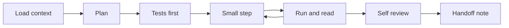

<div dir="rtl">

# کار با AI

چطور با دستیار کدنویسی AI روی سرمیز کار کنی، طوری که سریع‌تر شوی ولی کنترل کد از دستت بیرون نرود.

[فهرست مستندات](../README.md)

## ۱. چرا مهم است

بیشتر کد سرمیز را تو با کمک یک دستیار AI می‌نویسی. دستیار خوب سرعتت را چند برابر می‌کند، ولی دستیار بدون راهنما با اطمینان کامل جدولی می‌سازد که در طرح نیست، endpointی اختراع می‌کند که هیچ‌کس قرارداد نکرده، یا `venue_id` را از یک query جا می‌اندازد و داده‌ی یک کافه را به کافه‌ی دیگر نشان می‌دهد. این ریپو طوری ساخته شده که دستیار همان چیزی را بداند که تو می‌دانی. این فصل می‌گوید چطور از آن استفاده کنی.

## ۲. تصمیم‌ها در یک نگاه

| موضوع | تصمیم | چرا |
|---|---|---|
| استفاده از AI | آزاد و توصیه‌شده | سرعت، و یادگرفتن کار با ابزاری که در هر تیمی هست |
| قواعد دستیار | در `AGENTS.md` در ریشه‌ی ریپو؛ `CLAUDE.md` به همان اشاره می‌کند | بیشتر ابزارها این فایل را خودشان می‌خوانند |
| مرجع فنی دستیار | `docs/SPEC.md`، به انگلیسی | دستیار متن انگلیسی دقیق را بهتر و یکسان‌تر می‌فهمد |
| زبان گفتگو | فارسی؛ کد، commit و نام‌ها انگلیسی | تو راحت‌تر فکر می‌کنی، کد استاندارد می‌ماند |
| مسئولیت کد | با تو، نه با دستیار | منتور درباره‌ی هر خط از تو سؤال می‌کند |
| داده‌ی حساس | هرگز به دستیار داده نمی‌شود | رمزها و داده‌ی مشتری نباید از سیستم بیرون برود |
| جزئیات درگاه و پیامک | از مستندات رسمی، نه از حافظه‌ی دستیار | دستیار این جزئیات را با اطمینان اشتباه می‌گوید |

## ۳. دستیار چه چیزی را از قبل می‌داند

وقتی یک دستیار کدنویسی را در این ریپو باز می‌کنی، این‌ها برایش آماده است:

| فایل | به دستیار چه می‌گوید |
|---|---|
| `AGENTS.md` | تو کی هستی، چطور جواب بدهد، ده قاعده‌ی شکست‌ناپذیر، قراردادهای کد، تعریف «تمام شد» |
| `docs/SPEC.md` | همه‌ی تصمیم‌های فنی: سرویس‌ها، جدول‌ها، مسیرها، رویدادها، محدودیت‌ها |
| `docs/handoffs/week-N/<بخش>.md` | کار این هفته‌ی تو، با معیار پذیرش و پرامپت‌های آماده |
| `services/<نام>/README.md` | مرز و قاعده‌های یک سرویس |
| <span dir="ltr">`proto/`</span> | قراردادهای واقعی بین سرویس‌ها |

اگر ابزارت `AGENTS.md` را خودکار نمی‌خواند، اولین پیامت در هر جلسه این باشد: «اول `AGENTS.md` را کامل بخوان.»

## ۴. چرخه‌ی یک جلسه‌ی کاری

</div>



<div dir="rtl">

1. **زمینه بده.** بگو روی کدام کار هستی و کدام فایل‌ها را بخواند: `AGENTS.md`، بخش مربوط در مشخصات فنی، تحویل همین هفته، README سرویس، و متن issue. اگر جلسه‌ی قبلی یادداشت تحویل دارد، آن را هم بده.
2. **اول نقشه بگیر، نه کد.** از دستیار بخواه فهرست فایل‌ها، ترتیب قدم‌ها و سؤال‌های باز را بدهد. نقشه را با معیار پذیرش مقایسه کن و اگر چیزی اضافه یا کم است، همین‌جا اصلاح کن.
3. **اول تست.** برای منطق کاری، اول تست‌ها را بخواه و بخوان. اگر تست‌ها قاعده‌ی درستی را نمی‌سنجند، کدی که از رویشان نوشته می‌شود هم درست نیست.
4. **قدم‌های کوچک.** هر بار یک قدم: یک تابع، یک endpoint، یک migration. بعد از هر قدم اجرا کن.
5. **خودت اجرا کن و بخوان.** تست را اجرا کن، خروجی را بخوان، و اگر خطا بود متن کامل خطا را به دستیار بده.
6. **بازبینی خودی.** قبل از PR، از دستیار بخواه diff را مثل یک بازبین سخت‌گیر بخواند. بعد خودت هم بخوان.
7. **یادداشت تحویل.** آخر جلسه، یادداشت تحویل بگیر تا جلسه‌ی بعد از همان‌جا ادامه بدهد.

## ۵. پرامپت خوب چه شکلی است

پرامپت خوب این پنج چیز را دارد:

| بخش | مثال |
|---|---|
| کار و شناسه | «روی `W2-ORD-1` کار می‌کنیم: ساخت سفارش.» |
| زمینه | «بخش ۶ و ۷٫۳ مشخصات فنی و `docs/handoffs/week-2/order.md` را بخوان.» |
| محدوده | «فقط لایه‌ی service؛ handler و repository را دست نزن.» |
| شکل خروجی | «اول نقشه، بعد صبر کن تا تأیید کنم.» |
| معیار درستی | «تست‌ها باید حالت کد idempotency تکراری را هم بسنجند.» |

پرامپت ضعیف و قوی کنار هم:

</div>

```text
ضعیف:
یک API برای سفارش بنویس.

قوی:
روی W2-ORD-1 در سرویس order کار می‌کنیم.
AGENTS.md، بخش‌های ۶٫۱ و ۷٫۳ docs/SPEC.md و docs/handoffs/week-2/order.md را بخوان.
فقط متد CreateOrder در لایه‌ی service. قیمت‌ها از catalog.PriceItems می‌آیند و هیچ قیمتی از ورودی باور نمی‌شود.
اول فهرست حالت‌هایی را بده که باید تست شوند، بعد صبر کن.
```

<div dir="rtl">

## ۶. ده کاری که دستیار نباید بکند

این‌ها در `AGENTS.md` هم هستند، ولی تو باید حواست باشد، چون دستیار گاهی یادش می‌رود:

1. query روی داده‌ی کسب‌وکار بدون `venue_id`.
2. پول با عدد اعشاری یا مبلغی که از مرورگر آمده.
3. تأیید پرداخت که اگر دو بار صدا زده شود، دو بار اثر کند.
4. خواندن جدول سرویس دیگر.
5. رمز، کلید یا شماره‌ی واقعی در کد، تست یا مثال.
6. لاگ کردن کد یک‌بارمصرف، توکن یا شماره‌ی کامل موبایل.
7. نشان دادن متن منو یا جواب مدل به شکل HTML.
8. نوشتن جزئیات API درگاه یا پیامک از حافظه.
9. ساختن قابلیت، سرویس یا ابزاری که در انتشار ۱ نیست.
10. چند کار در یک PR.

اگر دستیار یکی از این‌ها را نوشت، به او بگو کدام قاعده‌ی `AGENTS.md` را شکسته و بخواه درستش کند. این‌طوری خودت هم قاعده را بهتر یاد می‌گیری.

## ۷. وقتی دستیار چیزی را اختراع می‌کند

دستیار گاهی با اطمینان کامل چیزی می‌گوید که وجود ندارد: یک تابع کتابخانه، یک فیلد درگاه، یک endpoint، یک ستون جدول. نشانه‌هایش:

- نامی که در هیچ فایلی از ریپو پیدا نمی‌کنی.
- تابعی از یک کتابخانه که کامپایل نمی‌شود.
- جوابی درباره‌ی یک سرویس بیرونی که هیچ منبعی برایش نمی‌دهد.

کاری که می‌کنی:

1. نام را در ریپو جست‌وجو کن (`grep` یا جست‌وجوی ویرایشگر).
2. برای کتابخانه‌ها، مستندات رسمی همان نسخه‌ای را که در `go.mod` یا `package.json` هست ببین.
3. برای درگاه و پیامک، بخش مربوط از مستندات رسمی‌شان را خودت پیدا کن و متنش را به دستیار بده.
4. اگر چیزی در مشخصات فنی نیست، اختراعش نکن: در issue بپرس.

## ۸. امنیت و داده

> [!CAUTION]
> این‌ها را هیچ‌وقت در گفتگو با دستیار AI نگذار: فایل <span dir="ltr">`.env`</span> واقعی، کلید و رمز هر سرویس، شناسه‌ی پذیرنده‌ی درگاه، توکن GitHub، لاگ یا دیتابیس `production`، و هر داده‌ی واقعی مشتری مثل شماره‌ی موبایل.

برای کار با داده از داده‌ی ساختگی (seed) استفاده کن. اگر باید یک خطای `production` را با دستیار بررسی کنی، اول شماره‌ها، توکن‌ها و شناسه‌ها را از متن پاک کن.

## ۹. کار با AI در هر بخش

| بخش | دستیار کجا بیشترین کمک را می‌کند | کجا بیشتر حواست باشد |
|---|---|---|
| هسته | migration، تست جدولی، کد تکراری CRUD | منطق ورود، جداسازی کسب‌وکارها |
| سفارش | ماشین وضعیت، تست هم‌روندی، outbox | پرداخت، idempotency، تراکنش‌ها |
| فرانت | کامپوننت‌ها، فرم‌ها، تست‌های رابط | راست‌به‌چپ، دسترس‌پذیری، کارایی منوی مهمان |
| پلتفرم و هوش مصنوعی | Dockerfile، Helm، workflow، داشبورد، کد FastAPI | رمزها، NetworkPolicy، prompt injection |

## ۱۰. یادداشت تحویل جلسه

دستیار حافظه ندارد. هر جلسه‌ی تازه از صفر شروع می‌شود، مگر اینکه یادداشت جلسه‌ی قبل را به او بدهی. آخر هر جلسه این را بخواه:

</div>

```text
جلسه تمام شد. یک یادداشت تحویل کوتاه به فارسی بنویس با این پنج بخش:
۱. چه کاری انجام شد (با نام فایل‌ها)
۲. چه کاری انجام نشد
۳. چه تصمیم‌هایی گرفتیم و چرا
۴. سؤال‌های باز
۵. قدم بعدی، آن‌قدر دقیق که جلسه‌ی بعد بتواند از همان‌جا ادامه بدهد
فقط چیزهایی را بنویس که واقعاً در این جلسه اتفاق افتاد.
```

<div dir="rtl">

یادداشت را بخوان و اصلاح کن، بعد در توضیح PR یا در <span dir="ltr">`docs/handoffs/week-N/notes/`</span> بگذار. جلسه‌ی بعد را این‌طور شروع کن:

</div>

```text
AGENTS.md را بخوان. این یادداشت جلسه‌ی قبل است:
<یادداشت>
فایل‌هایی که نام برده را بخوان و بگو وضعیت فعلی با یادداشت می‌خواند یا نه. بعد از قدم بعدی ادامه بده.
```

<div dir="rtl">

## ۱۱. توضیح دادن کد در بازبینی

منتور ممکن است درباره‌ی هر خط بپرسد. قبل از بازبینی، این را از دستیار بخواه و جواب‌ها را خودت بلند تمرین کن:

</div>

```text
diff این شاخه را بخوان و پنج سؤال سختی را بنویس که یک بازبین ارشد درباره‌اش می‌پرسد.
برای هر سؤال، جواب کوتاه را هم بنویس و بگو جوابش در کدام فایل و کدام بخش مشخصات فنی است.
```

<div dir="rtl">

اگر جوابی را نمی‌فهمی، آن بخش هنوز آماده‌ی PR نیست.

## چک‌لیست انتشار ۱

- [ ] هر PR بخش «استفاده از هوش مصنوعی» در قالب را پر کرده است.
- [ ] هیچ رمز یا داده‌ی واقعی در تاریخچه‌ی Git نیست (`gitleaks` در CI سبز است).
- [ ] بخش «دستورها» در `AGENTS.md` با دستورهای واقعی هفته‌ی ۱ به‌روز شده است.
- [ ] هر زوج یادداشت‌های آخر هفته را نوشته است، با بخش «درباره‌ی کار با AI».
- [ ] هیچ جزئیاتی از درگاه یا پیامک در کد نیست که از مستندات رسمی برداشته نشده باشد.

## اشتباه‌های رایج

| اشتباه | چرا بد است | چه کار کن |
|---|---|---|
| «کل سرویس را بنویس» در یک پرامپت | کد زیاد، نفهمیده، با اختراع‌های پنهان | کار را به قدم‌های کوچک بشکن |
| قبول کردن کد بدون اجرا | دستیار تست را «سبز» توصیف می‌کند بی‌آنکه اجرا شده باشد | خودت اجرا کن و خروجی را بخوان |
| چسباندن تکه‌ای از خطا | دستیار حدس می‌زند | متن کامل خطا و دستوری که اجرا کردی را بده |
| یک گفتگوی خیلی طولانی | دستیار اول جلسه را فراموش می‌کند | جلسه را با یادداشت تحویل ببند و تازه شروع کن |
| تست‌هایی که فقط تکرار کدند | چیزی را نمی‌سنجند | بخواه تست‌ها از روی معیار پذیرش نوشته شوند، نه از روی کد |
| دنبال کردن پیشنهاد دستیار برای عوض کردن معماری | تصمیم‌ها با بقیه‌ی تیم گرفته شده‌اند | پیشنهاد را در issue بگذار، نه در کد |

## کار با AI روی این موضوع

این فصل خودش درباره‌ی کار با AI است. سه پرامپت که در هر کاری به دردت می‌خورند:

</div>

```text
شروع کار:
روی کار <شناسه> کار می‌کنیم. AGENTS.md، docs/handoffs/week-<N>/<بخش>.md و بخش‌های مربوط docs/SPEC.md را بخوان.
هنوز کد ننویس. فهرست فایل‌ها، ترتیب قدم‌ها و سؤال‌هایی که جوابشان در مستندات نیست را بده.
```

```text
قبل از PR:
diff این شاخه را با ده قاعده‌ی AGENTS.md و معیارهای پذیرش issue مقایسه کن.
برای هر قاعده بگو رعایت شده یا نه، با نام فایل و شماره‌ی خط. چیزی را که مطمئن نیستی، «نامطمئن» علامت بزن.
```

```text
وقتی گیر کرده‌ای:
این خطا را می‌بینم: <متن کامل خطا>. این دستور را اجرا کردم: <دستور>.
قبل از اینکه راه‌حل بدهی، سه علت محتمل را به ترتیب احتمال بگو و برای هر کدام بگو چطور بفهمم همان است.
```

<div dir="rtl">

**خودت حتماً بررسی کن:** اینکه کد اجرا می‌شود، تست‌ها واقعاً چیزی می‌سنجند، و هر خط را می‌فهمی.

## بیشتر بخوان

- [AGENTS.md](../../AGENTS.md) و [CONTRIBUTING.md](../../CONTRIBUTING.md)
- [راهنمای تحویل‌ها](../handoffs/README.md)
- [فصل ۱۷: تست](17-testing.md) و [فصل ۱۰: امنیت و پرداخت](10-security-and-payments.md)
- مشخصات فنی: بخش ۱۷ (امنیت) و بخش ۹ (پرداخت)

</div>
