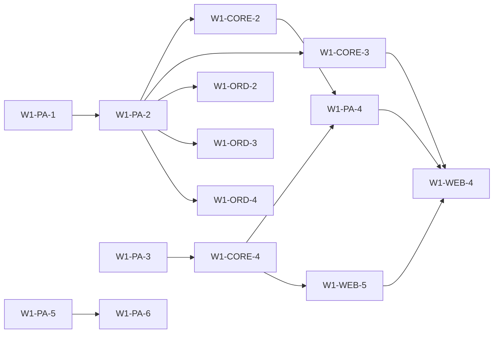

# هفته‌ی ۱: پایه

این هفته هیچ قابلیتی به مشتری نمی‌رسد، ولی همه‌ی هفته‌های بعد روی همین پایه ساخته می‌شوند: محیط محلی، شاسی مشترک، قراردادها، طرح داده، cluster و نسخه‌ی «سلام» هر سرویس.

[راهنمای تحویل‌ها](../README.md) | [طرح پروژه](../../plan.md) | [مشخصات فنی](../../SPEC.md)

## ۱. هدف هفته

همه‌ی سرویس‌ها روی سرور واقعی بالا باشند و تیم روی طرح داده و قراردادها توافق کرده باشد، تا از هفته‌ی ۲ هر زوج بدون معطلی قابلیت بسازد.

معیار پایان هفته، که در دمو سنجیده می‌شود:

- [ ] نسخه‌ی «سلام» هر هفت جزء (`gateway`، `identity`، `catalog`، `order`، `realtime`، `ai`، `web`) روی سرور واقعی با دامنه و TLS بالاست.
- [ ] طرح داده‌ی `identity`، `catalog` و `orders` و قراردادهای proto تأیید منتور را دارند.
- [ ] برای ساخت منو از عکس، تصمیم «برو» یا «نرو» بر اساس گزارش ارزیابی گرفته شده است.

## ۲. کارها در یک نگاه

| بخش | کار | موضوع | پرچم |
|---|---|---|---|
| [هسته](core.md) | `W1-CORE-1` | نهایی کردن طرح داده‌ی `identity` و `catalog` | منتور |
| | `W1-CORE-2` | سرویس `identity`: ورود با کد و توکن‌ها | منتور |
| | `W1-CORE-3` | اسکلت `catalog` و ساخت کسب‌وکار | |
| | `W1-CORE-4` | قرارداد proto هسته برای هفته‌های ۱ و ۲ | |
| [سفارش](order.md) | `W1-ORD-1` | طرح داده‌ی `orders` و دو ماشین وضعیت | منتور |
| | `W1-ORD-2` | اسکلت `order` و قرارداد سفارش | |
| | `W1-ORD-3` | اسکلت `realtime` و دموی رویداد | |
| | `W1-ORD-4` | پایه‌ی رویدادها در شاسی (با پلتفرم) | |
| [فرانت](web.md) | `W1-WEB-1` | اسکلت اپ React | |
| | `W1-WEB-2` | توکن‌های طراحی و اجزای پایه | |
| | `W1-WEB-3` | wireframe صفحه‌های اصلی | منتور |
| | `W1-WEB-4` | ورود به پنل و ساخت کسب‌وکار | |
| | `W1-WEB-5` | کلاینت تایپ‌شده و الگوی خطا | |
| [پلتفرم و هوش مصنوعی](platform-ai.md) | `W1-PA-1` | محیط محلی | |
| | `W1-PA-2` | شاسی مشترک Go | |
| | `W1-PA-3` | ابزار Protobuf | |
| | `W1-PA-4` | اسکلت `gateway` | |
| | `W1-PA-5` | CI | |
| | `W1-PA-6` | cluster و استقرار | |
| | `W1-PA-7` | ارزیابی AI و اسکلت `ai` | |

## ۳. وابستگی‌ها

این هفته بیشتر از هر هفته‌ی دیگری همه منتظر زوج پلتفرم‌اند. اگر چیزی از این جدول عقب افتاد، همان روز در گروه تیم بگو.

| چه کسی منتظر است | منتظر چه چیزی | کار | تا کی |
|---|---|---|---|
| همه | محیط محلی | `W1-PA-1` | روز دوم |
| هسته | شکل جدول `outbox` و envelope | `W1-ORD-4` | روز دوم |
| هسته، سفارش | شاسی مشترک | `W1-PA-2` | روز سوم |
| هسته، سفارش | ابزار `buf` | `W1-PA-3` | روز سوم |
| فرانت، پلتفرم، سفارش | proto هسته | `W1-CORE-4` | روز سوم |
| فرانت، پلتفرم، هسته | proto سفارش | `W1-ORD-2` | روز سوم (PR)، روز چهارم (تأیید) |
| فرانت | `docs/api/openapi.yaml` | `W1-PA-3` | روز سوم |
| همه | CI و استقرار خودکار `staging` | `W1-PA-5`، `W1-PA-6` | روز چهارم |
| هسته، سفارش | تأیید wireframeها برای دیدن داده‌ی لازم | `W1-WEB-3` | روز چهارم |
| فرانت، پلتفرم | `identity` با ورود کامل | `W1-CORE-2` | روز پنجم |
| فرانت | `gateway` با ورود | `W1-PA-4` | روز پنجم |
| فرانت | `CreateVenue` | `W1-CORE-3` | آخر هفته |

## ۴. برنامه‌ی روزها

| روز | چه چیزی آخر روز آماده است |
|---|---|
| روز اول | هر زوج تحویل خودش و این صفحه را خوانده است. جلسه‌ی کوتاه همه‌ی تیم: تقسیم کار هر زوج، تصمیم درباره‌ی تنظیم کوکی‌ها (هسته و پلتفرم) و کلید بلیت `realtime` (سفارش، هسته و پلتفرم). پلتفرم k3s را روی سرور نصب و دسترسی به registry را سنجیده است. نفر AI ارزیابی را با عکس منوها شروع کرده است |
| روز دوم | محیط محلی با یک دستور بالا می‌آید. شکل `outbox` و envelope توافق شده است. پیش‌نویس طرح داده‌ی هسته و سفارش برای منتور فرستاده شده است. اسکلت اپ وب با Dockerfile آماده است |
| روز سوم | شاسی و `buf` ادغام شده‌اند. PR قرارداد proto هسته و سفارش باز است و بازبینی می‌شود. `docs/api/openapi.yaml` تولید شده است. migrationهای اولیه ادغام شده‌اند. wireframeها برای بازبینی آماده‌اند |
| روز چهارم | CI و استقرار خودکار `staging` کار می‌کنند. قراردادها و wireframeها تأیید شده‌اند. اسکلت `order`، `realtime`، `catalog` و `ai` روی `staging` بالا هستند. فرانت کلاینت تایپ‌شده و اجزای پایه را دارد |
| روز پنجم | `identity` و `gateway` ورود را کامل دارند و فرانت به API واقعی وصل شده است. `CreateVenue` کار می‌کند. گزارش AI نوشته شده است. صبح تمرین دمو، عصر دمو و یادداشت‌های آخر هفته |

> [!IMPORTANT]
> روز پنجم روز وصل کردن است، نه روز نوشتن. هر چیزی که تا ظهر روز چهارم روی `staging` نیست، به احتمال زیاد به دمو نمی‌رسد. همان موقع با منتور درباره‌ی برش حرف بزن.

## ۵. سناریوی دمو

دمو روی سرور واقعی و از گوشی و لپ‌تاپ اجرا می‌شود. هر زوج قسمت خودش را نشان می‌دهد.

1. **پلتفرم:** `https://<دامنه>/` روی گوشی با گواهی معتبر باز می‌شود. `kubectl get pods -n staging` هر هفت جزء را در حالت `Running` نشان می‌دهد.
2. **پلتفرم:** یک PR کوچک ادغام می‌شود و چند دقیقه بعد image تازه با git SHA روی `staging` است.
3. **فرانت و هسته:** روی گوشی `/panel` را باز کن، با شماره‌ی آزمایشی کد بگیر، کد اشتباه و بعد کد درست را بزن و یک کسب‌وکار بساز.
4. **هسته:** درخواست دوم کد در کمتر از ۶۰ ثانیه `rate_limited` می‌گیرد. `GET /api/v1/me` نقش `owner` را برای کسب‌وکار تازه نشان می‌دهد. کاربر دوم کسب‌وکار اول را با `not_found` می‌بیند.
5. **سفارش:** نمودار دو ماشین وضعیت در `services/order/README.md`، و دموی محلی: یک ردیف outbox نوشته می‌شود و رویداد در مرورگر دیده می‌شود؛ با NATS خاموش، رویداد صبر می‌کند و بعد می‌رسد.
6. **فرانت:** wireframeهای تأییدشده در `docs/design/`، و صفحه‌ی ورود فقط با کیبورد و در `en`.
7. **هوش مصنوعی:** عددهای گزارش ارزیابی و پیشنهاد. منتور همان‌جا درباره‌ی ساخت منو از عکس «برو» یا «نرو» می‌گوید و تصمیم در یادداشت آخر هفته‌ی پلتفرم ثبت می‌شود.
8. **همه:** لاگ‌های `gateway` و `identity` را با هم بگردید: هیچ کد، توکن یا شماره‌ی کاملی نباید پیدا شود.

## ۶. ریسک‌های این هفته

| ریسک | چطور زود بفهمیم | آن‌وقت چه می‌کنیم |
|---|---|---|
| دامنه یا سرور از هفته‌ی صفر آماده نیست | روز اول | `staging` موقتاً با نشانی موقت بالا می‌آید و دامنه و TLS اولین کار هفته‌ی ۲ می‌شود؛ منتور این را صریح ثبت می‌کند |
| شاسی تا روز سوم آماده نیست | روز دوم هنوز PR ندارد | هسته و سفارش با یک نسخه‌ی کوچک (config، لاگ، سرور gRPC، health) شروع می‌کنند و بقیه‌ی شاسی بعداً اضافه می‌شود |
| سرور به registry یا مخزن مدل نمی‌رسد | بررسی روز اول | image روی registry در دسترس از داخل، و مدل‌ها دستی روی سرور گذاشته می‌شوند |
| `identity` روز پنجم کامل نیست | ظهر روز چهارم | فرانت دموی ورود را روی لایه‌ی جعلی نشان می‌دهد و اتصال واقعی اولین کار هفته‌ی ۲ است |
| ارزیابی AI به عدد روشن نمی‌رسد | روز سوم هنوز یک منو هم کامل خوانده نشده | پیش‌فرض «نرو» است: ساخت منو از Excel در هفته‌ی ۲، و مسیر عکس اختیاری می‌ماند |

**چه چیزی اول حذف می‌شود:** به این ترتیب: ۱) `Toast`، `Skeleton` و `EmptyState` از `W1-WEB-2` به هفته‌ی ۲ می‌روند. ۲) دموی «رویداد سلام» `realtime` فقط محلی نشان داده می‌شود. ۳) بخش ترجمه‌ی ارزیابی AI به هفته‌ی ۳ می‌رود و فقط خواندن عکس سنجیده می‌شود. نسخه‌ی «سلام» همه‌ی سرویس‌ها روی سرور، طرح داده و قراردادها حذف نمی‌شوند؛ طبق [طرح پروژه](../../plan.md)، اگر این‌ها آخر هفته بالا نباشند کارهای اختیاری همان موقع از برنامه بیرون می‌روند.

