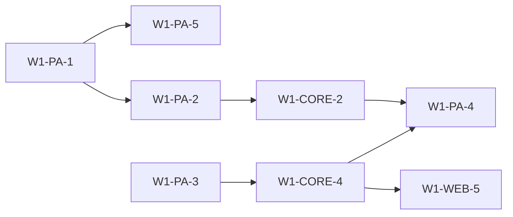

# هفته‌ی ۱: پایه

این هفته هیچ قابلیتی به مشتری نمی‌رسد، ولی همه‌ی هفته‌های بعد روی همین پایه ساخته می‌شوند: محیط محلی، شاسی مشترک، قراردادها، طرح داده، CI، و اولین مسیر واقعی سیستم، یعنی ورود صاحب کسب‌وکار.

[راهنمای تحویل‌ها](../README.md) | [تیم و تقسیم کار](../../team.md) | [طرح پروژه](../../plan.md) | [مشخصات فنی](../../SPEC.md) | [هفته‌ی ۲](../week-2/README.md)

## ۱. هدف هفته

همه‌ی تیم روی یک محیط محلی کار کند، طرح داده و قراردادها تأیید شده باشند و ورود با کد پیامکی از سر تا ته کار کند، تا از هفته‌ی ۲ هر نفر بدون معطلی قابلیت بسازد.

معیار پایان هفته، که در دمو سنجیده می‌شود:

- [ ] روی یک clone تازه، یک دستور زیرساخت محلی را بالا می‌آورد و CI روی PRها اجرا می‌شود و سبز است.
- [ ] طرح داده‌ی `identity`، `catalog` و `orders` و قرارداد proto `identity` و `catalog` تأیید منتور را دارند.
- [ ] روی محیط محلی، کد ورود از راه `gateway` درخواست و تأیید می‌شود و کوکی‌های `sz_at` و `sz_rt` درست تنظیم می‌شوند.
- [ ] اپ `web` با توکن‌های طراحی و اجزای پایه اجرا می‌شود و wireframeها تأیید منتور را دارند.
- [ ] دسترسی سرور به registry و DNS یک بار سنجیده شده و نتیجه‌اش در گروه تیم نوشته شده است.

> [!NOTE]
> در طرح اولِ هشت‌نفره، هفته‌ی ۱ با بالا آمدن همه‌ی سرویس‌ها روی سرور واقعی تمام می‌شد. با سه نفر، cluster و استقرار (`W1-PA-6`) به هفته‌ی ۲ رفته است و این هفته فقط یک ساعت دسترسی سرور سنجیده می‌شود.

## ۲. کارها در یک نگاه

همه‌ی کارهای این هفته، به تفکیک نقش. صاحب هر نقش در [تیم و تقسیم کار](../../team.md) است. ستون «نکته» می‌گوید هر کار در طرح سه‌نفره چه فرقی کرده است.

| نقش | شناسه | کار | برچسب | نکته | تحویل |
|---|---|---|---|---|---|
| فرانت | `W1-WEB-1` | اسکلت اپ |  |  | [week-1/web.md](../week-1/web.md) |
| فرانت | `W1-WEB-2` | توکن‌های طراحی و اجزای پایه |  |  | [week-1/web.md](../week-1/web.md) |
| فرانت | `W1-WEB-3` | wireframe صفحه‌های اصلی | بازبینی منتور |  | [week-1/web.md](../week-1/web.md) |
| فرانت | `W1-WEB-5` | کلاینت تایپ‌شده و الگوی خطا |  |  | [week-1/web.md](../week-1/web.md) |
| ورود و منو | `W1-CORE-1` | نهایی کردن طرح داده | بازبینی منتور |  | [week-1/core.md](../week-1/core.md) |
| ورود و منو | `W1-CORE-2` | سرویس identity | بازبینی منتور |  | [week-1/core.md](../week-1/core.md) |
| ورود و منو | `W1-CORE-4` | قرارداد proto |  |  | [week-1/core.md](../week-1/core.md) |
| ورود و منو | `W1-PA-4` | اسکلت gateway |  |  | [week-1/platform-ai.md](../week-1/platform-ai.md) |
| سفارش و زیرساخت | `W1-ORD-1` | نهایی کردن طرح داده و ماشین‌های وضعیت | بازبینی منتور |  | [week-1/order.md](../week-1/order.md) |
| سفارش و زیرساخت | `W1-PA-1` | محیط محلی |  | دیتابیس `ai`، pgvector و Ollama لازم نیست. در زمان نوشتن این طرح، image رسمی MinIO در Docker Hub پیدا نمی‌شد: روز اول بررسی کن و اگر نبود، یک object storage سازگار با S3 مثل RustFS بگذار و انتخاب را در `deploy/README.md` بنویس. اگر پورت ۵۴۳۲ روی ماشینی گرفته است، پورت PostgreSQL را در Compose قابل تنظیم کن. | [week-1/platform-ai.md](../week-1/platform-ai.md) |
| سفارش و زیرساخت | `W1-PA-2` | شاسی مشترک Go |  |  | [week-1/platform-ai.md](../week-1/platform-ai.md) |
| سفارش و زیرساخت | `W1-PA-3` | ابزار Protobuf |  | stubهای Python لازم نیست. | [week-1/platform-ai.md](../week-1/platform-ai.md) |
| سفارش و زیرساخت | `W1-PA-5` | CI |  | Ruff و تست‌های Python لازم نیست. | [week-1/platform-ai.md](../week-1/platform-ai.md) |

**کارهایی با شناسه‌ی هفته‌ی ۱ که این هفته انجام نمی‌شوند:**

| شناسه | کار | چه شد |
|---|---|---|
| `W1-CORE-3` | اسکلت catalog و ساخت کسب‌وکار | در هفته‌ی ۲ انجام می‌شود (نقش «ورود و منو») |
| `W1-ORD-2` | اسکلت order و قرارداد سفارش | در هفته‌ی ۲ انجام می‌شود (نقش «سفارش و زیرساخت») |
| `W1-ORD-3` | اسکلت realtime | در `W2-ORD-4` ادغام شد (هفته‌ی ۳، نقش «سفارش و زیرساخت») |
| `W1-ORD-4` | پایه‌ی رویدادها در شاسی | در هفته‌ی ۲ انجام می‌شود (نقش «سفارش و زیرساخت») |
| `W1-WEB-4` | ورود به پنل و ساخت کسب‌وکار | در هفته‌ی ۲ انجام می‌شود (نقش «فرانت») |
| `W1-PA-6` | cluster و استقرار | در هفته‌ی ۲ انجام می‌شود (نقش «سفارش و زیرساخت») |
| `W1-PA-7` | ارزیابی AI و اسکلت سرویس ai | **انجام نمی‌شود.** سرویس `ai` و همه‌ی قابلیت‌های هوش مصنوعی به انتشار ۲ رفته‌اند. |

## ۳. وابستگی‌ها

این هفته بیشتر از هر هفته‌ی دیگری همه منتظر نقش «سفارش و زیرساخت»اند. اگر چیزی از این جدول عقب افتاد، همان روز در گروه تیم بگو.

| چه کسی منتظر است | منتظر چه چیزی | کار | تا کی |
|---|---|---|---|
| همه | محیط محلی | `W1-PA-1` | روز دوم |
| ورود و منو | شاسی مشترک Go | `W1-PA-2` | روز سوم |
| ورود و منو | ابزار `buf` و تولید کد | `W1-PA-3` | روز سوم |
| فرانت، سفارش و زیرساخت | proto `identity` و `catalog` | `W1-CORE-4` | روز سوم (PR)، روز چهارم (تأیید) |
| فرانت | `docs/api/openapi.yaml` تولیدشده | `W1-PA-3` و `W1-CORE-4` | روز چهارم |
| همه | CI برای PRها | `W1-PA-5` | روز چهارم |
| ورود و منو، سفارش و زیرساخت | wireframeهای تأییدشده، تا بدانند هر صفحه چه داده‌ای لازم دارد | `W1-WEB-3` | روز چهارم |
| فرانت (هفته‌ی ۲) | ورود کامل در `identity` و `gateway` | `W1-CORE-2`، `W1-PA-4` | روز پنجم |

## ۴. برنامه‌ی روزها

| روز | چه چیزی آخر روز آماده است |
|---|---|
| روز اول | جلسه‌ی شروع: هر نفر نقشش را برداشته، issueهایش را به خودش assign کرده و جدول [تیم و تقسیم کار](../../team.md) با یک PR پر شده است. «ورود و منو» و «سفارش و زیرساخت» درباره‌ی تنظیم کوکی‌ها توافق کرده‌اند (پیشنهاد اولیه در `W1-PA-4`). «سفارش و زیرساخت» یک ساعت دسترسی سرور به registry و DNS را سنجیده است. هر نفر PR تمرین روز اول را فرستاده است ([از اینجا شروع کن](../../guide/01-start-here.md)، بخش ۱۰) |
| روز دوم | محیط محلی با یک دستور بالا می‌آید. پیش‌نویس طرح داده‌ی `identity`، `catalog` و `orders` برای منتور فرستاده شده است. اسکلت اپ وب اجرا می‌شود |
| روز سوم | شاسی و `buf` ادغام شده‌اند. PR قرارداد proto `identity` و `catalog` باز است. migrationهای اولیه نوشته شده‌اند. wireframeها برای بازبینی آماده‌اند |
| روز چهارم | CI روی PRها کار می‌کند. قرارداد proto، طرح داده و wireframeها تأیید شده‌اند. `docs/api/openapi.yaml` ساخته شده و فرانت کلاینت تایپ‌شده را دارد |
| روز پنجم | `identity` و `gateway` ورود را کامل دارند. صبح تمرین دمو، عصر دمو و یادداشت‌های آخر هفته |

> [!IMPORTANT]
> روز پنجم روز وصل کردن است، نه روز نوشتن. هر چیزی که تا ظهر روز چهارم روی محیط محلی کار نمی‌کند، به احتمال زیاد به دمو نمی‌رسد. همان موقع با منتور درباره‌ی برش حرف بزن.

## ۵. سناریوی دمو

دمو روی محیط محلی یکی از لپ‌تاپ‌ها اجرا می‌شود. هر نفر قسمت خودش را نشان می‌دهد.

1. **سفارش و زیرساخت:** روی یک clone تازه، یک دستور زیرساخت را بالا می‌آورد. یک اسکریپت نشان می‌دهد هر role دیتابیس فقط به دیتابیس خودش وصل می‌شود.
2. **سفارش و زیرساخت:** یک PR کوچک باز می‌شود و CI فقط بخشی را که عوض شده بررسی می‌کند. نتیجه‌ی سنجش دسترسی سرور به registry و DNS گفته می‌شود.
3. **ورود و منو:** migrationهای `identity` و `catalog` روی یک دیتابیس خالی بالا و پایین می‌روند.
4. **ورود و منو:** با `curl` از راه `gateway` کد ورود درخواست می‌شود و کد در لاگ سرویس پیامکِ جعلی دیده می‌شود. کد اشتباه و بعد کد درست زده می‌شود و کوکی‌های `sz_at` و `sz_rt` با ویژگی‌های بخش ۸ مشخصات فنی برمی‌گردند.
5. **ورود و منو:** درخواست دوم کد در کمتر از ۶۰ ثانیه `rate_limited` می‌گیرد. `GET /api/v1/me` کاربر واردشده را نشان می‌دهد.
6. **سفارش و زیرساخت:** نمودار دو ماشین وضعیت سفارش و پرداخت در `services/order/README.md`.
7. **فرانت:** wireframeهای تأییدشده در `docs/design/`، و صفحه‌ی نمونه‌ی اجزای پایه در `fa` و `en`، راست‌به‌چپ و چپ‌به‌راست، فقط با کیبورد.
8. **همه:** لاگ‌های `gateway` و `identity` را با هم بگردید: هیچ کد، توکن یا شماره‌ی کاملی نباید پیدا شود.

## ۶. ریسک‌های این هفته

| ریسک | چطور زود بفهمیم | آن‌وقت چه می‌کنیم |
|---|---|---|
| شاسی تا روز سوم آماده نیست | روز دوم هنوز PR ندارد | «ورود و منو» با یک نسخه‌ی کوچک (config، لاگ، سرور gRPC، health) شروع می‌کند و بقیه‌ی شاسی بعداً اضافه می‌شود |
| بار «سفارش و زیرساخت» این هفته زیاد است | روز سوم هنوز `buf` یا CI ادغام نشده | «ورود و منو» `W1-PA-3` را برمی‌دارد، چون اولین proto را خودش می‌نویسد |
| `identity` روز پنجم کامل نیست | ظهر روز چهارم | ورود در دمو مستقیم روی `identity` نشان داده می‌شود و اتصال `gateway` اولین کار هفته‌ی ۲ است |
| سرور به registry نمی‌رسد | بررسی روز اول | image روی registry در دسترس از داخل گذاشته می‌شود؛ تصمیمش تا آخر هفته با منتور |
| image یکی از ابزارهای محیط محلی در دسترس نیست، مثلاً MinIO | روز اول | یک جایگزین سازگار انتخاب و در `deploy/README.md` نوشته می‌شود |

**چه چیزی اول حذف می‌شود:** به این ترتیب: ۱) `Toast`، `Skeleton` و `EmptyState` از `W1-WEB-2` به هفته‌ی ۲ می‌روند. ۲) فیلتر مسیر در CI (`W1-PA-5`) به هفته‌ی ۲ می‌رود و CI فعلاً همه‌چیز را بررسی می‌کند. محیط محلی، شاسی، طرح داده، قراردادها و ورود حذف نمی‌شوند.

