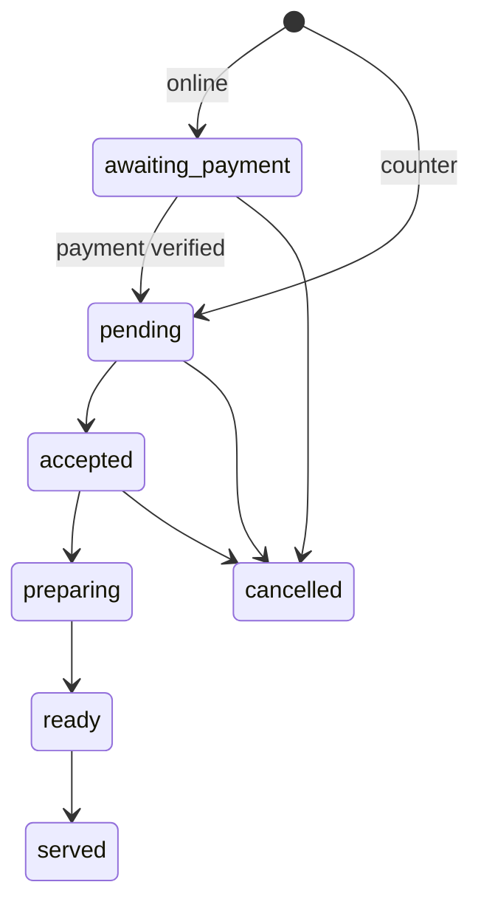

<div dir="rtl">

# هفته‌ی ۱، بخش سفارش: طرح سفارش و پایه‌ی رویدادها

در این هفته سرویس‌های `order` و `realtime` را از صفر بالا می‌آوری و پایه‌ی رویدادهای کل سیستم را در شاسی مشترک می‌گذاری. آخر هفته طرح داده‌ی سفارش تأیید منتور را دارد و یک رویداد آزمایشی از NATS تا مرورگر می‌رسد.

[صفحه‌ی هفته‌ی ۱](README.md) | [راهنمای تحویل‌ها](../README.md)

| | |
|---|---|
| سرویس‌ها | `order`، `realtime`، و بخش رویدادهای `libs/go/kit` |
| کارها | `W1-ORD-1`، `W1-ORD-2`، `W1-ORD-3`، `W1-ORD-4` |
| معیار پایان هفته | نسخه‌ی «سلام» `order` و `realtime` روی `staging` بالاست؛ طرح جدول‌ها و دو ماشین وضعیت تأیید منتور را دارد؛ در محیط محلی یک رویداد که از outbox منتشر شده، در مرورگر دیده می‌شود |
| بازبینی منتور لازم است | `W1-ORD-1` |

## ۱. قبل از شروع بخوان

| صفحه | چرا |
|---|---|
| [مشخصات فنی](../../SPEC.md)، بخش‌های ۴٫۱، ۶٫۳، ۶٫۴ و ۷٫۳ | قواعد ارتباط، رویدادها، WebSocket و جدول‌های سفارش |
| [فصل ۷: سرویس‌های بک‌اند](../../guide/07-backend-services.md) | ساختار یک سرویس Go و جای منطق کسب‌وکار |
| [فصل ۸: دیتابیس و ذخیره‌سازی](../../guide/08-database-and-storage.md) | migration، شمارنده‌ی روزانه و جدول‌های outbox |
| [فصل ۶: API و قراردادها](../../guide/06-api-and-contracts.md) | قواعد proto و شکل رویدادها |
| [سند تصمیم ۴: NATS JetStream و outbox](../../decisions/0004-nats-jetstream-and-outbox.md) | چرا رویداد را مستقیم منتشر نمی‌کنیم |
| [سند تصمیم ۲: پرداخت مال `order` است](../../decisions/0002-order-owns-payments.md) | چرا جدول‌های پرداخت در همین دیتابیس‌اند |

## ۲. چه چیزی از قبل آماده است

هفته‌ی ۱ اولین هفته است و کدی از قبل نیست. این‌ها را داری:

- طرح پایه‌ی جدول‌های `orders` و دو ماشین وضعیت در بخش ۷٫۳ مشخصات فنی.
- شکل envelope رویدادها و فهرست subjectها در بخش ۶٫۳.
- فهرست متدهای `OrderService` در بخش ۶٫۲.

چیزهایی که بخش‌های دیگر همین هفته برایت می‌سازند:

| چیزی که لازم داری | کار | تا کی |
|---|---|---|
| محیط محلی با PostgreSQL، Redis و NATS JetStream | `W1-PA-1` | روز دوم |
| شاسی مشترک سرویس Go در `libs/go/kit` | `W1-PA-2` | روز سوم |
| ابزار `buf` برای ساختن کد از proto | `W1-PA-3` | روز سوم |
| proto سرویس `catalog` با `ResolveTable` و `PriceItems` | `W1-CORE-4` | روز سوم |
| کلید عمومی امضای توکن از `identity` | `W1-CORE-2` | روز پنجم |
| مسیر <span dir="ltr">`/ws`</span> در ingress روی `staging` | `W1-PA-6` | روز چهارم |

تا شاسی آماده شود، روی طرح داده (`W1-ORD-1`) و شکل envelope و outbox (`W1-ORD-4`، روی کاغذ) کار کن. این دو به شاسی وابسته نیستند.

## ۳. چه چیزی تحویل می‌دهی

| خروجی | چه کسی منتظرش است | تا کی |
|---|---|---|
| شکل جدول `outbox` و envelope رویداد | هسته (جدول `outbox` در migrationهای `catalog`) | روز دوم |
| فایل‌های proto سرویس `order` برای ساخت و خواندن سفارش | فرانت (کلاینت تایپ‌شده)، پلتفرم (مسیرهای `gateway` در هفته‌ی ۲)، هسته (بازبینی) | روز سوم برای PR، روز چهارم تأییدشده |
| migrationهای اولیه‌ی دیتابیس `orders` | خودت | روز سوم |
| کمکی‌های رویداد در شاسی: envelope، outbox، relay، مصرف‌کننده‌ی تکرارناپذیر | هسته (`menu.changed` در هفته‌ی ۲)، خودت | آخر هفته |
| JSON Schema رویدادها در <span dir="ltr">`proto/events/`</span> | پلتفرم و هوش مصنوعی (سرویس `ai` در Python همین قالب را می‌سازد) | آخر هفته |
| `order` و `realtime` نسخه‌ی «سلام» روی `staging` | همه، برای دموی هفته | روز پنجم |
| README هر دو سرویس با نمودار جدول‌ها و ماشین‌های وضعیت | همه | آخر هفته |

## ۴. کارها

### `W1-ORD-1`: نهایی کردن طرح داده و ماشین‌های وضعیت

**هدف:** طرح پایه‌ی بخش ۷٫۳ را بازبینی کنی، دو ماشین وضعیت (وضعیت سفارش و وضعیت پرداخت) را دقیق بنویسی و اولین migrationها را بسازی.

**محدوده:** این هفته فقط جدول‌های `orders`، `order_items`، `daily_counters`، `outbox`، `processed_events` و `audit_log` را می‌سازی. جدول‌های `payments` و `payment_configs` در هفته‌ی ۳ و ۴، `service_requests` در هفته‌ی ۳ و `ratings` در هفته‌ی ۴ می‌آیند؛ طرحشان را همین هفته روی کاغذ بازبینی کن.

**معیار پذیرش:**

- [ ] migrationها با goose روی دیتابیس خالی `orders` بالا می‌روند و کامل برمی‌گردند (`up` و `down`).
- [ ] هر جدولِ متعلق به کسب‌وکار، از جمله `order_items`، ستون `venue_id` و ایندکسی دارد که با `venue_id` شروع می‌شود.
- [ ] هیچ کلید خارجی به جدول‌های سرویس دیگر نیست؛ `table_id` و `item_id` شناسه‌ی ساده‌ی UUID هستند.
- [ ] پول همه‌جا `bigint` به ریال است و توکن سفارش فقط به شکل hash در `order_token_hash` ذخیره می‌شود.
- [ ] نمودار هر دو ماشین وضعیت با Mermaid در `services/order/README.md` هست، با همه‌ی گذرهای مجاز و شاخه‌ی `cancelled`.
- [ ] مرز «روز» برای شمارنده‌ی روزانه و دامنه‌ی یکتایی `idempotency_key` تصمیم گرفته و در README نوشته شده است.
- [ ] هر جا از طرح پایه فاصله گرفتی، یک سند تصمیم در <span dir="ltr">`docs/decisions/`</span> نوشته‌ای.
- [ ] منتور طرح را تأیید کرده است.

**نکته:** مشخصات فنی مرز روز را نگفته است. پیشنهاد اولیه وقت تهران است، چون کافه‌دار «سفارش ۱ امروز» را با ساعت خودش می‌شناسد. دامنه‌ی یکتایی کلید تکرار را هم مشخصات فنی نگفته؛ پیشنهاد اولیه یکتایی روی (`venue_id`، `idempotency_key`) است. هر دو را با منتور قطعی کن.

</div>



<div dir="rtl">

### `W1-ORD-2`: اسکلت `order` و قرارداد سفارش

**هدف:** سرویس `order` روی شاسی مشترک بالا بیاید و قرارداد ساخت و خواندن سفارش، که هفته‌ی ۲ پیاده می‌شود، از همین حالا با بقیه توافق شود.

**محدوده:** در proto متدهای `CreateOrder`، `GetOrder`، `ListOrders`، `UpdateOrderStatus` و `ValidateOrderToken`. پیاده‌سازی همه‌شان فعلاً خطای `unimplemented` برمی‌گرداند. متدهای پرداخت، `MarkPaidAtCounter` و `CancelOrder` در هفته‌های بعد به proto اضافه می‌شوند.

**معیار پذیرش:**

- [ ] فایل‌ها در <span dir="ltr">`proto/sarmiz/order/v1/`</span> هستند و `buf lint` بدون خطاست.
- [ ] مسیرهای HTTP با جدول بخش ۶٫۱ می‌خوانند: `POST /api/v1/public/t/{qr_token}/orders`، <span dir="ltr">`GET /api/v1/public/orders/{order_id}`</span> و `GET /api/v1/venues/{venue_id}/orders`.
- [ ] همه‌ی فیلدهای پول `int64` و با پسوند `_rial` هستند و قیمت از مرورگر در درخواست ساخت سفارش نیست؛ فقط شناسه‌ی آیتم، گزینه‌ها، تعداد و یادداشت.
- [ ] قاعده‌های `protovalidate` نوشته شده‌اند، مثلاً تعداد دست‌کم ۱.
- [ ] نوشته‌ای که می‌گوید `Idempotency-Key` و توکن سفارش چطور از `gateway` به سرویس می‌رسند، با زوج پلتفرم توافق شده است.
- [ ] زوج‌های هسته و فرانت PR قرارداد را بازبینی و تأیید کرده‌اند.
- [ ] سرویس روی `staging` بالاست و <span dir="ltr">`/healthz`</span>، <span dir="ltr">`/readyz`</span>، <span dir="ltr">`/metrics`</span> و سرویس health در gRPC جواب می‌دهند.

**نکته:** مشخصات فنی نگفته توکن سفارش در کدام header یا پارامتر می‌آید. پیشنهاد اولیه یک header است، نه query string، چون query string در لاگ‌ها می‌ماند. تصمیم را در توضیح proto بنویس.

### `W1-ORD-3`: اسکلت `realtime`

**هدف:** سرویس `realtime` اتصال WebSocket را با بلیت معتبر قبول کند، به NATS گوش بدهد و پیام را به اتصال درست برساند.

**محدوده:** نشانی <span dir="ltr">`/ws?ticket=<ticket>`</span>، بررسی بلیت (JWT شصت‌ثانیه‌ای با scope یکی از <span dir="ltr">`venue:<venue_id>`</span> یا <span dir="ltr">`order:<order_id>`</span>)، اشتراک در stream `SARMIZ`، ping هر ۲۵ ثانیه، و یک دموی «رویداد سلام». کانال‌های کامل و صدور بلیت در `identity` کار هفته‌ی ۲ است (`W2-ORD-4`).

**معیار پذیرش:**

- [ ] اتصال بدون بلیت، با بلیت منقضی، با امضای نادرست یا با scope ناشناخته رد می‌شود و برای هر کدام تست هست.
- [ ] پیامی که از NATS می‌رسد فقط به اتصال‌هایی می‌رود که scope آن‌ها با `venue_id` پیام می‌خواند. تست دارد.
- [ ] یک اتصال کند جلوی رسیدن پیام به بقیه را نمی‌گیرد؛ هر اتصال صف جدا با اندازه‌ی محدود دارد.
- [ ] سرور هر ۲۵ ثانیه ping می‌فرستد و اتصال مرده را می‌بندد.
- [ ] metric `ws_connections` و <span dir="ltr">`/healthz`</span>، <span dir="ltr">`/readyz`</span> و <span dir="ltr">`/metrics`</span> کار می‌کنند.
- [ ] در محیط محلی یک envelope ساختگی با subject `sarmiz.order.order.created` منتشر می‌شود و در یک صفحه‌ی ساده‌ی مرورگر دیده می‌شود.
- [ ] سرویس روی `staging` پشت مسیر <span dir="ltr">`/ws`</span> بالاست.

**نکته:** طبق جدول بخش ۴٫۱، `realtime` هیچ سرویسی را صدا نمی‌زند. پس نمی‌تواند هنگام اتصال JWKS را از `identity` بگیرد. پیشنهاد اولیه: کلید عمومی امضا از راه config (یک secret فقط‌خواندنی) به `realtime` داده شود. اگر تیم راه دیگری خواست، سند تصمیم لازم است. این را روز اول با زوج هسته و پلتفرم روشن کن.

### `W1-ORD-4`: پایه‌ی رویدادها در شاسی

**هدف:** همه‌ی سرویس‌ها رویداد را یک‌جور بسازند، یک‌جور منتشر کنند و یک‌جور مصرف کنند. این کار را با زوج پلتفرم انجام می‌دهی، چون شاسی مال آن‌هاست.

**محدوده:** نوع envelope با فیلدهای بخش ۶٫۳، قاعده‌ی نام subject (<span dir="ltr">`sarmiz.<service>.<entity>.<event>`</span>)، JSON Schema رویدادها در <span dir="ltr">`proto/events/`</span>، جدول `outbox` و حلقه‌ی relay، و کمکی مصرف‌کننده که با جدول `processed_events` تکرار را حذف می‌کند.

**معیار پذیرش:**

- [ ] تابع نوشتن در outbox فقط یک تراکنش pgx می‌گیرد، پس نمی‌شود رویداد را بیرون از تراکنش کسب‌وکار نوشت.
- [ ] تست یکپارچه: اگر تراکنش rollback شود، هیچ رویدادی منتشر نمی‌شود.
- [ ] تست یکپارچه: وقتی NATS خاموش است ردیف‌ها می‌مانند و بعد از روشن شدن منتشر و علامت `sent_at` می‌خورند.
- [ ] دو نسخه‌ی هم‌زمان relay یک ردیف را دو بار منتشر نمی‌کنند. تست دارد.
- [ ] کمکی مصرف‌کننده یک رویداد تکراری را فقط یک بار اثر می‌دهد و ثبت در `processed_events` در همان تراکنش اثر انجام می‌شود.
- [ ] metric `outbox_lag_seconds` منتشر می‌شود.
- [ ] برای هر نُه رویداد جدول بخش ۶٫۳ یک JSON Schema در <span dir="ltr">`proto/events/`</span> هست و یک تست نمونه‌ها را با آن می‌سنجد.
- [ ] زوج پلتفرم PR را بازبینی و تأیید کرده است.

**نکته:** ستون‌های `processed_events`، زمان پاک کردن ردیف‌های قدیمی هر دو جدول، و اینکه stream `SARMIZ` را چه کسی می‌سازد در مشخصات فنی نیامده است. همین کار درباره‌شان تصمیم می‌گیرد. پیشنهاد اولیه برای قفل relay: `SELECT ... FOR UPDATE SKIP LOCKED`. نمونه‌ی شکل استفاده:

</div>

```go
// example only: business change and event in one transaction
err := kit.InTx(ctx, pool, func(tx pgx.Tx) error {
    if err := repo.InsertOrder(ctx, tx, venueID, o); err != nil {
        return err
    }
    return outbox.Add(ctx, tx, events.New("sarmiz.order.order.created", venueID, summary))
})
```

<div dir="rtl">

## ۵. قرارداد با بخش‌های دیگر

| قرارداد | با چه کسی | قاعده |
|---|---|---|
| proto سرویس `order` | فرانت، پلتفرم، هسته | بعد از تأیید، هر تغییری PR جدا می‌خواهد و `buf breaking` باید سبز باشد |
| `ResolveTable` و `PriceItems` در proto `catalog` | هسته | این‌ها را هسته تعریف می‌کند؛ تو بازبین آن PR هستی و نیازت را همان‌جا بگو |
| envelope و JSON Schemaها | همه، به‌خصوص `ai` | بعد از ادغام، فیلد را حذف یا تغییر نام نده؛ تغییر ناسازگار یعنی `version` تازه |
| ستون‌های جدول `outbox` | هسته | `catalog` همان شکل را می‌سازد تا relay مشترک برای هر دو کار کند |
| مسیر <span dir="ltr">`/ws`</span> و کلید عمومی بلیت | پلتفرم (ingress)، هسته (کلید) | مسیر و الگوریتم امضا را بدون هماهنگی عوض نکن |
| headerهای `Idempotency-Key` و توکن سفارش | پلتفرم | `gateway` آن‌ها را به metadata تبدیل می‌کند؛ نامشان ثابت بماند |

## ۶. تصمیم‌های گرفته‌شده

این‌ها را دوباره باز نکن. اگر فکر می‌کنی اشتباه‌اند، با منتور حرف بزن و سند تصمیم بنویس.

- پرداخت داخل سرویس `order` است، چون علامت «پرداخت‌شده» و ثبت پرداخت باید در یک تراکنش باشند: [سند تصمیم ۲](../../decisions/0002-order-owns-payments.md).
- رویداد فقط از راه outbox منتشر می‌شود و مصرف‌کننده تکرار را حذف می‌کند: [سند تصمیم ۴](../../decisions/0004-nats-jetstream-and-outbox.md).
- WebSocket فقط کانال خبر است. وضعیت واقعی همیشه از API خوانده می‌شود و گم شدن یک رویداد نباید سفارشی را گم کند.
- `realtime` دیتابیس ندارد و هیچ سرویسی را صدا نمی‌زند، تا بتواند آزادانه restart شود.
- خط سفارش همیشه snapshot نام، قیمت و گزینه‌ها را نگه می‌دارد.
- صفحه‌ی آشپزخانه هیچ‌وقت سفارش `awaiting_payment` را نمی‌بیند.

## ۷. دام‌های رایج

| دام | چرا بد است | چه کار کن |
|---|---|---|
| انتشار رویداد مستقیم بعد از commit | اگر سرویس بین commit و انتشار بیفتد، آشپزخانه سفارش را نمی‌بیند | فقط outbox، در همان تراکنش |
| کلید خارجی به جدول میز یا آیتم | آن جدول‌ها در دیتابیس دیگری‌اند؛ migration شکست می‌خورد یا وابستگی پنهان می‌سازد | UUID ساده و snapshot |
| ماشین وضعیت پخش‌شده در چند `if` | گذر غیرمجاز از یک مسیر فراموش‌شده رد می‌شود | یک جدول گذر در لایه‌ی `service` و تست جدولی برایش |
| relay بدون قفل ردیف | با دو replica هر رویداد دو بار منتشر می‌شود | `SKIP LOCKED` و مصرف‌کننده‌ی تکرارناپذیر |
| یک goroutine برای نوشتن روی همه‌ی اتصال‌ها | یک گوشی با اینترنت ضعیف کل آشپزخانه‌ها را کند می‌کند | صف محدود برای هر اتصال و بستن اتصالی که عقب ماند |
| بررسی نکردن `exp` بلیت | بلیت لو رفته تا ابد کار می‌کند | کتابخانه‌ی JWT را با بررسی زمان و الگوریتم ثابت تنظیم کن |
| float برای پول | گرد شدن، اختلاف جمع با سطرها | `int64` و `bigint` به ریال |

## ۸. کار با AI

**فایل‌هایی که به دستیار می‌دهی:** `AGENTS.md`، `docs/SPEC.md` (بخش‌های ۴٫۱، ۶٫۳، ۶٫۴ و ۷٫۳)، همین صفحه، `libs/go/kit/README.md` وقتی آماده شد، README سرویسی که رویش کار می‌کنی، و متن issue همان کار.

پرامپت شروع برای `W1-ORD-4`:

</div>

```text
روی کار W1-ORD-4 کار می‌کنیم: پایه‌ی رویدادها در libs/go/kit.
AGENTS.md، بخش‌های ۴٫۱ و ۶٫۳ از docs/SPEC.md و docs/handoffs/week-1/order.md را بخوان.
هنوز کد ننویس. اول این‌ها را بده:
۱. فهرست پکیج‌ها و فایل‌ها با مسئولیت هر کدام در یک خط (envelope، outbox، relay، consumer)
۲. ستون‌های پیشنهادی processed_events و دلیل هر ستون
۳. ترتیب پیاده‌سازی در قدم‌های کوچک، هر قدم با تست خودش
۴. چیزهایی که در مستندات تصمیم گرفته نشده و باید از منتور بپرسم
```

<div dir="rtl">

پرامپت برای نوشتن تست قبل از کد:

</div>

```text
برای relay در libs/go/kit تست یکپارچه با testcontainers-go بنویس، با PostgreSQL و NATS واقعی.
حالت‌ها: تراکنش rollback شده و هیچ رویدادی منتشر نمی‌شود؛ NATS خاموش است و ردیف می‌ماند؛
NATS دوباره روشن می‌شود و ردیف منتشر و sent_at پر می‌شود؛ دو relay هم‌زمان و هر ردیف دقیقاً یک بار.
هنوز خود relay را ننویس. بعد توضیح بده هر تست کدام قاعده‌ی بخش ۶٫۳ مشخصات فنی را می‌سنجد.
```

<div dir="rtl">

پرامپت بازبینی قبل از باز کردن PR:

</div>

```text
diff این شاخه را مثل یک بازبین سخت‌گیر بخوان. فقط دنبال این‌ها بگرد:
رویدادی که بیرون از تراکنش نوشته یا منتشر می‌شود، query بدون venue_id، کلید خارجی به دیتابیس دیگر،
پول با نوع غیر از int64، گذر وضعیتی که در بخش ۷٫۳ مشخصات فنی نیست، goroutine بدون راه توقف،
و تستی که چیزی را واقعاً نمی‌سنجد. برای هر مورد نام فایل و شماره‌ی خط بده. اگر چیزی نبود همین را بگو.
```

<div dir="rtl">

**از دستیار نخواه:**

- که نام subject یا رویداد تازه بسازد. فهرست کامل در بخش ۶٫۳ است.
- که برای `realtime` دیتابیس یا Redis اضافه کند تا «پیام‌ها گم نشوند». این تصمیم عمداً گرفته شده است.
- که کتابخانه‌ی WebSocket یا JWT را خودش پیاده کند.
- که migration و کد شاسی و سرویس را در یک PR بگذارد.

**خودت حتماً بررسی کن:** مرز هر تراکنش را با چشم دنبال کن و بگو رویداد دقیقاً کجا نوشته می‌شود. هر goroutine در relay و `realtime` را پیدا کن و بگو با لغو `context` چطور تمام می‌شود. اگر نمی‌توانی، کد هنوز آماده‌ی PR نیست.

## ۹. چطور بفهمی درست کار می‌کند

این سناریو را آخر هفته اجرا کن. قدم‌های ۱ تا ۴ روی `staging` و قدم‌های ۵ تا ۷ در محیط محلی‌اند، چون صدور بلیت واقعی کار هفته‌ی ۲ است.

1. `kubectl get pods -n staging`: Podهای `order` و `realtime` در حالت `Running` هستند و job migration موفق تمام شده است.
2. با `kubectl port-forward` به `order` وصل شو و <span dir="ltr">`/readyz`</span> را بخوان. بعد با `grpcurl` متد `CreateOrder` را صدا بزن؛ باید `Unimplemented` بگیری، نه خطای اتصال.
3. در دیتابیس `orders` روی `staging` جدول‌های این هفته را با <span dir="ltr">`\dt`</span> ببین.
4. از مرورگر به `wss://<دامنه>/ws` بدون بلیت وصل شو. اتصال باید رد شود.
5. در محیط محلی `make` (یا دستوری که `W1-PA-1` نوشته) را اجرا کن، `realtime` را با یک کلید آزمایشی محلی بالا بیاور و صفحه‌ی ساده‌ی دمو را با یک بلیت <span dir="ltr">`venue:<venue_id>`</span> باز کن.
6. در یک تراکنش آزمایشی یک ردیف outbox با subject `sarmiz.order.order.created` بنویس. پیام در کمتر از چند ثانیه در مرورگر دیده می‌شود. همین را با یک بلیت برای کسب‌وکار دیگر امتحان کن؛ نباید چیزی ببینی.
7. NATS را متوقف کن، یک ردیف دیگر بنویس، `outbox_lag_seconds` را ببین که بالا می‌رود، NATS را روشن کن و ببین پیام می‌رسد و lag به صفر برمی‌گردد.

## ۱۰. یادداشت آخر هفته

قبل از دمو، [قالب یادداشت آخر هفته](../TEMPLATE-weekly-note.md) را در `notes/order.md` همین پوشه پر کن. هفته‌ی ۲ به این‌ها تکیه می‌کند:

- طرح نهایی جدول‌ها و دو ماشین وضعیت چه فرقی با طرح پایه کرد، با لینک سندهای تصمیم.
- مرز روز و دامنه‌ی یکتایی کلید تکرار چه شد.
- `realtime` کلید عمومی بلیت را از کجا می‌گیرد.
- ستون‌های `processed_events`، سیاست پاک کردن، و اینکه stream `SARMIZ` را چه چیزی می‌سازد.
- دستور اجرای هر دو سرویس، متغیرهای محیطی و دستور دموی «رویداد سلام».

</div>
