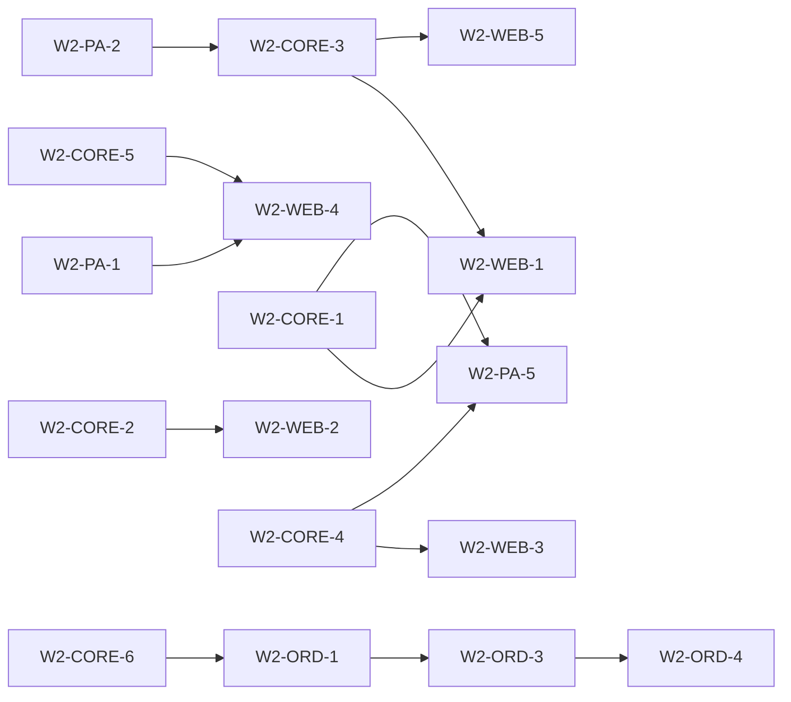

# هفته‌ی ۲: منو

این هفته سرمیز اولین چیزی را می‌سازد که یک کافه‌دار واقعاً می‌بیند: منوی کامل با عکس و گزینه، میز و QR، و صفحه‌ای که مهمان با اسکن QR روی گوشی‌اش باز می‌کند. زیر آن، ساخت سفارش و کانال‌های زنده هم برای هفته‌ی ۳ آماده می‌شوند.

[راهنمای تحویل‌ها](../README.md) | [طرح پروژه](../../plan.md) | [مشخصات فنی](../../SPEC.md)

## ۱. هدف هفته

صاحب کسب‌وکار منویش را در پنل بسازد و QR میزها را چاپ کند، و مهمان با اسکن همان QR منوی واقعی را به زبان خودش ببیند.

معیار پایان هفته، که در دمو سنجیده می‌شود:

- [ ] یک QR چاپ‌شده روی گوشی یک منوی واقعی باز می‌کند، با عکس، گزینه‌ها، برند کسب‌وکار و تغییر زبان.

قبل از شروع، یادداشت‌های آخر هفته‌ی ۱ را در `../week-1/notes/` بخوان؛ به‌خصوص تصمیم «برو» یا «نرو» منتور برای ساخت منو از عکس که مسیر `W2-PA-4` را تعیین می‌کند.

## ۲. کارها در یک نگاه

| بخش | کار | موضوع | پرچم |
|---|---|---|---|
| [هسته](core.md) | `W2-CORE-1` | دسته‌ها و آیتم‌های منو | |
| | `W2-CORE-2` | گزینه‌های آیتم | |
| | `W2-CORE-3` | عکس و برند کسب‌وکار | |
| | `W2-CORE-4` | میزها و QR | |
| | `W2-CORE-5` | منوی عمومی با cache و ETag | |
| | `W2-CORE-6` | `ResolveTable` و `PriceItems` برای سرویس سفارش | |
| [سفارش](order.md) | `W2-ORD-1` | ساخت سفارش | |
| | `W2-ORD-2` | ماشین وضعیت و APIهای پنل | |
| | `W2-ORD-3` | رویدادهای سفارش از راه outbox | |
| | `W2-ORD-4` | کانال‌های `realtime` و بلیت | |
| [فرانت](web.md) | `W2-WEB-1` | ویرایشگر منو در پنل | |
| | `W2-WEB-2` | ویرایشگر گزینه‌ها | |
| | `W2-WEB-3` | صفحه‌ی میزها، طراح QR و چاپ | |
| | `W2-WEB-4` | منوی مهمان | |
| | `W2-WEB-5` | تنظیمات برند کسب‌وکار | |
| [پلتفرم و هوش مصنوعی](platform-ai.md) | `W2-PA-1` | مسیرهای کامل `gateway`، نقش‌ها و محدودیت نرخ | |
| | `W2-PA-2` | object storage و CDN | |
| | `W2-PA-3` | لاگ مرکزی و GlitchTip | |
| | `W2-PA-4` | ساخت منو در سرویس `ai` | اختیاری برای مسیر عکس |
| | `W2-PA-5` | داده‌ی نمونه و اسکریپت کسب‌وکار دمو | |

## ۳. وابستگی‌ها

| چه کسی منتظر است | منتظر چه چیزی | کار | تا کی |
|---|---|---|---|
| پلتفرم | نام metadata برای کلید تکرار، نشست مهمان و توکن سفارش | `W2-ORD-1` | روز اول |
| هسته | bucketها و سیاست دسترسی در `staging` | `W2-PA-2` | روز دوم |
| هسته، فرانت | مسیرهای `catalog` در `gateway` | `W2-PA-1` | روز دوم |
| سفارش | `ResolveTable` و `PriceItems` | `W2-CORE-6` | روز سوم |
| فرانت، پلتفرم | CRUD دسته و آیتم | `W2-CORE-1` | روز سوم |
| فرانت | CRUD میز و تصویر QR | `W2-CORE-4` | روز سوم |
| سفارش | مسیرهای سفارش و `/stream-tickets` در `gateway` | `W2-PA-1` | روز سوم |
| همه | GlitchTip در شاسی | `W2-PA-3` | روز سوم |
| فرانت | گزینه‌ها، بارگذاری عکس، برند و منوی عمومی | `W2-CORE-2`، `W2-CORE-3`، `W2-CORE-5` | روز چهارم |
| همه، برای دمو | کسب‌وکار نمونه با منوی کامل | `W2-PA-5` | روز چهارم |
| پلتفرم | `ValidateOrderToken` | `W2-ORD-2` | روز چهارم |

## ۴. برنامه‌ی روزها

| روز | چه چیزی آخر روز آماده است |
|---|---|
| روز اول | همه یادداشت‌های هفته‌ی ۱ را خوانده‌اند. هسته migrationهای منو، میز و `media` را ادغام کرده است. سفارش نام metadata را به پلتفرم داده است. فرانت با لایه‌ی جعلی روی ویرایشگر منو و منوی مهمان کار را شروع کرده است. تصمیم شکل JSON منوی عمومی و پارامتر زبان بین هسته و فرانت گرفته شده است |
| روز دوم | bucketهای `staging` آماده‌اند. مسیرهای `catalog` از `gateway` می‌گذرند. تصمیم انتقال فایل بارگذاری بین هسته و پلتفرم گرفته شده است |
| روز سوم | `ResolveTable`، `PriceItems`، CRUD منو و CRUD میز روی `staging` هستند. مسیرهای سفارش و بلیت در `gateway` وصل‌اند. GlitchTip در شاسی است |
| روز چهارم | گزینه‌ها، بارگذاری عکس، برند و منوی عمومی روی `staging` هستند و فرانت به API واقعی وصل شده است. `CreateOrder` و رویدادهای سفارش کار می‌کنند. اسکریپت داده‌ی نمونه یک کسب‌وکار کامل روی `staging` ساخته است. نقش‌ها و محدودیت نرخ فعال‌اند |
| روز پنجم | QRها چاپ شده‌اند و روی چند گوشی امتحان شده‌اند. صبح تمرین دمو، عصر دمو و یادداشت‌های آخر هفته |

> [!IMPORTANT]
> مسیر بحرانی این هفته `W2-PA-2` به `W2-CORE-3` به `W2-WEB-1` و `W2-WEB-4` است. اگر bucket روز دوم آماده نبود، هسته بارگذاری را اول روی MinIO محلی کامل می‌کند و فرانت با عکس‌های داده‌ی نمونه جلو می‌رود.

## ۵. سناریوی دمو

دمو روی سرور واقعی و با گوشی واقعی روی اینترنت موبایل اجرا می‌شود.

1. **فرانت و هسته:** در پنل یک دسته‌ی تازه و یک آیتم با نام `fa` و `en`، یک گروه گزینه‌ی «اندازه» و یک عکس بساز. ترتیب آیتم‌ها را با کشیدن عوض کن.
2. **فرانت:** در تنظیمات برند لوگو، کاور و رنگ را بگذار و `en` را در زبان‌های منو روشن کن.
3. **فرانت و هسته:** صفحه‌ی میزها را باز کن، QR سه میز را با لوگو چاپ کن.
4. **همه:** یکی از حاضران QR چاپ‌شده را با دوربین گوشی خودش اسکن می‌کند. منوی همان کسب‌وکار با برند، عکس و آیتم تازه باز می‌شود.
5. **فرانت:** روی گوشی بین دسته‌ها برو، جست‌وجو کن، فیلتر «گیاهی» را بزن، برگه‌ی یک آیتم را با گزینه‌هایش باز کن و زبان را به `en` ببر.
6. **هسته:** قیمت یک آیتم را در پنل عوض کن؛ در کمتر از ۳۰ ثانیه روی گوشی قیمت تازه دیده می‌شود. QR یک میز را دوباره بساز؛ QR چاپ‌شده‌ی قبلی دیگر کار نمی‌کند.
7. **سفارش:** با `curl` روی همان میز سفارش بفرست؛ در کمتر از ۲ ثانیه روی صفحه‌ی آزمایشی کانال کسب‌وکار دیده می‌شود.
8. **پلتفرم:** گزارش Lighthouse منوی مهمان با شبیه‌سازی موبایل، حجم JavaScript گروه مهمان، و یک درخواست را با `request_id` در Loki از `gateway` تا `catalog` دنبال کن. یک خطای عمدی وب در GlitchTip دیده می‌شود.
9. **هوش مصنوعی:** یک رویداد `import.requested` آزمایشی منتشر می‌شود و `import.completed` با پیش‌نویس منو، اطمینان و هشدارها برمی‌گردد.

## ۶. ریسک‌های این هفته

| ریسک | چطور زود بفهمیم | آن‌وقت چه می‌کنیم |
|---|---|---|
| منوی مهمان از بودجه‌ی ۱۵۰ KB یا ۲ ثانیه رد می‌شود | اندازه‌گیری روز سوم | جست‌وجو و فیلترها جدا و تنبل بارگذاری می‌شوند؛ ویژگی تازه اضافه نمی‌شود تا بودجه برگردد |
| CDN ارائه‌دهنده‌ی ایرانی تا آخر هفته آماده نیست | روز دوم | عکس‌ها مستقیم از object storage با همان headerهای cache داده می‌شوند و CDN اولین کار هفته‌ی ۳ پلتفرم است |
| `PriceItems` روز سوم آماده نیست | ظهر روز سوم | سفارش با `catalog` جعلی کامل می‌شود و اتصال واقعی روز چهارم |
| خواندن عکس منو بعد از تصمیم هفته‌ی ۱ ضعیف است | یادداشت هفته‌ی ۱ | مسیر Excel اصلی است و مسیر عکس اختیاری |
| QR با لوگو روی بعضی گوشی‌ها خوانده نمی‌شود | آزمایش روز چهارم با چند گوشی | لوگو کوچک‌تر یا حذف از وسط QR |

**چه چیزی اول حذف می‌شود:** به این ترتیب: ۱) مسیر عکس در `W2-PA-4` (اختیاری است). ۲) کشیدن برای مرتب کردن در `W2-WEB-1`، که موقتاً با دکمه‌ی بالا و پایین جایگزین می‌شود. ۳) فیلتر حساسیت در منوی مهمان، با نگه داشتن نمایش برچسب‌ها. ۴) کانال سفارش مهمان در `W2-ORD-4`، که به هفته‌ی ۳ می‌رود. منوی مهمان، QR، `PriceItems` و `CreateOrder` حذف نمی‌شوند، چون هفته‌ی ۳ کاملاً به آن‌ها تکیه دارد.

