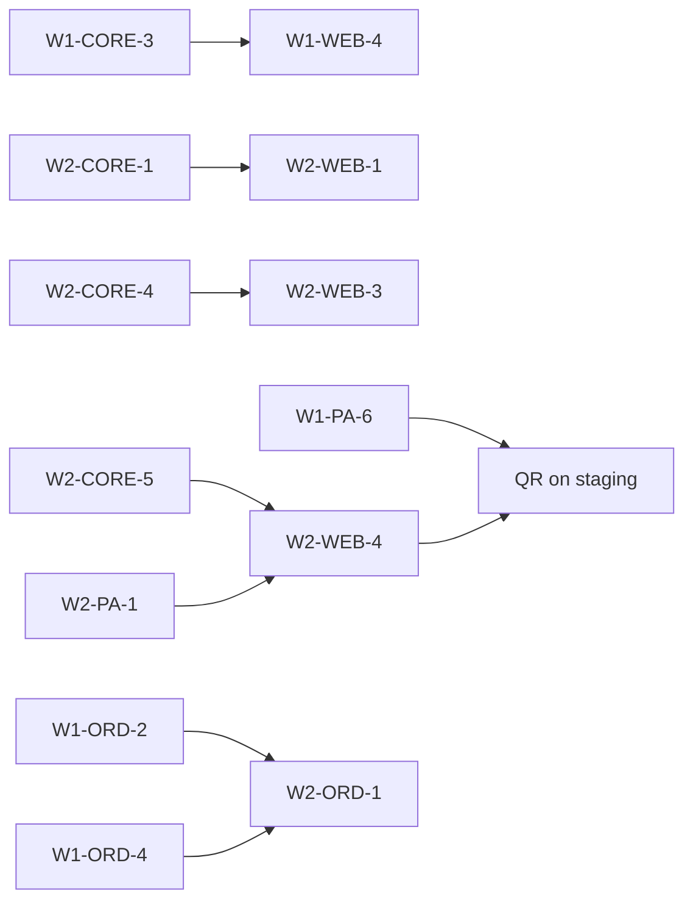

# هفته‌ی ۲: منو

این هفته سرمیز اولین چیزی را می‌سازد که یک کافه‌دار واقعاً می‌بیند: منو، میز و QR، و صفحه‌ای که مهمان با اسکن QR روی گوشی‌اش باز می‌کند؛ این بار روی سرور واقعی. زیر آن، پایه‌ی سفارش برای هفته‌ی ۳ آماده می‌شود.

[راهنمای تحویل‌ها](../README.md) | [تیم و تقسیم کار](../../team.md) | [هفته‌ی ۱](../week-1/README.md) | [هفته‌ی ۳](../week-3/README.md)

## ۱. هدف هفته

صاحب کسب‌وکار وارد پنل شود، کسب‌وکارش را بسازد، منو را بسازد و QR میزها را چاپ کند، و مهمان با اسکن همان QR منوی واقعی را روی گوشی ببیند.

معیار پایان هفته، که در دمو سنجیده می‌شود:

- [ ] روی `staging` با دامنه و TLS، یک QR چاپ‌شده روی گوشی یک منوی واقعی باز می‌کند، با دسته‌ها، قیمت‌ها و تغییر زبان بین `fa` و `en`.
- [ ] هر merge به `main` خودکار روی `staging` مستقر می‌شود.

عکس، گزینه‌های آیتم و برند در هفته‌ی ۳ به منو اضافه می‌شوند. قبل از شروع، یادداشت‌های آخر هفته‌ی ۱ را در `../week-1/notes/` بخوان.

## ۲. کارها در یک نگاه

همه‌ی کارهای این هفته، به تفکیک نقش. صاحب هر نقش در [تیم و تقسیم کار](../../team.md) است. کارهایی که از برنامه‌ی هفته‌ی ۱ آمده‌اند، تحویلشان در پوشه‌ی هفته‌ی ۱ است.

| نقش | شناسه | کار | برچسب | نکته | تحویل |
|---|---|---|---|---|---|
| فرانت | `W1-WEB-4` | ورود به پنل و ساخت کسب‌وکار |  | از برنامه‌ی هفته‌ی ۱. صفحه‌ی ورود را هفته‌ی ۱ روی لایه‌ی جعلی شروع کن؛ اتصال واقعی و ساخت کسب‌وکار در هفته‌ی ۲، چون `CreateVenue` (`W1-CORE-3`) هفته‌ی ۲ می‌رسد. | [week-1/web.md](../week-1/web.md) |
| فرانت | `W2-WEB-1` | ویرایشگر منو در پنل |  | بارگذاری عکس در ویرایشگر وقتی کامل می‌شود که `W2-CORE-3` در هفته‌ی ۳ برسد. | [week-2/web.md](../week-2/web.md) |
| فرانت | `W2-WEB-3` | صفحه‌ی میزها، طراح QR و چاپ |  |  | [week-2/web.md](../week-2/web.md) |
| فرانت | `W2-WEB-4` | منوی مهمان |  |  | [week-2/web.md](../week-2/web.md) |
| ورود و منو | `W1-CORE-3` | اسکلت catalog و ساخت کسب‌وکار |  | از برنامه‌ی هفته‌ی ۱. | [week-1/core.md](../week-1/core.md) |
| ورود و منو | `W2-CORE-1` | دسته‌ها و آیتم‌های منو |  |  | [week-2/core.md](../week-2/core.md) |
| ورود و منو | `W2-CORE-4` | میزها و QR |  |  | [week-2/core.md](../week-2/core.md) |
| ورود و منو | `W2-CORE-5` | منوی عمومی |  |  | [week-2/core.md](../week-2/core.md) |
| ورود و منو | `W2-PA-1` | مسیرهای کامل gateway، نقش‌ها و محدودیت نرخ |  |  | [week-2/platform-ai.md](../week-2/platform-ai.md) |
| سفارش و زیرساخت | `W1-ORD-2` | اسکلت order و قرارداد سفارش |  | از برنامه‌ی هفته‌ی ۱. | [week-1/order.md](../week-1/order.md) |
| سفارش و زیرساخت | `W1-ORD-4` | پایه‌ی رویدادها در شاسی |  | از برنامه‌ی هفته‌ی ۱. | [week-1/order.md](../week-1/order.md) |
| سفارش و زیرساخت | `W1-PA-6` | cluster و استقرار |  | از برنامه‌ی هفته‌ی ۱. روز اول هفته‌ی ۱ فقط یک ساعت دسترسی سرور به registry و DNS را بسنج و نتیجه را در گروه تیم بنویس. خود cluster و استقرار در هفته‌ی ۲ است. نسخه‌ی «سلام» سرویس `ai` لازم نیست؛ هر سرویسی که تا آن روز اسکلت دارد بالا می‌آید. | [week-1/platform-ai.md](../week-1/platform-ai.md) |
| سفارش و زیرساخت | `W2-ORD-1` | ساخت سفارش |  | تا `W2-CORE-6` برسد (روز اول هفته‌ی ۳)، با `catalog` جعلی پشت یک interface کار کن. | [week-2/order.md](../week-2/order.md) |

**کارهایی با شناسه‌ی هفته‌ی ۲ که این هفته انجام نمی‌شوند:**

| شناسه | کار | چه شد |
|---|---|---|
| `W2-CORE-2` | گزینه‌های آیتم | در هفته‌ی ۳ انجام می‌شود (نقش «ورود و منو») |
| `W2-CORE-3` | عکس و برند کسب‌وکار | در هفته‌ی ۳ انجام می‌شود (نقش «ورود و منو») |
| `W2-CORE-6` | قرارداد قیمت‌گذاری برای سرویس سفارش | در هفته‌ی ۳ انجام می‌شود (نقش «ورود و منو») |
| `W2-ORD-2` | ماشین وضعیت و APIهای پنل | در هفته‌ی ۳ انجام می‌شود (نقش «سفارش و زیرساخت») |
| `W2-ORD-3` | رویدادهای سفارش | در هفته‌ی ۳ انجام می‌شود (نقش «سفارش و زیرساخت») |
| `W2-ORD-4` | کانال‌های realtime | در هفته‌ی ۳ انجام می‌شود (نقش «سفارش و زیرساخت») |
| `W2-WEB-2` | ویرایشگر گزینه‌ها | در هفته‌ی ۳ انجام می‌شود (نقش «فرانت») |
| `W2-WEB-5` | تنظیمات برند کسب‌وکار | در `W4-WEB-2` ادغام شد (هفته‌ی ۴، نقش «فرانت») |
| `W2-PA-2` | object storage و CDN | در هفته‌ی ۳ انجام می‌شود (نقش «ورود و منو») |
| `W2-PA-3` | لاگ مرکزی و ردگیری خطا | در هفته‌ی ۵ انجام می‌شود (نقش «ورود و منو») |
| `W2-PA-4` | ساخت منو در سرویس ai | **انجام نمی‌شود.** سرویس `ai` و همه‌ی قابلیت‌های هوش مصنوعی به انتشار ۲ رفته‌اند. |
| `W2-PA-5` | داده‌ی نمونه و اسکریپت کسب‌وکار دمو | در هفته‌ی ۳ انجام می‌شود (نقش «ورود و منو») |

## ۳. وابستگی‌ها

| چه کسی منتظر است | منتظر چه چیزی | کار | تا کی |
|---|---|---|---|
| فرانت | `CreateVenue` و مسیرش در `gateway` | `W1-CORE-3` | روز دوم |
| همه | `staging` با دامنه و TLS و استقرار خودکار | `W1-PA-6` | روز سوم |
| فرانت | مسیرهای `catalog` در `gateway`، با نقش‌ها و محدودیت نرخ | `W2-PA-1` | روز سوم |
| فرانت | CRUD دسته و آیتم | `W2-CORE-1` | روز سوم |
| فرانت | CRUD میز و تصویر QR | `W2-CORE-4` | روز سوم |
| فرانت | منوی عمومی | `W2-CORE-5` | روز چهارم |
| فرانت و ورود و منو (برای هفته‌ی ۳) | قرارداد proto سفارش | `W1-ORD-2` | روز سوم |
| سفارش و زیرساخت (برای هفته‌ی ۳) | `ResolveTable` و `PriceItems` | `W2-CORE-6` | روز اول هفته‌ی ۳ |

## ۴. برنامه‌ی روزها

| روز | چه چیزی آخر روز آماده است |
|---|---|
| روز اول | همه یادداشت‌های هفته‌ی ۱ را خوانده‌اند. «ورود و منو» migrationهای کسب‌وکار، منو و میز را ادغام کرده است. «فرانت» صفحه‌ی ساخت کسب‌وکار، ویرایشگر منو و منوی مهمان را با لایه‌ی جعلی شروع کرده است. شکل JSON منوی عمومی و پارامتر زبان بین «ورود و منو» و «فرانت» توافق شده است |
| روز دوم | `CreateVenue` کار می‌کند. PR قرارداد proto سفارش باز است. namespaceهای `staging` و `production` روی cluster ساخته شده‌اند |
| روز سوم | `staging` با دامنه و TLS بالاست و هر merge خودکار مستقر می‌شود. CRUD منو و میز و مسیرهایشان در `gateway` روی `staging` هستند |
| روز چهارم | منوی عمومی روی `staging` است و فرانت به API واقعی وصل شده است. بسته‌ی رویدادها در شاسی ادغام شده و `CreateOrder` با `catalog` جعلی کار می‌کند |
| روز پنجم | QRها چاپ شده‌اند و روی چند گوشی امتحان شده‌اند. صبح تمرین دمو، عصر دمو و یادداشت‌های آخر هفته |

> [!IMPORTANT]
> مسیر بحرانی این هفته `W1-PA-6` و `W2-CORE-5` به `W2-WEB-4` است. اگر `staging` روز سوم با دامنه بالا نبود، «سفارش و زیرساخت» همان روز با منتور حرف می‌زند و بقیه روی محیط محلی جلو می‌روند.

## ۵. سناریوی دمو

دمو روی `staging` و با گوشی واقعی روی اینترنت موبایل اجرا می‌شود.

1. **فرانت و ورود و منو:** روی گوشی `/panel` را باز کن، با شماره‌ی آزمایشی وارد شو و یک کسب‌وکار بساز.
2. **فرانت و ورود و منو:** در پنل یک دسته و یک آیتم با نام `fa` و `en` بساز و ترتیب آیتم‌ها را عوض کن.
3. **فرانت و ورود و منو:** صفحه‌ی میزها را باز کن و QR سه میز را چاپ کن.
4. **همه:** یکی از حاضران QR چاپ‌شده را با دوربین گوشی خودش اسکن می‌کند. منوی همان کسب‌وکار باز می‌شود.
5. **فرانت:** روی گوشی بین دسته‌ها برو، جست‌وجو کن، فیلتر «گیاهی» را بزن و زبان را به `en` ببر.
6. **ورود و منو:** قیمت یک آیتم را در پنل عوض کن؛ در کمتر از ۳۰ ثانیه روی گوشی قیمت تازه دیده می‌شود. QR یک میز را دوباره بساز؛ QR چاپ‌شده‌ی قبلی دیگر کار نمی‌کند.
7. **ورود و منو:** کاربر دوم کسب‌وکار اول را با `not_found` می‌بیند.
8. **سفارش و زیرساخت:** یک PR کوچک merge می‌شود و چند دقیقه بعد image تازه با git SHA روی `staging` است. `kubectl get pods -n staging` همه‌ی سرویس‌هایی را که تا امروز ساخته شده‌اند `Running` نشان می‌دهد.
9. **سفارش و زیرساخت:** یک تست نشان می‌دهد `CreateOrder` با `catalog` جعلی، سفارش و ردیف outbox آن را در یک تراکنش می‌نویسد.

## ۶. ریسک‌های این هفته

| ریسک | چطور زود بفهمیم | آن‌وقت چه می‌کنیم |
|---|---|---|
| دامنه یا سرور از هفته‌ی صفر آماده نیست | روز اول | `staging` موقتاً با نشانی موقت بالا می‌آید و دامنه و TLS اولین کار هفته‌ی ۳ «سفارش و زیرساخت» می‌شود؛ منتور این را صریح ثبت می‌کند |
| منوی مهمان از بودجه‌ی ۱۵۰ KB یا ۲ ثانیه رد می‌شود | اندازه‌گیری روز سوم | جست‌وجو و فیلترها جدا و تنبل بارگذاری می‌شوند؛ ویژگی تازه اضافه نمی‌شود تا بودجه برگردد |
| `W1-WEB-4` و ویرایشگر منو با هم برای فرانت زیاد است | روز سوم ویرایشگر به API واقعی وصل نیست | کشیدن برای مرتب کردن در `W2-WEB-1` موقتاً با دکمه‌ی بالا و پایین جایگزین می‌شود |
| `W2-ORD-1` بدون `PriceItems` واقعی کند پیش برود | روز چهارم تست تراکنش سبز نیست | `CreateOrder` با `catalog` جعلی کامل می‌شود و اتصال واقعی روز اول هفته‌ی ۳ |

**چه چیزی اول حذف می‌شود:** به این ترتیب: ۱) کشیدن برای مرتب کردن در `W2-WEB-1`. ۲) فیلتر حساسیت در منوی مهمان، با نگه داشتن نمایش برچسب‌ها. منوی مهمان، QR و `staging` با دامنه حذف نمی‌شوند، چون هفته‌ی ۳ کاملاً به آن‌ها تکیه دارد.

