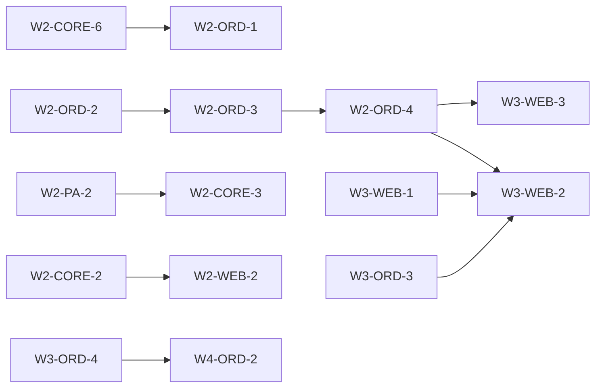

# هفته‌ی ۳: سفارش

این هفته سرمیز از «منوی دیجیتال» به «سفارش از سر میز» می‌رسد. مهمان سبد می‌سازد و سفارش می‌دهد، آشپزخانه سفارش را زنده می‌بیند، منو عکس و گزینه و برند می‌گیرد، و طراحی پرداخت آنلاین برای هفته‌ی ۴ آماده می‌شود.

[راهنمای تحویل‌ها](../README.md) | [تیم و تقسیم کار](../../team.md) | [هفته‌ی ۲](../week-2/README.md) | [هفته‌ی ۴](../week-4/README.md)

## ۱. هدف هفته

**یک جمله:** سفارشی که مهمان با گوشی ثبت می‌کند، کمتر از ۲ ثانیه بعد روی صفحه‌ی آشپزخانه دیده شود.

معیار پایان هفته، که در دمو سنجیده می‌شود:

- [ ] روی `staging`، یک نفر QR یک میز را با گوشی اسکن می‌کند، سبد می‌سازد و سفارش «پرداخت پای صندوق» ثبت می‌کند. روی تبلت آشپزخانه، سفارش با صدای اعلان در کمتر از ۲ ثانیه ظاهر می‌شود. زمان با کرنومتر و از روی لاگ‌های همان `request_id` سنجیده می‌شود.
- [ ] منوی مهمان عکس، گزینه‌ها و برند کسب‌وکار را نشان می‌دهد.
- [ ] سند طراحی پرداخت (`W3-ORD-4`) تأیید منتور را دارد.

> [!IMPORTANT]
> این هفته پرداخت آنلاین ساخته نمی‌شود. سبد مهمان فقط «پرداخت پای صندوق» را می‌فرستد. دکمه‌های گارسون و صورت‌حساب هم هفته‌ی ۴ وصل می‌شوند. ولی طراحی ماژول پرداخت (`W3-ORD-4`) باید آخر همین هفته آماده باشد، وگرنه هفته‌ی ۴ با تأخیر شروع می‌شود.

## ۲. کارها در یک نگاه

همه‌ی کارهای این هفته، به تفکیک نقش. صاحب هر نقش در [تیم و تقسیم کار](../../team.md) است. بیشتر کارهای این هفته از برنامه‌ی هفته‌ی ۲ آمده‌اند و تحویلشان در پوشه‌ی هفته‌ی ۲ است.

| نقش | شناسه | کار | برچسب | نکته | تحویل |
|---|---|---|---|---|---|
| فرانت | `W2-WEB-2` | ویرایشگر گزینه‌ها |  | از برنامه‌ی هفته‌ی ۲. | [week-2/web.md](../week-2/web.md) |
| فرانت | `W3-WEB-1` | سبد خرید مهمان و ثبت سفارش |  |  | [week-3/web.md](../week-3/web.md) |
| فرانت | `W3-WEB-2` | صفحه‌ی زنده‌ی وضعیت سفارش، گارسون و صورت‌حساب |  | دکمه‌های «صدا زدن گارسون» و «درخواست صورت‌حساب» وقتی `W3-ORD-1` در هفته‌ی ۴ برسد وصل می‌شوند. | [week-3/web.md](../week-3/web.md) |
| فرانت | `W3-WEB-3` | صفحه‌ی زنده‌ی آشپزخانه و صندوق |  | `W3-WEB-4` هم در همین کار است. | [week-3/web.md](../week-3/web.md) |
| ورود و منو | `W2-CORE-2` | گزینه‌های آیتم |  | از برنامه‌ی هفته‌ی ۲. | [week-2/core.md](../week-2/core.md) |
| ورود و منو | `W2-CORE-3` | عکس و برند کسب‌وکار |  | از برنامه‌ی هفته‌ی ۲. | [week-2/core.md](../week-2/core.md) |
| ورود و منو | `W2-CORE-6` | قرارداد قیمت‌گذاری برای سرویس سفارش |  | از برنامه‌ی هفته‌ی ۲. روز اول هفته‌ی ۳ تحویل بده، چون `W2-ORD-1` منتظرش است. | [week-2/core.md](../week-2/core.md) |
| ورود و منو | `W2-PA-2` | object storage و CDN |  | از برنامه‌ی هفته‌ی ۲. | [week-2/platform-ai.md](../week-2/platform-ai.md) |
| ورود و منو | `W2-PA-5` | داده‌ی نمونه و اسکریپت کسب‌وکار دمو |  | از برنامه‌ی هفته‌ی ۲. | [week-2/platform-ai.md](../week-2/platform-ai.md) |
| سفارش و زیرساخت | `W2-ORD-2` | ماشین وضعیت و APIهای پنل |  | از برنامه‌ی هفته‌ی ۲. | [week-2/order.md](../week-2/order.md) |
| سفارش و زیرساخت | `W2-ORD-3` | رویدادهای سفارش |  | از برنامه‌ی هفته‌ی ۲. | [week-2/order.md](../week-2/order.md) |
| سفارش و زیرساخت | `W2-ORD-4` | کانال‌های realtime |  | از برنامه‌ی هفته‌ی ۲. `W1-ORD-3` هم در همین کار است. | [week-2/order.md](../week-2/order.md) |
| سفارش و زیرساخت | `W3-ORD-3` | پرداخت پای صندوق و «سفارش‌های من» | بازبینی منتور |  | [week-3/order.md](../week-3/order.md) |
| سفارش و زیرساخت | `W3-ORD-4` | طراحی ماژول پرداخت | بازبینی منتور |  | [week-3/order.md](../week-3/order.md) |

**کارهایی با شناسه‌ی هفته‌ی ۳ که این هفته انجام نمی‌شوند:**

| شناسه | کار | چه شد |
|---|---|---|
| `W3-CORE-1` | جریان ساخت منو از فایل | **انجام نمی‌شود.** ساخت منو از فایل (عکس یا Excel) به انتشار ۲ رفته است؛ صاحب کسب‌وکار منو را در پنل وارد می‌کند. |
| `W3-CORE-2` | کلید «تمام شد» (منوی زمان‌دار در انتشار ۲) | در هفته‌ی ۴ انجام می‌شود (نقش «ورود و منو») |
| `W3-CORE-3` | ترجمه‌ی منو | **انجام نمی‌شود.** ترجمه‌ی خودکار به انتشار ۲ رفته است؛ صاحب کسب‌وکار ترجمه را در ویرایشگر منو دستی می‌نویسد. |
| `W3-CORE-4` | «با این می‌چسبد» و نشان‌ها | **انجام نمی‌شود.** پیشنهاد «با این می‌چسبد» به انتشار ۲ رفته است؛ نشان‌ها با `W2-CORE-1` دستی گذاشته می‌شوند. |
| `W3-ORD-1` | درخواست خدمت | در هفته‌ی ۴ انجام می‌شود (نقش «سفارش و زیرساخت») |
| `W3-ORD-2` | محکم‌کاری قواعد سفارش | در هفته‌ی ۴ انجام می‌شود (نقش «سفارش و زیرساخت») |
| `W3-WEB-4` | فهرست و جزئیات سفارش‌ها در پنل | در `W3-WEB-3` ادغام شد (هفته‌ی ۳، نقش «فرانت») |
| `W3-PA-1` | metric، trace و داشبوردها | در هفته‌ی ۵ انجام می‌شود (نقش «ورود و منو») |
| `W3-PA-2` | هشدارها و پایش از بیرون | در `W3-PA-1` ادغام شد (هفته‌ی ۵، نقش «ورود و منو») |
| `W3-PA-3` | تست بار با k6 | در `W5-ORD-2` ادغام شد (هفته‌ی ۵، نقش «سفارش و زیرساخت») |
| `W3-PA-4` | نشانی ترجمه در سرویس ai | **انجام نمی‌شود.** سرویس `ai` و همه‌ی قابلیت‌های هوش مصنوعی به انتشار ۲ رفته‌اند. |

## ۳. وابستگی‌ها

| چه کسی منتظر است | منتظر چه چیزی | کار | تا کی |
|---|---|---|---|
| سفارش و زیرساخت | `ResolveTable` و `PriceItems` | `W2-CORE-6` | روز اول |
| فرانت | PR قرارداد proto ماشین وضعیت، «سفارش‌های من» و پرداخت پای صندوق | `W2-ORD-2`، `W3-ORD-3` | روز اول |
| ورود و منو | بازبینی `IssueStreamTicket` در `identity` | `W2-ORD-4` | روز دوم |
| فرانت | APIهای پنل سفارش و ماشین وضعیت روی `staging` | `W2-ORD-2` | روز سوم |
| فرانت | کانال‌های `realtime` و بلیت | `W2-ORD-4` | روز سوم |
| فرانت | گزینه‌های آیتم | `W2-CORE-2` | روز سوم |
| فرانت | بارگذاری عکس و برند | `W2-PA-2`، `W2-CORE-3` | روز سوم |
| `W3-ORD-4` | جواب منتور درباره‌ی مدل تسویه | منتور | روز سوم |
| همه، برای دمو | کسب‌وکار نمونه با منوی کامل | `W2-PA-5` | روز چهارم |

`W2-ORD-1` هفته‌ی قبل با `catalog` جعلی ساخته شد؛ این هفته به `W2-CORE-6` واقعی وصل می‌شود.

## ۴. برنامه‌ی روزها

| روز | چه چیزی آخر روز آماده است |
|---|---|
| روز اول | `W2-CORE-6` ادغام شده و `CreateOrder` به `catalog` واقعی وصل است. PR قرارداد proto ماشین وضعیت، «سفارش‌های من» و پرداخت پای صندوق باز است. سؤال‌های طراحی پرداخت برای منتور فرستاده شده است (فهرست در تحویل `W3-ORD-4`) |
| روز دوم | APIهای پنل سفارش و رویدادهای سفارش از outbox کار می‌کنند. فرانت سبد را روی `CreateOrder` می‌سازد. bucketهای object storage روی `staging` آماده‌اند |
| روز سوم (مهم‌ترین روز) | `realtime` با بلیت روی `staging` است و صفحه‌ی آشپزخانه سفارش تازه را نشان می‌دهد. گزینه‌ها، عکس و برند روی `staging` هستند. جواب منتور درباره‌ی مدل تسویه رسیده است |
| روز چهارم | پرداخت پای صندوق و «سفارش‌های من» کار می‌کنند. داده‌ی نمونه یک کسب‌وکار کامل روی `staging` ساخته است. صفحه‌ی وضعیت سفارش مهمان زنده است |
| روز پنجم | تمرین دمو روی تبلت و گوشی واقعی. سند طراحی پرداخت merge شده است. یادداشت‌های آخر هفته |

## ۵. سناریوی دمو

روی `staging` و دامنه‌ی واقعی، با یک تبلت برای آشپزخانه و یک گوشی برای مهمان:

1. روی تبلت وارد پنل شو و `/panel/kitchen` را باز کن. دکمه‌ی شروع را بزن تا مرورگر اجازه‌ی پخش صدا بدهد. نشانگر اتصال سبز است.
2. با گوشی، QR چاپ‌شده‌ی میز ۳ را اسکن کن. منو با عکس‌ها، رنگ و لوگوی کسب‌وکار باز می‌شود.
3. یک قلم با گزینه (مثلاً لاته‌ی بزرگ با شیر جو) و یک قلم دیگر با یادداشت به سبد اضافه کن. صفحه را ببند و دوباره باز کن: سبد سر جایش است.
4. سفارش را با «پرداخت پای صندوق» ثبت کن. صفحه‌ی وضعیت سفارش باز می‌شود.
5. روی تبلت، سفارش با صدا در ستون «جدید» ظاهر می‌شود. زمان را با کرنومتر بگیر.
6. روی تبلت سفارش را «پذیرفته» و بعد «در حال آماده‌سازی» کن. صفحه‌ی گوشی بدون refresh عوض می‌شود.
7. در پنل، از جزئیات سفارش «پرداخت شد پای صندوق» را بزن.
8. اینترنت تبلت را ۲۰ ثانیه قطع کن و از گوشی یک سفارش دیگر بده. بعد از وصل شدن، سفارش دوم بدون refresh دیده می‌شود.
9. **سفارش و زیرساخت:** در دو دقیقه سند طراحی پرداخت و تصمیم مدل تسویه را توضیح بده.

## ۶. ریسک‌های این هفته

| ریسک | نشانه‌ی زودهنگام | اگر رخ داد |
|---|---|---|
| بار «سفارش و زیرساخت» با پنج کار زیاد است | روز سوم `realtime` روی `staging` نیست | «ورود و منو» `IssueStreamTicket` را در `identity` می‌نویسد و صاحب `W2-ORD-4` فقط کانال‌ها را؛ «سفارش‌های من» از `W3-ORD-3` به هفته‌ی ۴ می‌رود |
| جواب منتور درباره‌ی مدل تسویه تا روز سوم نرسد | سؤال‌های `W3-ORD-4` بی‌جواب مانده | طراحی برای هر دو مدل پشت `PaymentProvider` نوشته می‌شود و سند تصمیم ۶ «باز» می‌ماند؛ هفته‌ی ۴ با provider جعلی شروع می‌شود |
| رویدادها دیر به آشپزخانه برسند | لاگ‌ها نشان می‌دهند زمان در relay صندوق خروجی (outbox) می‌گذرد | فاصله‌ی relay را کوتاه کنید |
| صدا روی تبلت پخش نشود | مرورگر بدون تعامل کاربر صدا را بلاک می‌کند | دکمه‌ی «شروع شیفت» که اولین تعامل را می‌گیرد |
| QR با لوگو روی بعضی گوشی‌ها خوانده نمی‌شود | آزمایش روز چهارم با چند گوشی | لوگو کوچک‌تر یا حذف از وسط QR |
| کار هفته‌ی ۲ ناتمام مانده باشد | یادداشت‌های `week-2/notes/` | روز اول همان را ببندید |

**ترتیب حذف اگر زمان کم آمد:** ۱) «سفارش‌های من روی این دستگاه» از `W3-ORD-3` به هفته‌ی ۴ می‌رود. ۲) ویرایشگر گزینه‌ها (`W2-WEB-2`) به روز اول هفته‌ی ۴ می‌رود و دمو با کسب‌وکار نمونه‌ای اجرا می‌شود که گزینه‌هایش را اسکریپت داده‌ی نمونه ساخته است. این‌ها هرگز حذف نمی‌شوند: سبد و ثبت سفارش، صفحه‌ی آشپزخانه، صفحه‌ی وضعیت سفارش و طراحی پرداخت، چون معیار پایان هفته و کل هفته‌ی ۴ به آن‌ها بسته است.

