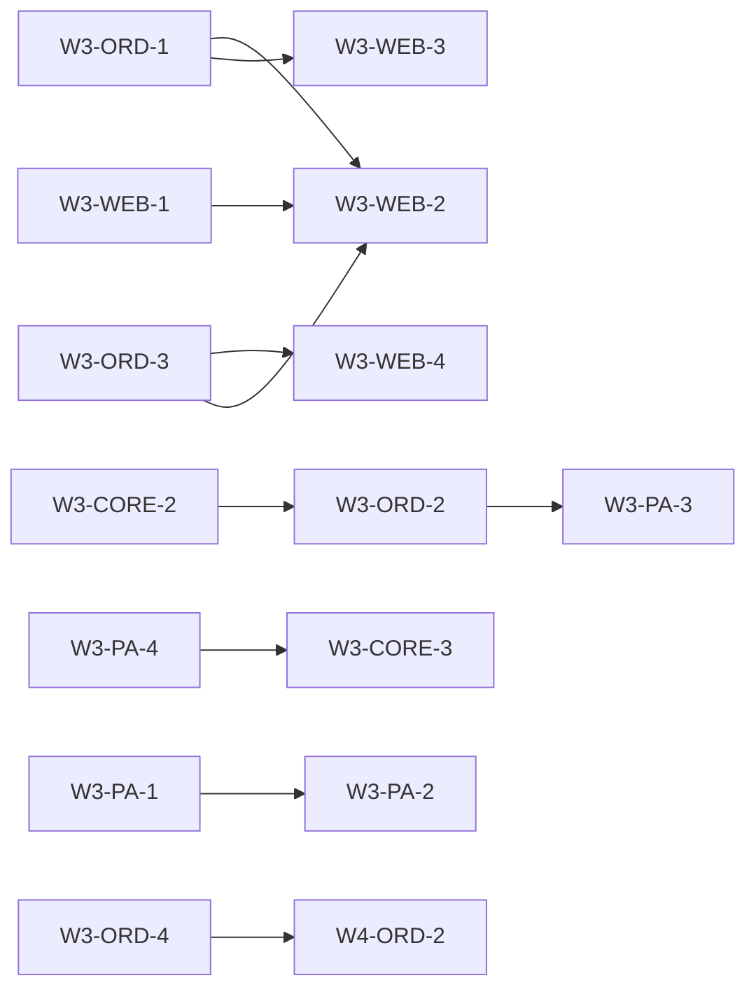

# هفته‌ی ۳: سفارش

این هفته سرمیز از «منوی دیجیتال» به «سفارش از سر میز» می‌رسد. مهمان سبد خرید می‌سازد و سفارش می‌دهد، آشپزخانه سفارش را زنده می‌بیند، و برای پرداخت آنلاین هفته‌ی ۴ طراحی آماده می‌شود.

[راهنمای تحویل‌ها](../README.md) | [هفته‌ی ۲](../week-2/README.md) | [هفته‌ی ۴](../week-4/README.md)

## ۱. هدف هفته

**یک جمله:** سفارشی که مهمان با گوشی ثبت می‌کند، کمتر از ۲ ثانیه بعد روی صفحه‌ی آشپزخانه دیده شود.

**معیار پایان هفته که در دمو سنجیده می‌شود:** روی سرور واقعی، یک نفر QR چاپ‌شده‌ی یک میز را با گوشی اسکن می‌کند، سبد می‌سازد و سفارش «پرداخت پای صندوق» ثبت می‌کند. روی تبلت آشپزخانه، سفارش با صدای اعلان در کمتر از ۲ ثانیه ظاهر می‌شود. این زمان را از روی trace در Grafana هم نشان می‌دهیم، نه فقط با چشم.

> [!IMPORTANT]
> این هفته پرداخت آنلاین ساخته نمی‌شود. سبد مهمان فقط «پرداخت پای صندوق» را می‌فرستد. ولی طراحی ماژول پرداخت (`W3-ORD-4`) باید آخر همین هفته آماده باشد، وگرنه هفته‌ی ۴ با یک روز تأخیر شروع می‌شود.

## ۲. کارها در یک نگاه

| بخش | کار | خلاصه | پرچم |
|---|---|---|---|
| [سفارش](order.md) | `W3-ORD-1` | درخواست خدمت: صدا زدن گارسون و درخواست صورت‌حساب | |
| [سفارش](order.md) | `W3-ORD-2` | محکم‌کاری قواعد سفارش: لغو، انقضای خودکار، idempotency زیر بار هم‌زمان | |
| [سفارش](order.md) | `W3-ORD-3` | پرداخت پای صندوق و «سفارش‌های من روی این دستگاه» | |
| [سفارش](order.md) | `W3-ORD-4` | طراحی ماژول پرداخت و سند تصمیم مدل تسویه | منتور |
| [هسته](core.md) | `W3-CORE-1` | جریان کار ساخت منو از فایل: ساخت کار، رویدادها، بازبینی و اعمال پیش‌نویس | |
| [هسته](core.md) | `W3-CORE-2` | منوی زمان‌دار و کلید «تمام شد» در منوی عمومی و `PriceItems` | |
| [هسته](core.md) | `W3-CORE-3` | ترجمه‌ی منو با سرویس `ai` و ویرایش ترجمه توسط صاحب کسب‌وکار | |
| [هسته](core.md) | `W3-CORE-4` | پیشنهاد «با این می‌چسبد» و نشان‌ها در منوی عمومی | |
| [فرانت](web.md) | `W3-WEB-1` | سبد خرید مهمان و ثبت سفارش | |
| [فرانت](web.md) | `W3-WEB-2` | صفحه‌ی زنده‌ی وضعیت سفارش، دکمه‌های گارسون و صورت‌حساب | |
| [فرانت](web.md) | `W3-WEB-3` | صفحه‌ی زنده‌ی آشپزخانه و صندوق روی تبلت | |
| [فرانت](web.md) | `W3-WEB-4` | فهرست و جزئیات سفارش‌ها در پنل | |
| [پلتفرم و هوش مصنوعی](platform-ai.md) | `W3-PA-1` | metric، trace و داشبوردهای Grafana | |
| [پلتفرم و هوش مصنوعی](platform-ai.md) | `W3-PA-2` | هشدارها به گروه پیام‌رسان تیم و پایش از بیرون | |
| [پلتفرم و هوش مصنوعی](platform-ai.md) | `W3-PA-3` | تست بار با k6 و گزارش کتبی | |
| [پلتفرم و هوش مصنوعی](platform-ai.md) | `W3-PA-4` | نشانی ترجمه در سرویس `ai` با نمونه‌های سنجش کیفیت | |

هیچ کاری در این هفته پرچم «اختیاری» ندارد. با این حال طبق [طرح پروژه](../../plan.md)، منوی زمان‌دار و پیشنهاد «با این می‌چسبد» روی خط برش هستند (بخش ۶ همین صفحه).

## ۳. وابستگی‌ها

| چه کسی منتظر است | منتظر چه چیزی | از چه کسی | تا کی |
|---|---|---|---|
| فرانت و پلتفرم | PR قرارداد proto برای درخواست خدمت، لغو، پرداخت پای صندوق و «سفارش‌های من» | سفارش | روز اول |
| فرانت | تصمیم درباره‌ی نمایش منوی زمان‌دار و کش (پاسخ سرور یا فیلتر در مرورگر) | هسته | روز اول |
| فرانت و سفارش | مسیرهای تازه‌ی هفته‌ی ۳ با بررسی نقش و محدودیت نرخ در `gateway` | پلتفرم | روز دوم |
| هسته | نشانی `POST /v1/translate` روی `staging` | پلتفرم (`W3-PA-4`) | روز سوم |
| فرانت | درخواست خدمت و رویدادهایش روی `staging` | سفارش (`W3-ORD-1`) | روز سوم |
| فرانت | `MarkPaidAtCounter` و «سفارش‌های من» روی `staging` | سفارش (`W3-ORD-3`) | روز سوم |
| سفارش | «تمام شد» و منوی زمان‌دار در `PriceItems` | هسته (`W3-CORE-2`) | روز سوم |
| همه | داشبوردهای Grafana و trace سرتاسری | پلتفرم (`W3-PA-1`) | روز سوم |
| پلتفرم | ثبت سفارش محکم‌شده برای دور دوم تست بار | سفارش (`W3-ORD-2`) | روز چهارم |
| `W3-ORD-4` | جواب منتور درباره‌ی مدل تسویه | منتور | روز سوم |
| هفته‌ی ۴ کل تیم | سند طراحی پرداخت و سند تصمیم ۶ | سفارش (`W3-ORD-4`) | روز پنجم |

همه‌ی این کارها روی کار هفته‌ی ۲ سوارند: ثبت سفارش (`W2-ORD-1`)، ماشین وضعیت (`W2-ORD-2`)، رویدادها (`W2-ORD-3`)، کانال‌های `realtime` (`W2-ORD-4`) و منوی عمومی (`W2-CORE-5`). اگر یکی از این‌ها در یادداشت‌های `week-2/notes/` «تمام نشد» خورده، روز اول اول همان را ببندید.

## ۴. برنامه‌ی روزها

**روز اول**

- زوج سفارش PR قرارداد proto را باز می‌کند: `ServiceRequestService`، `CancelOrder`، `MarkPaidAtCounter` و شکل «سفارش‌های من». فرانت و پلتفرم همان روز بازبینی می‌کنند.
- زوج هسته با فرانت درباره‌ی منوی زمان‌دار و کش تصمیم می‌گیرد و با پلتفرم درباره‌ی مهلت زمانی تماس ترجمه.
- زوج سفارش سؤال‌های طراحی پرداخت را برای منتور می‌فرستد (فهرست در [تحویل سفارش](order.md)).
- زوج پلتفرم scrape کردن Prometheus را روی همه‌ی سرویس‌ها روشن می‌کند.

**روز دوم**

- مسیرهای تازه در `gateway` با نقش و محدودیت نرخ.
- فرانت سبد خرید را روی `CreateOrder` موجود از هفته‌ی ۲ می‌سازد؛ منتظر کار تازه‌ای نیست.
- زوج پلتفرم یک نسخه‌ی اولیه‌ی `POST /v1/translate` با provider جعلی بالا می‌آورد تا هسته بتواند کلاینتش را بنویسد.

**روز سوم (وسط هفته، مهم‌ترین روز)**

- درخواست خدمت، پرداخت پای صندوق و «سفارش‌های من» روی `staging`.
- «تمام شد» و منوی زمان‌دار در `PriceItems` و منوی عمومی روی `staging`.
- صفحه‌ی آشپزخانه به WebSocket وصل است و سفارش تازه را نشان می‌دهد.
- داشبوردها بالا هستند و جواب منتور درباره‌ی مدل تسویه رسیده است.

**روز چهارم**

- انقضای خودکار سفارش‌های آنلاینِ پرداخت‌نشده و تست‌های هم‌زمانی.
- تست بار روی `staging` و هشدارها با یک پیام آزمایشی در گروه تیم.
- ترجمه‌ی منو از سر تا ته روی `staging` کار می‌کند.

**روز پنجم**

- تمرین دمو روی تبلت و گوشی واقعی، رفع اشکال‌ها.
- سند طراحی پرداخت و سند تصمیم ۶ merge شده‌اند.
- هر زوج یادداشت آخر هفته را در `notes/` همین پوشه می‌نویسد.

## ۵. سناریوی دمو

روی سرور واقعی و دامنه‌ی واقعی، با یک تبلت برای آشپزخانه و یک گوشی برای مهمان:

1. روی تبلت وارد پنل شو و `/panel/kitchen` را باز کن. دکمه‌ی شروع را بزن تا مرورگر اجازه‌ی پخش صدا بدهد. نشانگر اتصال سبز است.
2. با گوشی، QR چاپ‌شده‌ی میز ۳ را اسکن کن. منو باز می‌شود.
3. یک قلم با گزینه (مثلاً لاته‌ی بزرگ با شیر جو) و یک قلم دیگر با یادداشت به سبد اضافه کن. صفحه را ببند و دوباره باز کن: سبد سر جایش است.
4. سفارش را با «پرداخت پای صندوق» ثبت کن. صفحه‌ی وضعیت سفارش باز می‌شود.
5. روی تبلت، سفارش با صدا در ستون «جدید» ظاهر می‌شود. زمان را با کرنومتر بگیر.
6. روی تبلت سفارش را «پذیرفته» و بعد «در حال آماده‌سازی» کن. صفحه‌ی گوشی بدون refresh عوض می‌شود.
7. روی گوشی «صدا زدن گارسون» را بزن. روی تبلت درخواست با نام میز دیده می‌شود. دوباره بزن: پیام «کمی صبر کن» می‌آید.
8. در پنل، از جزئیات سفارش «پرداخت شد پای صندوق» را بزن.
9. اینترنت تبلت را ۲۰ ثانیه قطع کن و از گوشی یک سفارش دیگر بده. بعد از وصل شدن، سفارش دوم بدون refresh دیده می‌شود.
10. در Grafana، trace همین سفارش را از `gateway` تا `realtime` نشان بده و داشبورد کسب‌وکار را که `orders_created_total` را نشان می‌دهد.
11. در پنل یک قلم را «تمام شد» کن و نشان بده که در منوی گوشی دیگر قابل سفارش نیست.
12. زوج سفارش در دو دقیقه سند طراحی پرداخت و تصمیم مدل تسویه را توضیح می‌دهد.

## ۶. ریسک‌های این هفته

| ریسک | نشانه‌ی زودهنگام | اگر رخ داد |
|---|---|---|
| جواب منتور درباره‌ی مدل تسویه تا روز سوم نرسد | سؤال‌های `W3-ORD-4` تا روز سوم بی‌جواب مانده | طراحی برای هر دو مدل پشت `PaymentProvider` نوشته می‌شود و سند تصمیم ۶ با وضعیت «باز» می‌ماند؛ هفته‌ی ۴ با provider جعلی شروع می‌شود |
| رویدادها دیر به آشپزخانه برسند | trace نشان می‌دهد زمان در relay صندوق خروجی (outbox) می‌گذرد | فاصله‌ی relay را کوتاه کنید و `outbox_lag_seconds` را در داشبورد ببینید |
| صدا روی تبلت پخش نشود | مرورگر بدون تعامل کاربر صدا را بلاک می‌کند | دکمه‌ی «شروع شیفت» که اولین تعامل را می‌گیرد |
| ترجمه با مدل محلی خیلی کند باشد | یک دسته‌ی کوچک بیشتر از مهلت تماس طول می‌کشد | ترجمه دسته‌به‌دسته؛ اگر هنوز کند بود، با منتور درباره‌ی مدل یا سرور مدل حرف بزنید |
| تست بار به محدودیت نرخ بخورد | همه‌ی درخواست‌ها `429` می‌گیرند | پیکربندی جدای تست در `staging` که مستند می‌شود؛ هرگز در `production` |
| کار هفته‌ی ۲ ناتمام مانده باشد | یادداشت‌های `week-2/notes/` | روز اول همان را ببندید و از خط برش پایین کم کنید |

**ترتیب حذف اگر زمان کم آمد:** اول پیشنهاد «با این می‌چسبد» (`W3-CORE-4`)، بعد منوی زمان‌دار از `W3-CORE-2` (کلید «تمام شد» می‌ماند)، بعد دور دوم تست بار. این‌ها هرگز حذف نمی‌شوند: سبد و ثبت سفارش، صفحه‌ی آشپزخانه، صفحه‌ی وضعیت سفارش و طراحی پرداخت، چون معیار پایان هفته و کل هفته‌ی ۴ به آن‌ها بسته است.

