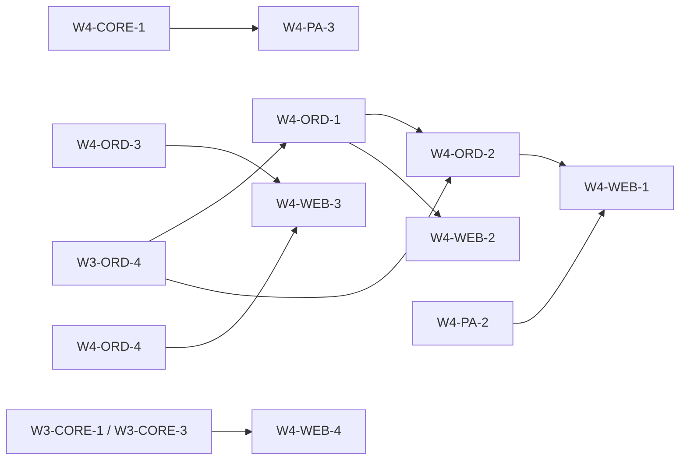

# هفته‌ی ۴: پرداخت و مدیریت

این هفته پول وارد سرمیز می‌شود، فعلاً در محیط آزمایشی درگاه. کنارش ابزارهای مدیریت می‌آیند: نقش‌ها و ثبت رویدادهای حساس، پنل تنظیمات، ادمین Tecso، پشتیبان‌گیری و تست جداسازی کسب‌وکارها.

[راهنمای تحویل‌ها](../README.md) | [هفته‌ی ۳](../week-3/README.md) | [هفته‌ی ۵](../week-5/README.md)

## ۱. هدف هفته

**یک جمله:** پرداخت آزمایشی (sandbox) یک سفارش را دقیقاً یک بار «پرداخت‌شده» کند، و منتور کد پرداخت را بازبینی کرده باشد.

**معیار پایان هفته که در دمو سنجیده می‌شود:** روی سرور واقعی، مهمان سفارش آنلاین می‌دهد و در محیط آزمایشی درگاه پرداخت می‌کند. آشپزخانه سفارش را فقط بعد از تأیید پرداخت می‌بیند. اگر callback دوباره صدا زده شود یا کار تطبیق (reconciliation) همان پرداخت را دوباره بررسی کند، هیچ چیزی دو بار ثبت نمی‌شود: یک ردیف `verified` در `payments`، یک رویداد `order.paid`، و `payments_verified_total` فقط یکی بالا رفته است. PRهای `W4-ORD-1` و `W4-ORD-2` تأیید منتور را دارند.

> [!IMPORTANT]
> مدل تسویه یک [تصمیم باز](../../decisions/0006-payment-settlement-model.md) است که منتور با درگاه تأیید می‌کند. کد پشت interface `PaymentProvider` نوشته می‌شود و اول با provider جعلی کار می‌کند، پس اگر جواب درگاه دیر برسد هم کار هفته نمی‌خوابد. نشانی‌ها، فیلدها و کدهای درگاه فقط از مستندات رسمی و به‌روز خود درگاه برداشته می‌شوند.

## ۲. کارها در یک نگاه

| بخش | کار | خلاصه | پرچم |
|---|---|---|---|
| [سفارش](order.md) | `W4-ORD-1` | تنظیمات پرداخت کسب‌وکار: اعتبارنامه‌ی رمزشده، فقط مالک، ثبت در audit log، حالت `off`/`sandbox`/`live` | منتور |
| [سفارش](order.md) | `W4-ORD-2` | پرداخت آنلاین در محیط آزمایشی: شروع، callback، idempotency، کار تطبیق | منتور |
| [سفارش](order.md) | `W4-ORD-3` | گزارش فروش: امروز و ۷ روز گذشته، پرفروش‌ها، ساعت‌های شلوغ | اختیاری |
| [سفارش](order.md) | `W4-ORD-4` | امتیاز مهمان بعد از سفارش | |
| [هسته](core.md) | `W4-CORE-1` | نقش‌ها و audit log: اجرای جدول نقش‌ها، API اعضا | منتور |
| [هسته](core.md) | `W4-CORE-2` | API ادمین Tecso: فهرست، فعال و تعلیق کسب‌وکار، چند عدد پایه | |
| [هسته](core.md) | `W4-CORE-3` | لینک عمومی منو با slug و بهینه‌سازی منوی عمومی | |
| [فرانت](web.md) | `W4-WEB-1` | جریان پرداخت مهمان: انتخاب روش، رفتن به درگاه، صفحه‌ی نتیجه، تلاش دوباره | |
| [فرانت](web.md) | `W4-WEB-2` | تنظیمات پنل: پرداخت، منوی زمان‌دار، «تمام شد» روی صفحه‌ی آشپزخانه، pairing | |
| [فرانت](web.md) | `W4-WEB-3` | داشبورد فروش و درخواست امتیاز | اختیاری (فقط داشبورد) |
| [فرانت](web.md) | `W4-WEB-4` | صفحه‌ی ساخت منو از فایل و دکمه‌ی ترجمه‌ی خودکار | |
| [پلتفرم و هوش مصنوعی](platform-ai.md) | `W4-PA-1` | پشتیبان‌گیری شبانه از هر دیتابیس | |
| [پلتفرم و هوش مصنوعی](platform-ai.md) | `W4-PA-2` | امنیت در CI و کلاستر | |
| [پلتفرم و هوش مصنوعی](platform-ai.md) | `W4-PA-3` | مجموعه‌ی تست جداسازی کسب‌وکارها در `tests/isolation/` | |
| [پلتفرم و هوش مصنوعی](platform-ai.md) | `W4-PA-4` | پایه‌ی گارسون هوشمند: نمایه‌سازی، بازیابی ترکیبی، ارزیابی | اختیاری |

## ۳. وابستگی‌ها

| چه کسی منتظر است | منتظر چه چیزی | از چه کسی | تا کی |
|---|---|---|---|
| زوج سفارش | سند تصمیم ۶ به‌روز (یا تصمیم «فعلاً هر دو مدل») و اعتبارنامه‌ی sandbox در Kubernetes secret | منتور | روز اول |
| فرانت و پلتفرم | PR قرارداد proto: `PaymentService`، `RatingService`، `ReportService` | سفارش | روز اول |
| فرانت | جواب این سؤال: مهمان از کجا بفهمد پرداخت آنلاین برای این کسب‌وکار روشن است | سفارش | روز اول |
| پلتفرم (`W4-PA-3`) | proto و شکل مسیر API اعضا | هسته (`W4-CORE-1`) | روز دوم |
| سفارش و هسته | نقش هر مسیر تازه‌ی هفته‌ی ۴ و محدودیت نرخ در `gateway` | پلتفرم | روز دوم |
| فرانت (`W4-WEB-1`) | جریان کامل پرداخت با provider جعلی در محیط محلی | سفارش (`W4-ORD-2`) | روز دوم |
| پلتفرم (`W4-PA-2`) | نام میزبان درگاه از مستندات رسمی، برای اجازه‌ی خروج در NetworkPolicy | سفارش | روز دوم |
| فرانت (`W4-WEB-2`) | تنظیمات پرداخت روی `staging` | سفارش (`W4-ORD-1`) | روز سوم |
| فرانت (`W4-WEB-1`) | سرآیندهای امنیتی و CSP روی `staging` برای امتحان redirect | پلتفرم (`W4-PA-2`) | روز سوم |
| پلتفرم (هشدار پرداخت) | metricهای `payments_verified_total` و `payments_failed_total` | سفارش | روز چهارم |
| دموی هفته | پرداخت sandbox سرتاسری روی `staging` | سفارش و فرانت | روز چهارم |

همه‌ی این‌ها روی کار هفته‌ی ۳ سوارند، به‌خصوص طراحی پرداخت (`W3-ORD-4`) و انقضای خودکار (`W3-ORD-2`). اگر یادداشت‌های `week-3/notes/` می‌گویند چیزی ناتمام مانده، روز اول اول همان را ببندید.

## ۴. برنامه‌ی روزها

**روز اول**

- منتور سند تصمیم ۶ را با جواب درگاه به‌روز می‌کند. اگر جواب نیامده، تیم با provider جعلی و طراحی هر دو مدل جلو می‌رود.
- زوج سفارش مستندات رسمی محیط آزمایشی درگاه را می‌خواند و بخش‌های لازم را برای خودش خلاصه می‌کند. PR قرارداد proto پرداخت، امتیاز و گزارش باز می‌شود.
- زوج هسته PR قرارداد API اعضا و ادمین را باز می‌کند.
- زوج پلتفرم پشتیبان‌گیری شبانه را شروع می‌کند.

**روز دوم**

- جریان پرداخت با provider جعلی در محیط محلی کامل است؛ فرانت جریان مهمان را رویش می‌سازد.
- PR `W4-ORD-1` برای منتور باز است.
- مسیرهای هفته‌ی ۴ با نقش و محدودیت نرخ در `gateway`.

**روز سوم (وسط هفته، مهم‌ترین روز)**

- `W4-ORD-1` بعد از بازبینی منتور روی `staging` است.
- پیاده‌سازی provider واقعی برای محیط آزمایشی، پشت همان interface.
- سرآیندهای امنیتی و CSP روی `staging`؛ فرانت redirect به درگاه را امتحان می‌کند.
- امتیاز مهمان روی `staging`.

**روز چهارم**

- پرداخت sandbox از سر تا ته روی `staging`، با کار تطبیق.
- جلسه‌ی بازبینی منتور برای `W4-ORD-2` و `W4-CORE-1`.
- هشدار «پرداخت‌های ناموفق» با metric واقعی امتحان می‌شود.
- کارهای اختیاری فقط اگر همه‌ی بالایی‌ها سبزند.

**روز پنجم**

- تمرین دمو، رفع اشکال، تست جداسازی در CI سبز.
- هر زوج یادداشت آخر هفته را در `notes/` همین پوشه می‌نویسد.

## ۵. سناریوی دمو

روی سرور واقعی و دامنه‌ی واقعی، با یک گوشی و تبلت آشپزخانه:

1. صاحب کسب‌وکار در پنل، بخش تنظیمات پرداخت را باز می‌کند و حالت را `sandbox` می‌کند. اعتبارنامه بعد از ذخیره فقط به شکل پوشیده دیده می‌شود.
2. همان کاربر تلاش می‌کند حالت را `live` کند: اجازه ندارد.
3. ادمین Tecso در audit log ردیف تغییر تنظیمات را نشان می‌دهد.
4. مهمان با گوشی سفارش می‌دهد و «پرداخت آنلاین» را انتخاب می‌کند. تبلت آشپزخانه چیزی نشان نمی‌دهد.
5. مهمان به صفحه‌ی آزمایشی درگاه می‌رود، پرداخت موفق می‌کند و به صفحه‌ی نتیجه برمی‌گردد. سفارش کمتر از ۲ ثانیه بعد روی تبلت با صدا ظاهر می‌شود.
6. زوج سفارش همان نشانی callback را دوباره در مرورگر باز می‌کند: همان صفحه‌ی نتیجه، بدون رویداد دوم. در دیتابیس یک ردیف `verified` و در Grafana `payments_verified_total` فقط یکی بالا رفته است.
7. مهمان یک سفارش دیگر می‌دهد و در صفحه‌ی درگاه «انصراف» می‌زند. صفحه‌ی نتیجه شکست را نشان می‌دهد و «تلاش دوباره» کار می‌کند.
8. یک پرداخت موفق که برگشتنش به سرمیز عمداً قطع شده (تب را قبل از redirect ببند). حداکثر چند دقیقه بعد کار تطبیق آن را `verified` می‌کند و سفارش روی تبلت می‌آید.
9. یک سفارش «پرداخت پای صندوق» همچنان مثل هفته‌ی ۳ کار می‌کند.
10. مهمان بعد از `served` شدن سفارش امتیاز می‌دهد.
11. زوج پلتفرم تست جداسازی را در CI و فایل پشتیبان دیشب را در object storage نشان می‌دهد.
12. لینک تأیید منتور روی PRهای `W4-ORD-1` و `W4-ORD-2` نشان داده می‌شود.

## ۶. ریسک‌های این هفته

| ریسک | نشانه‌ی زودهنگام | اگر رخ داد |
|---|---|---|
| جواب درگاه درباره‌ی مدل تسویه نیامده | سند تصمیم ۶ روز اول هنوز «باز» است | همه‌چیز با provider جعلی و پیاده‌سازی sandbox برای مدلی که در دسترس است؛ دمو با sandbox، و منتور تصمیم را پیگیری می‌کند |
| دسترسی sandbox یا اعتبارنامه آماده نیست | روز دوم هنوز تماس آزمایشی موفق نداریم | دموی پرداخت با provider جعلی؛ معیار پایان هفته به هفته‌ی ۵ می‌رود و منتور خبر دارد |
| سرور به میزبان درگاه نمی‌رسد | تماس از داخل Pod با خطای شبکه | NetworkPolicy و DNS را با زوج پلتفرم چک کنید |
| بازبینی منتور دیر انجام شود | PR تا روز سوم بی‌جواب | PRها را کوچک نگه دارید و جلسه‌ی بازبینی را روز اول تقویم کنید |
| CSP تازه redirect یا عکس‌ها را بشکند | خطا در کنسول مرورگر روی `staging` | CSP اول در حالت گزارش (report-only) و بعد اجباری |
| تست جداسازی endpointی را رد کند | CI قرمز | این باگ امنیتی است و قبل از هر کار دیگری درست می‌شود |

**ترتیب حذف اگر زمان کم آمد:** اول پایه‌ی گارسون هوشمند (`W4-PA-4`)، بعد داشبورد فروش (`W4-WEB-3`، درخواست امتیاز می‌ماند) و گزارش فروش (`W4-ORD-3`)، بعد منوی زمان‌دار و pairing از `W4-WEB-2`. این‌ها هرگز حذف نمی‌شوند: پرداخت sandbox با بازبینی منتور، تنظیمات پرداخت، نقش‌ها و audit log، پشتیبان‌گیری و تست جداسازی.

