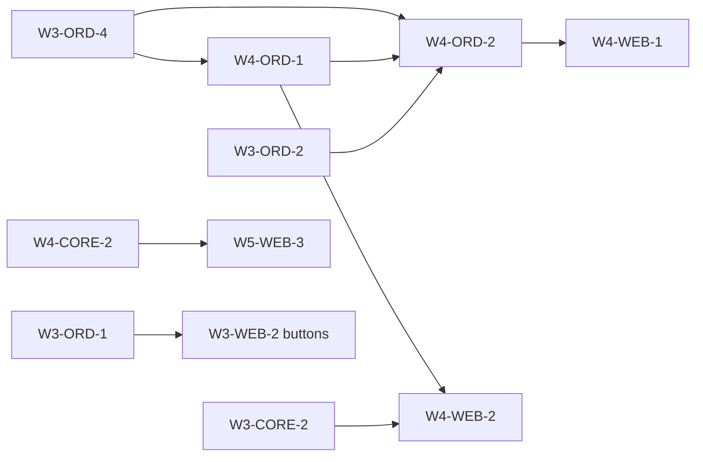

# هفته‌ی ۴: پرداخت و مدیریت

این هفته پول وارد سرمیز می‌شود، فعلاً در محیط آزمایشی درگاه. کنارش ابزارهای مدیریت می‌آیند: تنظیمات پنل، کلید «تمام شد»، درخواست خدمت، API و پنل ادمین Tecso، پشتیبان‌گیری و تست جداسازی کسب‌وکارها.

[راهنمای تحویل‌ها](../README.md) | [تیم و تقسیم کار](../../team.md) | [هفته‌ی ۳](../week-3/README.md) | [هفته‌ی ۵](../week-5/README.md)

## ۱. هدف هفته

**یک جمله:** پرداخت آزمایشی (sandbox) یک سفارش را دقیقاً یک بار «پرداخت‌شده» کند، و منتور کد پرداخت را بازبینی کرده باشد.

**معیار پایان هفته، که در دمو سنجیده می‌شود:** روی `staging`، مهمان سفارش آنلاین می‌دهد و در محیط آزمایشی درگاه پرداخت می‌کند. آشپزخانه سفارش را فقط بعد از تأیید پرداخت می‌بیند. اگر callback دوباره صدا زده شود یا کار تطبیق (reconciliation) همان پرداخت را دوباره بررسی کند، هیچ چیزی دو بار ثبت نمی‌شود: یک ردیف `verified` در `payments`، یک رویداد `order.paid`، و `payments_verified_total` در `/metrics` فقط یکی بالا رفته است. PRهای `W4-ORD-1` و `W4-ORD-2` تأیید منتور را دارند.

> [!IMPORTANT]
> مدل تسویه یک [تصمیم باز](../../decisions/0006-payment-settlement-model.md) است که منتور با درگاه تأیید می‌کند. کد پشت interface `PaymentProvider` نوشته می‌شود و اول با provider جعلی کار می‌کند، پس اگر جواب درگاه دیر برسد هم کار هفته نمی‌خوابد. نشانی‌ها، فیلدها و کدهای درگاه فقط از مستندات رسمی و به‌روز خود درگاه برداشته می‌شوند.

## ۲. کارها در یک نگاه

همه‌ی کارهای این هفته، به تفکیک نقش. صاحب هر نقش در [تیم و تقسیم کار](../../team.md) است. کارهایی که از برنامه‌ی هفته‌های ۳ و ۵ آمده‌اند، تحویلشان در پوشه‌ی همان هفته است.

| نقش | شناسه | کار | برچسب | نکته | تحویل |
|---|---|---|---|---|---|
| فرانت | `W4-WEB-1` | جریان پرداخت مهمان |  |  | [week-4/web.md](../week-4/web.md) |
| فرانت | `W4-WEB-2` | تنظیمات پنل |  | `W2-WEB-5` هم در همین کار است. ویرایشگر منوی زمان‌دار و pairing به انتشار ۲ رفته‌اند؛ کلید «تمام شد» روی صفحه‌ی آشپزخانه می‌ماند. | [week-4/web.md](../week-4/web.md) |
| فرانت | `W5-WEB-3` | پنل ادمین Tecso |  | از برنامه‌ی هفته‌ی ۵. صفحه‌ی ادمین فقط چیزهایی را دارد که `W4-CORE-2` و `AdminSetPaymentMode` می‌دهند. | [week-5/web.md](../week-5/web.md) |
| ورود و منو | `W3-CORE-2` | کلید «تمام شد» (منوی زمان‌دار در انتشار ۲) |  | از برنامه‌ی هفته‌ی ۳. فقط کلید «تمام شد» (`SetItemAvailability` و اثرش در منوی عمومی و `PriceItems`). منوی زمان‌دار به انتشار ۲ رفته است. | [week-3/core.md](../week-3/core.md) |
| ورود و منو | `W4-CORE-2` | API ادمین Tecso |  |  | [week-4/core.md](../week-4/core.md) |
| ورود و منو | `W4-PA-1` | پشتیبان‌گیری شبانه |  |  | [week-4/platform-ai.md](../week-4/platform-ai.md) |
| ورود و منو | `W4-PA-3` | مجموعه‌ی تست جداسازی کسب‌وکارها |  | متدهای اعضا در انتشار ۲اند؛ فقط endpointهایی را که وجود دارند بسنج. | [week-4/platform-ai.md](../week-4/platform-ai.md) |
| سفارش و زیرساخت | `W3-ORD-1` | درخواست خدمت |  | از برنامه‌ی هفته‌ی ۳. | [week-3/order.md](../week-3/order.md) |
| سفارش و زیرساخت | `W3-ORD-2` | محکم‌کاری قواعد سفارش |  | از برنامه‌ی هفته‌ی ۳. | [week-3/order.md](../week-3/order.md) |
| سفارش و زیرساخت | `W4-ORD-1` | تنظیمات پرداخت کسب‌وکار | بازبینی منتور |  | [week-4/order.md](../week-4/order.md) |
| سفارش و زیرساخت | `W4-ORD-2` | پرداخت آنلاین در محیط آزمایشی | بازبینی منتور |  | [week-4/order.md](../week-4/order.md) |

**کارهایی با شناسه‌ی هفته‌ی ۴ که این هفته انجام نمی‌شوند:**

| شناسه | کار | چه شد |
|---|---|---|
| `W4-CORE-1` | نقش‌ها و audit log | **انجام نمی‌شود.** API اعضا و مدیریت نقش‌ها به انتشار ۲ رفته است؛ در انتشار ۱ هر کسب‌وکار فقط مالک دارد. |
| `W4-CORE-3` | لینک عمومی منو و بهینه‌سازی منوی عمومی | در هفته‌ی ۵ انجام می‌شود (نقش «ورود و منو») |
| `W4-ORD-3` | گزارش فروش | **انجام نمی‌شود.** گزارش فروش به انتشار ۲ رفته است. |
| `W4-ORD-4` | امتیاز بعد از سفارش | **انجام نمی‌شود.** امتیاز مهمان به انتشار ۲ رفته است. |
| `W4-WEB-3` | داشبورد فروش و درخواست امتیاز | **انجام نمی‌شود.** داشبورد فروش و درخواست امتیاز به انتشار ۲ رفته‌اند. |
| `W4-WEB-4` | صفحه‌ی ساخت منو از فایل و ترجمه‌ی خودکار | **انجام نمی‌شود.** ساخت منو از فایل و ترجمه‌ی خودکار به انتشار ۲ رفته‌اند. |
| `W4-PA-2` | امنیت در CI و کلاستر | در `W5-PA-3` ادغام شد (هفته‌ی ۵، نقش «سفارش و زیرساخت») |
| `W4-PA-4` | پایه‌ی گارسون هوشمند | **انجام نمی‌شود.** سرویس `ai` و همه‌ی قابلیت‌های هوش مصنوعی به انتشار ۲ رفته‌اند. |

## ۳. وابستگی‌ها

| چه کسی منتظر است | منتظر چه چیزی | کار | تا کی |
|---|---|---|---|
| سفارش و زیرساخت | سند تصمیم ۶ به‌روز (یا تصمیم «فعلاً هر دو مدل») و اعتبارنامه‌ی sandbox در Kubernetes secret | منتور | روز اول |
| فرانت | PR قرارداد proto پرداخت و درخواست خدمت | `W4-ORD-1`، `W4-ORD-2`، `W3-ORD-1` | روز اول |
| فرانت | جریان کامل پرداخت با provider جعلی در محیط محلی | `W4-ORD-2` | روز دوم |
| فرانت | تنظیمات پرداخت روی `staging` | `W4-ORD-1` | روز سوم |
| فرانت | `SetItemAvailability` برای کلید «تمام شد» | `W3-CORE-2` | روز سوم |
| فرانت | درخواست خدمت و رویدادهایش | `W3-ORD-1` | روز سوم |
| فرانت | API ادمین و `AdminSetPaymentMode` | `W4-CORE-2`، `W4-ORD-1` | روز سوم |
| ورود و منو (`W4-PA-3`) | فهرست همه‌ی endpointهای پنل که تا امروز ساخته شده‌اند | همه | روز اول |
| دموی هفته | پرداخت sandbox سرتاسری روی `staging` | `W4-ORD-2`، `W4-WEB-1` | روز چهارم |

## ۴. برنامه‌ی روزها

| روز | چه چیزی آخر روز آماده است |
|---|---|
| روز اول | منتور سند تصمیم ۶ را به‌روز کرده است. «سفارش و زیرساخت» مستندات رسمی محیط آزمایشی درگاه را خوانده و PR قرارداد پرداخت و درخواست خدمت را باز کرده است. «ورود و منو» پشتیبان‌گیری شبانه را شروع کرده است |
| روز دوم | جریان پرداخت با provider جعلی در محیط محلی کامل است و فرانت جریان مهمان را رویش می‌سازد. PR `W4-ORD-1` برای منتور باز است. انقضای خودکار سفارش‌های آنلاینِ پرداخت‌نشده (`W3-ORD-2`) کار می‌کند |
| روز سوم (مهم‌ترین روز) | `W4-ORD-1` بعد از بازبینی منتور روی `staging` است. provider واقعی محیط آزمایشی پشت همان interface نوشته شده است. کلید «تمام شد»، درخواست خدمت و API ادمین روی `staging` هستند |
| روز چهارم | پرداخت sandbox از سر تا ته روی `staging`، با کار تطبیق. جلسه‌ی بازبینی منتور برای `W4-ORD-2`. تست جداسازی در CI سبز است |
| روز پنجم | تمرین دمو، رفع اشکال، یادداشت‌های آخر هفته |

## ۵. سناریوی دمو

روی `staging`، با یک گوشی و تبلت آشپزخانه:

1. صاحب کسب‌وکار در پنل، تنظیمات پرداخت را باز می‌کند و حالت را `sandbox` می‌کند. اعتبارنامه بعد از ذخیره فقط به شکل پوشیده دیده می‌شود.
2. همان کاربر تلاش می‌کند حالت را `live` کند: اجازه ندارد.
3. مهمان با گوشی سفارش می‌دهد و «پرداخت آنلاین» را انتخاب می‌کند. تبلت آشپزخانه چیزی نشان نمی‌دهد.
4. مهمان به صفحه‌ی آزمایشی درگاه می‌رود، پرداخت موفق می‌کند و به صفحه‌ی نتیجه برمی‌گردد. سفارش کمتر از ۲ ثانیه بعد روی تبلت با صدا ظاهر می‌شود.
5. **سفارش و زیرساخت:** همان نشانی callback را دوباره در مرورگر باز کن: همان صفحه‌ی نتیجه، بدون رویداد دوم. در دیتابیس یک ردیف `verified` است.
6. مهمان یک سفارش دیگر می‌دهد و در صفحه‌ی درگاه «انصراف» می‌زند. صفحه‌ی نتیجه شکست را نشان می‌دهد و «تلاش دوباره» کار می‌کند.
7. یک پرداخت موفق که برگشتنش به سرمیز عمداً قطع شده (تب را قبل از redirect ببند). حداکثر چند دقیقه بعد کار تطبیق آن را `verified` می‌کند و سفارش روی تبلت می‌آید.
8. مهمان «صدا زدن گارسون» را می‌زند و درخواست با نام میز روی تبلت دیده می‌شود. روی تبلت یک قلم «تمام شد» می‌شود و در منوی گوشی دیگر قابل سفارش نیست.
9. ادمین Tecso در پنل ادمین یک کسب‌وکار را تعلیق و دوباره فعال می‌کند.
10. **ورود و منو:** تست جداسازی را در CI و فایل پشتیبان دیشب را در object storage نشان بده.
11. لینک تأیید منتور روی PRهای `W4-ORD-1` و `W4-ORD-2` نشان داده می‌شود.

## ۶. ریسک‌های این هفته

| ریسک | نشانه‌ی زودهنگام | اگر رخ داد |
|---|---|---|
| جواب درگاه درباره‌ی مدل تسویه نیامده | سند تصمیم ۶ روز اول هنوز «باز» است | همه‌چیز با provider جعلی و پیاده‌سازی sandbox برای مدلی که در دسترس است؛ منتور تصمیم را پیگیری می‌کند |
| دسترسی sandbox یا اعتبارنامه آماده نیست | روز دوم هنوز تماس آزمایشی موفق نداریم | دموی پرداخت با provider جعلی؛ معیار پایان هفته به هفته‌ی ۵ می‌رود و منتور خبر دارد |
| «سفارش و زیرساخت» با چهار کار، از جمله پرداخت، عقب بیفتد | روز دوم هنوز جریان جعلی کامل نیست | درخواست خدمت (`W3-ORD-1`) به هفته‌ی ۵ می‌رود؛ این مورد سوم خط برش دوم هم هست |
| سرور به میزبان درگاه نمی‌رسد | تماس از داخل Pod با خطای شبکه | NetworkPolicy و DNS را بررسی کنید |
| بازبینی منتور دیر انجام شود | PR تا روز سوم بی‌جواب | PRها را کوچک نگه دارید و جلسه‌ی بازبینی را روز اول تقویم کنید |
| تست جداسازی endpointی را رد کند | CI قرمز | این باگ امنیتی است و قبل از هر کار دیگری درست می‌شود |

**ترتیب حذف اگر زمان کم آمد:** ۱) پنل ادمین (`W5-WEB-3`) با چند درخواست مستند جایگزین می‌شود. ۲) درخواست خدمت (`W3-ORD-1`) به هفته‌ی ۵ می‌رود. این‌ها هرگز حذف نمی‌شوند: پرداخت sandbox با بازبینی منتور، تنظیمات پرداخت، پشتیبان‌گیری و تست جداسازی.

