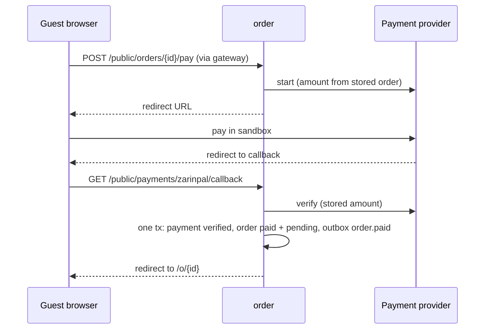

<div dir="rtl">

# هفته‌ی ۴، بخش سفارش: پرداخت آنلاین، تنظیمات پرداخت، امتیاز و گزارش

این مهم‌ترین و حساس‌ترین هفته‌ی بخش سفارش است. پول واقعیِ آینده از همین کد رد می‌شود، پس این هفته آهسته، با تست و با بازبینی منتور جلو می‌روی. همه‌ی کار در محیط آزمایشی (sandbox) درگاه است.

[صفحه‌ی هفته‌ی ۴](README.md) | [راهنمای تحویل‌ها](../README.md)

| | |
|---|---|
| سرویس‌ها | `order` (و `realtime` بدون تغییر بزرگ) |
| کارها | `W4-ORD-1`، `W4-ORD-2`، `W4-ORD-3` (اختیاری)، `W4-ORD-4` |
| معیار پایان هفته | روی `staging`، پرداخت sandbox سفارش را دقیقاً یک بار «پرداخت‌شده» می‌کند؛ callback تکراری و کار تطبیق چیزی را دو بار ثبت نمی‌کنند؛ آشپزخانه سفارش آنلاین را فقط بعد از تأیید پرداخت می‌بیند |
| بازبینی منتور لازم است | `W4-ORD-1` و `W4-ORD-2`. بدون تأیید منتور merge نکن |
| اختیاری | `W4-ORD-3`؛ فقط اگر `W4-ORD-1`، `W4-ORD-2` و `W4-ORD-4` تمام‌اند |

## ۱. قبل از شروع بخوان

| صفحه | چرا |
|---|---|
| [مشخصات فنی](../../SPEC.md)، بخش ۹ کامل، و بخش‌های ۴٫۳، ۶٫۱، ۷٫۳، ۸ و ۱۲ | قواعد پرداخت، جریان پرداخت، مسیرها، جدول‌ها، نقش‌ها و metricها |
| [فصل ۱۰: امنیت و پرداخت](../../guide/10-security-and-payments.md) | توضیح فارسی همه‌ی قواعد این هفته؛ قبل از اولین خط کد |
| [سند تصمیم ۶](../../decisions/0006-payment-settlement-model.md) | مدل تسویه‌ای که منتور تأیید کرده، یا اینکه هنوز باز است |
| [سند تصمیم ۲](../../decisions/0002-order-owns-payments.md) | چرا پرداخت و سفارش در یک تراکنش‌اند |
| README سرویس `order` ([لینک](../../../services/order/README.md)) | سند طراحی پرداخت که خودت در `W3-ORD-4` نوشتی |
| مستندات رسمی و به‌روز درگاه پرداخت، بخش محیط آزمایشی | تنها منبع نشانی‌ها، فیلدها و کدهای درگاه |

> [!CAUTION]
> نشانی‌ها، نام فیلدها و کدهای وضعیت درگاه را از حافظه، از این صفحه یا از دستیار AI برندار. مستندات رسمی و به‌روز خود درگاه را باز کن، بخش لازم را بخوان، و همان را به دستیار بده. به دستیار هم صریح بگو که از حافظه‌اش چیزی درباره‌ی درگاه ننویسد.

## ۲. چه چیزی از قبل آماده است

قبل از هر چیز یادداشت آخر هفته‌ی ۳ بخش خودت را در `docs/handoffs/week-3/notes/order.md` بخوان. جواب منتور به پنج سؤال طراحی پرداخت آنجاست، و ممکن است با برنامه فرق کرده باشد.

| چیزی که داری | از کدام کار |
|---|---|
| ماشین وضعیت سفارش و پرداخت در README سرویس | `W1-ORD-1` |
| outbox، relay و رویداد `order.paid` (از پرداخت پای صندوق) | `W1-ORD-4`، `W3-ORD-3` |
| `CreateOrder` با `Idempotency-Key`، توکن سفارش و `expires_at` | `W2-ORD-1` |
| لغو خودکار سفارش آنلاینِ پرداخت‌نشده بعد از ۱۵ دقیقه و تغییر وضعیت شرطی | `W3-ORD-2` |
| interface `PaymentProvider`، provider جعلی، جدول‌های `payments` و `payment_configs`، نمودار جریان‌ها | `W3-ORD-4` |
| `RatingService` و `ReportService` فقط در فهرست متدهای بخش ۶٫۲ | هنوز ساخته نشده‌اند |
| فهرست و گذار وضعیت در پنل و صفحه‌ی آشپزخانه | `W2-ORD-2`، `W3-WEB-3` |

## ۳. چه چیزی تحویل می‌دهی

| خروجی | چه کسی منتظرش است | تا کی |
|---|---|---|
| PR قرارداد proto: `PaymentService`، `RatingService`، `ReportService` | فرانت، پلتفرم (نقش مسیرها) | روز اول |
| جواب «مهمان از کجا بفهمد پرداخت آنلاین روشن است» | فرانت (`W4-WEB-1`) | روز اول |
| نام میزبان درگاه از مستندات رسمی | پلتفرم (`W4-PA-2`، اجازه‌ی خروج در NetworkPolicy) | روز دوم |
| جریان کامل پرداخت با provider جعلی در محیط محلی | فرانت (`W4-WEB-1`) | روز دوم |
| PR `W4-ORD-1` برای منتور | منتور | روز دوم |
| تنظیمات پرداخت روی `staging` | فرانت (`W4-WEB-2`) | روز سوم |
| امتیاز مهمان روی `staging` | فرانت (`W4-WEB-3`) | روز سوم |
| پرداخت sandbox و کار تطبیق روی `staging`، با metricهای <span dir="ltr">`payments_*`</span> | دمو، فرانت، پلتفرم (هشدار پرداخت) | روز چهارم |
| گزارش فروش (اختیاری) | فرانت (`W4-WEB-3`) | روز چهارم |

## ۴. کارها

### `W4-ORD-1`: تنظیمات پرداخت کسب‌وکار

**هدف:** هر کسب‌وکار تنظیمات پرداخت آنلاین خودش را امن نگه دارد و فقط کسی که اجازه دارد بتواند آن را عوض کند.

**محدوده:** متدهای `GetPaymentConfig` و `SetPaymentConfig` روی <span dir="ltr">`/venues/{venue_id}/payment-config`</span> و `AdminSetPaymentMode` زیر <span dir="ltr">`/admin/*`</span>، رمزنگاری اعتبارنامه و audit log. اینکه دقیقاً چه چیزی در `credentials_enc` و `settlement` می‌نشیند از سند تصمیم ۶ می‌آید.

**معیار پذیرش:**

- [ ] اعتبارنامه با AES-256-GCM و کلیدی از Kubernetes secret رمز می‌شود، هر بار با nonce تازه؛ یک تست ستون خام دیتابیس را می‌خواند و متن ساده پیدا نمی‌کند.
- [ ] اعتبارنامه هیچ‌وقت لاگ نمی‌شود و هیچ API آن را کامل برنمی‌گرداند؛ `GetPaymentConfig` فقط «تنظیم شده یا نه» یا شکل پوشیده را می‌دهد.
- [ ] `SetPaymentConfig` فقط برای `owner` است: `manager` و `staff` `permission_denied` می‌گیرند و کسب‌وکار دیگر `not_found`. هر سه تست دارند.
- [ ] صاحب کسب‌وکار فقط می‌تواند `mode` را `off` یا `sandbox` کند؛ `live` فقط با `AdminSetPaymentMode` و claim `adm` ممکن است و تست دارد.
- [ ] هر تغییر تنظیمات در همان تراکنش یک ردیف `audit_log` می‌نویسد: چه کسی، کدام کسب‌وکار، کدام بخش عوض شد، بدون هیچ مقدار محرمانه.
- [ ] اگر کلید رمزنگاری در محیط نباشد، سرویس بالا نمی‌آید و خطای روشن می‌دهد.
- [ ] منتور کد را بازبینی کرده است.

**نکته:** پیشنهاد اولیه: `venue_id` را به‌عنوان داده‌ی همراه (associated data) در GCM بده تا اعتبارنامه‌ی یک کسب‌وکار در ردیف کسب‌وکار دیگر قابل استفاده نباشد. چرخش کلید در مشخصات فنی نیامده؛ اگر لازم شد، با منتور حرف بزن.

### `W4-ORD-2`: پرداخت آنلاین در محیط آزمایشی

**هدف:** مهمان سفارش آنلاین را در محیط آزمایشی درگاه پرداخت کند و سفارش دقیقاً یک بار پرداخت‌شده شود، حتی اگر callback تکرار شود یا مهمان مرورگر را ببندد.

**محدوده:** `StartPayment` روی `POST /api/v1/public/orders/{order_id}/pay`، `HandleCallback` روی `GET /api/v1/public/payments/zarinpal/callback`، کار تطبیق، پیاده‌سازی provider محیط آزمایشی پشت `PaymentProvider`، و پنهان ماندن سفارش آنلاین از آشپزخانه تا تأیید پرداخت. حالت `live` و بازپرداخت در این هفته نیستند.

**معیار پذیرش:**

- [ ] `StartPayment` فقط برای سفارش با `payment_method = online` و `payment_status` در (`unpaid`، `failed`) و فقط وقتی `mode` کسب‌وکار `sandbox` یا `live` است کار می‌کند؛ در غیر این صورت `failed_precondition`. مبلغ فقط از `total_rial` سفارش ذخیره‌شده می‌آید.
- [ ] `StartPayment` یک ردیف `payments` می‌سازد، provider را صدا می‌زند، `authority` یکتا را ذخیره می‌کند و نشانی redirect را برمی‌گرداند؛ تماس با provider داخل تراکنشی که قفل نگه داشته نیست.
- [ ] `HandleCallback` پرداخت را با `authority` پیدا و ردیفش را قفل می‌کند؛ اگر قبلاً `verified` شده، همان نتیجه را برمی‌گرداند، بدون تماس دوباره با provider و بدون رویداد دوم. از پارامترهای callback فقط برای پیدا کردن `authority` استفاده می‌شود.
- [ ] verify با مبلغ ذخیره‌شده صدا زده می‌شود. در موفقیت، پرداخت `verified`، سفارش `paid` و `pending`، و ردیف outbox `order.paid` در یک تراکنش نوشته می‌شوند؛ در شکست، پرداخت `failed` و سفارش برای تلاش دوباره می‌ماند.
- [ ] کار تطبیق هر ۵ دقیقه پرداخت‌هایی را که بیش از ۲ دقیقه `initiated` مانده‌اند از همان مسیر کد callback دوباره بررسی می‌کند و روی چند replica فقط یک بار اجرا می‌شود.
- [ ] سفارش `awaiting_payment` نه در فهرست پنل و صفحه‌ی آشپزخانه دیده می‌شود و نه به‌عنوان سفارش تازه به کانال <span dir="ltr">`venue:`</span> می‌رسد؛ تست نشان می‌دهد سفارش آنلاین فقط بعد از تأیید پرداخت ظاهر می‌شود.
- [ ] تست‌ها با provider جعلی این حالت‌ها را دارند: callback دوباره، callback و کار تطبیق هم‌زمان، verify که از مهلت می‌گذرد، `authority` ناشناخته (`not_found` بدون جزئیات)، و پرداخت دیرهنگام برای سفارش منقضی طبق قاعده‌ی `W3-ORD-4`.
- [ ] metricهای `payments_verified_total` و `payments_failed_total` کار می‌کنند، لاگ‌ها هیچ اعتبارنامه‌ای ندارند و منتور کد را بازبینی کرده است.

جریان، همان‌طور که بخش ۴٫۳ و ۹ مشخصات فنی می‌گویند:

</div>



<div dir="rtl">

**نکته:** callback بعد از پرداخت، مهمان را به <span dir="ltr">`/o/{order_id}`</span> برمی‌گرداند و آن صفحه وضعیت را از سرور می‌خواند. قاعده‌ی «پرداخت دیرهنگام برای سفارش منقضی» را منتور در `W3-ORD-4` گفته است؛ اگر هنوز باز است، تا جوابش merge نکن.

### `W4-ORD-3`: گزارش فروش

**هدف:** صاحب کسب‌وکار ببیند امروز و هفته‌ی گذشته چقدر فروخته، چه چیزی بیشتر فروش رفته و کدام ساعت‌ها شلوغ‌اند.

**محدوده:** متدهای `GetSalesSummary` (امروز و ۷ روز گذشته)، `GetTopItems` و `GetBusyHours` زیر <span dir="ltr">`/venues/{venue_id}/reports/*`</span>. این کار اختیاری است و اولین چیزی است که به بعد از هفته‌ی ۶ می‌رود.

**معیار پذیرش:**

- [ ] تعریف «فروش» در README سرویس نوشته شده است (پیشنهاد اولیه: سفارش‌های `paid`، بدون `cancelled`) و همه‌ی گزارش‌ها همان را به کار می‌برند.
- [ ] `GetTopItems` از `order_items` و snapshot نام‌ها حساب می‌کند، نه از منوی فعلی.
- [ ] مرز روزها با همان منطقه‌ی زمانی منوی زمان‌دار (`W3-CORE-2`) حساب می‌شود.
- [ ] فقط `owner` و `manager` گزارش می‌بینند و `staff` `permission_denied` می‌گیرد.
- [ ] همه‌ی queryها با `venue_id` شروع می‌شوند و از ایندکسی که با `venue_id` شروع می‌شود استفاده می‌کنند؛ `EXPLAIN` و زمان اجرا روی داده‌ی seed بزرگ در توضیح PR هست.
- [ ] مبلغ‌ها `bigint` ریال‌اند و هیچ محاسبه‌ای با عدد اعشاری نیست.

### `W4-ORD-4`: امتیاز بعد از سفارش

**هدف:** مهمان بعد از سفارش با یک تا پنج ستاره و یک جمله نظرش را بگوید.

**محدوده:** `RatingService.CreateRating` زیر <span dir="ltr">`/public/orders/{order_id}*`</span> با توکن سفارش. نمایش درخواست امتیاز کار `W4-WEB-3` است.

**معیار پذیرش:**

- [ ] امتیاز فقط با توکن سفارش درست ثبت می‌شود و توکن با hash ذخیره‌شده در زمان ثابت مقایسه می‌شود.
- [ ] `stars` فقط ۱ تا ۵ است و هر مقدار دیگر `validation_failed` می‌گیرد.
- [ ] برای هر سفارش فقط یک امتیاز هست (`order_id` یکتا) و امتیاز دوم `conflict` می‌گیرد.
- [ ] امتیاز فقط برای سفارشی ثبت می‌شود که به وضعیت توافق‌شده با فرانت رسیده است (پیشنهاد اولیه: `served`).
- [ ] `venue_id` از خود سفارش خوانده می‌شود، نه از درخواست.
- [ ] `comment` متن ساده با سقف طول است و هیچ‌جا HTML رندر نمی‌شود؛ سقف در README نوشته شده است.

## ۵. قرارداد با بخش‌های دیگر

| قرارداد | با چه کسی | قاعده |
|---|---|---|
| proto سرویس‌های `PaymentService`، `RatingService`، `ReportService` | فرانت، پلتفرم | بعد از تأیید، هر تغییر PR جدا؛ تغییر در پرداخت دوباره به منتور |
| «پرداخت آنلاین روشن است؟» برای صفحه‌ی مهمان | فرانت | مشخصات فنی این را نگفته؛ روز اول با فرانت و منتور یک راه را انتخاب کن و در README بنویس |
| نقش مسیرها: `payment-config` فقط `owner`، `reports` بدون `staff`، <span dir="ltr">`/admin/*`</span> فقط `adm` | پلتفرم | `gateway` بررسی می‌کند و `order` دوباره بررسی می‌کند |
| میزبان درگاه برای خروج از کلاستر | پلتفرم | فقط میزبان‌هایی که در مستندات رسمی آمده |
| `order.paid` با `method` = `online` | `realtime`، فرانت | همان payload بخش ۶٫۳ |
| صفحه‌ی نتیجه <span dir="ltr">`/o/{order_id}`</span> | فرانت | callback فقط redirect می‌کند؛ نتیجه از سرور خوانده می‌شود |

## ۶. تصمیم‌های گرفته‌شده

- همه‌ی قواعد بخش ۹ مشخصات فنی. هیچ‌کدام را این هفته دوباره باز نکن.
- مدل تسویه همان است که منتور در [سند تصمیم ۶](../../decisions/0006-payment-settlement-model.md) نوشته؛ در هر دو مدل Tecso پول کسی را نگه نمی‌دارد.
- محیط آزمایشی تا بازبینی امنیتی هفته‌ی ۶. فقط ادمین Tecso می‌تواند کسب‌وکاری را `live` کند.
- بازپرداخت در انتشار ۱ دستی است: صاحب کسب‌وکار در پنل خود درگاه برمی‌گرداند و سفارش را `refunded` علامت می‌زند.
- آشپزخانه هیچ‌وقت سفارش `awaiting_payment` را نمی‌بیند.

## ۷. دام‌های رایج

| دام | چرا بد است | چه کار کن |
|---|---|---|
| اعتماد به وضعیت یا مبلغ در query string callback | هر کسی می‌تواند نشانی callback را با «موفق» بسازد | فقط verify سمت سرور با مبلغ ذخیره‌شده |
| verify بدون قفل ردیف | callback و کار تطبیق هم‌زمان هر دو «پرداخت‌شده» می‌کنند و دو رویداد می‌سازند | `SELECT ... FOR UPDATE` روی ردیف پرداخت و بررسی `verified` بعد از قفل |
| کار تطبیق با کد جدا از callback | دو منطق که کم‌کم از هم دور می‌شوند | یک تابع مشترک برای «بررسی و ثبت نتیجه» |
| تماس با درگاه وسط تراکنش | تراکنش تا جواب درگاه باز می‌ماند | تماس بیرون از تراکنش، ثبت نتیجه در تراکنش کوتاه |
| لاگ کردن پاسخ کامل درگاه | ممکن است داده‌ی حساس داشته باشد | فقط فیلدهای لازم در `provider_response` و لاگ بدون اعتبارنامه |
| نوشتن فیلدهای درگاه از حافظه‌ی دستیار | کد روی چیزی بنا می‌شود که وجود ندارد یا عوض شده | فقط مستندات رسمی |

## ۸. کار با AI

**فایل‌هایی که به دستیار می‌دهی:** `AGENTS.md`، بخش‌های ۷٫۳، ۸ و ۹ از `docs/SPEC.md`، فصل ۱۰ راهنما، همین صفحه، `services/order/README.md` (سند طراحی `W3-ORD-4`)، سند تصمیم ۶، و بخشی از مستندات رسمی درگاه که خودت خواندی و چسباندی. هیچ اعتبارنامه‌ای، حتی آزمایشی، به دستیار نده.

پرامپت شروع برای `W4-ORD-2`:

</div>

```text
روی کار W4-ORD-2، پرداخت آنلاین در محیط آزمایشی، کار می‌کنیم. این کد پرداخت است و منتور بازبینی‌اش می‌کند.
AGENTS.md، بخش ۹ از docs/SPEC.md، docs/handoffs/week-4/order.md و سند طراحی در services/order/README.md را بخوان.
درباره‌ی درگاه هیچ چیزی از حافظه‌ات ننویس؛ فقط از متن مستندات رسمی که پایین می‌چسبانم استفاده کن
و هر جا چیزی در آن نیست بگو «در مستندات نیست».
هنوز کد ننویس. اول این‌ها را بده:
۱. نگاشت هر قاعده‌ی بخش ۹ به تابع و تستی که آن را می‌سنجد
۲. ترتیب پیاده‌سازی در قدم‌های کوچک: اول با provider جعلی، بعد provider محیط آزمایشی
۳. سؤال‌هایی که جوابشان نه در مستندات ماست نه در متن درگاه
[بخش لازم مستندات رسمی درگاه اینجا]
```

<div dir="rtl">

پرامپت برای نوشتن تست قبل از کد:

</div>

```text
برای HandleCallback تست یکپارچه با PostgreSQL واقعی و provider جعلی بنویس. هنوز خود تابع را ننویس.
حالت‌ها: موفق، ناموفق، callback دوم بعد از موفقیت، callback و کار تطبیق هم‌زمان در دو goroutine،
authority ناشناخته، verify که از مهلت می‌گذرد، و callback که در query string ادعای «موفق» دارد ولی provider می‌گوید ناموفق.
در هر حالت بشمار: ردیف‌های verified در payments، ردیف‌های outbox برای order.paid، و تعداد تماس verify با provider.
برای هر حالت بگو کدام بند بخش ۹ مشخصات فنی را می‌سنجد.
```

<div dir="rtl">

پرامپت بازبینی قبل از باز کردن PR:

</div>

```text
diff این شاخه را مثل بازبین امنیتی پرداخت بخوان. فقط دنبال این‌ها بگرد:
مبلغ یا وضعیتی که از مرورگر یا پارامترهای callback خوانده می‌شود، verify بدون قفل ردیف،
تغییر پرداخت و سفارش و outbox که در یک تراکنش نیستند، تماس شبکه داخل تراکنش، اعتبارنامه در لاگ یا جواب API،
query بدون venue_id، و هر نشانی یا فیلد درگاه که در متن مستندات رسمی چسبانده‌شده نبود.
برای هر مورد فایل و خط بده. اگر چیزی پیدا نکردی همین را بگو.
```

<div dir="rtl">

**از دستیار نخواه:**

- که نشانی، نام فیلد یا کد وضعیت درگاه را بگوید یا «حدس بزند». اگر چیزی در متن چسبانده‌شده نیست، از مستندات رسمی پیدا کن.
- که مدل تسویه را انتخاب کند یا سند تصمیم ۶ را عوض کند. این کار منتور است.
- که `W4-ORD-1` و `W4-ORD-2` را در یک PR بنویسد. PR کوچک بازبینی منتور را سریع می‌کند.
- که برای راحتی تست، بررسی مبلغ یا قفل را «موقتاً» بردارد.

**خودت حتماً بررسی کن:** هر خط `HandleCallback` و کار تطبیق را باید بتوانی برای منتور توضیح بدهی. تست هم‌زمانی را یک بار با برداشتن `FOR UPDATE` اجرا کن و ببین شکست می‌خورد. در لاگ‌های `staging` بعد از یک پرداخت بگرد: هیچ اعتبارنامه‌ای نباید باشد.

## ۹. چطور بفهمی درست کار می‌کند

این سناریو را روز چهارم و دوباره روز پنجم روی `staging` اجرا کن:

1. با حساب `owner` تنظیمات پرداخت را `sandbox` کن. با `GET` همان مسیر ببین اعتبارنامه برنمی‌گردد. با حساب `manager` همان کار را بکن: `permission_denied`.
2. با حساب `owner` حالت `live` را امتحان کن: رد می‌شود. ردیف‌های `audit_log` را در دیتابیس ببین.
3. با گوشی یک سفارش آنلاین بده. تبلت آشپزخانه چیزی نشان نمی‌دهد و فهرست پنل هم.
4. در صفحه‌ی آزمایشی درگاه پرداخت را موفق کن. به <span dir="ltr">`/o/{order_id}`</span> برمی‌گردی و سفارش زیر ۲ ثانیه روی تبلت است.
5. نشانی callback را از تاریخچه‌ی مرورگر دوباره باز کن. همان نتیجه؛ در `payments` یک ردیف `verified` و در `outbox` یک ردیف `order.paid`.
6. همان نشانی callback را با پارامترهای دست‌کاری‌شده برای سفارش دیگری باز کن. آن سفارش پرداخت‌شده نمی‌شود.
7. سفارش دیگری بده و در صفحه‌ی درگاه انصراف بزن. پرداخت `failed` است و «تلاش دوباره» یک پرداخت تازه شروع می‌کند.
8. یک پرداخت موفق کن و تب را قبل از برگشت ببند. حداکثر حدود ۷ دقیقه بعد (۲ دقیقه انتظار و یک دور ۵ دقیقه‌ای) کار تطبیق آن را `verified` می‌کند.
9. در Grafana `payments_verified_total` و `payments_failed_total` را با تعداد واقعی مقایسه کن.
10. با توکن سفارش اول امتیاز ۵ بده، بعد دوباره بده: `conflict`.

## ۱۰. یادداشت آخر هفته

قبل از دمو، [قالب یادداشت آخر هفته](../TEMPLATE-weekly-note.md) را در `notes/order.md` همین پوشه پر کن. این‌ها را حتماً بنویس، چون هفته‌ی ۵ و پرداخت واقعی هفته‌ی ۶ به آن‌ها تکیه می‌کنند:

- وضعیت سند تصمیم ۶ و هر چیزی که هنوز به جواب درگاه بسته است.
- کدام بخش مستندات رسمی درگاه را خواندید (نام صفحه و تاریخ مطالعه، بدون هیچ اعتبارنامه).
- لینک PRها و تأیید منتور.
- راهی که برای «پرداخت آنلاین روشن است؟» انتخاب شد.
- رفتار واقعی کار تطبیق روی `staging` و هر حالتی که تست نشد.
- اینکه `W4-ORD-3` ساخته شد یا به بعد رفت.

</div>
