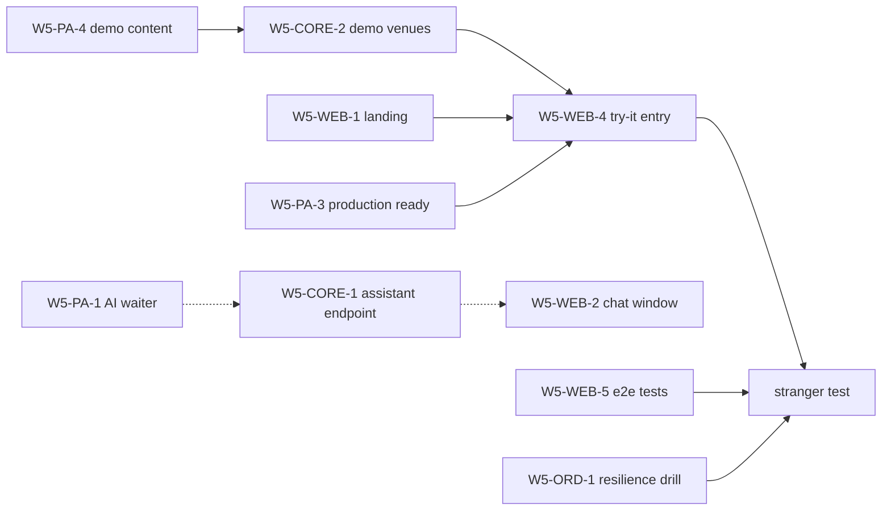

# هفته‌ی ۵: هوش مصنوعی و ویترین

این هفته سرمیز از «کار می‌کند» به «می‌شود نشانش داد» می‌رسد: صفحه‌ی معرفی، دو دموی عمومی، پنل ادمین Tecso، تست‌های سرتاسری، و آمادگی برای `production`. گارسون هوشمند هم اگر کنار نرفته باشد، همین هفته تمام می‌شود.

[راهنمای تحویل‌ها](../README.md) | [طرح پروژه](../../plan.md) | [هفته‌ی ۴](../week-4/README.md) | [هفته‌ی ۶](../week-6/README.md)

## ۱. هدف هفته

**یک جمله:** هر کسی که لینک سرمیز را دارد، بدون کمک ما، می‌تواند دمو را از اسکن QR تا پرداخت آزمایشی امتحان کند.

**معیار پایان هفته (در دمو سنجیده می‌شود):** یک نفر غریبه، یعنی کسی بیرون از تیم سرمیز که تا حالا محصول را ندیده، روی گوشی خودش از صفحه‌ی معرفی وارد دمو می‌شود، سفارش می‌دهد، در محیط آزمایشی زرین‌پال پرداخت می‌کند و وضعیت سفارشش را می‌بیند. هیچ‌کس از تیم در این مدت حرف نمی‌زند و دستش به گوشی نمی‌خورد.

> [!IMPORTANT]
> این هفته کار تازه کم است و کار «محکم کردن» زیاد. اگر بین یک قابلیت تازه و درست کار کردن مسیر دمو مجبور به انتخاب شدی، مسیر دمو برنده است.

## ۲. کارها در یک نگاه

| بخش | کار | عنوان | برچسب | تحویل |
|---|---|---|---|---|
| هسته | `W5-CORE-1` | نشانی گارسون هوشمند برای مهمان از طریق `catalog` | اختیاری | [core](core.md) |
| هسته | `W5-CORE-2` | کسب‌وکارهای دمو، بازسازی شبانه، کارایی و رفع باگ | | [core](core.md) |
| سفارش | `W5-ORD-1` | تاب‌آوری: timeout، retry و circuit breaker، آزمایش جدول بخش ۱۶ | | [order](order.md) |
| سفارش | `W5-ORD-2` | کارایی و رفع باگ از روی گزارش تست بار | | [order](order.md) |
| فرانت | `W5-WEB-1` | صفحه‌ی معرفی و صفحه‌ی قیمت، prerender و SEO پایه | | [web](web.md) |
| فرانت | `W5-WEB-2` | پنجره‌ی گفتگو با گارسون هوشمند در منوی مهمان | اختیاری | [web](web.md) |
| فرانت | `W5-WEB-3` | پنل ادمین Tecso | | [web](web.md) |
| فرانت | `W5-WEB-4` | دو دمو، ورود «امتحان کن»، صفحه‌ی لینک منو برای اینستاگرام، بررسی دسترس‌پذیری | | [web](web.md) |
| فرانت | `W5-WEB-5` | تست سرتاسری Playwright برای سه مسیر بخش ۱۳ | | [web](web.md) |
| پلتفرم و هوش مصنوعی | `W5-PA-1` | تکمیل گارسون هوشمند و ارزیابی آن، با تست prompt injection | اختیاری | [platform-ai](platform-ai.md) |
| پلتفرم و هوش مصنوعی | `W5-PA-2` | تمرین بازیابی از نسخه‌ی پشتیبان شبانه و runbook کامل | | [platform-ai](platform-ai.md) |
| پلتفرم و هوش مصنوعی | `W5-PA-3` | آمادگی `production`: منابع، autoscaling، استقرار بی‌توقف، تأیید دستی، تمرین برگشت | | [platform-ai](platform-ai.md) |
| پلتفرم و هوش مصنوعی | `W5-PA-4` | محتوای کافه و رستوران دمو: منو، عکس، ترجمه | | [platform-ai](platform-ai.md) |

**اگر گارسون هوشمند کنار رفته باشد** (اولین مورد خط برش در [طرح پروژه](../../plan.md)): `W5-CORE-1`، `W5-WEB-2` و `W5-PA-1` این هفته انجام نمی‌شوند و هر زوج وقتش را روی کار جایگزینی می‌گذارد که در تحویل همان بخش نوشته شده است.

## ۳. وابستگی‌ها

| چه کسی منتظر است | منتظر چه چیزی | از چه کسی | تا کی |
|---|---|---|---|
| هسته (`W5-CORE-2`) | ساختار و اولین نسخه‌ی محتوای دمو | پلتفرم (`W5-PA-4`) | ساختار روز اول، محتوای کافه روز دوم، رستوران روز سوم |
| فرانت (`W5-WEB-4`) | دو کسب‌وکار دمو با `is_demo = true` روی `staging` | هسته (`W5-CORE-2`) | روز سوم |
| فرانت (`W5-WEB-4`) | صفحه‌ی معرفی که دکمه‌ی «امتحان کن» رویش بنشیند | خود فرانت (`W5-WEB-1`) | روز سوم |
| فرانت (`W5-WEB-4`) | استقرار `production` با تأیید دستی | پلتفرم (`W5-PA-3`) | روز چهارم |
| فرانت (`W5-WEB-4`) | پیکربندی پرداخت هر دو دمو در حالت `sandbox` | سفارش | روز سوم |
| فرانت (`W5-WEB-3`) | APIهای ادمین از هفته‌ی ۴ | هسته (`W4-CORE-2`) و سفارش (`W4-ORD-1`) | از قبل آماده است |
| هسته (`W5-CORE-1`) | `POST /v1/assistant` پایدار در سرویس `ai` | پلتفرم (`W5-PA-1`) | روز دوم |
| فرانت (`W5-WEB-2`) | مسیر `POST /api/v1/public/t/{qr_token}/assistant` روی `staging` | هسته (`W5-CORE-1`) | روز سوم |
| سفارش (`W5-ORD-1`) | کسی با دسترسی cluster برای از کار انداختن وابستگی‌ها در `staging` | پلتفرم | روز سوم، یک جلسه‌ی مشترک |

خط‌چین یعنی مسیر اختیاری گارسون هوشمند.

## ۴. برنامه‌ی روزها

| روز | چه چیزی باید آماده باشد |
|---|---|
| روز اول | قرارداد `Ask` بین هسته، فرانت و پلتفرم توافق شده (اگر گارسون مانده). ساختار فایل محتوای دمو بین پلتفرم و هسته قطعی شده. سفارش فهرست کندترین queryها را از گزارش تست بار هفته‌ی ۳ بیرون کشیده. پلتفرم تمرین بازیابی را شروع کرده |
| روز دوم | منوی کافه‌ی دمو در seed است. `is_demo` و پیش‌نویس کار بازسازی شبانه در `catalog`. صفحه‌ی معرفی روی `staging`. `W5-PA-2` تمام و runbook نوشته شده |
| روز سوم | منوی رستوران دمو هم آماده است. جلسه‌ی مشترک سفارش و پلتفرم: وابستگی‌ها یکی‌یکی در `staging` خاموش می‌شوند و جدول بخش ۱۶ پر می‌شود. پنل ادمین روی `staging` |
| روز چهارم | اولین استقرار `production` با تگ SemVer و تأیید دستی، و یک تمرین `helm rollback`. ورود «امتحان کن» به هر دو دمو. تست‌های Playwright در CI سبز |
| روز پنجم | آزمون غریبه روی `staging` و بعد روی `production`. رفع چیزهایی که غریبه در آن‌ها گیر کرد. یادداشت آخر هفته و دمو |

> [!TIP]
> آزمون غریبه را تا روز پنجم عقب نینداز. یک نسخه‌ی خام آن را روز سوم با یک نفر از تیم دیگری از Tecso اجرا کن؛ بیشتر گیرها همان‌جا پیدا می‌شوند.

## ۵. سناریوی دمو

روی `staging`، با گوشی کسی که در تیم نیست. تیم فقط تماشا می‌کند و یادداشت برمی‌دارد.

1. غریبه نشانی صفحه‌ی معرفی را در مرورگر گوشی باز می‌کند. صفحه فارسی و راست‌به‌چپ است و سریع باز می‌شود.
2. روی «امتحان کن» می‌زند و بین کافه‌ی دمو و رستوران دمو، کافه را انتخاب می‌کند. منوی یک میز دمو باز می‌شود.
3. زبان را به انگلیسی و بعد به عربی عوض می‌کند. جهت صفحه و متن منو درست عوض می‌شوند.
4. اگر گارسون هوشمند مانده: می‌پرسد «چه چیزی بدون لبنیات دارید؟» و جوابی می‌گیرد که به آیتم‌های واقعی منو اشاره می‌کند.
5. یک آیتم با گزینه انتخاب می‌کند، به سبد می‌برد و سفارش می‌دهد.
6. پرداخت آنلاین را انتخاب می‌کند، به محیط آزمایشی زرین‌پال می‌رود، پرداخت را موفق می‌کند و به صفحه‌ی نتیجه برمی‌گردد.
7. صفحه‌ی وضعیت سفارش «پرداخت‌شده» را نشان می‌دهد. روی تبلت تیم، صفحه‌ی آشپزخانه‌ی کافه‌ی دمو سفارش را در کمتر از ۲ ثانیه نشان می‌دهد.
8. یک نفر از تیم وضعیت را در صفحه‌ی آشپزخانه به «آماده» می‌برد و گوشی غریبه بدون refresh همان را نشان می‌دهد.
9. تیم نشان می‌دهد: Playwright در CI سبز است، جدول رفتار بخش ۱۶ پر شده، runbook بازیابی وجود دارد، و همین دمو روی `production` هم بالاست.
10. از غریبه می‌پرسید کجا مکث کرد یا گیج شد. جواب‌ها در یادداشت آخر هفته می‌روند و هفته‌ی ۶ رفع می‌شوند.

## ۶. ریسک‌های این هفته

| ریسک | نشانه‌ی زود | چه چیزی اول حذف می‌شود |
|---|---|---|
| گارسون هوشمند تا روز سوم جواب قابل‌قبول نمی‌دهد | ارزیابی ۳۰ سؤالی زیر حد قبولِ تیم است یا prompt injection رد نمی‌شود | `W5-CORE-1`، `W5-WEB-2` و `W5-PA-1` به بعد از هفته‌ی ۶ می‌روند. این اولین برش است |
| محتوای دمو دیر آماده شود | روز دوم منوی کافه در seed نیست | رستوران دمو با منوی کوچک‌تر بالا می‌آید؛ کافه کامل می‌ماند |
| استقرار `production` گیر کند | روز چهارم تگ اول به `production` نرسیده | دمو روی `staging` نشان داده می‌شود و `W5-PA-3` اولین کار هفته‌ی ۶ می‌شود. دمو را روی `production` بدون تأیید دستی بالا نبرید |
| تست‌های Playwright ناپایدار باشند | یک تست بدون تغییر کد گاهی قرمز می‌شود | تست ناپایدار علامت می‌خورد و issue می‌گیرد، ولی سه مسیر بخش ۱۳ حذف نمی‌شوند |
| آزمایش تاب‌آوری چیز جدی پیدا کند | با خاموش شدن `catalog` سفارش‌های قبلی هم از دست می‌روند | باقی کارهای کارایی (`W5-ORD-2`) صبر می‌کنند تا این رفع شود |
| صفحه‌ی قیمت محتوا نداشته باشد | تا روز دوم قیمت‌گذاری از منتور نیامده | صفحه‌ی قیمت با متن «به‌زودی» و راه تماس منتشر می‌شود؛ قیمت‌گذاری تصمیم باز ۸ در طرح پروژه است |

ترتیب برش این هفته: اول گارسون هوشمند، بعد جزئیات تزئینی صفحه‌ی معرفی (انیمیشن و بخش‌های اضافه)، بعد رستوران دمو با منوی کامل. تمرین بازیابی، آمادگی `production`، تست‌های سرتاسری و مسیر دموی کافه حذف نمی‌شوند.

