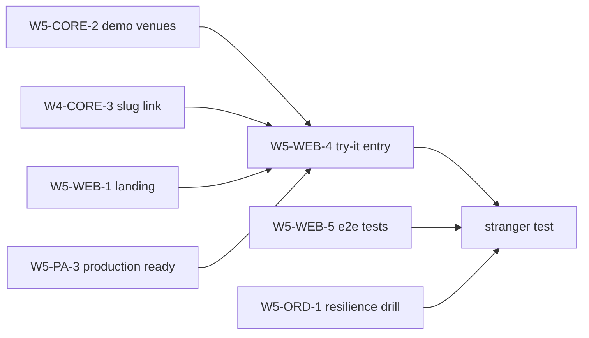

# هفته‌ی ۵: ویترین

این هفته سرمیز از «کار می‌کند» به «می‌شود نشانش داد» می‌رسد: صفحه‌ی معرفی، دو دموی عمومی، لینک منو برای اینستاگرام، تست‌های سرتاسری، لاگ مرکزی و مانیتورینگ، و آمادگی برای `production`.

[راهنمای تحویل‌ها](../README.md) | [تیم و تقسیم کار](../../team.md) | [هفته‌ی ۴](../week-4/README.md) | [هفته‌ی ۶](../week-6/README.md)

## ۱. هدف هفته

**یک جمله:** هر کسی که لینک سرمیز را دارد، بدون کمک ما، می‌تواند دمو را از اسکن QR تا پرداخت آزمایشی امتحان کند.

معیار پایان هفته، که در دمو سنجیده می‌شود:

- [ ] یک نفر غریبه، یعنی کسی بیرون از تیم سرمیز که تا حالا محصول را ندیده، روی گوشی خودش از صفحه‌ی معرفی وارد دمو می‌شود، سفارش می‌دهد، در محیط آزمایشی زرین‌پال پرداخت می‌کند و وضعیت سفارشش را می‌بیند. هیچ‌کس از تیم در این مدت حرف نمی‌زند و دستش به گوشی نمی‌خورد.
- [ ] همین دمو روی `production` هم بالاست، با استقرار دستی تأییدشده.
- [ ] هشدارهای اصلی به گروه تیم می‌رسند و یک خطای عمدی در GlitchTip دیده می‌شود.

> [!IMPORTANT]
> این هفته کار تازه کم است و کار «محکم کردن» زیاد. اگر بین یک قابلیت تازه و درست کار کردن مسیر دمو مجبور به انتخاب شدی، مسیر دمو برنده است.

## ۲. کارها در یک نگاه

همه‌ی کارهای این هفته، به تفکیک نقش. صاحب هر نقش در [تیم و تقسیم کار](../../team.md) است. کارهایی که از برنامه‌ی هفته‌های دیگر آمده‌اند، تحویلشان در پوشه‌ی همان هفته است.

| نقش | شناسه | کار | برچسب | نکته | تحویل |
|---|---|---|---|---|---|
| فرانت | `W5-WEB-1` | صفحه‌ی معرفی و صفحه‌ی قیمت |  |  | [week-5/web.md](../week-5/web.md) |
| فرانت | `W5-WEB-4` | دو دمو، «امتحان کن»، لینک منو برای اینستاگرام، دسترس‌پذیری |  |  | [week-5/web.md](../week-5/web.md) |
| فرانت | `W5-WEB-5` | تست‌های سرتاسری با Playwright |  |  | [week-5/web.md](../week-5/web.md) |
| ورود و منو | `W2-PA-3` | لاگ مرکزی و ردگیری خطا |  | از برنامه‌ی هفته‌ی ۲. | [week-2/platform-ai.md](../week-2/platform-ai.md) |
| ورود و منو | `W3-PA-1` | metric، trace و داشبوردها |  | از برنامه‌ی هفته‌ی ۳. `W3-PA-2` هم در همین کار است. اول metric، داشبورد و هشدار؛ trace با Tempo فقط اگر وقت ماند. | [week-3/platform-ai.md](../week-3/platform-ai.md) |
| ورود و منو | `W4-CORE-3` | لینک عمومی منو و بهینه‌سازی منوی عمومی |  | از برنامه‌ی هفته‌ی ۴. | [week-4/core.md](../week-4/core.md) |
| ورود و منو | `W5-CORE-2` | کسب‌وکارهای دمو، بازسازی شبانه، کارایی و رفع باگ |  | `W5-PA-4` هم در همین کار است. ترجمه‌ی منوی دمو دستی است، دست‌کم `en`. | [week-5/core.md](../week-5/core.md) |
| سفارش و زیرساخت | `W5-ORD-1` | تاب‌آوری |  |  | [week-5/order.md](../week-5/order.md) |
| سفارش و زیرساخت | `W5-ORD-2` | کارایی و رفع باگ از روی تست بار |  | `W3-PA-3` هم در همین کار است. اول اسکریپت‌های k6 و گزارش تست بار، بعد رفع کندترین مسیرها. | [week-5/order.md](../week-5/order.md) |
| سفارش و زیرساخت | `W5-PA-2` | تمرین بازیابی و runbook |  |  | [week-5/platform-ai.md](../week-5/platform-ai.md) |
| سفارش و زیرساخت | `W5-PA-3` | آمادگی production |  | `W4-PA-2` هم در همین کار است. | [week-5/platform-ai.md](../week-5/platform-ai.md) |

**کارهایی با شناسه‌ی هفته‌ی ۵ که این هفته انجام نمی‌شوند:**

| شناسه | کار | چه شد |
|---|---|---|
| `W5-CORE-1` | نشانی گارسون هوشمند برای مهمان (اختیاری) | **انجام نمی‌شود.** سرویس `ai` و همه‌ی قابلیت‌های هوش مصنوعی به انتشار ۲ رفته‌اند. |
| `W5-WEB-2` | پنجره‌ی گفتگو با گارسون هوشمند (اختیاری) | **انجام نمی‌شود.** سرویس `ai` و همه‌ی قابلیت‌های هوش مصنوعی به انتشار ۲ رفته‌اند. |
| `W5-WEB-3` | پنل ادمین Tecso | در هفته‌ی ۴ انجام می‌شود (نقش «فرانت») |
| `W5-PA-1` | تکمیل گارسون هوشمند و ارزیابی آن (اختیاری) | **انجام نمی‌شود.** سرویس `ai` و همه‌ی قابلیت‌های هوش مصنوعی به انتشار ۲ رفته‌اند. |
| `W5-PA-4` | محتوای کافه و رستوران دمو | در `W5-CORE-2` ادغام شد (هفته‌ی ۵، نقش «ورود و منو») |

## ۳. وابستگی‌ها

| چه کسی منتظر است | منتظر چه چیزی | کار | تا کی |
|---|---|---|---|
| سفارش و زیرساخت (`W5-ORD-2`) | لاگ مرکزی، برای پیدا کردن کندترین درخواست‌ها | `W2-PA-3` | روز دوم |
| فرانت (`W5-WEB-4`) | دو کسب‌وکار دمو با `is_demo = true` روی `staging` | `W5-CORE-2` | روز سوم |
| فرانت (`W5-WEB-4`) | لینک عمومی منو با slug | `W4-CORE-3` | روز سوم |
| فرانت (`W5-WEB-4`) | پیکربندی پرداخت هر دو دمو در حالت `sandbox` | سفارش و زیرساخت | روز سوم |
| سفارش و زیرساخت (`W5-ORD-1`) | داشبوردها، برای دیدن رفتار سیستم هنگام خاموش کردن وابستگی‌ها | `W3-PA-1` | روز سوم |
| فرانت (`W5-WEB-4`) | استقرار `production` با تأیید دستی | `W5-PA-3` | روز چهارم |
| همه | هشدارها در گروه تیم | `W3-PA-1` | روز چهارم |

## ۴. برنامه‌ی روزها

| روز | چه چیزی باید آماده باشد |
|---|---|
| روز اول | ساختار فایل محتوای دمو قطعی شده است. «سفارش و زیرساخت» اسکریپت‌های k6 را روی `staging` اجرا کرده و فهرست کندترین مسیرها را دارد. «ورود و منو» لاگ مرکزی و GlitchTip را بالا آورده است |
| روز دوم | منوی کافه‌ی دمو در seed است. صفحه‌ی معرفی روی `staging` است. تمرین بازیابی از نسخه‌ی پشتیبان شروع شده است |
| روز سوم | منوی رستوران دمو و لینک عمومی منو آماده‌اند. داشبوردها بالا هستند. جلسه‌ی مشترک: وابستگی‌ها یکی‌یکی در `staging` خاموش می‌شوند و جدول بخش ۱۶ مشخصات فنی پر می‌شود |
| روز چهارم | اولین استقرار `production` با تگ SemVer و تأیید دستی، و یک تمرین `helm rollback`. ورود «امتحان کن» به هر دو دمو. تست‌های Playwright در CI سبزند. هشدارها با یک پیام آزمایشی به گروه تیم رسیده‌اند |
| روز پنجم | آزمون غریبه روی `staging` و بعد روی `production`. رفع چیزهایی که غریبه در آن‌ها گیر کرد. یادداشت آخر هفته و دمو |

> [!TIP]
> آزمون غریبه را تا روز پنجم عقب نینداز. یک نسخه‌ی خام آن را روز سوم با یک نفر از تیم دیگری از Tecso اجرا کن؛ بیشتر گیرها همان‌جا پیدا می‌شوند.

## ۵. سناریوی دمو

روی `staging`، با گوشی کسی که در تیم نیست. تیم فقط تماشا می‌کند و یادداشت برمی‌دارد.

1. غریبه نشانی صفحه‌ی معرفی را در مرورگر گوشی باز می‌کند. صفحه فارسی و راست‌به‌چپ است و سریع باز می‌شود.
2. روی «امتحان کن» می‌زند و بین کافه‌ی دمو و رستوران دمو، کافه را انتخاب می‌کند. منوی یک میز دمو باز می‌شود.
3. زبان را به انگلیسی عوض می‌کند. جهت صفحه و متن منو درست عوض می‌شوند.
4. یک آیتم با گزینه انتخاب می‌کند، به سبد می‌برد و سفارش می‌دهد.
5. پرداخت آنلاین را انتخاب می‌کند، به محیط آزمایشی زرین‌پال می‌رود، پرداخت را موفق می‌کند و به صفحه‌ی نتیجه برمی‌گردد.
6. صفحه‌ی وضعیت سفارش «پرداخت‌شده» را نشان می‌دهد. روی تبلت تیم، صفحه‌ی آشپزخانه‌ی کافه‌ی دمو سفارش را در کمتر از ۲ ثانیه نشان می‌دهد.
7. یک نفر از تیم وضعیت را در صفحه‌ی آشپزخانه به «آماده» می‌برد و گوشی غریبه بدون refresh همان را نشان می‌دهد.
8. تیم نشان می‌دهد: Playwright در CI سبز است، جدول رفتار بخش ۱۶ پر شده، runbook بازیابی وجود دارد، داشبوردها و هشدارها کار می‌کنند، و همین دمو روی `production` هم بالاست.
9. از غریبه می‌پرسید کجا مکث کرد یا گیج شد. جواب‌ها در یادداشت آخر هفته می‌روند و هفته‌ی ۶ رفع می‌شوند.

## ۶. ریسک‌های این هفته

| ریسک | نشانه‌ی زود | آن‌وقت چه می‌کنیم |
|---|---|---|
| «ورود و منو» با چهار کار، از جمله لاگ و مانیتورینگ، عقب بیفتد | روز سوم داشبوردها بالا نیستند | trace کنار می‌رود و فقط metric، داشبورد overview و چهار هشدار اصلی ساخته می‌شوند: سرویس از کار افتاده، نرخ خطا، پرداخت ناموفق، و شکست پشتیبان شبانه |
| محتوای دمو دیر آماده شود | روز دوم منوی کافه در seed نیست | رستوران دمو با منوی کوچک‌تر بالا می‌آید؛ کافه کامل می‌ماند |
| استقرار `production` گیر کند | روز چهارم تگ اول به `production` نرسیده | دمو روی `staging` نشان داده می‌شود و `W5-PA-3` اولین کار هفته‌ی ۶ می‌شود. دمو را روی `production` بدون تأیید دستی بالا نبرید |
| تست‌های Playwright ناپایدار باشند | یک تست بدون تغییر کد گاهی قرمز می‌شود | تست ناپایدار علامت می‌خورد و issue می‌گیرد، ولی سه مسیر بخش ۱۳ مشخصات فنی حذف نمی‌شوند |
| آزمایش تاب‌آوری چیز جدی پیدا کند | با خاموش شدن `catalog` سفارش‌های قبلی هم از دست می‌روند | باقی کارهای کارایی (`W5-ORD-2`) صبر می‌کنند تا این رفع شود |
| صفحه‌ی قیمت محتوا نداشته باشد | تا روز دوم قیمت‌گذاری از منتور نیامده | صفحه‌ی قیمت با متن «به‌زودی» و راه تماس منتشر می‌شود؛ قیمت‌گذاری تصمیم باز ۵ در [طرح پروژه](../../plan.md) است |

**ترتیب برش این هفته:** اول جزئیات تزئینی صفحه‌ی معرفی (انیمیشن و بخش‌های اضافه)، بعد رستوران دمو با منوی کامل، بعد تست بار (مورد چهارم خط برش دوم). تمرین بازیابی، آمادگی `production`، تست‌های سرتاسری و مسیر دموی کافه حذف نمی‌شوند.

