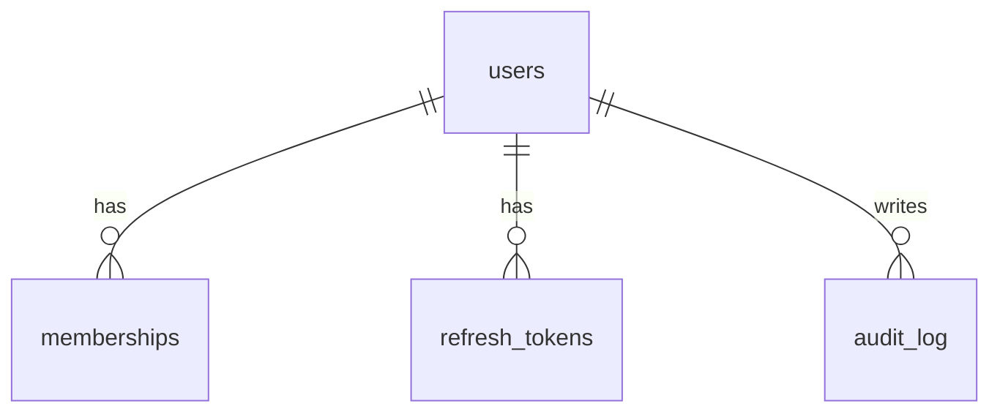

<div dir="rtl">

# سرویس `identity`

کاربران پنل، ورود با کد یک‌بارمصرف، توکن‌ها و نقش هر کاربر در هر کسب‌وکار.

[مشخصات فنی](../../docs/SPEC.md) | [فصل ۹: ورود و دسترسی](../../docs/guide/09-auth-and-permissions.md) | [قواعد دستیار AI](../../AGENTS.md)

| | |
|---|---|
| زبان | Go، روی شاسی [`libs/go/kit`](../../libs/go/kit/README.md) |
| بخش مسئول | هسته (`core`)؛ صاحبش نقش «ورود و منو» است ([تیم و تقسیم کار](../../docs/team.md)) |
| دیتابیس | `identity`، و Redis برای کد یک‌بارمصرف |
| ارتباط با بیرون | gRPC، و JWKS روی HTTP داخلی |

## ۱. یک‌خطی

`identity` می‌داند هر کاربر پنل کیست و در کدام کسب‌وکار چه نقشی دارد، و تنها جایی است که توکن امضا می‌کند. مهمان‌ها حساب ندارند و به این سرویس ربطی ندارند.

## ۲. مسئولیت‌ها

- ورود با شماره‌ی موبایل و OTP (کد یک‌بارمصرف): ۶ رقم، ۱۲۰ ثانیه اعتبار، حداکثر ۵ تلاش برای هر کد، ارسال دوباره بعد از ۶۰ ثانیه.
- ساختن توکن دسترسی: JWT با امضای Ed25519، عمر ۱۵ دقیقه، claimهای `sub`، `adm`، `mem`، `exp` و `jti`.
- توکن تازه‌سازی: ۲۵۶ بیت تصادفی، عمر ۳۰ روز، عوض شدن در هر استفاده، و باطل شدن کل خانواده (family) اگر توکن قدیمی دوباره بیاید.
- انتشار کلیدهای عمومی به شکل JWKS (فهرست کلیدهای عمومی برای بررسی امضا) تا `gateway` توکن را بررسی کند.
- نگه‌داری عضویت‌ها و نقش‌ها (`owner`، `manager`، `staff`) و ادمین‌های پلتفرم.
- صدور تیکت ۶۰ ثانیه‌ای WebSocket با scope <span dir="ltr">`venue:<venue_id>`</span> یا <span dir="ltr">`order:<order_id>`</span>.
- ثبت audit log برای ورود و تغییر عضویت.

## ۳. چه چیزی مالِ این سرویس است

| جدول یا داده | ستون‌های کلیدی |
|---|---|
| `users` | `phone` یکتا (E.164)، `name`، `is_platform_admin` |
| `memberships` | `user_id`، `venue_id`، `role`؛ یکتا روی (`user_id`، `venue_id`) |
| `refresh_tokens` | `user_id`، `token_hash`، `family_id`، `expires_at`، `revoked_at`، `user_agent`، `ip` |
| `audit_log` | `user_id`، `action`، `target`، `meta` |
| کد OTP در Redis | کلید <span dir="ltr">`otp:{phone}`</span>، مقدار hash کد و شمارنده‌ی تلاش، TTL ۱۲۰ ثانیه |
| کلید امضا | از Kubernetes secret؛ هیچ‌وقت در کد یا مخزن نیست |

طرح پایه؛ نمودار نهایی را بخش هسته در `W1-CORE-1` جایگزین می‌کند. `venue_id` در `memberships` یک UUID ساده است، بدون foreign key به `catalog`.

</div>



<div dir="rtl">

## ۴. قرارداد

gRPC در بسته‌ی `sarmiz.identity.v1` (فایل‌ها در <span dir="ltr">`proto/sarmiz/identity/v1/`</span>):

| سرویس gRPC | متدها |
|---|---|
| `AuthService` | `RequestOtp`، `VerifyOtp`، `RefreshToken`، `Logout`، `GetMe`، `IssueStreamTicket` |
| `AccessService` | `GrantMembership`، `RevokeMembership`، `ListMemberships` |

مسیرهای REST از طریق `gateway`: `POST /auth/otp/request`، `POST /auth/otp/verify`، `POST /auth/refresh`، `POST /auth/logout`، `GET /me` و `POST /stream-tickets`. نشانی JWKS روی HTTP داخلی است و فقط `gateway` آن را می‌خواند.

رویداد: در انتشار ۱ هیچ رویدادی منتشر یا مصرف نمی‌کند.

## ۵. به چه کسی وابسته است

به هیچ سرویس دیگری وابسته نیست (بخش ۴٫۱). فقط PostgreSQL، Redis و سرویس پیامک (پشت یک interface) را لازم دارد. چه کسی صدایش می‌زند: `gateway` (ورود، `GetMe`، تیکت) و `catalog` (فقط `GrantMembership`، هنگام ساخت کسب‌وکار).

## ۶. قاعده‌هایی که نباید بشکنند

1. کد OTP و توکن تازه‌سازی فقط به شکل hash ذخیره می‌شوند. مقایسه‌ی کد در زمان ثابت (`crypto/subtle`).
2. `RequestOtp` برای شماره‌ی ثبت‌نام‌شده و نشده یک جواب می‌دهد.
3. کد، توکن و شماره‌ی کامل هیچ‌وقت لاگ نمی‌شوند؛ شماره در لاگ پوشیده است.
4. پیاده‌سازی `console` پیامک فقط در محیط `local` فعال است.
5. `GetMe` عضویت‌ها را همیشه از دیتابیس می‌خواند، نه از توکن.
6. جدول دسترسی از هفته‌ی ۱ هر سه نقش را می‌شناسد، حتی اگر رابط کاربری فقط `owner` بسازد.
7. هر تغییر در این سرویس کد ورود است و بازبینی منتور می‌خواهد.
8. نشانی‌ها و فیلدهای سرویس پیامک از مستندات رسمی همان سرویس برداشته می‌شوند، نه از حافظه یا دستیار AI.

## ۷. ساختار پوشه

</div>

```text
services/identity/
├── cmd/server/main.go
├── internal/
│   ├── config/
│   ├── handler/      gRPC handlers and the JWKS HTTP handler
│   ├── service/      OTP, tokens, memberships (unit tested)
│   ├── repository/   SQL with pgx
│   └── model/
├── migrations/       goose SQL files
├── Dockerfile
└── README.md
```

<div dir="rtl">

## ۸. اجرا و تست

دستورهای اجرا و تست را تیم در هفته‌ی ۱ می‌سازد و در بخش Commands فایل [AGENTS.md](../../AGENTS.md) می‌نویسد. منطق OTP و چرخش توکن تست جدولی دارد و مسیر کامل ورود یک تست یکپارچه با PostgreSQL و Redis واقعی.

## ۹. در کدام هفته چه چیزی ساخته می‌شود

| هفته | کار | چه چیزی | تحویل |
|---|---|---|---|
| ۱ | `W1-CORE-1` تا `W1-CORE-4` | جدول‌ها و migrationها، ورود کامل با JWT و JWKS و پیامک پشت interface، `GrantMembership` برای ساخت کسب‌وکار، قرارداد proto | [core](../../docs/handoffs/week-1/core.md) |
| ۲ | `W2-ORD-4` | تیکت WebSocket (`IssueStreamTicket`) همراه با بخش سفارش | [order](../../docs/handoffs/week-2/order.md) |
| ۴ | `W4-CORE-1` | اعمال جدول دسترسی، APIهای عضویت، audit log | [core](../../docs/handoffs/week-4/core.md) |
| ۴ | `W4-PA-3` | تست جداسازی و جدول نقش‌ها | [platform-ai](../../docs/handoffs/week-4/platform-ai.md) |
| ۶ | `W6-ALL-1` | بازبینی امنیتی کامل | [هفته‌ی ۶](../../docs/handoffs/week-6/README.md) |

## ۱۰. سؤال‌های باز

- سرویس پیامک هنوز انتخاب نشده است (بخش ۲۰ مشخصات فنی، تصمیم ۴).
- مسیر و قالب نشانی JWKS را تیم در `W1-CORE-2` با بخش پلتفرم تعیین می‌کند.
- `realtime` تیکت را با کدام کلید بررسی می‌کند؟ بخش ۴٫۱ می‌گوید `realtime` به هیچ سرویسی وابسته نیست؛ اگر قرار است JWKS را از `identity` بخواند، سند تصمیم لازم است. در هفته‌ی ۱ با بخش سفارش تصمیم بگیرید.

</div>
