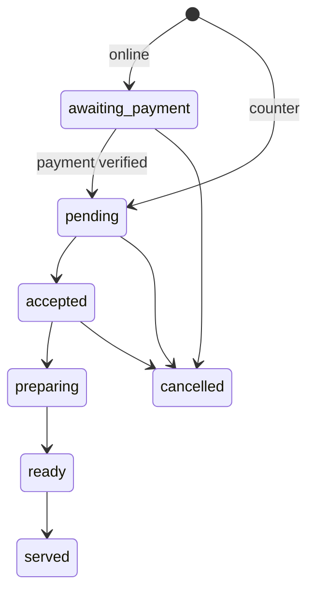

<div dir="rtl">

# سرویس `order`

سفارش‌ها، درخواست‌های سرویس (صدا زدن گارسون و درخواست صورت‌حساب)، امتیاز، پرداخت، تنظیم پرداخت کسب‌وکار و گزارش فروش.

[مشخصات فنی](../../docs/SPEC.md) | [فصل ۱۰: امنیت و پرداخت](../../docs/guide/10-security-and-payments.md) | [قواعد دستیار AI](../../AGENTS.md)

| | |
|---|---|
| زبان | Go، روی شاسی [`libs/go/kit`](../../libs/go/kit/README.md) |
| بخش مسئول | سفارش (`order`)؛ صاحبش نقش «سفارش و زیرساخت» است ([تیم و تقسیم کار](../../docs/team.md)) |
| دیتابیس | `orders` |
| ارتباط با بیرون | gRPC |

## ۱. یک‌خطی

`order` جایی است که پول و سفارش با هم ثبت می‌شوند. پرداخت هم مال همین سرویس است، چون «پرداخت تأیید شد» و «سفارش پرداخت‌شده است» باید در یک تراکنش دیتابیس اتفاق بیفتند ([سند تصمیم ۲](../../docs/decisions/0002-order-owns-payments.md)).

## ۲. مسئولیت‌ها

- ساخت سفارش: میز را با `catalog.ResolveTable` پیدا می‌کند، قیمت را با `catalog.PriceItems` می‌گیرد، جمع را روی سرور حساب می‌کند و snapshot نام، قیمت و گزینه‌ها را نگه می‌دارد.
- کد کوتاه سفارش که هر روز برای هر کسب‌وکار از نو شروع می‌شود، و order token تصادفی ۱۲۸ بیتی که فقط یک بار برگردانده و hash آن ذخیره می‌شود.
- ماشین وضعیت سفارش و پرداخت، لغو خودکار سفارش آنلاین پرداخت‌نشده بعد از ۱۵ دقیقه.
- پرداخت آنلاین پشت interface `PaymentProvider` با یک provider جعلی برای تست و محیط محلی، پرداخت در صندوق، و کار reconciliation (تطبیق دوباره) هر ۵ دقیقه.
- درخواست سرویس، امتیاز بعد از سفارش، و گزارش فروش.
- انتشار رویدادهای سفارش از طریق outbox برای `realtime`.

## ۳. چه چیزی مالِ این سرویس است

| جدول | نکته |
|---|---|
| `orders` | `code`، `type` (فعلاً فقط `dine_in`)، `status`، `payment_method`، `payment_status`، `subtotal_rial`، `total_rial`، `order_token_hash`، `idempotency_key`، `expires_at` |
| `order_items` | snapshot: `name_snapshot`، `unit_price_rial`، `options_snapshot`، `line_total_rial` |
| `payments` | `mode` (`sandbox`، `live`)، `amount_rial`، `authority` یکتا، `status` (`initiated`، `verified`، `failed`) |
| `payment_configs` | کلید اصلی `venue_id`، `mode` (`off`، `sandbox`، `live`)، `credentials_enc` رمزشده با AES-256-GCM |
| `service_requests`، `ratings`، `daily_counters` | درخواست سرویس، امتیاز ۱ تا ۵، شمارنده‌ی کد روزانه |
| `outbox`، `processed_events`، `audit_log` | مثل `catalog` |

ماشین وضعیت پرداخت: `unpaid` به `pending` به `paid` یا `failed`؛ `refunded` در انتشار ۱ دستی است. ماشین وضعیت سفارش در پایین آمده (بخش ۷٫۳ مشخصات فنی)؛ نسخه‌ی نهایی را بخش سفارش در `W1-ORD-1` اینجا می‌گذارد:

</div>



<div dir="rtl">

## ۴. قرارداد

gRPC در بسته‌ی `sarmiz.order.v1`: `OrderService` (`CreateOrder`، `GetOrder`، `ListOrders`، `UpdateOrderStatus`، `MarkPaidAtCounter`، `CancelOrder`، `ValidateOrderToken`)، `ServiceRequestService`، `PaymentService` (`GetPaymentConfig`، `SetPaymentConfig`، `StartPayment`، `HandleCallback`، `AdminSetPaymentMode`)، `RatingService` و `ReportService`.

مسیرهای REST از `gateway`: <span dir="ltr">`/venues/{venue_id}/orders*`</span>، <span dir="ltr">`/service-requests*`</span>، <span dir="ltr">`/reports/*`</span>، <span dir="ltr">`/payment-config`</span>، مسیرهای عمومی سفارش و <span dir="ltr">`/public/payments/zarinpal/callback`</span>. هدر `Idempotency-Key` روی `POST .../orders` و `POST .../pay` پذیرفته و ۲۴ ساعت نگه داشته می‌شود. رویدادهایی که منتشر می‌کند (همه را `realtime` مصرف می‌کند): `sarmiz.order.order.created`، `sarmiz.order.order.status_changed`، `sarmiz.order.order.paid`، `sarmiz.order.service_request.created` و `sarmiz.order.service_request.resolved`. در انتشار ۱ رویدادی مصرف نمی‌کند.

## ۵. به چه کسی وابسته است

فقط `catalog` از طریق gRPC، برای `ResolveTable` و `PriceItems`، با deadline، retry فقط برای خواندن، و circuit breaker. بیرون از سرمیز: درگاه پرداخت، پشت `PaymentProvider`. چه کسی صدایش می‌زند: فقط `gateway`.

## ۶. قاعده‌هایی که نباید بشکنند

1. پول عدد صحیح ریال است. مبلغ از سفارش ذخیره‌شده حساب می‌شود؛ هیچ مبلغ یا وضعیتی از مرورگر یا پارامترهای callback پذیرفته نمی‌شود.
2. `HandleCallback` ردیف پرداخت را با `authority` پیدا و قفل می‌کند، با مبلغ ذخیره‌شده verify می‌کند و پرداخت، سفارش و ردیف `order.paid` را در یک تراکنش می‌نویسد. فراخوانی دوباره همان نتیجه را می‌دهد.
3. آشپزخانه هیچ‌وقت سفارش `awaiting_payment` را نمی‌بیند.
4. ویرایش بعدی منو سفارش قدیمی را عوض نمی‌کند؛ همیشه از snapshot بخوان.
5. حالت `live` را فقط ادمین پلتفرم روشن می‌کند؛ تا بازبینی امنیتی هفته‌ی ۶ همه چیز `sandbox` است.
6. اطلاعات حساب درگاه رمزشده ذخیره می‌شود، لاگ نمی‌شود و کامل از هیچ API برنمی‌گردد. هر تغییر تنظیم پرداخت audit log می‌نویسد.
7. نشانی‌ها و فیلدهای Zarinpal از مستندات رسمی خودش در هفته‌ی ۴ برداشته می‌شوند، نه از حافظه یا دستیار AI.
8. همه‌ی کد پرداخت بازبینی منتور می‌خواهد.

## ۷. ساختار پوشه

</div>

```text
services/order/
├── cmd/server/main.go
├── internal/
│   ├── config/
│   ├── handler/      gRPC handlers, no business rules
│   ├── service/      state machines, totals, payments (unit tested)
│   ├── repository/   SQL with pgx, venue_id on every method
│   └── model/
├── migrations/       goose SQL files
├── Dockerfile
└── README.md
```

<div dir="rtl">

## ۸. اجرا و تست

دستورهای اجرا و تست را تیم در هفته‌ی ۱ می‌سازد و در بخش Commands فایل [AGENTS.md](../../AGENTS.md) می‌نویسد. ماشین‌های وضعیت و محاسبه‌ی جمع تست جدولی دارند؛ idempotency و callback تکراری تست هم‌زمانی با دیتابیس واقعی.

## ۹. در کدام هفته چه چیزی ساخته می‌شود

| هفته | کارها | چه چیزی | تحویل |
|---|---|---|---|
| ۱ | `W1-ORD-1`، `W1-ORD-2`، `W1-ORD-4` | طرح داده و ماشین‌های وضعیت، اسکلت و قرارداد proto، outbox در شاسی | [order](../../docs/handoffs/week-1/order.md) |
| ۲ | `W2-ORD-1` تا `W2-ORD-3` | ساخت سفارش، وضعیت و APIهای پنل، رویدادهای سفارش | [order](../../docs/handoffs/week-2/order.md) |
| ۳ | `W3-ORD-1` تا `W3-ORD-4` | درخواست سرویس، قواعد لغو و انقضا، پرداخت در صندوق، طراحی ماژول پرداخت | [order](../../docs/handoffs/week-3/order.md) |
| ۴ | `W4-ORD-1` تا `W4-ORD-4` | تنظیم پرداخت، پرداخت آنلاین sandbox، گزارش فروش (اختیاری)، امتیاز | [order](../../docs/handoffs/week-4/order.md) |
| ۵ | `W5-ORD-1`، `W5-ORD-2` | تاب‌آوری در برابر قطعی `catalog`، کارایی بعد از load test | [order](../../docs/handoffs/week-5/order.md) |
| ۶ | `W6-ALL-1`، `W6-ALL-3` | بازبینی امنیتی، یک پرداخت واقعی در حالت `live` | [هفته‌ی ۶](../../docs/handoffs/week-6/README.md) |

## ۱۰. سؤال‌های باز

- مدل تسویه (A یا B) باز است و منتور تا قبل از هفته‌ی ۴ با Zarinpal روشنش می‌کند ([سند تصمیم ۶](../../docs/decisions/0006-payment-settlement-model.md)). کد پشت `PaymentProvider` است تا هر دو جا بشوند.
- شکل دقیق `settlement` در `payment_configs` به همان تصمیم بستگی دارد؛ تیم در `W3-ORD-4` می‌نویسد.
- کد کوتاه روزانه بر اساس روز کدام منطقه‌ی زمانی صفر می‌شود؟ مشخصات فنی نگفته است؛ تیم در `W1-ORD-1` تصمیم می‌گیرد.

</div>
