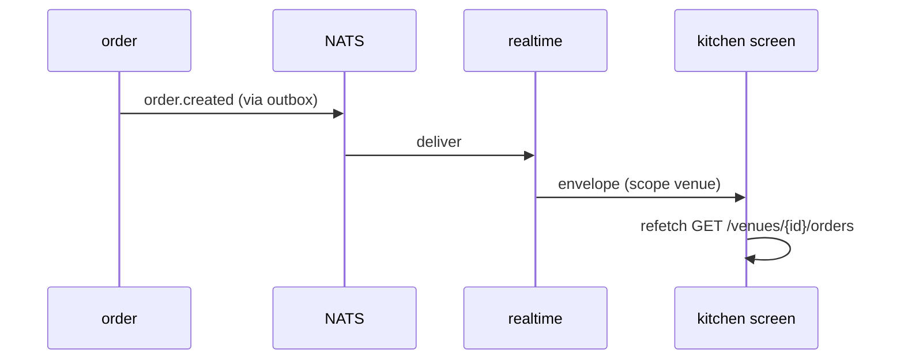

<div dir="rtl">

# سرویس `realtime`

هاب WebSocket برای صفحه‌ی آشپزخانه و صفحه‌ی وضعیت سفارش مهمان.

[مشخصات فنی](../../docs/SPEC.md) | [فصل ۱۸: مقیاس و تاب‌آوری](../../docs/guide/18-scaling-and-resilience.md) | [قواعد دستیار AI](../../AGENTS.md)

| | |
|---|---|
| زبان | Go، روی شاسی [`libs/go/kit`](../../libs/go/kit/README.md) |
| بخش مسئول | سفارش (`order`) |
| دیتابیس | ندارد |
| ارتباط با بیرون | WSS روی <span dir="ltr">`/ws`</span> |

## ۱. یک‌خطی

`realtime` رویدادهای سفارش را از NATS JetStream می‌گیرد و به مرورگرهایی که اجازه‌ی دیدنشان را دارند می‌رساند. فقط کانال خبر است، نه منبع داده: اگر یک پیام گم شود، هیچ سفارشی نباید گم شود.

## ۲. مسئولیت‌ها

- پذیرفتن اتصال <span dir="ltr">`wss://<host>/ws?ticket=<ticket>`</span> و بررسی تیکت: یک JWT شصت‌ثانیه‌ای با scope <span dir="ltr">`venue:<venue_id>`</span> (پنل) یا <span dir="ltr">`order:<order_id>`</span> (مهمان).
- subscribe به رویدادهای سفارش روی NATS و فرستادن envelope هر رویداد فقط به اتصال‌هایی که scope آن‌ها می‌خواند.
- ping هر ۲۵ ثانیه (heartbeat) و بستن اتصال‌های مرده.
- متریک `ws_connections` و متریک‌های عمومی روی <span dir="ltr">`/metrics`</span>.

## ۳. چه چیزی مالِ این سرویس است

دیتابیس ندارد و چیزی ذخیره نمی‌کند. تنها state آن فهرست اتصال‌های باز در حافظه‌ی همان pod است. برای همین می‌شود هر وقت آن را restart یا زیاد کرد. هر pod خودش به NATS subscribe می‌کند و اتصال‌های خودش را سرویس می‌دهد، پس sticky session (چسباندن یک کاربر به یک pod) لازم نیست.

## ۴. قرارداد

ورودی: <span dir="ltr">`GET /ws?ticket=<ticket>`</span> با ارتقا به WebSocket. تیکت را مرورگر از `POST /api/v1/stream-tickets` در `gateway` می‌گیرد.

پیام‌های سرور همان envelope رویدادهای بخش ۶٫۳ مشخصات فنی هستند (`id`، `type`، `version`، `time`، `venue_id`، `trace_id`، `data`)، فیلترشده با scope.

| رویدادی که مصرف می‌کند | به چه کسی می‌رسد |
|---|---|
| `sarmiz.order.order.created` | صفحه‌ی آشپزخانه‌ی همان کسب‌وکار |
| `sarmiz.order.order.status_changed` | آشپزخانه و صفحه‌ی همان سفارش |
| `sarmiz.order.order.paid` | آشپزخانه و صفحه‌ی همان سفارش |
| `sarmiz.order.service_request.created` | آشپزخانه‌ی همان کسب‌وکار |
| `sarmiz.order.service_request.resolved` | آشپزخانه‌ی همان کسب‌وکار |

هیچ رویدادی منتشر نمی‌کند و متد gRPC کسب‌وکاری ندارد؛ فقط سرویس health استاندارد gRPC.

</div>



<div dir="rtl">

## ۵. به چه کسی وابسته است

به هیچ سرویسی تماس هم‌زمان ندارد (بخش ۴٫۱). فقط به NATS JetStream وابسته است. هیچ سرویسی صدایش نمی‌زند؛ فقط مرورگر از طریق ingress به آن وصل می‌شود.

## ۶. قاعده‌هایی که نباید بشکنند

1. هیچ پیامی بدون بررسی scope فرستاده نمی‌شود. اتصال کسب‌وکار «الف» هیچ‌وقت رویداد کسب‌وکار «ب» را نمی‌بیند؛ مهمان فقط سفارش خودش را می‌بیند.
2. سفارش `awaiting_payment` به آشپزخانه نمی‌رسد. `order` آن را منتشر نمی‌کند؛ این سرویس هم چیزی نمی‌سازد.
3. تیکت منقضی یا با امضای نادرست رد می‌شود. خود تیکت لاگ نمی‌شود.
4. `realtime` منطق کسب‌وکار ندارد و وضعیت سفارش را حساب نمی‌کند؛ فقط پیام را می‌رساند.
5. پنل در هر اتصال، بعد از هر اتصال دوباره و هر ۳۰ ثانیه وضعیت واقعی را از `GET /venues/{venue_id}/orders` می‌خواند. اگر `realtime` پایین باشد، پنل هر ۵ ثانیه polling می‌کند.
6. رسیدن سفارش به صفحه‌ی آشپزخانه زیر ۲ ثانیه، با ۱۰۰ اتصال پنل و ۵۰۰ اتصال مهمان.

## ۷. ساختار پوشه

`realtime` دیتابیس ندارد، پس `repository` و `migrations` هم ندارد. پیشنهاد اولیه:

</div>

```text
services/realtime/
├── cmd/server/main.go
├── internal/
│   ├── config/
│   ├── handler/      WebSocket upgrade, ticket check
│   ├── service/      hub: connections, scopes, fan-out (unit tested)
│   └── model/
├── Dockerfile
└── README.md
```

<div dir="rtl">

## ۸. اجرا و تست

دستورهای اجرا و تست را تیم در هفته‌ی ۱ می‌سازد و در بخش Commands فایل [AGENTS.md](../../AGENTS.md) می‌نویسد. فیلتر scope تست واحد جدولی دارد، fan-out یک تست یکپارچه با NATS واقعی، و بار WebSocket در load test با k6 سنجیده می‌شود.

## ۹. در کدام هفته چه چیزی ساخته می‌شود

| هفته | کار | چه چیزی | تحویل |
|---|---|---|---|
| ۱ | `W1-ORD-3` | اسکلت: WebSocket، بررسی تیکت، subscribe به NATS، دموی «hello event» | [order](../../docs/handoffs/week-1/order.md) |
| ۲ | `W2-ORD-4` | کانال کسب‌وکار و سفارش، تیکت با `identity`، heartbeat، fan-out، متریک اتصال | [order](../../docs/handoffs/week-2/order.md) |
| ۳ | `W3-WEB-3` | صفحه‌ی آشپزخانه که از این سرویس استفاده می‌کند (کار فرانت) | [web](../../docs/handoffs/week-3/web.md) |
| ۳ | `W3-PA-3` | load test برای fan-out روی WebSocket | [platform-ai](../../docs/handoffs/week-3/platform-ai.md) |
| ۵ | `W5-PA-3` | آمادگی production: حداقل ۲ replica و autoscaling | [platform-ai](../../docs/handoffs/week-5/platform-ai.md) |
| ۶ | `W6-ALL-1` | بازبینی امنیتی کامل | [هفته‌ی ۶](../../docs/handoffs/week-6/README.md) |

## ۱۰. سؤال‌های باز

- `realtime` کلید عمومی تیکت را از کجا می‌گیرد؟ بخش ۴٫۱ می‌گوید به هیچ سرویسی وابسته نیست. اگر JWKS را از `identity` بخواند، این یک وابستگی تازه است و سند تصمیم می‌خواهد. تیم در `W1-ORD-3` با زوج هسته تصمیم می‌گیرد.
- نوع consumer در JetStream (برای اینکه هر pod همه‌ی پیام‌ها را بگیرد) را تیم در `W1-ORD-3` انتخاب می‌کند.
- پیام‌های ارتباطی دیگر (مثلاً پیام خوش‌آمد بعد از اتصال یا پیام خطا) در مشخصات فنی نیامده‌اند؛ اگر لازم شد، قالبشان را در PR قرارداد بنویسید و زوج فرانت تأیید کند.

</div>
